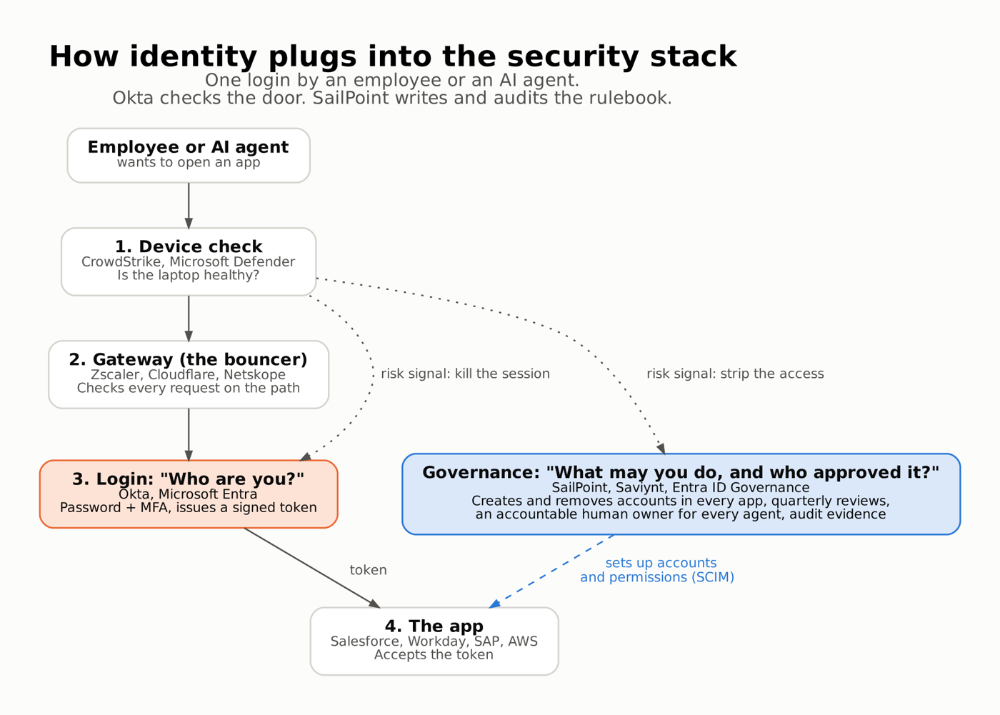
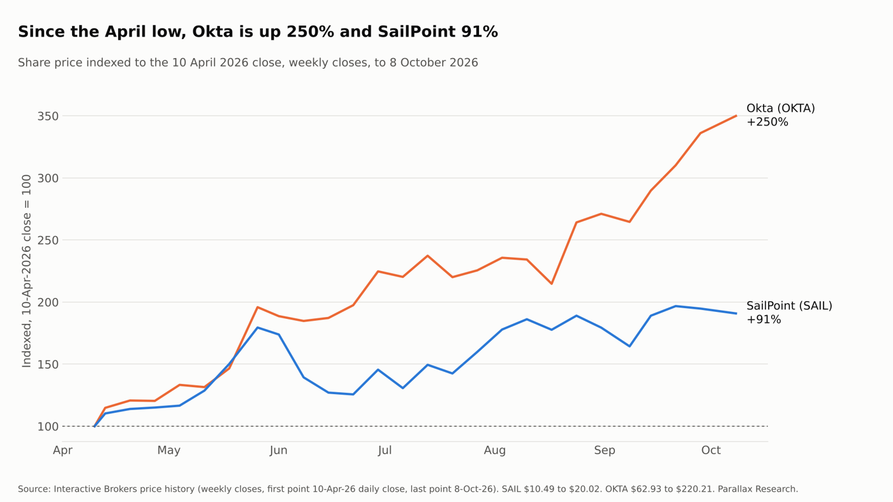
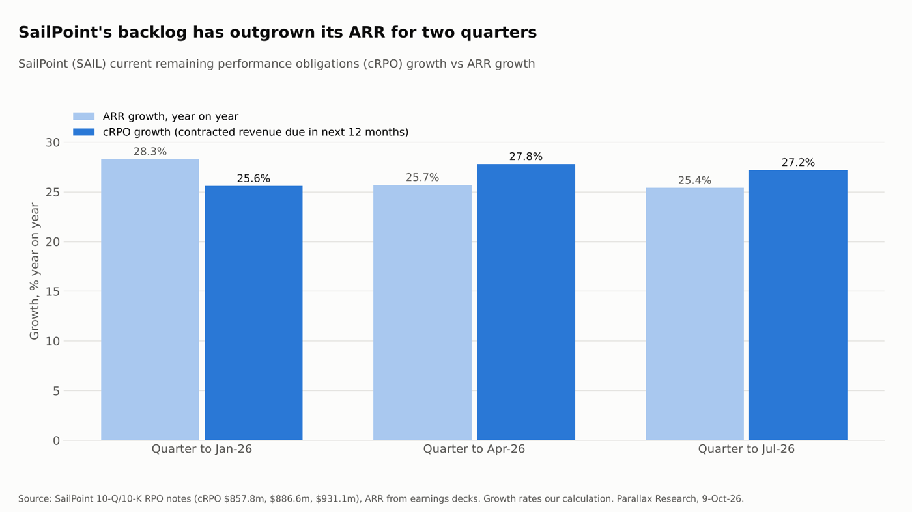
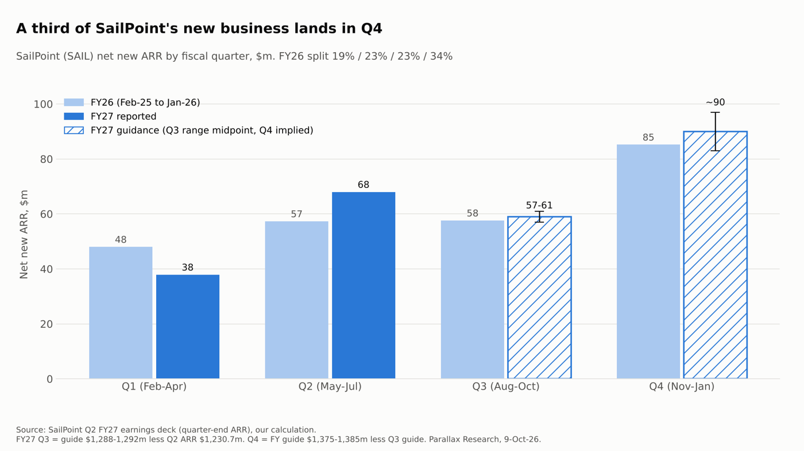

*AI agents pay the identity registry, not the login. Two identity pure plays, one agent boom, and why the market is backing the wrong layer.*

## Key points (as of 9 October 2026)

- **Thesis.** AI agents make identity security bigger, but they pay the layer that governs identities, not the layer that logs them in. Governance is priced on the number of identities. Login is priced per employee, and Okta gives agent sign-on away free. Within listed identity, SailPoint (SAIL) owns the better-placed layer at the lower multiple.
- **SailPoint Inc (Nasdaq: SAIL), $20.02 at the 8 October 2026 close.** ARR $1.23bn, up 25%, and net revenue retention 113% in Q2 FY27 (quarter to 31 July 2026). EV about 8.8x FY27 guided revenue. View: the better way to own the agent identity theme, trading 13% below its $23 IPO price, with Thoma Bravo's 84.6% stake the main overhang. Next check: Q3 FY27 results on 8 December 2026, against guided net new ARR of $57-61m.
- **Okta Inc (Nasdaq: OKTA), $220.21 at the 8 October 2026 close.** Revenue $805m, up 11%, free cash flow margin 28% and net revenue retention 107% in Q2 FY27 (quarter to 31 July 2026). EV about 11.2x FY27 guided revenue. View: a strong cash business, but the shares are up 250% since 10 April 2026 on agent revenue that management calls "too small to show up in the numbers". Too expensive today. Next check: Q3 FY27 results on 1 December 2026.
- **Our own arithmetic.** About a third of SailPoint's yearly net new ARR lands in its fiscal Q4 (34% in FY26). Its contracted backlog due within 12 months (cRPO) has grown faster than ARR for two quarters: 27.2% against 25.4% in Q2 FY27.
- **Main risk.** SailPoint's new business is flat: $106m of net new ARR in H1 FY27 against $105m a year earlier. A Q4 FY27 figure below $85m would mean the agent pipeline is not converting. For Okta, charging for agent login volume would weaken the core argument of this piece.

## The thesis in six lines

1. Every AI agent is a new identity that needs to be registered, given permissions, watched and switched off. Agents do not make identity a new market. They make the existing one much bigger.
2. Identity is not one product. **Okta** (OKTA) mostly sells the check at the door (who are you?). **SailPoint** (SAIL) mostly sells the rulebook behind it (what are you allowed to do, and should you still be allowed?). They compete only at the edges.
3. Agents make the rulebook harder than the door. A login takes milliseconds. Deciding whether 10,000 unknown agents should hold access to payroll data is a governance problem. That favours SailPoint's layer. So does pricing: Okta charges per employee and gives agent sign-on away free, while SailPoint charges per identity it governs.
4. The market has done the opposite. Since the 10 April 2026 lows Okta is up about 250% and SailPoint about 91% (to the 8 October close). Okta now trades at a higher sales multiple than SailPoint despite growing at less than half the rate.
5. Okta's 2022 and 2023 breaches were priced, through a multi-year de-rating and net retention falling from 124% to 107%. They are not priced now. The 2026 re-rating rests on agent revenue that management says is "too small to show up in the numbers".
6. SailPoint's problems are different: a private-equity owner holding 84.6% of the shares, stock-based pay above free cash flow, and near-term growth slowing. These are entry-price problems, not thesis problems.

**Our view:** within listed identity, SailPoint is the better-structured way to own the agent thesis. The price to pay for it will be set by Thoma Bravo's eventual selling, not by the business.

## 1. What "identity security" actually is

Think of a company as an airport.

- **Access management: Okta (OKTA), Microsoft (MSFT) Entra, Ping.** Passport control. You show a passport (password plus a second factor) and get a boarding pass (a digital token) that every gate accepts. This is single sign-on (SSO) and multi-factor authentication (MFA).
- **Identity governance, or IGA: SailPoint (SAIL), Saviynt, Microsoft Entra ID Governance.** The visa office. It decides who may enter which countries, for how long, and cancels the visa when you change jobs or leave. In practice it creates and removes accounts in hundreds of applications and produces the evidence auditors ask for.
- **Privileged access management, or PAM: CyberArk, now inside Palo Alto Networks (PANW), plus BeyondTrust and Delinea.** The vault holding the master keys. It controls the few accounts that can change everything.
- **Machine identity and secrets (CyberArk/Venafi, HashiCorp Vault, startups).** Keys, certificates and service accounts that software uses to talk to other software.
- **Identity threat detection and response, or ITDR: CrowdStrike (CRWD), Microsoft, Silverfort.** The security cameras. They spot a stolen boarding pass in use.
- **Identity for AI agents (everyone, all at once).** A passport, visa and kill switch for software that acts on its own.

The simplest split for investors: **authentication answers "who are you?" Governance answers "what should you be able to do, and who approved it?"** Okta's centre of gravity is the first question. SailPoint's is the second.

## 2. Why agents change the size of the problem

Before agents, identity mostly tracked employees, contractors and customers. Each person has roughly one identity, and headcount moves slowly. Agents break that in three ways.

**There are far more of them.** All of these ratios come from vendors, so read them as direction, not measurement:

- CyberArk's 2025 survey of 2,600 security leaders counted [82 machine identities per human](https://www.silicon.co.uk/press-release/machine-identities-outnumber-humans-by-more-than-80-to-1-new-report-exposes-the-exponential-threats-of-fragmented-identity-security).
- Entro, now owned by SailPoint (SAIL), measured 144 to 1 in H1 2025.
- SailPoint's CTO talked about ratios of 1 to 1,000 at its 2026 Investor Day.
- In one Fortune 500 trial in 2026, SailPoint found **more than 10,000 agents nobody knew existed** ([Q2 FY27 call](https://web.quartr.com/companies/20182?companyId=20182&documentId=4144542&documentType=transcript&eventId=688248&targetTime=343.64)).

**They hold real permissions.** An agent that books travel, reconciles invoices or answers HR queries is logged in with credentials. A compromised agent does not need to break in. It is already inside.

**Recent breaches were identity breaches, not code breaches:**

- **2024, Snowflake (SNOW) customers.** About [165 organisations](https://thehackernews.com/2024/06/snowflake-breach-exposes-165-customers.html) hit with stolen passwords on accounts without MFA.
- **Aug 2025, Salesloft Drift.** Stolen OAuth tokens (machine credentials) used to export Salesforce data from [more than 700 organisations](https://cyberscoop.com/salesforce-salesloft-drift-attack-spree-google/), including Cloudflare (NET) and Palo Alto Networks (PANW).
- **Apr 2025, Marks & Spencer (MKS).** Help-desk social engineering, with a profit hit guided at around £300m.
- **Jan 2026, ShinyHunters.** [Voice phishing](https://bleepingcomputer.com/news/security/shinyhunters-claim-to-be-behind-sso-account-data-theft-attacks) against Okta (OKTA), Entra and Google sign-in, capturing MFA codes live.

The pattern is tokens, service accounts and phished sessions. Nobody broke the encryption. That is the demand case for identity in one line.

**The honest caveat: the money is still small.** Okta says its agent product is "too small to show up in the numbers". SailPoint reports "AI-driven ARR" above $70m, but that figure counts the whole contract value of any deal that includes an agentic product, human seats included. It is inflated by design. Agent identity today is a pipeline story, not a revenue story.

### More logins does not mean more revenue

The intuitive read is that Okta gains most from agents. Authentication volume is what explodes: every agent task can mean several token requests, so 10x to 100x more sign-ins and token grants is plausible. Governance volume grows too, but more slowly.

That is right about volume and wrong about money, because of how each company charges.

- **Okta is not paid per sign-in.**
  - Workforce identity is priced per employee per year.
  - Customer identity (Auth0) is priced per monthly active user, not per login.
  - Agent single sign-on is free in all Okta products.
  - More volume therefore mostly means more computing cost for Okta, not more revenue. That changes only if it moves to per-agent pricing, which management says it wants to do but has not done.
- **Login volume is also the easiest part to commoditise.** Microsoft Entra, AWS AgentCore, Google and, since September, CrowdStrike all issue agent tokens.
- **Governance is priced on the stock of identities, not the flow of logins.** Every agent is a new identity that needs an owner, a scope, a quarterly review and a kill switch. SailPoint sells capacity packs for non-human identities on top of human seats.

An analogy: Okta runs the toll booths but charges each car an annual pass, and rivals are handing out free passes to robot cars. SailPoint runs the vehicle registry. Every new robot car has to be registered, insured and inspected each year, and it pays for that.

Agents multiply both the flow (logins) and the stock (identities). Today only the stock gets paid for. That is the single most important point in this piece, and the main reason we prefer SailPoint's layer.

Okta's CEO confirmed the pricing point on the Q2 FY27 call: "Our pricing model is per user. If you want to buy Okta for AI agents, it's an uplift to your per user charge" ([call](https://web.quartr.com/companies/3870?companyId=3870&documentId=4081356&documentType=transcript&eventId=682009&targetTime=2964)).

He also showed where this could change. Agent single sign-on is now in Okta's base product with a usage cap that is "not going to \[be enforced\] right away", but "we're putting the framework and the scaffolding in there to have a consumption-based pricing eventually", because "agents are going to log in way more than people" ([call](https://web.quartr.com/companies/3870?companyId=3870&documentId=4081356&documentType=transcript&eventId=682009&targetTime=3055)).

So the flow-versus-stock argument holds today but is not permanent. If Okta starts charging for agent login volume, the bigger volume growth becomes its revenue growth. That is the single most important thing to watch at Okta.

### A tale of two breaches

The market still mostly prices cyber risk as broken code. The attacks that now do the damage use valid keys. Two stories show the difference. The company is fictional. Both attack methods are real.

**Story one: the code breach**

Meridian Logistics runs a file-transfer server so customers can send it shipping documents. One morning in 2023 a criminal group sends the server a carefully malformed request. A flaw in the software's code makes the server treat part of that request as a database command.

The attackers use this to plant a small program on the server, a "web shell", which lets them come back at will. They download every file on it.

This is how the [MOVEit Transfer attacks](https://www.cisa.gov/news-events/cybersecurity-advisories/aa23-158a) of May 2023 worked.

- **The fix:** a software patch.
- **The defences that matter:** vulnerability scanners, patching speed and network firewalls.
- **What the attacker needed:** a mistake in someone's code.

**Story two: the identity breach**

Two years earlier, Meridian's sales team added a chatbot to its website and connected it to Salesforce so chat leads flow into the CRM. An administrator clicked "Allow". Behind that click, Salesforce issued the chatbot vendor a token: a digital valet key that lets the vendor's software act inside Meridian's Salesforce without anyone logging in.

The key was never set to expire. It was granted "full" access, because that was the default. It sits in the vendor's cloud, alongside the keys of 700 other customers.

What happened next, in the [Salesloft Drift attack of August 2025](https://cloud.google.com/blog/topics/threat-intelligence/data-theft-salesforce-instances-via-salesloft-drift):

1. **March 2025.** Attackers take over the chatbot vendor's GitHub account. Meridian has no way to see it.
2. **The next three months.** The attackers explore quietly and reach the vendor's cloud account, where the customers' tokens are stored. They copy them.
3. **8 August.** They present Meridian's token to Salesforce. Salesforce sees a valid key from an approved app. There is no password prompt and no MFA challenge, because the token is proof that the login already happened. Nothing alerts.
4. **The next few days.** They count Meridian's records, then export every support case in one bulk job. At [Cloudflare, a real victim](https://blog.cloudflare.com/response-to-salesloft-drift-incident/), that export took about three minutes. Then they delete the job to cover their tracks.
5. **The real prize.** Support cases are full of text customers and engineers pasted in to fix problems: passwords, cloud access keys, API tokens. The attackers search for strings that look like AWS keys or Snowflake logins. Cloudflare found 104 of its own API tokens in its stolen cases. Each one is a new key to a new door.
6. **20 August.** Salesforce and the vendor revoke every chatbot token. Meridian learns from an advisory that it was breached twelve days earlier.

Google's threat team counted [more than 700 potentially affected organisations](https://cyberscoop.com/salesforce-salesloft-drift-attack-spree-google/).

**Why a stolen token is so harmful:**

- **It skips the front door.** MFA protects logins, and a token is what you get after logging in.
- **It belongs to a machine, so nobody notices it working at 3am.** No human is checking that it should not be exporting the whole database.
- **It is often over-scoped and never expires,** because whoever clicked "Allow" never had to choose otherwise.
- **It lives with a third party** whose security you cannot see.
- **It leads to more keys,** so one stolen token turns into a chain.

**What would have stopped it.** Not a patch, because there was no bug. What would have helped:

- An **inventory** of every connected app and token, each with a named human owner.
- **Least-privilege scopes and expiry dates.**
- **A quarterly review** that asks whether the chatbot still needs this.
- **Detection** of a machine identity suddenly doing a bulk export.

That is governance plus identity threat detection.

Every AI agent a company deploys is another chatbot integration: a non-human identity holding tokens to real systems. Companies are about to create these by the thousand. That is why we think the market has not caught up with where the risk now sits.

**What an individual can do.** There is no consumer version of a corporate security team watching your laptop, but you can get most of the way:

- **Built into macOS:** turn on automatic updates, FileVault and the firewall (it is off by default). Gatekeeper and XProtect run automatically ([Apple](https://support.apple.com/guide/security/protecting-against-malware-sec469d47bd8/web)).
- **Free tools from [Objective-See](https://objective-see.org/tools.html):** KnockKnock and BlockBlock show what installs itself to run at startup, and LuLu shows what phones out.
- **Paid scanners:** Bitdefender ($24.99 first year), Malwarebytes ($59.99 a year for 3 devices), or CrowdStrike Falcon Go ($59.99 per device a year, aimed at small businesses).
- **The single best upgrade is two hardware keys on your important accounts** (Apple requires at least two). They are the one control that defeats the real-time MFA phishing used against Okta, Entra and Google sign-ins in early 2026.

## 3. How big is the market?

The market that actually pays today is about $23bn, growing about 12% a year. The company TAM figures are four times that.

| Measure | Figure | Source |
| --- | --- | --- |
| IAM spending, 2025 | $20.7bn | Gartner 1Q26 outlook |
| IAM spending, 2026E | $23.4bn (+11.8%) | Gartner 1Q26 outlook |
| IAM spending, 2030E | $30.9bn | Gartner 1Q26 outlook |
| Okta TAM claim | $80bn ($50bn workforce + $30bn customer) | [Okta deck](https://web.quartr.com/companies/3870?companyId=3870&documentId=4078517&documentType=slide&eventId=682009&sp=31) |
| SailPoint TAM claim | $90bn (was $10bn in 2017) | [SailPoint Investor Day](https://web.quartr.com/companies/20182?companyId=20182&documentId=3599477&documentType=slide&eventId=669261&sp=8) |

In text: Gartner puts identity and access management spending at $20.7bn in 2025, $23.4bn in 2026 (up 11.8%) and $30.9bn in 2030. Okta claims an $80bn market ($50bn workforce, $30bn customer). SailPoint claims $90bn, up from $10bn in 2017.

The CEO of Okta (OKTA) said it himself on the Q4 FY26 call: identity is ["roughly $20 billion TAM right now in terms of what people spend"](https://web.quartr.com/companies/3870?companyId=3870&documentId=3313013&documentType=transcript&eventId=409956&targetTime=1958.56). The $80bn and $90bn figures assume every company buys every product. They are ambitions, not markets.

Other reference points:

- **Access management alone** was $5.85bn in 2023, growing 17.6% ([Gartner via ISMG](https://www.bankinfosecurity.net/microsoft-ping-okta-dominate-access-management-gartner-mq-a-27214)).
- **SailPoint** (SAIL) claims 23.2% of identity governance. Okta puts Microsoft (MSFT) at about 40% of workforce access management and itself at about 30%. Both are company claims.
- **The agent layer is the option on top.** If agents are priced like people, today's $23bn is too small. If agents are a cheap add-on (Okta already gives agent single sign-on away free), the market grows but the price per identity collapses.

The number to watch is not the TAM. It is whether either company starts charging per agent rather than per employee, and at what price.

## 4. How identity plugs into the rest of the stack

Identity is the reference point every other security layer checks against. Here is one request, step by step, when an employee or an agent opens a business application.

1. **The device.** The CrowdStrike (CRWD) agent on the laptop reports whether the device is healthy.
2. **The gate.** A zero-trust gateway from Zscaler (ZS), Cloudflare (NET) or Netskope intercepts the request and redirects it to the identity provider.
3. **The passport check.** Okta (OKTA) or Microsoft (MSFT) Entra checks the password and second factor and issues a signed token (SAML or OIDC, the two standard formats).
4. **The decision.** The gateway combines "who is this" from Okta with "is the device clean" from CrowdStrike, then lets the request through or blocks it.
5. **The application.** Salesforce, Workday or SAP accepts the token. The account and its permissions inside that app were created in advance by the governance system, here SailPoint (SAIL), over a standard called SCIM.
6. **The watch.** Risk signals flow both ways over the Shared Signals Framework. If CrowdStrike sees malware, it can tell Okta to kill the session and tell SailPoint to strip the access, mid-session.

**On Cloudflare specifically:** the CDN is not the link. The link is Cloudflare's zero-trust product (Cloudflare One / Access), which works with [any identity provider](https://developers.cloudflare.com/cloudflare-one/integrations/identity-providers/) and consumes the token Okta or Entra issues. Today Cloudflare and Zscaler are partners of the identity vendors, not competitors. They are the bouncer. The identity provider is the guest list.

**Why both a gateway and an identity provider?** They answer different questions, and neither can answer the other's.

- **The identity provider (Okta, Entra) is the authority on who you are.** It is connected to HR, holds your password and second factor, and knows your groups. A company has one.
- **The gateway (Zscaler, Cloudflare, Netskope) is the enforcement point on the path.** Every request passes through it, and it sees the destination, device, location and content. But it does not know who you are unless someone it trusts tells it.

Office analogy:

- HR issues your staff badge (Okta).
- The guard at each door checks the badge is genuine and not expired, checks your bag, and checks this door is on your list (the gateway).
- The facilities office decides which doors your badge should open, and removes doors when you change role (SailPoint).

**What is the token?** It is not a bare yes or no. It is a signed digital note, roughly: *issued by okta.com, user alex@company, groups investment and finance, signed in with a hardware key at 10:02, valid until 11:02.*

- Okta signs it with its private key. Cloudflare checks the signature with Okta's public key, like checking the watermark on a banknote, so it does not need to call Okta on every request.
- "Works with any identity provider" means Cloudflare accepts badges from Okta, Entra, Google and others.

**How does the gateway decide?** It combines four signals, then allows, blocks or asks for more proof (a fresh hardware-key tap, say):

1. Who: the token.
2. Which device: health reported by the endpoint agent (CrowdStrike, Microsoft Defender), such as encrypted, patched, no malware alert.
3. Context: location, time, network, unusual behaviour.
4. What: the app requested and, for some traffic, the content (malware coming in, client files going out).

"Zero trust" means no request is trusted just because it comes from inside the office network. Every request is checked, every time.

**What changes with agents.** The agent gets its own identity, registered as acting for a named person. When it calls a tool (Slack, Jira, a database), the identity provider issues a short-lived token scoped to that one task. In July 2026 the Model Context Protocol, the standard most agents use to call tools, made [Enterprise-Managed Authorization](https://infoq.com/news/2026/07/mcp-ema-enterprise-auth/) stable. It uses Okta's Cross App Access design, Okta is the first supported identity provider, and Anthropic has adopted it across Claude. That is a real standards win for Okta at the door.

The governance question sits one level up: *should this person be allowed to hand this access to an agent at all, and who reviews that every quarter?* That is the visa office, and it is SailPoint's layer.

**Partner or competitor? It is shifting:**

- **CrowdStrike** feeds signals into both Okta and SailPoint. On 2 September 2026 it also launched its own [Agentic Identity Provider](https://secure.businesswire.com/news/home/20260902817711/en/Introducing-the-CrowdStrike-Agentic-Identity-Provider-the-Foundation-for-AI-Agent-Identity-Security), a direct move into Okta's layer.
- **Palo Alto** closed its \~$25bn [CyberArk acquisition](https://paloaltonetworks.com/company/press/2026/palo-alto-networks-completes-acquisition-of-cyberark-to-secure-the-ai-era) in February 2026. It now owns privileged access and machine identity.
- **Cisco** bought [Astrix](https://blogs.cisco.com/news/cisco-announces-intent-to-acquire-astrix-security) (agent and machine identity, closed June 2026) to add to Duo.
- **AWS** is a partner. It named SailPoint its [preferred identity governance solution for agentic AI](https://www.sailpoint.com/press-releases/sailpoint-aws-agentic-ai-strategic-collaboration-agreement) on AWS (March 2026).

The pattern so far: the platforms are mostly moving into Okta's layer. SailPoint's layer is safer, but not safe.

| Who | Moving into | Evidence |
| --- | --- | --- |
| CrowdStrike | Okta's layer | Agentic Identity Provider (Sep 2026), SGNL authorisation (Jan 2026) |
| Cisco | Okta's layer and machine identity | Duo plus Astrix (Jun 2026) |
| Microsoft | Both layers | Entra in E3/E5, ID Governance add-on, Agent ID |
| Palo Alto | Privileged and machine identity, some governance | CyberArk, which had bought Zilla (governance, $165m) |
| ServiceNow | SailPoint's layer | Veza access-governance graph (>$1bn reported) |
| Okta | SailPoint's layer | Okta Identity Governance, its largest new product |
| Saviynt | SailPoint's layer | $700m of fresh capital (Dec 2025) |

In text: CrowdStrike (CRWD) is moving into Okta's layer with its Agentic Identity Provider (September 2026) and SGNL authorisation (January 2026). Cisco (CSCO) is moving into Okta's layer and machine identity with Duo plus Astrix (June 2026). Microsoft (MSFT) is in both layers through Entra, ID Governance and Agent ID. Palo Alto Networks (PANW) owns privileged and machine identity, plus some governance, through CyberArk. ServiceNow (NOW) is moving into SailPoint's layer with Veza. Okta is moving into SailPoint's layer with Okta Identity Governance. Saviynt raised $700m in December 2025.

SailPoint says Microsoft is "a non-factor in enterprise IGA" and that it has "never lost a deal" to Zilla. These are company claims, and we found no documented losses either way. The one to watch is **ServiceNow**, because it already runs the IT workflows where access requests start.

**Okta is the clearest threat to SailPoint, and its Q2 deck says so.** Okta for AI Agents now includes "agent governance and access certification with Okta Identity Governance". Okta calls itself the "first independent neutral identity platform to bring AI agent governance" to market. Governance is the largest of its new products.

The pitch is consolidation. McKinnon described a Fortune 25 customer with "200 identity vendors" that "could save tens of millions of dollars by standardizing on us" ([call](https://web.quartr.com/companies/3870?companyId=3870&documentId=4081356&documentType=transcript&eventId=682009&targetTime=1691)). He also argues agent security should start from the login layer, not specialist tools: "It makes sense to start it from the broad IdP" ([call](https://web.quartr.com/companies/3870?companyId=3870&documentId=4081356&documentType=transcript&eventId=682009&targetTime=3237)).

SailPoint argues the opposite: governance is the hard part, and a login vendor's governance is "below the line". Neither company discloses win rates against the other. Okta's governance growth and SailPoint's net new ARR, side by side each quarter, are the scoreboard.

## 5. Who else is in the market

Only three listed pure plays remain: Okta (OKTA), SailPoint (SAIL) and Yubico (YUBICO on Nasdaq Stockholm, hardware security keys). CyberArk disappeared into Palo Alto in February 2026. Everyone else is a platform with an identity division, or private.

**Platforms with identity exposure**

- **Microsoft (MSFT) Entra.** The largest vendor by users. Entra ID P1 comes in Microsoft 365 E3 and P2 in E5. [Entra ID Governance](https://www.microsoft.com/en-us/security/business/microsoft-entra-pricing) is $7 per user per month and Entra Suite $12. [Entra Agent ID](https://learn.microsoft.com/en-us/entra/agent-id/whats-new-agent-id) is generally available, and Agent 365 launched at $15 per user in May 2026. No revenue disclosed.
- **Palo Alto Networks (PANW) / CyberArk (rebranded Idira).** FY26 pro forma revenue $1.26bn, +21%.
- **CrowdStrike (CRWD).** Identity ARR $585m, +34%, after buying SGNL ($740m) and Seraphic (\~$400m) in January 2026.
- **Cisco (CSCO).** Duo plus Astrix.
- **IBM.** HashiCorp Vault ($6.4bn, 2025), and a leader in Gartner's access management ranking.
- **Others moving in:** Twilio (Stytch, customer identity), ServiceNow ([Veza](https://www.securityweek.com/servicenow-to-acquire-identity-security-firm-veza-in-reported-1-billion-deal/amp/), >$1bn reported), Snowflake ([Natoma](https://investors.snowflake.com/news/news-details/2026/Snowflake-Announces-Intent-to-Acquire-Natoma-Providing-Secure-Connectivity-For-The-Agentic-Enterprise/default.aspx), agent tool governance).

**Private companies**

| Company | What it does | Latest |
| --- | --- | --- |
| Saviynt | Governance, SailPoint's main rival | [$700m at \~$3bn](https://www.barchart.com/story/news/36524676/saviynt-raises-700m-at-approximately-3b-valuation-in-kkr-led-round-to-establish-identity-security-as-the-foundation-for-the-ai-era), KKR, Dec 2025 |
| Ping Identity | Access management, merged with ForgeRock | Owned by Thoma Bravo |
| Silverfort | Threat detection, MFA everywhere | $116m Series D, 2024 |
| Persona | Identity verification | $200m at $2bn, 2025 |
| ID.me | Consumer identity verification | $340m at >$2bn, 2025 |
| ConductorOne | AI-native governance | $79m Series B, Oct 2025 |
| Keycard | Agent identity | $38m at launch, Oct 2025 |
| Clutch, Aembit | Machine identity | Series A |

In text: Saviynt raised $700m at about $3bn, led by KKR, in December 2025. Ping Identity is owned by Thoma Bravo. Silverfort raised a $116m Series D in 2024. Persona raised $200m at $2bn and ID.me $340m at over $2bn, both in 2025. ConductorOne raised a $79m Series B and Keycard $38m at launch, both in October 2025. Clutch and Aembit are at Series A.

**The 2025-26 deal pattern matters more than any single name.** The platforms bought the agent and machine-identity startups rather than build them:

- Astrix → Cisco
- Entro → SailPoint ($122.6m per its 10-Q, not the \~$200m reported in the press)
- Oasis → Cyera (\~$1bn)
- [Permiso → Okta](https://www.okta.com/newsroom/press-releases/okta-signs-definitive-agreement-to-acquire-permiso-security/)
- Natoma → Snowflake
- Veza → ServiceNow
- SGNL → CrowdStrike
- Zilla and Venafi → CyberArk, then CyberArk → Palo Alto

This is the strongest evidence that identity is a control point worth owning. It is also a warning that competition for the agent layer will be fierce.

**One thing worth noticing:** Thoma Bravo owns SailPoint (84.6%), Ping Identity and Imprivata. In December 2024 SailPoint bought Imprivata's governance business from its own parent for $16.4m. The same sponsor sits across both access management and governance.

### The third pure play: Yubico

Yubico makes YubiKeys: small USB or NFC hardware keys that prove a real person is present at login. A fake website cannot trick the key into signing for it, which makes them the most phishing-resistant login method available. After Google gave 85,000+ staff security keys in 2017, it reported no successful account phishing ([Krebs](https://krebsonsecurity.com/2018/07/google-security-keys-neutralized-employee-phishing/)).

- **Listing:** Nasdaq Stockholm, via a September 2023 SPAC merger. Founded by Stina and Jakob Ehrensvärd.
- **Customers:** 4,500+ businesses, including 19 of the 20 largest US tech companies. Public sector and defence is the largest one-off buyer.
- **FY2025:** sales SEK 2,218m (-4.7%, +1.4% excluding currency), EBIT margin 9.0%.
- **Q2 2026:** sales SEK 544m (+9.0%), EBIT margin 14.4%, gross margin 80.1%.
- **Weak spots:**
  - Bookings -7.2%, the third straight fall.
  - ARR growth slowed to 4.4%.
  - A leak-driven profit warning in March 2026.
  - An acting CEO since December 2025.

Sources: [FY25 report](https://investors.yubico.com/en/year-end-report-january-december-2025/), [Q2-26 deck](https://investors.yubico.com/en/wp-content/uploads/sites/2/2023/03/Presentation-Interim-Report-Q2-2026.pdf).

**The OpenAI link:**

- **April 2026:** OpenAI and Yubico announced a "strategic, long-term partnership". Co-branded keys are sold to ChatGPT users through OpenAI's Advanced Account Security programme ([Yubico](https://www.yubico.com/press-releases/openai-and-yubico-partner-to-bring-custom-phishing-resistant-yubikeys-to-openai-users/)).
- **1 September 2026:** OpenAI made hardware-backed passkeys mandatory for its Trusted Access for Cyber program, the tier with its most capable cyber models ([Forrester](https://www.forrester.com/blogs/openai-makes-hardware-passkeys-mandatory-for-its-highest-end-cyber-model/)).
- **No terms are disclosed:** no volumes, revenue share or pricing.

This is the first sign of frontier labs mandating hardware keys for their most dangerous tools.

- **Bear case:** passkeys stored on phones do much of the same job for free, and revenue is mostly one-off hardware.
- **What to watch:** whether the OpenAI deal shows up in bookings. The Q3 report is due on 5 November and the Capital Markets Day on 19 November 2026.

## 6. SailPoint: the rulebook

SailPoint (SAIL) has sold one thing since 2005: identity governance. ARR is $1.23bn, growing 25%, and the business is moving from on-premise licences to cloud.

### What it sells

- **Identity Security Cloud** on a shared data layer called Atlas. This is the cloud product.
- **Add-on modules:** machine identities, agent identities, contractors and other non-employees, data access, cloud permissions and access risk.
- **Agentic Fabric (2026):** governance for agent identities, sold standalone even to non-SailPoint customers.
- **IdentityIQ:** the legacy on-premise product. Moving these customers to the cloud is the biggest growth driver.
- **What it will not do:** management says it will not build traditional privileged access management.

### How it works, day to day

SailPoint does not write one rulebook for everyone. Each customer writes its own rules, and SailPoint provides the machinery to enforce them and prove it. Think of it as the accounting system for access: every company has its own chart of accounts, but the ledger software is shared.

1. **Connect.** Read who has what in every system: SAP, Workday, Salesforce, AWS, mainframes.
2. **Model.** Define roles and policies. A classic one: nobody may both create a supplier and approve payments to it. That is a SOX control.
3. **Run the lifecycle.** Joiners get access on day one. Movers lose old access when they change team. Leavers lose everything on their last day.
4. **Certify.** Each quarter managers confirm or revoke their staff's access. This is the evidence auditors ask for.
5. **Recommend.** The cloud product learns patterns across about 3,300 customers and flags outliers.

For agents the same machinery applies. Discover every agent, assign an accountable human owner ("that agent will not be able to alter its own ownership", says McClain), give it the least access it needs, review it like an employee, and switch it off when it misbehaves.

SailPoint does not keep bad bots out at the gate. That is Okta's and the gateway's job. SailPoint decides who is on the guest list, with which keys, and who signs for them.

### Revenue mix, Q2 FY27 (quarter to 31-Jul-26)

| Line | $m | Share |
| --- | --- | --- |
| SaaS (cloud) | 193.9 | 63% |
| Term licences (on-premise) | 56.2 | 18% |
| Maintenance (legacy) | 35.5 | 11% |
| Other subscription | 9.7 | 3% |
| Services | 13.6 | 4% |
| **Total** | **308.8** |  |

In text: SailPoint's Q2 FY27 revenue (quarter to 31 July 2026) was $308.8m. SaaS was $193.9m (63%), term licences $56.2m (18%), maintenance $35.5m (11%), other subscription $9.7m (3%) and services $13.6m (4%).

Source: [Q2 FY27 earnings release](https://web.quartr.com/companies/20182?companyId=20182&documentId=3695764&documentType=report&eventId=688248). No revenue is disclosed by module. What is disclosed:

- "Emerging" modules were 17% of net new ARR in Q4 FY26 and 20% in Q1 FY27.
- AI-driven products were above 30% of net new ARR in Q2 FY27.
- Customers who adopt them raise annual spend by more than 60%.

**Are "emerging modules" the agent business?** Largely, yes.

- **Q4 FY26:** management said "a significant portion" came from AI identity, specifically Agent Identity Security, Machine Identity Security and Data Access Security ([call](https://web.quartr.com/companies/20182?companyId=20182&documentId=3787275&documentType=transcript&eventId=418901&targetTime=1586.72)).
- **Q1 FY27:** about a third of cloud migrations pulled them in, "typically… those related to agentic".
- **From Q2 the metric changed** to "AI-driven ARR". It counts whole contracts that include agentic products, and even suite customers with "an immediate upgrade path". The definition is generous, and management will not split human from agent revenue.

### The numbers

|  | Q2 FY26 | Q2 FY27 |
| --- | --- | --- |
| Total ARR | $982m | $1,231m (+25%) |
| SaaS ARR | $623m | $847m (+36%) |
| Revenue | $264m | $309m (+17%) |
| Net revenue retention | 114% | 113% |
| Customers >$1m ARR | 185 | 235 (+27%) |
| Adj. operating margin | 20.4% | 20.3% |
| Free cash flow | $46m | $37m |
| Stock-based comp | $48m | $68m |

In text: In Q2 FY27 against Q2 FY26, SailPoint's total ARR rose 25% to $1,231m, SaaS ARR rose 36% to $847m and revenue rose 17% to $309m. Net revenue retention was 113% against 114%. Customers above $1m ARR rose 27% to 235. Adjusted operating margin was 20.3% against 20.4%. Free cash flow was $37m against $46m. Stock-based comp was $68m against $48m.

Source: [Q2 FY27 deck](https://web.quartr.com/companies/20182?companyId=20182&documentId=4142950&documentType=slide&eventId=688248) and earnings releases.

- **FY27 guidance:** ARR $1,375-1,385m (+22-23%), revenue $1,265-1,275m, FCF about $200m, stock-based pay about 20% of revenue.
- **FY29 targets (Investor Day, June 2026):** ARR at least $2.1bn, of which $800m+ AI-driven. FCF $400m+. Adjusted operating margin 22%+.
- **Balance sheet:** $310m cash, no debt. The $1.04bn term loan was repaid from IPO proceeds.

### Growth drivers, in management's words

1. **Cloud migration of the installed base.** About $350m of on-premise ARR is left, roughly 28% of the total, and only about 15% has migrated. Customers pay 2-3x more on migration, and 3-4x over time. The plan is 50% migrated by FY29. Migration added about 4 points to ARR growth in Q2. This is the most bankable driver, because these customers already run SailPoint.
2. **Agents and machine identities.** "Hundreds" of trials in the pipeline with 30-45 day sales cycles. The AI pipeline "more than doubled since June".
3. **Pricing.** "Land with seat, grow with capacity". Each human seat includes a quota of non-human identities, and capacity packs sell beyond that. If AI cuts headcount, a per-employee price shrinks. SailPoint is partly hedged against that. Okta's workforce business is not.

### Why push customers from on-premise to cloud?

**For SailPoint:**

- Customers pay 2-3x more after migrating, because SailPoint now runs the software and sells cloud-only modules.
- New features ship to everyone at once.
- AI recommendations need pooled data across customers, which only exists in the cloud.

**For the customer:** no servers to run, faster upgrades, and access to the agent features.

**The frictions:**

- **Revenue dips during the shift.** On-premise term licences book most revenue upfront, while cloud books it monthly. Each $5m of ARR moved costs about $10m of near-term revenue.
- **SailPoint pays for hosting.** It has a $721m five-year cloud commitment.
- **Regulated customers resist.** Banks, government and defence want control and data residency. An identity governance database is a map of who can reach everything, which makes it a prime target. One cloud breach would expose many customers at once, as Okta's 2023 support breach showed.
- **The migration is a switching moment.** A customer re-implementing anyway may invite rival bids.

About $350m of on-premise ARR remains and about 15% has migrated, against a plan of about 10% a year.

### The flags

- **Growth is slowing.** ARR growth went from 30% to 25% over six quarters, and guidance implies 22-23% for the year. Net new ARR grew only 19% in Q2. An analyst asked about "greater than average deal slippage". Management said the pipeline was "taking some time to convert".
- **Q3 margin guide is lower:** 17.4-17.9%, against 20.3% in Q2, because of the Entro integration.
- **Stock-based pay exceeds free cash flow.** H1 SBC was $137m against $70m of FCF. Shares outstanding rose 2.6% in a year. After stock-based pay, SailPoint does not yet make money.
- **It has been breached too.** An [8-K on 8 May 2026](https://www.sec.gov/Archives/edgar/data/0002030781/000162828026033016/sail-20260508.htm) disclosed unauthorised access to "a subset of our GitHub repositories", detected 20 April, with no evidence that customer data was accessed. A July 2026 IdentityIQ flaw ([CVE-2026-12341](https://www.sailpoint.com/security-advisories/sailpoint-identityiq-improper-bearer-token-validation-vulnerability-cve-2026-12341)) was rated CVSS 8.8. Neither is on Okta's scale, but no identity vendor is spotless.

### Why is growth slowing?

The mechanical answer: **SailPoint is adding about the same new ARR each year, so the growth rate falls as the base grows.**

- Q3 guidance implies net new ARR of about $59m ($1,290m midpoint less $1,231m). Q3 last year was $58m, so that is flat.
- The full-year guide implies about $255m of net new ARR against $248m in FY26, roughly +3%.

**Net new ARR (NNARR)** is the change in ARR during a period: from the end of the prior quarter for a quarter, or from a year earlier for a year ([Q2 FY27 deck, slide 22](https://web.quartr.com/companies/20182?companyId=20182&documentId=4142950&documentType=slide&eventId=688248&sp=22)). It measures how much new recurring business was added. ARR growth in % is the result of that.

| Quarter | Net new ARR | vs year earlier |
| --- | --- | --- |
| Q3 FY26 (Oct-25) | $58m | +26% |
| Q4 FY26 (Jan-26) | $85m | +33% |
| Q1 FY27 (Apr-26) | $38m | -21% |
| Q2 FY27 (Jul-26) | $68m | +19% |
| Q3 FY27 guide | $57-61m | -2% to +5% |
| Q4 FY27 implied | \~$90m | \~+6% |

In text: SailPoint's net new ARR was $58m in Q3 FY26 (up 26% on a year earlier), $85m in Q4 FY26 (up 33%), $38m in Q1 FY27 (down 21%) and $68m in Q2 FY27 (up 19%). Guidance implies $57-61m in Q3 FY27 and about $90m in Q4 FY27.

Our calculation from the quarterly ARR series in the [Q2 FY27 deck](https://web.quartr.com/companies/20182?companyId=20182&documentId=4142950&documentType=slide&eventId=688248&sp=6).

In the first half of FY27 SailPoint added $106m of net new ARR, against $105m a year earlier. That is flat. The FY27 guide of $250-260m compares with $248m in FY26. ARR growth is slowing from 30% towards 22% because the base is bigger, not because new business is falling. But new business is not growing either. For the agent story to show up, this line has to start rising.

### How customers buy, and when

**Contracts are multi-year, billed annually.** Neither company discloses an average contract length, but the backlog tells us roughly what it is. Total contracted backlog (RPO) divided by the part due in the next 12 months (cRPO):

| Jul-26 | RPO | cRPO | Ratio |
| --- | --- | --- | --- |
| SailPoint | $1.9bn | $931m | 2.0x |
| Okta | $4.86bn | $2.59bn | 1.9x |

In text: At 31 July 2026 SailPoint had $1.9bn of RPO, of which $931m is due within 12 months, a ratio of 2.0x. Okta had $4.86bn of RPO, of which $2.59bn is current, a ratio of 1.9x.

About two years of contracted revenue on the books is what you would expect if most deals run three years and renewals are spread through the year. That is our inference, not a company disclosure. SailPoint's CEO described a typical win as a "multi-year agreement", and its CFO said deal lengths are "in line with historicals" while deal sizes grow ([Q2 FY27 call](https://web.quartr.com/companies/20182?companyId=20182&documentId=4144542&documentType=transcript&eventId=688248)). So the real buying decision comes roughly every three years. In between, customers add identities and modules, which is where net retention above 100% comes from.

**Customers rarely leave.**

|  | SailPoint | Okta |
| --- | --- | --- |
| Gross retention | "High 90s" | Not disclosed |
| Net retention | 113% (114-115% a year ago) | 107% (115% in Q3 FY24) |

In text: SailPoint reports gross retention in the "high 90s" and net retention of 113%, against 114-115% a year earlier. Okta does not disclose gross retention. Its trailing 12-month net retention is 107%, down from 115% in Q3 FY24.

Ripping out an identity system means rewiring hundreds of application connections and the HR feed, with audit exposure while you do it. Customers that are unhappy tend to slow their spending rather than leave. That is why the warning sign in this industry is falling net retention, not churn. Okta's fall from 115% to 107% is the example.

**Sales are back-loaded into the fourth quarter.** Both fiscal years end on 31 January, so Q4 covers November to January, when corporate budgets get spent. SailPoint's 10-Q says sales are "generally highest in the fourth fiscal quarter and lowest in the first" ([Q2 FY27 10-Q](https://web.quartr.com/companies/20182?companyId=20182&documentId=3695770&documentType=report&eventId=688248)).

| SailPoint net new ARR | Q1 | Q2 | Q3 | Q4 | Year |
| --- | --- | --- | --- | --- | --- |
| FY26 ($m) | 48.0 | 57.3 | 57.6 | 85.2 | 248.1 |
| Share of year | 19% | 23% | 23% | 34% |  |
| FY27 ($m) | 37.9 | 68.0 | 57-61 guide | \~90 implied |  |

In text: SailPoint added $48.0m, $57.3m, $57.6m and $85.2m of net new ARR in the four quarters of FY26, a total of $248.1m split 19%, 23%, 23% and 34%. In FY27 it added $37.9m in Q1 and $68.0m in Q2. Guidance implies $57-61m in Q3 and about $90m in Q4.

Our calculation from quarter-end ARR in the [Q2 FY27 deck](https://web.quartr.com/companies/20182?companyId=20182&documentId=4142950&documentType=slide&eventId=688248). The FY27 Q4 figure is the full-year ARR guide ($1,375-1,385m) minus the Q3 guide.

Reported revenue hides most of this, because subscription revenue is recognised evenly over the contract. The exception is SailPoint's on-premise term licences, which are booked upfront. That line swung between $40m and $66m a quarter in FY26 and is heaviest in Q3 and Q4, when the US federal fiscal year ends. Okta runs on the same calendar. It called Q2 a "record non-Q4 bookings quarter" and "typically our seasonal low for cash flow". Cash peaks in Q4 and Q1, when annual invoices are paid.

**What went right in Q2.** Flat net new ARR is the headline worry, but the call carried hard evidence the other way. Source for all of these: the [Q2 FY27 call](https://web.quartr.com/companies/20182?companyId=20182&documentId=4144542&documentType=transcript&eventId=688248).

- **Contracted backlog is growing faster than ARR.** Remaining performance obligations (RPO: contracts signed but not yet recognised as revenue) were $1.9bn, up 30% per the release. The portion due in the next 12 months (cRPO) was $931.1m, up 27.2%, against ARR growth of 25.4%. cRPO has now grown faster than ARR for two quarters running (table below). Management attributed it to "larger deal sizes" with unchanged contract length. This is the best forward indicator in the release.
- **Cloud is taking over the mix, at a steady pace.** Cloud ARR was $846.9m, up 36%, and rose to 69% of total ARR from 63% a year earlier (10-Q). Growth is steady at 36-38% a quarter, not accelerating. In the first half, cloud added $101m of net new ARR, up 22% on a year earlier, while legacy added only $5m against $22m. Cloud was 97% of Q2 net new ARR. Total net new ARR grew a slower 19%, because the legacy term business is a shrinking share of new deals.
- **Bigger customers.** Those above $1m ARR grew 27% to 235, and average ARR per cloud customer grew 17% to over $400k.
- **The agent upsell is larger than promised.** Customers adopting an AI product raised annual spend by more than 60%. At the June Investor Day the figure was 25-50%.
- **The pipeline is building, and it brings new customers.** The AI pipeline is above $200m, more than double June's. This is a management figure: neither the 10-Q nor the deck discloses pipeline. There are "hundreds" of trials with 30-45 day cycles, and "a high percentage" come from companies that are not yet SailPoint customers.
- **The second half is not heroic.** Guidance implies 58% of the year's net new ARR lands in H2. That is the same seasonal split as last year.
- **Independent validation.** SailPoint was named a leader in KuppingerCole's 2026 identity governance Leadership Compass. It is rated 4.8 out of 5 on 824 Gartner Peer Insights reviews.

**Backlog vs ARR, from the filings**

| Quarter end | cRPO | cRPO growth | ARR growth |
| --- | --- | --- | --- |
| Jul-25 | $732.0m | n/a | 28% |
| Oct-25 | $783.9m | n/a | 28% |
| Jan-26 | $857.8m | +25.6% | 28.3% |
| Apr-26 | $886.6m | +27.8% | 25.7% |
| Jul-26 | $931.1m | +27.2% | 25.4% |

In text: SailPoint's cRPO was $732.0m at July 2025 and $783.9m at October 2025. It was $857.8m at January 2026 (up 25.6%, against ARR growth of 28.3%), $886.6m at April 2026 (up 27.8% against 25.7%) and $931.1m at July 2026 (up 27.2% against 25.4%).

Sources: RPO notes in each 10-Q and 10-K ([Q2 FY27 10-Q, p.11](https://web.quartr.com/companies/20182?companyId=20182&documentId=3695770&documentType=report&eventId=688248&rp=11), [Q2 FY26 10-Q, p.12](https://web.quartr.com/companies/20182?companyId=20182&documentId=2136821&documentType=report&eventId=355185&rp=12)). ARR is from the earnings deck. Growth rates are our calculations, and the prior-year cRPO for the first two rows is not in our set. Total RPO was $1,485.7m a year ago, and the filings now round it to $0.1bn, so the 30% growth figure comes from the press release.

The filing also shows revenue recognised over time (excluding upfront licence revenue) of $273.1m, up 22.4% on a year earlier. That is the cleanest read on the recurring business, free of the term-versus-cloud timing noise.

The caveat stands: "AI-driven ARR" counts whole contracts, including suite customers with an upgrade path, so it overstates agent revenue. The test is still whether total net new ARR grows in Q3 and Q4.

Management's explanations are all about timing:

- **The agent products are new.** They launched in early May, and "we knew we would not see a tremendous amount of that convert" before the July quarter-end.
- **No proof yet.** "Pipeline is pipeline until it converts into contracts" (McClain, 15-Sep).
- **Almost nothing in guidance.** "We're building very minimal into our guidance."
- **Customers unsure about AI costs.** That prompted the new hybrid pricing.
- **Other headwinds:** currency, the federal year-end, and budgets moving to emergency patching.
- **Slippage denied.** Asked about channel talk of slipped deals, McClain said there was no "deal slippage of note".

The stock fell about 23% in the week of the June print. We found no sell-side downgrade since then. Consensus is 19 Buy, 5 Hold, 1 Sell. The bull case now needs net new ARR to grow again as the agent pipeline (more than $200m, per management) converts. The Q3 print on 8 December is the test.

### Is stock comp above free cash flow normal?

Common in this group, but SailPoint is at the weak end and moving the wrong way.

| Company | SBC % rev | FCF margin | FCF minus SBC |
| --- | --- | --- | --- |
| SailPoint (TTM Jul-26) | 20.4% | 15.1% | -$62m |
| Okta (FY26) | 18.6% | 29.6% | +$319m |
| Cloudflare (FY25) | 20.8% | 12.0% | -$191m |
| CrowdStrike (FY26) | 22.8% | 27.2% | +$214m |
| Zscaler (FY26) | 24.5% | 23.2% | -$43m |
| Snowflake (FY26) | 34.1% | \~23.9% | -$479m |
| Palo Alto (FY26) | 15.5% | 35.8% | +$2,339m |
| Fortinet (FY25) | 4.1% | 32.5% | +$1,932m |

In text: Stock comp as a share of revenue, free cash flow margin, and FCF minus stock comp. SailPoint (SAIL): 20.4%, 15.1%, -$62m (12 months to July 2026). Okta (OKTA): 18.6%, 29.6%, +$319m (FY26). Cloudflare (NET): 20.8%, 12.0%, -$191m (FY25). CrowdStrike (CRWD): 22.8%, 27.2%, +$214m (FY26). Zscaler (ZS): 24.5%, 23.2%, -$43m (FY26). Snowflake (SNOW): 34.1%, about 23.9%, -$479m (FY26). Palo Alto Networks (PANW): 15.5%, 35.8%, +$2,339m (FY26). Fortinet (FTNT): 4.1%, 32.5%, +$1,932m (FY25).

Source: company filings via Quartr. The SailPoint trailing figure is our own calculation.

- **About 22% of revenue is the median** for scaled security software, so SailPoint's ratio is normal.
- **Its 15% FCF margin is in the bottom third.**
- **The direction differs.** Okta cut stock comp from 43.5% of revenue in FY22 to 14.7% in H1 FY27. SailPoint's rose from about 17% in H2 FY26 back to 23% in H1 FY27, as post-IPO grants vest.

### Smaller things in the latest deck worth knowing

From the [Q2 FY27 earnings deck](https://web.quartr.com/companies/20182?companyId=20182&documentId=4142950&documentType=slide&eventId=688248):

- **A restructuring.** Q2 FY27 carried $2.5m of restructuring expense spread across R&D, sales and admin. There was none a year earlier. It is small, but it was not mentioned on the call.
- **A line still labelled "Thoma Bravo monitoring fees".** It is $1.7m in Q2, combined with acquisition costs. The monitoring agreement ended at the IPO, so this is probably mostly Entro deal costs. A question for investor relations.
- **The cash margin fell.** Q2 free cash flow margin was 12.1%, down from 17.4% a year earlier. Subscription gross margin slipped from 83.0% to 82.3% and is guided at about 82%, as more customers move to the cloud and SailPoint pays the hosting bill.
- **The legacy book is still growing.** Non-cloud ARR (term licences, maintenance and other) was $384m, up 7% from $359m a year earlier, even as migrations continue. Migration has a long runway, but cloud is not yet cannibalising it fast.
- **Net retention is smoothed.** The 113% is a weighted average of the last four quarters, so it reacts slowly in either direction.
- **Q3 revenue will look soft by design.** Term revenue is guided down mid-single digits because less is booked upfront, while revenue booked over time grows about 22%. The deck's example: on a three-year, $3m deal, a term licence books 63% of the value in the first quarter, and a cloud contract books 8%.

### Who actually runs it

SailPoint is founder-*operated*, not founder-*owned*.

- **Mark McClain** co-founded it in 2005 and has been CEO through both IPOs. He owns 5.63m shares, **below 1%**, about $113m at the 8 October close. He rolled $26.1m into the 2022 take-private and sold nothing in the 2025 IPO. Every sale since has been tax sell-to-cover. That is a good sign.
- **Thoma Bravo owns 479.8m shares, 84.6%** ([2026 proxy](https://web.quartr.com/companies/20182?companyId=20182&documentId=3258988&documentType=report&eventId=655264)). It bought SailPoint in 2014, listed it in 2017, took it private again in August 2022 for [$6.9bn](https://www.sailpoint.com/press-releases/thoma-bravo-completes-acquisition-of-sailpoint/), and relisted it in February 2025 at $23. It sold 2.5m shares in the IPO and none since. SailPoint is a "controlled company": Thoma Bravo nominates the whole board while it holds at least 40% of its original stake.
- **Pay:** McClain's FY26 compensation was $80.1m, almost all IPO restricted stock that vests over time with **no performance conditions**. The annual bonus is 75% ARR and 25% operating income. FY26 ARR missed target ($1,125m against $1,150m), and the bonus still paid 104% because operating income beat its maximum.

**What this means:** McClain looks aligned and long-tenured. But the board, capital allocation and the timing of the largest sale in the stock's life belong to the private-equity owner. Thoma Bravo's stake is about six times the free float (roughly 81m shares). When it sells, most likely in overnight blocks at a discount, that supply will set the price for a while.

### Who is Thoma Bravo, and how does it exit?

Thoma Bravo is a private equity firm, not a person, and the largest software-only buyout investor, with about [$170bn under management](https://www.thomabravo.com/about) across about 80 companies.

- **Lineage:** it traces back to Golder Thoma & Co (1980), co-founded by Carl Thoma. It took its current name in 2008, and Orlando Bravo is its public face.
- **Who decides on the SAIL shares:** an investment committee of six, including Bravo, Thoma and Seth Boro, who also sits on SailPoint's board.
- **Which funds hold them:** Fund XIII (2019) and Fund XV (2022), plus a co-investment vehicle.
- **Other identity holdings:** Ping Identity and Imprivata.

Its past IPO exits split cleanly on one variable: where the stock trades against the IPO price.

| Company | IPO price | What happened |
| --- | --- | --- |
| SailPoint (2017) | $12 | Stock well above IPO. Sold out in blocks within \~13 months, at 1.4-3.4% discounts |
| Dynatrace (2019) | $16 | Stock well above IPO. Nine blocks over \~57 months, paused during the 2022 sell-off |
| Instructure (2021) | $20 | Stock near IPO. No real selling. Whole company sold to KKR at $23.60, +18% |
| SolarWinds (2018) | $15 | Stock near or below IPO. Little selling. Whole company sold at $18.50, +23% |

In text: After SailPoint's 2017 IPO at $12, Thoma Bravo sold out in blocks within about 13 months at 1.4-3.4% discounts. After Dynatrace's 2019 IPO at $16, it sold nine blocks over about 57 months. Instructure (2021 IPO at $20) was sold whole to KKR at $23.60, 18% above the IPO price. SolarWinds (2018 IPO at $15) was sold whole at $18.50, 23% above.

Sources: SEC 424B and 13G filings, and [Instructure 8-K](https://www.sec.gov/Archives/edgar/data/1841804/000119312524257230/d878225dex991.htm).

SailPoint today trades about 13% below its $23 IPO price. If the pattern holds, the exit is more likely a sale of the whole company than a stream of discounted blocks. In the two below-IPO cases that sale came at 18-23% above the IPO price. That is a pattern from four cases, not a promise. Thoma Bravo's registration rights let it demand an offering at any time.

**Thoma Bravo has bought SailPoint twice and listed it twice:**

1. **2014:** bought it.
2. **November 2017:** IPO at $12. Sold out within about 13 months at $22.50-28.25.
3. **August 2022:** bought it back for $6.9bn ($65.25 a share).
4. **February 2025:** relisted it at $23, keeping 84.6%. No sales since.

It knows this business better than anyone, and chose to keep almost all of it.

**Where the pressure could come from:**

- **Medallia:** handed to its lenders in June 2026, crystallising about a $5.1bn equity loss. Bloomberg reports some of its fund investors are "restless".
- **Orlando Bravo's own words (June 2025):** private equity has "lost its way" on exits.
- **SolarWinds:** Thoma Bravo and Silver Lake sold about $459m of stock days before the 2020 Sunburst hack was disclosed. They said they did not know about the hack, and Thoma Bravo was not charged.

Pressure to return cash to its investors could speed a SailPoint exit, in either form.

## 7. Okta: the door

Okta (OKTA) is a mature, cash-generative, low-growth business: $3.2bn of revenue growing 11%, with a 28% free cash flow margin.

### What it sells

- **Workforce Identity, 59% of annual contract value (+11%).** Single sign-on, MFA and user lifecycle for employees.
- **Customer Identity (Auth0), 41% (+13%).** Logins for consumers of a company's own apps.
- **Newer products:** governance (Okta Identity Governance, its attack on SailPoint's market), privileged access, threat protection (strengthened by Permiso, August 2026) and Okta for AI Agents (generally available April 2026). Together they were about 30% of Q2 bookings, led by governance. No ARR is disclosed for any of them.

### The numbers

|  | Q2 FY26 | Q2 FY27 |
| --- | --- | --- |
| Revenue | $728m | $805m (+11%) |
| Current RPO | $2,265m | $2,585m (+14%) |
| Net revenue retention | 106% | 107% |
| Customers >$100k | \~4,960 | 5,255 (+6%) |
| Non-GAAP op margin | 28% | 28% |
| Free cash flow | $162m | $227m |
| GAAP net income | $67m | $116m |

In text: In Q2 FY27 (quarter to 31 July 2026) against a year earlier, Okta's revenue rose 11% to $805m and current RPO rose 14% to $2,585m. Net revenue retention was 107% against 106%. Customers above $100k rose 6% to 5,255. Non-GAAP operating margin was 28% in both periods. Free cash flow was $227m against $162m, and GAAP net income $116m against $67m.

Source: [Q2 FY27 earnings release](https://web.quartr.com/companies/3870?companyId=3870&documentId=3693625&documentType=report&eventId=682009) and [deck](https://web.quartr.com/companies/3870?companyId=3870&documentId=4078517&documentType=slide&eventId=682009).

- **FY27 guidance:** revenue $3.216-3.226bn (+10-11%), FCF $910-930m (28-29% margin).
- **Balance sheet:** $2.3bn cash, no convertible debt left. Buybacks of $366m in H1 FY27.
- **Cash quality:** FCF margin 28% against SailPoint's \~16%. Stock-based pay about 15% of revenue against SailPoint's 20-23%.

### What management says

- On agents: "it could be the biggest category of cyber". Also: "too small to show up in the numbers" ([Q2 FY27 call](https://web.quartr.com/companies/3870?companyId=3870&documentId=4081356&documentType=transcript&eventId=682009)).
- On pricing: if the platform is "four", the agent piece adds "one or 1.5". It is priced per user today, with plans to move to per agent. Agent single sign-on is free in all products.
- On Microsoft: "Microsoft is copying us, which I think they have been for 15 years". Okta's estimate is Microsoft about 40% of workforce access, Okta about 30%, "pretty stable".
- No medium-term financial targets were given at the September 2026 investor event.

**What the Q2 FY27 deck and call add** ([deck](https://web.quartr.com/companies/3870?companyId=3870&documentId=4078517&documentType=slide&eventId=682009), [call](https://web.quartr.com/companies/3870?companyId=3870&documentId=4081356&documentType=transcript&eventId=682009)):

- **Business momentum improved, but guidance does not assume it lasts.**
  - Q2 was a record bookings quarter outside a fourth quarter.
  - Current backlog (cRPO) growth accelerated by 2 points to 14%.
  - Customers above $1m grew 22%.
  - The Q3 guide is cRPO growth of 11-12% and revenue growth of 10%. Management calls this its usual "prudent" approach.
- **AI is not the driver yet.** Management ranks large enterprise first, the new products (30% of bookings) second, and AI conversations third. The AI conversations mostly pull through other products: one customer said "we have been talking about upgrading our governance legacy product for six years".
- **Costs are going back up.** Headcount grew 10% year on year to 6,572, against revenue growth of 11%.
- **Two accounting items flatter the reported numbers:**
  - From FY27 Okta uses a 21% non-GAAP tax rate, down from 26%. That alone lifts non-GAAP EPS by roughly 7%.
  - Amortisation of acquired intangibles fell to $3m in Q2 from $18m in Q1, which lifts GAAP profit.
- **Professional services moved to partners.** Services work is shifting to systems integrators, which costs about 1 point of FY27 revenue growth.

### The breach record

| Date | What happened | Who found it |
| --- | --- | --- |
| 16-21 Jan 2022 | Lapsus$ controls a support engineer's laptop at Sitel, Okta's contractor. Okta's systems flag an odd MFA change on 20 Jan. | Okta alert, not disclosed |
| 17 Mar 2022 | Okta receives the forensic summary | Sitel's investigator |
| 22 Mar 2022 | Lapsus$ posts screenshots. Okta first says the service "has not been breached", then that up to 366 customers (2.5%) may be affected. Stock -1.8%, then -10.7% next day. | Lapsus$ |
| 25 Mar 2022 | Okta: "we made a mistake" in delaying disclosure. Final count in April: 2 customers. |  |
| Mid to late 2022 | "0ktapus" phishing of Okta logins at 130+ firms. Okta source code copied from GitHub (Dec). | Group-IB, GitHub |
| 28 Sep - 17 Oct 2023 | Attackers use a service account whose password an employee saved to a personal Google profile on a work laptop. Downloads unlogged for 14 days. |  |
| 29 Sep 2023 | Suspicious activity detected | 1Password |
| 2 Oct 2023 | Detected and reported to Okta. Escalated on 3, 11 and 13 Oct, told "no known compromise". | BeyondTrust |
| 18 Oct 2023 | Detected independently | Cloudflare |
| 19-20 Oct 2023 | Okta confirms, then discloses: 134 customers. Stock -11.6%, then -8.1%. | Okta |
| 29 Nov 2023 | Scope revised: names and emails of **all** support users taken. 90-day pause on product development. | Okta |
| Oct 2024 | Login bypass for usernames of 52+ characters, found internally, fixed the same day | Okta |

In text: Okta's 2022 breach began on 16-21 January 2022 through a contractor's support laptop and became public on 22 March 2022, when Lapsus$ posted screenshots. The final count was 2 customers. The stock fell 1.8%, then 10.7% the next day. The 2023 breach ran from 28 September to 17 October 2023 through a service account. 1Password (29 September), BeyondTrust (2 October) and Cloudflare (18 October) detected it before Okta confirmed it on 19-20 October, with 134 customers affected. The stock fell 11.6%, then 8.1%. On 29 November 2023 Okta said the names and emails of all support users had been taken.

Sources: [Okta 2022 investigation](https://www.okta.com/blog/2022/03/oktas-investigation-of-the-january-2022-compromise/), [Okta 2023 root cause](https://sec.okta.com/articles/2023/11/unauthorized-access-oktas-support-case-management-system-root-cause), [BeyondTrust](https://www.beyondtrust.com/blog/entry/okta-support-unit-breach), [1Password](https://1password.com/blog/okta-incident), [Cloudflare](https://blog.cloudflare.com/how-cloudflare-mitigated-yet-another-okta-compromise/), [CNBC](https://www.cnbc.com/2023/11/29/okta-hackers-stole-data-on-all-customer-support-users-company-says.html).

After that: the Secure Identity Commitment (February 2024), no breach-level incident found in 2025-26, and the 2022 securities class action settled for $60m (final approval November 2024).

### Who runs it

- **Todd McKinnon,** co-founder and CEO, holds 6.5m Class B shares: 3.9% of the economics and 26.7% of the votes ([2026 proxy](https://web.quartr.com/companies/3870?companyId=3870&documentId=3301044&documentType=report&eventId=664106)). Class B carries 10 votes per share with no time-based sunset.
- He sold his remaining directly held Class A shares in July and September 2026, under a trading plan adopted on 8 April, two days before the low.
- **Pay:** FY26 CEO pay was $36.8m. 60% of the long-term award is performance shares tied to relative shareholder return. The annual bonus is 60% revenue and 40% operating income, with **no security metric**.
- Okta's own proxy shows $33 of value for every $100 invested since FY21, against $256 for its peer group.

### Has the market forgotten?

In our reading, the market priced the breaches for three years and has stopped pricing them now.

**The breach years cost Okta:**

- Net revenue retention fell from 124% (FY22) to 107%. Part of that is weaker software spending in general, but the slide began in 2022-23 and has not recovered.
- From end-September 2023 to today, Okta returned +167%, against +535% for CrowdStrike and +444% for Cloudflare.

**What changed in 2026:**

- The stock rose from $62.66 on 10 April to $220.21 at the 8 October close. Much of that came on two post-earnings days: +30.1% on 29 May and +28.6% on 27 August.
- It now trades at about 11 times this year's revenue, with growth of 11%.

**The fair conclusion:** the incident response raised real questions about disclosure culture. In 2023 three customers found the breach before Okta confirmed it. Since then Okta has been clean on breach-level events for nearly three years. What worries us more now is that a stock priced on a story management says is not yet in the numbers has very little room for a repeat.

## 8. Side by side

SailPoint (SAIL) grows faster with stickier customers. Okta (OKTA) generates more cash and costs more.

|  | SailPoint | Okta |
| --- | --- | --- |
| Core layer | Governance (what you may do) | Access (who you are) |
| Scale | $1.23bn ARR, \~$1.27bn revenue (FY27E) | \~$3.22bn revenue (FY27E), no total ARR disclosed |
| Growth | ARR +25%, revenue +17% | Revenue +11%, cRPO +14% |
| Net retention | 113% | 107% |
| FCF margin, FY27E | \~16% | \~28-29% |
| Stock comp / revenue | \~20-23% | \~15% |
| Who controls it | Thoma Bravo, 84.6% | Founder, 26.7% of votes |
| CEO economic stake | <1% (McClain, co-founder, CEO since 2005) | 3.9% (McKinnon, co-founder, CEO since 2009) |
| Microsoft bundling risk | Lower | Higher (Microsoft \~40% of workforce access) |
| Agent position | Discovers and governs agents across clouds, AWS preferred partner | MCP authorization standards win, CrowdStrike now in its layer |
| Since April 2026 low | +91% | +250% |
| EV / FY27 revenue | \~8.8x | \~11.2x |

In text: SailPoint (SAIL) against Okta (OKTA). ARR growth of 25% against revenue growth of 11%. Net retention of 113% against 107%. FY27 free cash flow margin of about 16% against 28-29%. Stock comp of about 20-23% of revenue against about 15%. Thoma Bravo owns 84.6% of SailPoint, and Okta's founder holds 26.7% of the votes. Since the 10 April 2026 low the shares are up 91% and 250%. EV is about 8.8x and 11.2x FY27 revenue.

**Two definitions behind this table:**

- **ARR (annual recurring revenue)** is the yearly value of all subscription contracts in force today. SailPoint leads with it because its accounting revenue is distorted by on-premise licences booked upfront. Okta does not disclose total ARR. About 98.5% of its revenue is subscription booked evenly, so revenue is a fair proxy.
- **Net revenue retention** takes last year's customers and divides what they pay today by what they paid a year ago. It counts upsells and price rises, minus downgrades and lost customers, and excludes new customers. 113% means existing customers spend 13% more. It is not a count of seats renewed.

**Why does SailPoint make less money than Okta?** It is not about agents. Four reasons:

1. **Scale.** Okta's revenue is about 2.5x SailPoint's ($3.22bn vs $1.27bn, FY27 guidance), so fixed R&D and admin costs are spread thinner.
2. **SailPoint is mid-transition to cloud.** Revenue lags while contracts shift from upfront licences to monthly billing, and SailPoint now pays for hosting. Okta was born in the cloud and finished this phase years ago.
3. **Growth costs money upfront.** Winning a customer is paid for now and earned back over years. Growing ARR 25% costs more than growing revenue 11%.
4. **Okta cut costs hard after 2023.** Its stock comp went from 43.5% to 14.7% of revenue, and it moved services work to partners.

SailPoint's own cost history shows the path. Adjusted operating margin went from -1.9% in FY23 to 18.1% in FY26, mainly as sales and marketing fell from 44.3% to 36.5% of revenue. The FY29 target is 22%+, and the long-term target about 30% ([deck, slide 16](https://web.quartr.com/companies/20182?companyId=20182&documentId=4142950&documentType=slide&eventId=688248&sp=16)).

## 9. Debate one: can coding agents just write this?

Our answer: AI will not replace identity vendors. It may lower barriers to entry enough to squeeze pricing over time.

The 2026 bear case for software is simple. If an AI can write the code, the vendor loses its moat. It has worked against vulnerability scanners: Tenable (TENB), Qualys (QLYS) and Rapid7 (RPD) sell a report of what is wrong, and an AI can increasingly produce that report.

Identity is a different kind of product. A scanner produces an answer. An identity system **enforces a decision**: it lets someone in or keeps them out, thousands of times a second, and an auditor signs off on it. That distinction decides who AI commoditises.

**Why the code is not the moat**

- **Connectors.** The hard part of governance is connecting to thousands of applications, each with a different, badly documented way of creating and removing access. The [Okta (OKTA) Integration Network](https://www.okta.com/en-ca/integrations/?page=1) lists 8,384 pre-built integrations. SailPoint (SAIL) supports 1,200+ enterprise apps out of the box and 25,000+ customer-built app connections, and Entro recognises more than 1,200 types of machine identity. Each one has to be maintained as the target apps change.
- **The audit trail.** Governance exists largely because SOX, banking and healthcare regulators require proof that access was reviewed and removed on time. The auditor has to trust the system of record. A home-built tool starts that trust from zero.
- **The cost of failure.** If your identity provider fails, every door in the company opens or every door locks. Few security chiefs will swap a certified vendor for generated code to save licence fees that are a small share of the security budget.
- **The evidence so far.** Incumbents have bought the AI-native entrants (section 5) rather than been displaced by them. We found no case of a large enterprise replacing its identity provider or governance system with in-house code.

**Someone has to sign.** The deepest reason is accountability. An agent can propose access rules, draft roles and flag anomalies faster than any analyst. It cannot take responsibility for them.

Governance exists so that a named person (a manager certifying access, a CISO signing the SOX attestation, a firm whose audit opinion depends on it) is answerable when access goes wrong. That chain runs through a vendor auditors already trust, with years of evidence and connections into thousands of enterprise systems.

SailPoint's CEO made the same point on the Q2 call: "some human has to be responsible for this agent. I like to say you can't bring a lawsuit against an agent" ([call](https://web.quartr.com/companies/20182?companyId=20182&documentId=4144542&documentType=transcript&eventId=688248&targetTime=2328)). Regulation is heading the same way. The EU AI Act's human-oversight and audit-logging requirements become enforceable as early as 2027, and McClain expects regulators to ask "who is accountable for this agent and its actions".

AI will write more of the rules. A human, backed by an accountable system of record, will still sign them. That is why incumbents are buying the AI-native entrants rather than being replaced by them.

**Where AI does bite**

- **Cheaper connectors help challengers.** If AI makes integrations cheap to build and maintain, SailPoint's biggest advantage shrinks. That helps ConductorOne, Saviynt and Microsoft more than SailPoint.
- **Faster deployments cut both ways.** Governance projects have historically taken a year or more. Faster deployment makes switching easier, but it also opens up the many companies that have never bought governance.
- **Fewer employees, fewer seats.** If AI shrinks headcount, per-employee pricing shrinks with it. That is a bigger risk for Okta's workforce business than for SailPoint's capacity-based model.

So far, AI is helping the incumbent more than the challengers. SailPoint's own AI migration tool, Agentic Acceleration, cut one financial firm's configuration work for 300,000 identities from "weeks" to "less than 10 hours" ([call](https://web.quartr.com/companies/20182?companyId=20182&documentId=4144542&documentType=transcript&eventId=688248&targetTime=673)). The same tool is now used to replace legacy Oracle and CA deployments and failed rival implementations. It can even turn a prospect's tender document into a working trial. That is AI lowering the switching cost in SailPoint's favour.

Okta reported the same build-versus-buy decision going its way. A large consulting firm racing to put its own agents into production "considered an in-house build" and chose Okta, citing one control plane, faster deployment and "lower cost of ownership" ([Okta Q2 FY27 call](https://web.quartr.com/companies/3870?companyId=3870&documentId=4081356&documentType=transcript&eventId=682009&targetTime=402)).

The first place to see it would be net retention. Watch it every quarter.

## 10. Debate two: will Microsoft (and friends) bundle it away?

Bundling is the more serious threat, and it hits Okta (OKTA) harder than SailPoint (SAIL).

**The case for bundling**

- Microsoft (MSFT) already sits on almost every corporate desktop. Entra is included in E3 and E5, governance is a $7 add-on, and the new E7 tier at $99 bundles Copilot and Agent 365.
- For a company standardised on Microsoft, "add the agent identity module" is a line on an existing invoice.
- Palo Alto, CrowdStrike and Cisco are each assembling an identity pillar so they can sell one platform.

**The case against**

- **Microsoft's own record.** The US Cyber Safety Review Board's April 2024 report on Storm-0558 (Chinese hackers forging Microsoft tokens to read US government email) blamed ["a cascade of security failures at Microsoft"](https://cyberscoop.com/microsoft-csrb-china-hacking/). In 2024 Midnight Blizzard got into Microsoft's own corporate email through a [test account with no MFA](https://msrc.microsoft.com/blog/2024/01/microsoft-actions-following-attack-by-nation-state-actor-midnight-blizzard/). Many boards are uneasy with the vendor whose software is the main target also being the gatekeeper.
- **Neutrality matters more with agents.** Enterprises run agents on OpenAI, Anthropic and Google models across AWS, Azure and Google Cloud. McKinnon: customers "don't want to get locked in" and "are hesitant to commit to the Microsoft stack or the Google stack". An identity layer independent of any one cloud or model is worth more in that world.
- **The numbers so far.** Okta's customers above $1m grew 22% despite the E5 bundle. SailPoint says Microsoft is making a "minimal dent" in governance, and that 66-85% of its new customers come from failed rival deployments. These are company claims, not independently verified.

A field anecdote from SailPoint's president on the Q2 call shows why bundling does not settle the agent question. When trials scan a company's environment, the result is usually the same: "Our company standardized on Copilot, and nobody's using Copilot. They're using everything else" ([call](https://web.quartr.com/companies/20182?companyId=20182&documentId=4144542&documentType=transcript&eventId=688248&targetTime=2265)). Employees bring agents from many vendors whatever the official standard. That is the case for a governance layer that sees all of them.

Okta's own deck makes the case against Microsoft on security habits, and these are Okta's claims, with sources in its appendix:

- Only about 34% of Microsoft Azure admin accounts used MFA before Microsoft made it mandatory, against over 90% of Okta admins.
- A customer that depends on a single vendor carries "commercial risk" when contract terms change ([Okta Q2 FY27 deck, slide 12](https://web.quartr.com/companies/3870?companyId=3870&documentId=4078517&documentType=slide&eventId=682009&sp=12)).

**How it splits between the two**

- **Okta is more exposed.** Single sign-on is the most bundle-able part of identity, and that is exactly where Microsoft has 40%. CrowdStrike's new agent identity provider now attacks the same layer from the security side.
- **SailPoint is less exposed.** Governing access across SAP, Workday, mainframes, AWS, Salesforce and 10,000 agents is complex, cross-vendor work, and Microsoft governs Microsoft best. SailPoint's bigger competitive risk is Okta and the startups moving up into governance, not Microsoft moving across.
- **AWS and Google are partners more than bundlers** in this layer. Basic AWS IAM is free but governs only AWS resources, and AWS chose SailPoint for agent governance.

### Why not just own Microsoft?

If Microsoft is in so many of these layers, why not own the bundler? Because identity is too small a part of Microsoft to move the stock.

- **The last hard figure:** security passed [$20bn of trailing revenue in January 2023](https://www.cybersecuritydive.com/news/microsoft-20b-security-revenue/641498/), about 10% of revenue at the time. Microsoft has published no security figure since.
- **Our estimate for FY26:** growing that at 10-20% a year gives $28-38bn, about 8-11% of Microsoft's $331.8bn revenue. Identity alone is a fraction of that. A Citi estimate put Entra above $4bn in 2023, roughly 1.5% of revenue.
- **Even the new reporting hides it.** From FY27 Microsoft reports two segments, "Agents and Infra" and "Devices and Consumer", and security is still not broken out.

What moves Microsoft is elsewhere:

- **Azure:** above $100bn for the year, +41%.
- **Capex:** about $145bn in FY26 and a calendar-2026 guide of about $175bn.
- **OpenAI:** a \~27% stake, and a large share of the $678bn commercial backlog ([FY26 10-K](https://web.quartr.com/companies/4417?companyId=4417&documentId=3669243&documentType=report&eventId=647770&rp=84)).

A great year for Entra would not show up in the share price, and a capex scare would swamp it. Microsoft is the competitor and the benchmark for this theme. For an investor who already owns it, it is the "bundler wins" leg, and an independent pure play is the natural other leg.

## 11. Investment implications

Identity is a durable control point that agents enlarge. Between the two pure plays, SailPoint (SAIL) owns the better layer at the lower multiple. Okta (OKTA) owns the better cash flow at the higher one.

1. **Identity is among the security categories least exposed to AI replication.** The platforms' buying spree is the market's own vote.
2. **Spend growth is about 12%, not the TAM.** Agent identity is a pipeline story for at least the next 12 months. Any thesis that needs agent revenue in FY27 numbers is early.
3. **SailPoint's layer is the better business for the agent era:**
   - Faster growth, with 113% retention against 107%.
   - Pricing that does not depend on employee counts. Agents multiply both the flow of logins (Okta's volume) and the stock of identities (SailPoint's registry). Today only the stock gets paid for: Okta charges per user, and gives agent sign-on away free.
   - Lower exposure to Microsoft's bundle.
   - A self-funded growth driver in its own installed base (cloud migration at a 2-3x uplift).
4. **Okta is the better cash business today:** 28% FCF margins, $2.3bn of cash, and buybacks.
5. **The market has paid for Okta's story first.** Okta is at about 11x revenue with 11% growth, and the re-rating has looked past its disclosure record. SailPoint is at about 8.8x with 25% ARR growth, still below its $23 IPO price, with an 84.6% owner yet to sell.

**Which has the better moat, one to two years out?** Okta's moat is a network. SailPoint's is accumulated knowledge.

- **Okta's moat is wide but contested.**
  - Every app in a company is wired to the identity provider, and app vendors build to Okta because customers use it (8,384 integrations).
  - Switching identity provider means re-pointing every app.
  - But the core function, login, is the most bundle-able part of identity. Microsoft holds about 40% of it, and CrowdStrike, Cisco and AWS now issue agent tokens too.
- **SailPoint's moat is narrower but deeper.**
  - A customer's roles, separation-of-duty rules, approval chains, years of audit history and custom connectors to SAP and mainframes all live in it.
  - Leaving means rebuilding the control environment and re-proving it to auditors: a multi-year project with career risk for whoever signs off.
  - It compounds, because the cloud product learns access patterns across about 3,300 customers.

Over one to two years, SailPoint's moat is the harder one to attack. Its risk is execution, converting the agent pipeline, rather than displacement. Okta's risk is pricing power in a layer everyone is entering.

**How we would approach it**

- **SailPoint: the core identity exposure.** Build in stages. Treat any Thoma Bravo block sale as the opportunity rather than the risk: it is selling pressure from the owner, not a change in the business.
- **Okta: wait.** We respect the standards win in agent authorization and the cash generation. We would not chase a stock up 3.5x from its low on a product not yet in the numbers, with CrowdStrike now in its layer.
- **Identity inside platforms:** CrowdStrike (identity ARR $585m, +34%) and Palo Alto (CyberArk) give diluted exposure.
- **Private names to watch for listings:** Saviynt and Ping Identity (the latter also Thoma Bravo-owned).

**Value investor or nimble trader?**

A strict value investor would likely pass on both. SailPoint does not yet make money after stock comp, and Okta's next few years look priced in. Waiting for a crash is a valid answer for anyone not measured against an index.

For investors who are, pure trading is costly in these two names:

- **The big moves happen overnight on earnings.** SailPoint fell 11% on its June print. Okta rose about 30% on each of its last two.
- **SailPoint's largest event, Thoma Bravo's exit, is unscheduled.** Whether it is a discounted block or a takeover, you want to be holding when it comes.

The middle path is a core position built in stages at levels written down in advance, plus an add on any Thoma Bravo block. Exit on the thesis, not the price. The thesis breaks if net new ARR stays flat with no agent conversion, or if net retention falls below 110%.

**Reading the calendar.** The way identity software is bought changes how to read each print:

- **Q4 decides the year.** About a third of SailPoint's annual net new ARR lands in November to January. The FY27 guide implies about $90m in Q4 against $85m a year ago. That number, reported in early 2027, tells us more about agent demand than anything before it. A Q4 at or above $95m would be the first real sign the AI pipeline is converting. A Q4 below $85m would mean demand is shrinking, not just slipping.
- **A weak first half is mostly timing.** Q1 is the seasonal low, so a Q1 or Q2 miss with an unchanged full-year guide is usually deals moving between quarters. A Q4 miss cannot be explained that way.
- **Watch backlog and ARR together.** Most renewals are multi-year, so cRPO growth running ahead of ARR growth means customers are committing more money for longer. If cRPO growth drops below ARR growth, commitments are thinning before the ARR shows it.
- **Net retention moves first.** Customers almost never churn, so the early warning is net retention, not gross. For SailPoint the line is 110%. For Okta, a move back above 110% would show agent products are expanding spend per customer.
- **Compare cash on a trailing 12-month basis.** Annual billing makes quarterly free cash flow swing with the calendar. Q2 is Okta's seasonal low. A single quarter says little.

**What would prove us wrong, and when we will know**

- **1 December 2026, Okta (OKTA) Q3 FY27.** Any move to charge for agent logins by volume. That would turn Okta's login growth into revenue and weaken the flow-versus-stock argument. Signs in Okta's favour: disclosed agent revenue, or net retention back above 110%.
- **8 December 2026, SailPoint (SAIL) Q3 FY27.** Net new ARR below $57m, the bottom of guidance, with timing given as the reason again.
- **Early 2027, SailPoint Q4 FY27 (quarter to 31 January 2027).** Net new ARR below $85m, last year's Q4 level, would mean demand is shrinking, not slipping.
- **Every SailPoint quarter.** ARR growth below 20%, net retention below 110%, cRPO growth falling below ARR growth, or cloud migration stalling (about 15% of on-premise ARR has moved, against a plan of 50% by FY29).
- **Every Okta quarter.** Okta Identity Governance winning in large, complex enterprises, SailPoint's core. Okta's governance growth against SailPoint's net new ARR is the scoreboard.
- **Unscheduled: Thoma Bravo.** A discounted block sale would pressure SailPoint's share price but not the thesis. A sale of the whole company would cap the upside near the takeover price.

## 12. Valuation, briefly

SailPoint (SAIL) is cheaper on sales and growth, and more expensive on cash once stock-based pay is counted. Okta (OKTA) is the reverse.

| At 8-Oct-26 close | SailPoint (SAIL) | Okta (OKTA) |
| --- | --- | --- |
| Share price | $20.02 | $220.21 |
| Market cap | \~$11.5bn | \~$38.5bn |
| Net cash | $0.3bn | $2.3bn |
| Enterprise value | \~$11.1bn | \~$36.2bn |
| EV / FY27 revenue | \~8.8x | \~11.2x |
| EV / FY27 exit ARR | \~8.1x | not reported |
| EV / FY27 FCF | \~56x | \~39x |
| FCF minus stock comp, FY27E | negative | \~$450m |

In text: At the 8 October 2026 close SailPoint traded at $20.02, a market cap of about $11.5bn and an EV of about $11.1bn. That is about 8.8x FY27 revenue, 8.1x FY27 exit ARR and 56x FY27 free cash flow. Okta traded at $220.21, a market cap of about $38.5bn and an EV of about $36.2bn. That is about 11.2x FY27 revenue and 39x FY27 free cash flow, with about $450m of free cash flow left after stock comp.

Our calculations from company guidance midpoints and share counts in the latest 10-Qs.

For a long-term holder of SailPoint, the question is whether it can reach its FY29 target of $400m+ of FCF while bringing stock comp down. If it can, today's price is reasonable. If it cannot, the discount is deserved.

**Dated catalysts**

- SailPoint investor update: 14 October 2026.
- Okta Q3 FY27: 1 December 2026.
- SailPoint Q3 FY27: 8 December 2026. Q3 ARR guide $1,288-1,292m.
- SailPoint Q4 FY27 (quarter ending 31 January 2027): date not yet announced, expected in early 2027. Implied Q4 net new ARR about $90m vs $85m a year ago. This is the print that matters most.
- The first Thoma Bravo sale: date unknown.

*The author may hold positions in the securities discussed. Not investment advice. Figures are from company filings, earnings releases and call transcripts unless otherwise stated. Market data as of the 8 October 2026 close.*

## Sources

**SailPoint**

- [Q2 FY27 earnings release](https://web.quartr.com/companies/20182?companyId=20182&documentId=3695764&documentType=report&eventId=688248)
- [Q2 FY27 investor deck](https://web.quartr.com/companies/20182?companyId=20182&documentId=4142950&documentType=slide&eventId=688248)
- [Q2 FY27 call transcript](https://web.quartr.com/companies/20182?companyId=20182&documentId=4144542&documentType=transcript&eventId=688248)
- [Investor Day 2026 slides](https://web.quartr.com/companies/20182?companyId=20182&documentId=3599477&documentType=slide&eventId=669261&sp=8)
- [Investor Day 2026 transcript](https://web.quartr.com/companies/20182?companyId=20182&documentId=3741002&documentType=transcript&eventId=669261)
- [Q2 FY27 10-Q](https://web.quartr.com/companies/20182?companyId=20182&documentId=3695770&documentType=report&eventId=688248)
- [2026 proxy statement](https://web.quartr.com/companies/20182?companyId=20182&documentId=3258988&documentType=report&eventId=655264)
- [2025 IPO prospectus](https://www.sec.gov/Archives/edgar/data/2030781/000119312525026566/d906470d424b4.htm)
- [8-K, GitHub incident, 8-May-26](https://www.sec.gov/Archives/edgar/data/0002030781/000162828026033016/sail-20260508.htm)

**Okta**

- [Q2 FY27 earnings release](https://web.quartr.com/companies/3870?companyId=3870&documentId=3693625&documentType=report&eventId=682009)
- [Q2 FY27 investor deck](https://web.quartr.com/companies/3870?companyId=3870&documentId=4078517&documentType=slide&eventId=682009)
- [Q2 FY27 call transcript](https://web.quartr.com/companies/3870?companyId=3870&documentId=4081356&documentType=transcript&eventId=682009)
- [Oktane 2026 investor summit](https://web.quartr.com/companies/3870?companyId=3870&documentId=4198434&documentType=transcript&eventId=752104)
- [2026 proxy statement](https://web.quartr.com/companies/3870?companyId=3870&documentId=3301044&documentType=report&eventId=664106)
- [Okta AD/LDAP advisory, 2024](https://trust.okta.com/security-advisories/okta-ad-ldap-delegated-authentication-username/)

**Market and peers**

- [Gartner IAM spending, 1Q26 outlook (secondary source)](https://softwarestrategiesblog.com/2026/04/01/top-10-fastest-growing-security-categories-gartner-2026-forecast/)
- [SailPoint–CrowdStrike integration](https://www.barchart.com/story/news/36691430/sailpoint-announces-integrations-with-the-crowdstrike-falcon-platform)
