Some updates since the report on 18th Sept 2026. The recommended basket has done 11.4% since the recommendation.

**Basket performance since the report (Sep 18 to Oct 23, 2026 close):** the equal-weight basket of nine names is up 11.4%, vs IGV up 6.0%, so 5.4 points ahead.

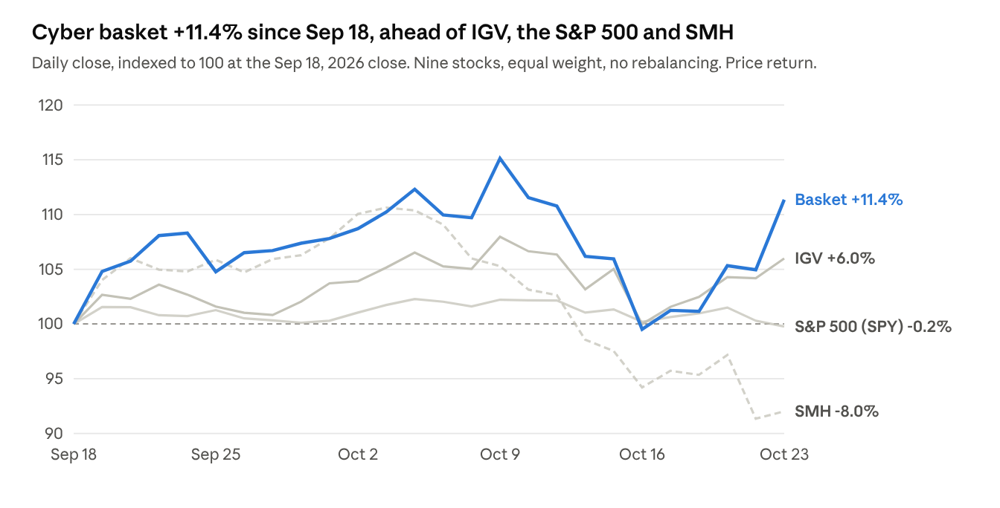

*Source: Interactive Brokers daily closes, Sep 18 to Oct 23, 2026.*

| Name | Weight Sep 18 | Return | Adds to basket |
| --- | --- | --- | --- |
| ZS | 11.1% | +29.3% | +3.3 pts |
| RBRK | 11.1% | +20.6% | +2.3 pts |
| DDOG | 11.1% | +17.3% | +1.9 pts |
| SAIL | 11.1% | +9.9% | +1.1 pts |
| CRWD | 11.1% | +8.4% | +0.9 pts |
| FTNT | 11.1% | +6.0% | +0.7 pts |
| FFIV | 11.1% | +5.4% | +0.6 pts |
| PANW | 11.1% | +4.7% | +0.5 pts |
| NET | 11.1% | +0.7% | +0.1 pts |
| **Basket** | 100% | **+11.4%** |  |

All nine names are up while the S&P 500 is flat and semis are down 8%. Over this window the basket behaved like software, not like the broad AI trade: it tracked IGV in direction and beat it on size.

**What's new in this update:** we zeroed in on which layer will likely see the most growth.

It’s easy to claim that any company selling a cybersecurity solution will see huge benefits. But that ignores the reality of what’s going on and fails to capture the nuance of how AI is changing the industry.

We drew on the main industry publications:

- Gartner's security spending forecasts
- The four largest incident datasets:
  - Verizon's Data Breach Investigations Report (22,000+ breaches)
  - Palo Alto Unit 42 (750+ incident response cases)
  - CrowdStrike's Global Threat Report
  - Google Mandiant's M-Trends

All are 2026 editions, so they show how attacks have changed in the AI era.

We then went beyond financial data. Most analysts stop at earnings, so we added **alternative data that tracks real-world activity**:

- downloads of the toolkit that connects AI agents to company systems (MCP SDK) to gauge agent adoption
- malicious packages imitating AI tools (OSV) to gauge attacks on agents
- ransomware leak-site victims (ransomware.live)
- the US government's list of exploited vulnerabilities (CISA KEV).

We checked this against company disclosures, such as ARR growth, to test our growth assumptions. Based on these work, we then split the cybersecurity ecosystem into 8 layers, it becomes a lot clearer where the most attractive companies sit, and these findings shaped our updated basket.

| Layer | The boardroom question (2026 spend) | Control needed | Basket exposure |
| --- | --- | --- | --- |
| 1 | **Who gave it permission?** about $23B | Agent identity, privilege governance, credential lifecycle | SAIL, MSFT, PANW, CRWD |
| 2 | **Where can it go?** about $30B | Network and cloud access, inline inspection, isolation | ZS, NET, PANW |
| 3 | **Can we trust what it uses?** about $10B | Verified tools, packages, artifacts and software supply chain | FROG, MSFT |
| 4 | **What is it doing with our information?** about $25B | Data controls, cloud/SaaS visibility, agent runtime rules | MSFT, ZS, PANW, CRWD |
| 5 | **Will we see it and stop it?** about $34B, plus $16B managed services | Endpoint monitoring, cross-system detection, automatic response | CRWD, PANW, MSFT |
| 6 | **What is it costing us?** about $28B (IT ops budget) | Observability of agent behaviour, usage and spend | DDOG |
| 7 | **Can we recover?** about $10 to 15B (IT budget, estimate) | Backups, recovery testing, operational resilience | RBRK |
| 8 | **Who can deploy it for us?** about $95B (security services) | Integration, rollout, staffing and managed security, often inside regulated or government networks | ACN, CACI |

**Old basket (Sep 18) vs new basket (Oct 26)**, equal weight:

| Ticker | Sep 18 | Oct 26 | Change |
| --- | --- | --- | --- |
| CRWD | 11.1% | 6.7% | Kept |
| DDOG | 11.1% | 6.7% | Kept |
| FFIV | 11.1% | 6.7% | Kept |
| FTNT | 11.1% | 6.7% | Kept |
| NET | 11.1% | 6.7% | Kept |
| PANW | 11.1% | 6.7% | Kept |
| RBRK | 11.1% | 6.7% | Kept |
| SAIL | 11.1% | 6.7% | Kept |
| ZS | 11.1% | 6.7% | Kept |
| MSFT |  | 6.7% | Added |
| FROG |  | 6.7% | Added |
| ACN |  | 6.7% | Added |
| QLYS |  | 6.7% | Added |
| CACI |  | 6.7% | Added |
| MITK |  | 6.7% | Added |
| **Names** | **9** | **15** | **+6** |

The rest of this report sets out our latest findings, where they differ from current market consensus, and why they led us to add new names to the basket.

## Section 1: Identity: the layer we like most

**Cybersecurity needs a new definition.** The old job was keeping outsiders out. Today companies authorise software to act on their behalf, so risk also starts inside, with logins and permissions the company granted itself.

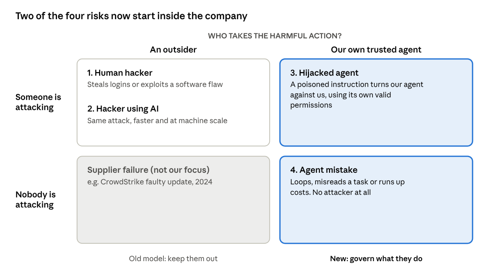

Risks 1 and 2 are the familiar hacker story. Risks 3 and 4 are new and sit inside the company. All four end at the same checkpoint: a valid login with permissions. That checkpoint is the identity layer.

**Where the money sits today.** Half of 2026 enterprise security product spend (about $145B, Gartner) sits in three layers:

| Layer | 2026 spend | Share | Main names |
| --- | --- | --- | --- |
| Network and edge | about $30B | 21% | FTNT, PANW, ZS, NET |
| **Identity** | **about $23B** | **16%** | **SAIL, PANW, CRWD, MSFT** |
| Endpoint | about $21B | 14% | CRWD, MSFT |
| Top three | about $74B | 51% |  |

Identity is the second-largest pool today, behind network. We favour it because it has the strongest breach evidence of any layer and the clearest new demand driver.

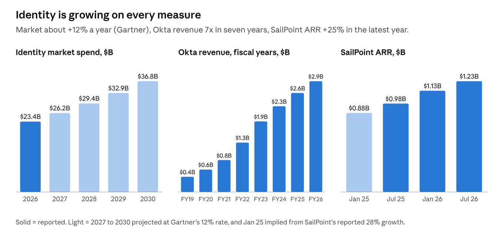

*Sources: Gartner information security forecast (identity and access management, 2026), Okta annual reports (fiscal years end January), SailPoint earnings releases (Q4 FY26, Q2 FY27), via Quartr.*

**What the incident data says.** The 2026 incident datasets all point to identity:

- Identity played a material role in about 90% of Unit 42's 750+ cases, and 65% of initial access was identity-based.
- Credential abuse appears in 39% of breaches in Verizon's DBIR. 73% of ransomware victims had stolen credentials for sale beforehand, half of them within 95 days of the attack.
- 99% of 680,000+ cloud identities held excessive permissions (Unit 42).
- Attacks are moving from email to phone calls and agents. A vishing call and a hijacked agent end in the same place: a valid login (DBIR, CrowdStrike).

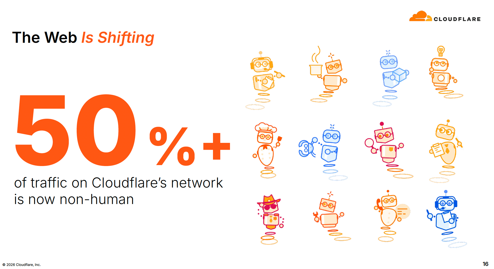

*Source: Cloudflare.*

**Why the layer grows with AI agents.**

- Machine identities (service accounts, API keys, agents) already outnumber people by roughly 80 to 100 to 1, and most are ungoverned.
- SailPoint's October survey: 79% of organisations run AI agents in production, but only 2% have identity tools built to govern them.
- If pricing moves from per employee to per identity, every agent becomes billable. SailPoint has introduced pricing it says will "scale in lockstep" with agent growth.
- Platforms are buying in: PANW-CyberArk (about $25B), CRWD-SGNL ($740M) and CSCO-Astrix all closed within about a year. Those prices set a floor for independent assets.

**The caveat.** The demand has not yet reached reported revenue: SAIL grows about 17% and OKTA about 11%.

**Why we expect identity to outgrow its share.** Identity is only the second-largest pool today, but the two charts below show why we expect its spend to accelerate. Companies are adopting AI agents quickly: downloads of the toolkit that connects agents to company systems rose about 7x in a year.

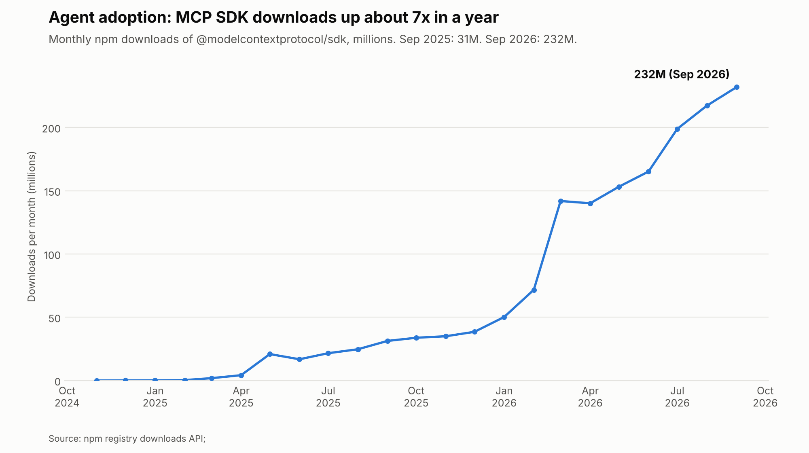

*Source: npm monthly downloads. Monthly data to Sep 2026. MCP launched Nov 2024.*

Attackers are following, and the monthly count of malicious packages imitating AI tools is up about 6x. Every agent needs a login and permissions, and every stolen agent credential is a new way in. We therefore expect identity spend to grow faster than Gartner's 12% forecast, and faster than most other layers, as agents multiply.

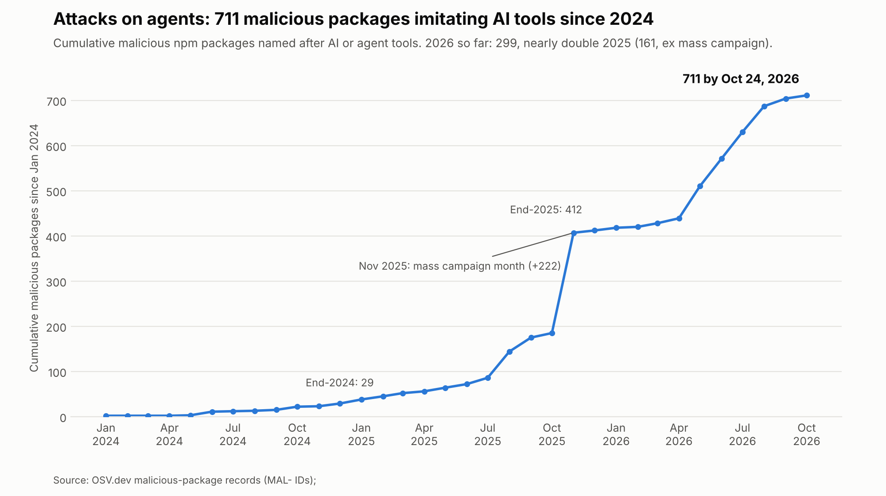

*Source: OSV malicious-package records, matched by package name. Data to Oct 24, 2026.*

Every one of these malicious packages has to pass through a company's software store before it can do harm. JFrog (FROG) runs that store for 83% of the Fortune 100, and its Curation tool blocks malicious packages and AI models before developers or agents can pull them in. It now also manages registries for the tools agents connect to (MCP servers). We cover FROG in more detail in Section 3.

**Why SAIL over OKTA.** The two listed pure plays in identity are Okta (OKTA) and SailPoint (SAIL). We prefer SAIL for three reasons:

- **Better growth for the price.** The two trade at similar multiples (about 12x forward sales for OKTA, 10x for SAIL), but SAIL's ARR is growing about 25% against OKTA's 11%. Adjusted for growth, OKTA is the more expensive stock.
- **A harder moat.** OKTA's core product is login: single sign-on and multi-factor authentication. That is the part of identity that bundlers find easiest to copy, led by Microsoft's Entra, which comes inside M365. SAIL sells governance: deciding who and what should have access, reviewing it and removing it. That needs deep connections into thousands of old and new applications, and the audit trail regulators rely on, so it is much harder to replace.
- **Growth that tracks agent numbers.** Every new agent, service account and API key needs to be governed, so SAIL's opportunity grows with the number of identities, not just the number of employees. SAIL has already moved to pricing it says will "scale in lockstep" with agent growth. OKTA's login business does not scale one-for-one with agents, because many agents reuse existing logins and tokens.

For more detail, see the identity layer in our [September primer](/research/cybersecurity-theme-primer/).

**A smaller name for consideration: Mitek (MITK).** Mitek fits the same identity trend. It trades more thinly than the names above and will be more volatile, but on valuation it is more attractive than many better-known peers, at about 4x sales and a market value of about $0.8B. We add it to the basket at a small weight.

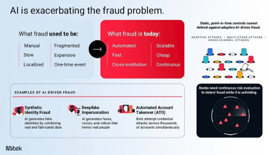

*Source: Mitek.*

Mitek is really two companies wearing one trench coat:

- **Check verification (about 47% of revenue).** It checks cheques deposited by phone. It is not exciting, but it generates steady, profitable revenue in a business unlikely to disappear in the next five years.
- **Fraud and identity (about 53%, up from 44% in 2024).** This is the part that matters for our thesis. Mitek helps banks and other high-assurance businesses confirm that a customer is real and authorised, using document checks, facial biometrics, liveness detection (proving a live person, not a photo or deepfake) and behavioural and device signals. Management expects this segment to grow about 19% in fiscal 2026, to $105 to $109M, with its SaaS revenue growing faster still.

**The main risk** is Microsoft bundling Entra identity into M365, which we cover in Section 5. We believe our basket exposure (MITK, SAIL, PANW, CRWD and MSFT) hedges this risk. This is also why we prefer to play the theme through a basket rather than any single stock: each name carries idiosyncratic risks that are not relevant to the theme.

## Section 2: Network and edge: the largest pool, with two ways to win

Network and edge security is the largest layer of 2026 enterprise security spend, at about $30B (21% of the total, see the table above). Gartner puts network security equipment at $27.2B, growing 15%, of which firewalls are $19.7B. Zero-trust network access, the cloud alternative to the VPN, is smaller at $3.0B but growing faster at 23%. The money is moving in two directions at once, and the four names we track cover both.

**1. Firewalls remain essential, and their weakness is driving demand.** Every company still needs a box where its network meets the internet: the firewall and VPN. That box is now the most attacked security product.

- Exploiting software flaws is now the number-one way into a company (31% of breaches, Verizon DBIR), mostly through edge devices. 40% of China-linked exploitation targeted them (CrowdStrike).
- These appliances are closed systems, so endpoint tools like CrowdStrike cannot run on them. In one case a China-linked group entered through a VPN box and stayed hidden for 22 months, because no security software was watching (CrowdStrike, "Warp Panda").
- 44% of the network access sold by initial access brokers is VPN access (DBIR).

The market response has been to upgrade, not to leave. Fortinet's product revenue grew 52% in Q2 2026. AI adds a second driver: AI workloads create heavy traffic inside the data centre, between GPU servers, agents and databases. Sending that traffic out to a cloud service to be checked is slow and costly, so it still needs fast physical firewalls on site. Fortinet's custom chips are built for this.

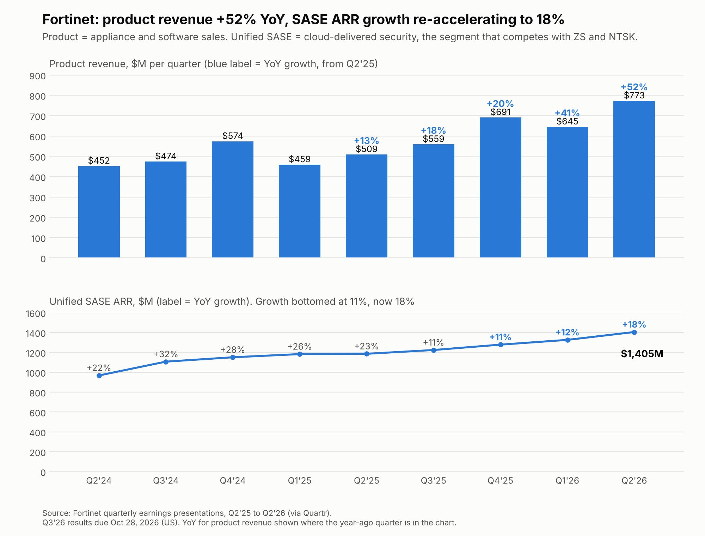

**2. Security is moving to the cloud, and SASE is taking share.** Users, applications and now AI agents sit outside the office network, so a box at the office perimeter protects less each year. Cloud-delivered security, known as SASE (secure access service edge) or SSE (security service edge, the same thing without the networking part), replaces it with a broker in the vendor's cloud:

- **Per-application access:** a VPN lets a user onto the whole network once logged in. SASE connects each user, or agent, to one approved app at a time, so a stolen login reaches far less.
- **Nothing to attack at the edge:** there is no internet-facing box, and the vendor patches its own cloud centrally, rather than waiting for each customer to patch.
- **Agent traffic control:** agents call outside tools and data sources constantly. A cloud broker can inspect and block that traffic in the path, wherever the agent runs.

This shows in the numbers. Zscaler's branch and cloud products have grown over 60% a year for eight quarters, and Palo Alto's SASE business grows about 40%, faster than the market.

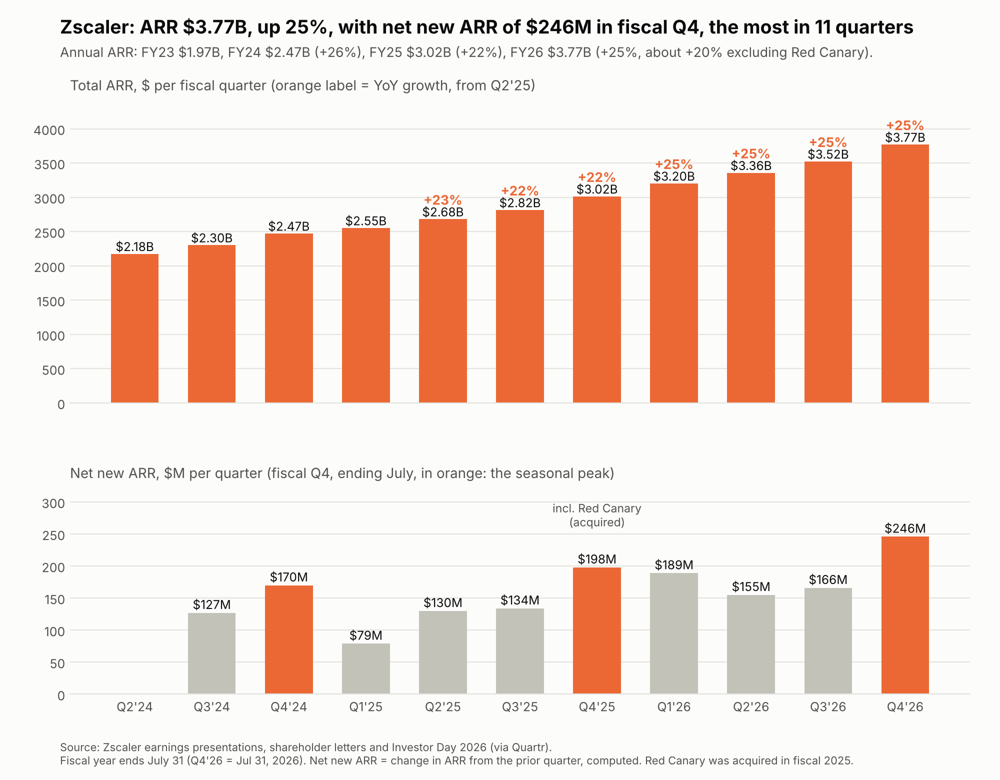

**3. How the four names split the opportunity**

|  | Position | Latest growth |
| --- | --- | --- |
| FTNT | Firewall hardware leader, own chips, adding cloud SASE | Product revenue +52%, SASE ARR +18% |
| PANW | Both models: firewalls plus Prisma Access, sold as a platform | SASE ARR about +40% (about $1.6B) |
| ZS | Largest cloud-native SASE pure play | ARR $3.8B, +25% (about +20% organic) |
| NTSK | Cloud-native challenger, strongest in data and SaaS control | ARR $0.9B, +27% |

FTNT and PANW win if customers want one vendor for network and security, and as data centres add firewalls for AI traffic. ZS and NTSK win if security moves fully to the cloud and is bought separately from the network. Tracking all four means we do not need to call which model wins. NTSK has not yet reached the conviction level we want for the basket, so we hold FTNT, PANW and ZS and keep watching Netskope.

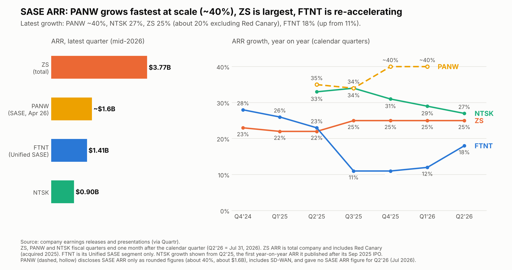

**Risks**

- FTNT: Part of Fortinet's product growth came from one-off price increases, but clearly management understands that and FTNT is pushing on the growth of their SASE revenue.
- PANW: Palo Alto gave no SASE ARR figure for its latest quarter (it only described growth qualitatively on the call).
- NTSK: Netskope's growth is slowing, from 34% to 27%, and its net retention fell from 118% to 114%. That is a familiar pattern in this sector. As smaller specialists slow, they tend to become acquisition targets for platforms that can sell their product into a much larger customer base: Palo Alto bought CyberArk, Cisco bought Splunk and CrowdStrike bought SGNL. If Netskope's growth keeps fading, a sale to a platform such as Palo Alto becomes a realistic outcome.

## Section 3: The bottleneck is fixing, not finding

**Finding flaws is becoming cheap.** Frontier AI models are now among the most productive vulnerability researchers in the world: Anthropic's Mythos, OpenAI's Codex Security and Google's Big Sleep find serious bugs at internet scale. Even Qualys concedes that "traditional scanning and detection have become table stakes". Scanning is the part of security most easily vibe-coded away.

**Fixing them is not.** **Companies fully fix only 26% of known-exploited vulnerabilities, and the median time to fix rose to 43 days from 32 (Verizon DBIR)**. AI is widening the gap: of about 530 serious bugs Mythos reported to open-source maintainers, only 75 were patched. Patching at scale needs software on every machine, change control, staged rollout and the ability to roll back, none of which a model can do on its own.

**The race starts at disclosure.** When a vulnerability is announced, defenders and attackers learn about it at the same moment. Attackers know a typical company takes weeks to patch, so the alert itself becomes their starting gun. Increasingly they do not even wait: Mandiant estimates attackers now exploit flaws about 7 days before they are disclosed.

**PHP2Shell showed the answer.** In October, two critical flaws in PHP, the software behind a large share of websites, let attackers take over unpatched servers.

**The fallout was global, and it hit within a day.** On Oct 21 and 22, governments and companies pulled their own websites offline rather than risk an attack (Reuters):

- **Europe's governments went dark.** Germany's federal IT provider, France's Interior Ministry (prefecture websites), Belgium's foreign ministry, the Czech government and Finland's state IT centre, which shut all of the government's public web services.
- **The Netherlands shut down almost everything public-facing.** Following the national cyber centre's lead, the Port of Rotterdam, the government portal Overheid.nl, the national football association, the five largest political parties and numerous hospitals all took their websites offline.
- **Japan's state and its largest companies suspended services.** The National Tax Agency took its service down, and the Ministry of Finance and the Meteorological Agency partially suspended theirs. Nomura, MUFG, ANA and East Japan Railway suspended some online services as emergency measures.
- **Household names went offline.** The Wikimedia Foundation (Wikipedia) took down a number of systems and said all its systems using PHP were affected. The Internet Archive took its portal offline, the BBC took down some web portals, and Orange suspended websites and apps across several subsidiaries.
- **It reached North America and local government too.** Canada warned that some government websites might be unavailable, and UK councils, including the City of Edinburgh, took services down.

Most of these shutdowns were precautions, not responses to confirmed breaches. That is the point: when the patch is days away, organisations without a shield in front of their websites have only one option, which is to switch them off.

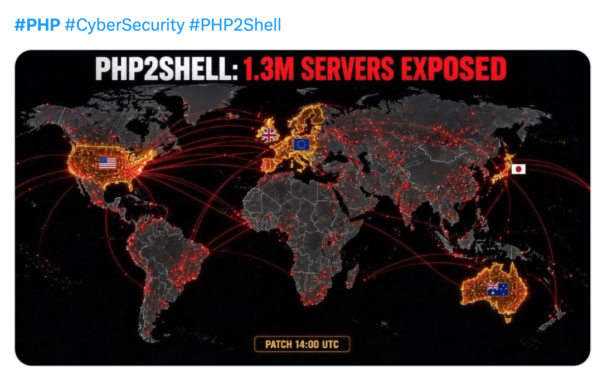

Unit 42 counted 22.6 million potentially vulnerable instances. Exploit attempts were seen on Oct 17, four days before the patch was released on Oct 21. Cloudflare (NET) had blocking rules live in its web application firewall (WAF) at 03:02 UTC on Oct 21. This is virtual patching: the vendor blocks the attack in the traffic path, which buys customers time to apply the real fix. We believe NET and FSLY will both do well as WAF providers.

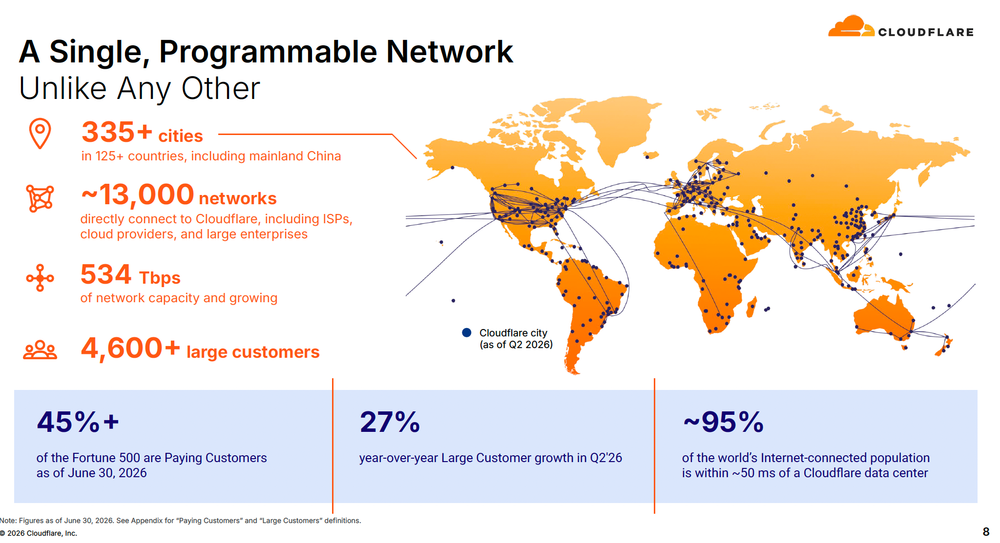

*Source: Cloudflare investor materials.*

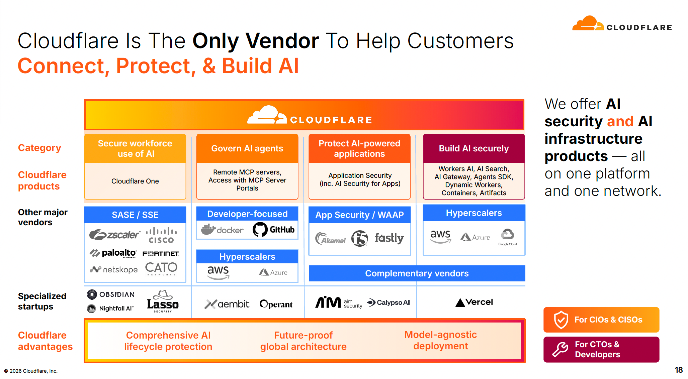

*Source: Cloudflare investor materials.*

**Where JFrog (FROG) fits: shipping the fix.** If fixing is the bottleneck, someone has to deliver the fix safely. JFrog runs the system that stores, scans and distributes every piece of software a company builds or downloads, from source code out to the cloud, its own data centres and edge devices such as cars and factory machines. It is a single platform that combines developer operations, security and release management, used by 83% of the Fortune 100.

AI makes this more valuable, not less. Even if AI can write an entire banking stack or update an airline's databases across thousands of devices, these systems have near-zero tolerance for faults, and lives can depend on them. So engineering teams are consolidating onto one platform that can trace, check and roll back every release, rather than stitching together tools. JFrog benefits from this platform shift because it offers reference designs and services that each company can shape to its own teams.

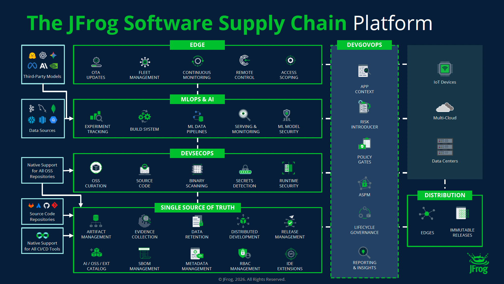

*Source: JFrog.*

The numbers support it. In Q2 2026 revenue grew 29% to $164M, cloud revenue grew 53%, and customers spending over $1M a year rose to 97 from 61. Security is now the growth engine: 80% of new $1M+ customers bought JFrog's security products, and gross retention is 97%.

**B****a****s****k****et**** ****to ****ex****pre****ss this ****finding****:**

| Role | Names | Why |
| --- | --- | --- |
| Fix | QLYS | The only listed security vendor with a real patching business |
| Ship the fix | FROG | Stores, scans and rolls out every software release to cloud, on-prem and edge devices |
| Shield | NET, FFIV (AKAM, FSLY tracked, not held) | Sit in front of websites and block attack traffic before it reaches unpatched servers |
| Avoid | TENB, RPD | Revenue depends on finding flaws, the part AI is commoditising |

**Why we like QLYS.** The market groups Qualys with the vulnerability scanners and has de-rated it with them. But patching already makes up about 9% of its bookings over the past year and 16% of new bookings. That share is still small, but it is growing, and it sits in the bottleneck. QLYS is in our new basket.

**The proof in Qualys's numbers.** Qualys does not report revenue by product, but since early 2026 it has disclosed patch management's share of bookings on every call. Patching rose from 7% of bookings in 2024 to 8% in 2025 and 9% in the 12 months to June 2026, and it has held at about 16% of new bookings throughout. Applied to revenue, that puts patching at roughly $63M a year, growing about 26% in 2025 against about 9% for the rest of the business.

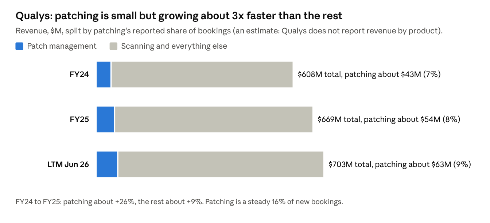

*Sources: Qualys earnings calls (Q4 2025, Q1 and Q2 2026) for patch management's share of bookings, and Qualys revenue via Quartr. Patching revenue is our estimate.*

Patching is still a small business, but it is the fastest-growing part of Qualys and it accounts for about a sixth of all new business. Among listed vulnerability-management vendors, Qualys is the only one with a meaningful patching product. Tenable and Rapid7 have essentially none. Larger patching businesses do exist, but they sit inside much bigger companies (Microsoft Intune, ServiceNow) or are private (Tanium, NinjaOne).

**Why we avoid TENB and RPD.** Tenable grows about 9%, with essentially no patching revenue. Rapid7 has the same exposure to detection, and its revenue is already shrinking.

On the shield side, Cloudflare and F5 are in our basket. Akamai and Fastly (FSLY) offer the same WAF protection, but we leave them out of the basket. Fastly is smaller with a higher beta, so we use Cloudflare to represent the WAF theme. Akamai is explained below.

**Why not Akamai.** Akamai has a real security business, but the stock is increasingly a bet on building cloud infrastructure. **It expects capital spending of about 40% of revenue in 2026, and its legacy content-delivery business is shrinking by mid-single digits.** Its new $11.6 billion multi-year agreement with Anthropic is for computing capacity, not security. The deal adds no revenue in 2026, needs about 100 megawatts of new capacity to deliver, and gives Anthropic warrants for up to 5% of Akamai's shares. Headlines like this can move a low-quality stock sharply, but that is beta from a capital-heavy business, not the quality we invest in. Cloudflare and F5 give us the same shield exposure with stronger fundamentals.

## Section 4: The hidden layer is people

Section 3 showed that fixing is the bottleneck. Part of the reason is simple: there are not enough skilled people to do the work. So we also look at the market horizontally, by who is paid, not just by which layer is protected.

**Who spends, and on what.** Gartner puts worldwide security spending at $247.5B in 2026. Consumers are a rounding error. More than 95% is spent by companies, led by the Fortune 500 and governments, and** almost 40% of that goes not to software but to people: consultants, integrators and outsourced monitoring.**

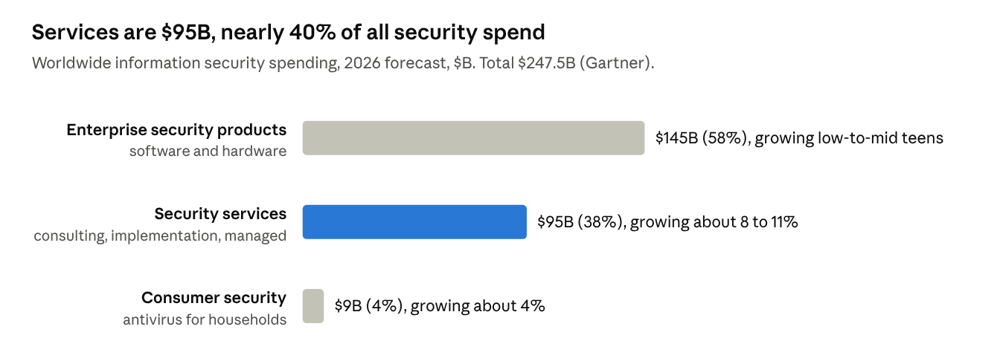

*Source: Gartner information security forecast, 2026 ($247.5B total).*

**The labour shortage is real and getting worse.** In ISC2's 2025 workforce study of more than 16,000 security professionals:

- 95% of teams reported at least one skills gap, and 59% called their gaps critical or significant, up from 44% a year earlier.
- 88% had at least one security incident or operational problem they linked to a skills shortage.
- 36% faced budget cuts and 24% had layoffs, while 72% agreed that cutting security staff significantly raises the risk of a breach.
- The most-needed skills are AI (41%) and cloud security (36%), which are exactly what agent rollouts require.

Attackers do not wait for hiring. The average intruder spreads from the first machine to others in 29 minutes (CrowdStrike), and few companies can staff a security operations centre around the clock. That gap is what the $95B services pool pays for.

**Where the services money goes.** It splits into two very different businesses:

- **Ongoing monitoring** (managed detection and response) is moving to the security platforms, because their AI agents now do much of the triage analysts used to do. This benefits CRWD, PANW and MSFT. CrowdStrike Falcon Complete, Palo Alto's Unit 42 and Microsoft Defender Experts all sell it, and only large platforms can afford to run this labour-intensive, lower-margin service.
- **One-off projects** stay with the consultants: designing security programmes, deploying identity and agent controls across thousands of applications, and meeting regulatory deadlines. Every company rolling out AI agents needs this work done once, and quickly.

**Our services names**** ****\[****n****ew p****i****ck\]**

- **Accenture (ACN):** the largest IT consultancy in the world, with a dedicated security practice. It wins enterprise-wide AI and security transformation projects for commercial clients, and reported record bookings in its latest quarter.
- **SAIC (tracked, not held):** a US government IT contractor that modernises federal agency systems, including cloud migration and cyber defence.
- **CACI:** a US national-security contractor focused on defence and intelligence agencies, including cyber operations and electronic warfare.

CACI gives us mandated government cyber spending, which does not depend on corporate IT budgets. SAIC offers similar exposure, but we track it rather than hold it. ACN and CACI are small weights, because neither reports security revenue separately and AI also threatens part of their billable-hours model.

**The numbers behind the labour side.**

- **Accenture's security practice is now a $10B business.** Accenture does not report security as a segment, but on its Q3 FY26 call it said its security services grew from about $700M in FY16 to $10B in FY25. That is about 35% growth a year by Accenture's own count, about four times the group's, and security has gone from 2% to about 14% of revenue. It is now buying security software too: Dragos, runZero and NetRise for industrial (OT) security, part of about $9B of acquisitions planned this fiscal year.

  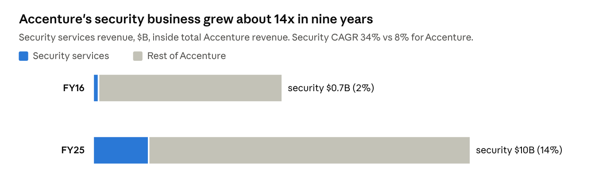

*Sources: Accenture Q3 FY26 earnings call (security services about $700M in FY16 and $10B in FY25), Accenture annual revenue via Quartr.*
- **CACI keeps growing.** CACI does not break out cyber revenue, but group revenue rose 11% to $9.6B in its fiscal year to June 2026, and about 58% since FY21. SAIC also does not report cyber separately.
- **Hiring is picking up again.** US employers posted 514,359 cybersecurity job listings in the 12 months to April 2025 (the latest CyberSeek data), up about 57,000 or 12% on the prior year (CyberSeek, CompTIA and NIST). There are only 74 available workers for every 100 openings.

  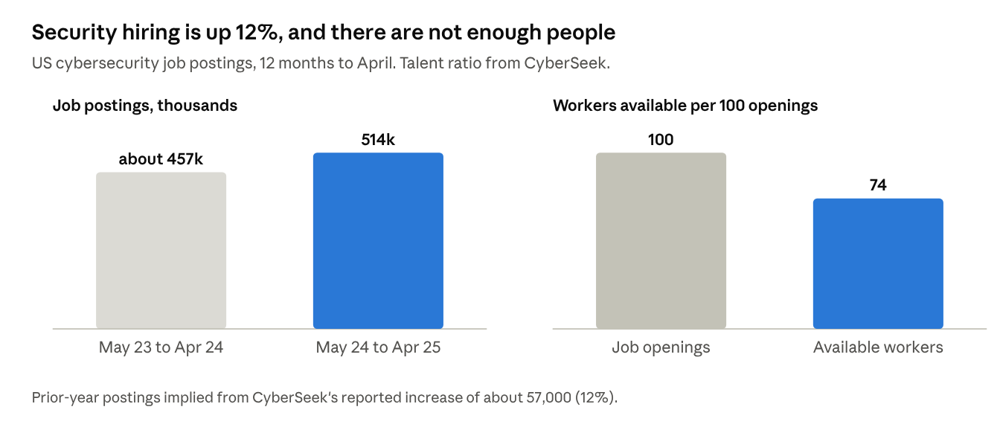

*Source: CyberSeek (CompTIA and NIST), June 2025 release covering May 2024 to April 2025.*

## Section 5: Who is the real threat?

The market's biggest fear this year has been the frontier labs. Anthropic's Mythos and Claude Code Security, and OpenAI's Codex Security, showed that AI can now find software flaws at internet scale, and security stocks were repriced for AI disruption. CrowdStrike fell about 36% from its November 2025 high to around $90 in March (split-adjusted), before recovering to $258.

**We think the fear is aimed at the wrong target. The labs replace work that is about *finding* and *labour*. The bundlers, meaning Microsoft and the hyperscalers that add security to products customers already pay for, threaten almost every layer. **We went back through each layer of our framework and asked two questions: can a frontier lab build this, and can a bundler give it away?

| Layer | Labs replace it? | Bundlers squeeze it? | Relevant tickers (basket) |
| --- | --- | --- | --- |
| Finding flaws (scanning) | Yes | Yes (Microsoft Defender) | QLYS (TENB, RPD not held) |
| Code security | Yes | Yes (GitHub Copilot Autofix) | FROG, MSFT (GitHub) |
| Agent runtime guardrails | Yes | Yes (lab and hyperscaler guardrails) | None pure-play. PANW, ZS, NET, CRWD add it as a feature |
| Security services | Yes (AI analysts) | Yes (platform-run monitoring) | ACN, CACI |
| Identity | No | Yes (Microsoft Entra in M365) | SAIL, MITK |
| Endpoint and detection | No | Yes (Defender in Microsoft E5) | CRWD |
| Cloud and data security | Partly | Yes (Purview, native cloud tools, Wiz in Google) | CRWD, PANW, ZS |
| Observability | No | Yes (native cloud monitoring) | DDOG |
| Network and edge | No | Partly (platform SASE bundles) | FTNT, PANW, ZS, NET, FFIV |
| Supply chain | Partly | Partly (GitHub) | FROG |
| Recovery | No | Partly (native cloud backup) | RBRK |
| Fixing and virtual patching | No | Partly (Microsoft patches its own estate) | QLYS (patching), NET, FFIV (WAF virtual patching) |
| **Total** | **4 yes, 2 partly** | **8 yes, 4 partly** |  |

**What the table shows.** Labs threaten four layers, and those are exactly the ones we avoid or underweight: detection-led scanners (TENB, RPD), code scanners and labour-heavy services. Bundlers press on every layer. The risk is not that a lab rebuilds CrowdStrike. It is that a CFO asks why the company pays for CrowdStrike when Defender is already in its Microsoft licence.

**How our basket handles it.** We hold the biggest bundlers directly. MSFT is the largest security vendor in the world, and PANW and CRWD are the two platforms with the breadth to consolidate rather than be consolidated. For the specialists (SAIL, ZS, FROG, DDOG, RBRK), we look for one of four things the bundlers cannot easily copy: a position in the traffic path, a sensor on the device, a system of record, or the authority to act. And we size them as satellites, not core positions.

## Section 6: Are we in bubble territory?

Cybersecurity stocks are not cheap, so the fair question is whether we are buying near a top. We looked at three past episodes when security and software stocks crashed.

**1. The 2000 dot-com peak, the closest parallel.** Security was a hot theme then too, and leaders traded at extreme multiples of sales: VeriSign at about 310x, Entrust at about 95x, Check Point at 60 to 70x. From 2000 to 2002 they fell 89 to 98%. VeriSign took 22 years to regain its peak, and Entrust never did.

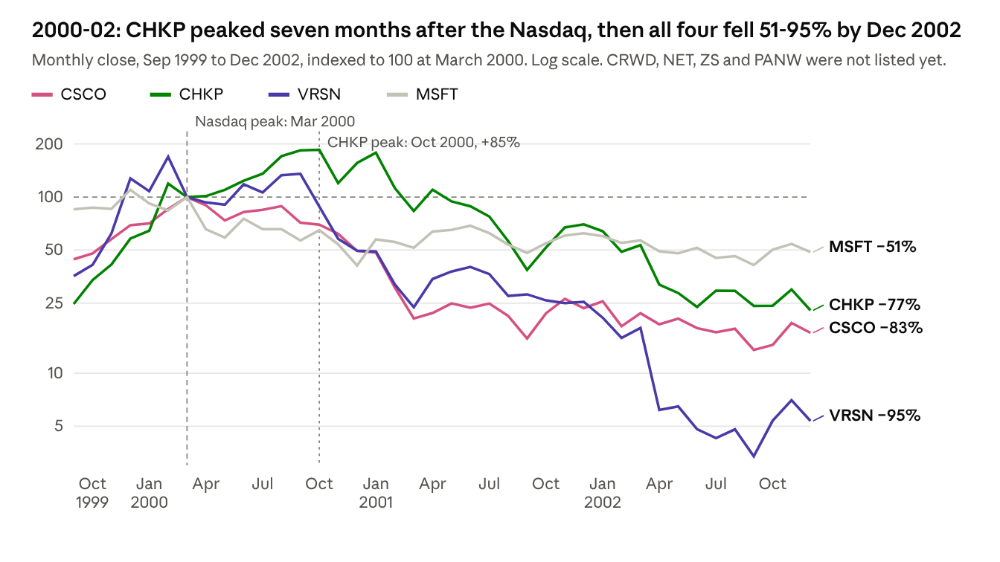

*Source: Interactive Brokers monthly closes, Sep 1999 to Dec 2002, split-adjusted (CHKP split dates from Check Point's investor FAQ).*

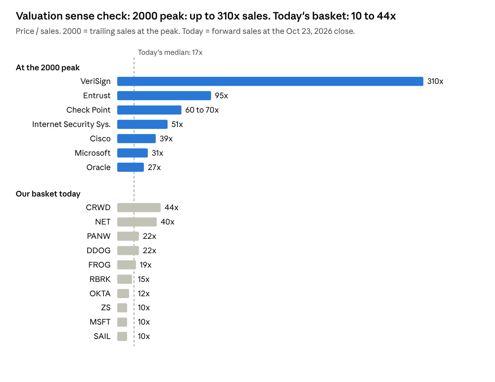

*Sources: 2000 from company 10-Ks and CFA Institute. Today: IBKR closes and company filings via Quartr, Oct 23, 2026.*

Today's basket is expensive in places, but it is nowhere near 1999. The median name trades at about 17x forward sales. Only CRWD (44x) and NET (40x) sit above Cisco's 39x at the 2000 peak, and the basket as a whole fits inside the bottom of the 2000 range.

**2. The 2021 to 2022 growth reset.** When interest rates rose, high-multiple software fell hard even though the businesses kept growing:

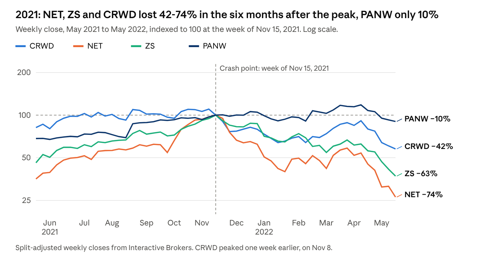

*Source: Interactive Brokers weekly closes, May 17, 2021 to May 16, 2022, split-adjusted.*

|  | Peak (Nov 2021) | Trough | Fall |
| --- | --- | --- | --- |
| NET | $222 | $37 (Nov 2022) | -83% |
| ZS | $376 | $85 (May 2023) | -77% |
| CRWD | $75 | $23 (Jan 2023) | -69% |

CRWD regained its peak in about two years and NET in about four. ZS is still about 32% below it.

**3. The 2026 AI-disruption scare.** When frontier labs showed they could find flaws at scale, the market sold first and asked questions later. From their November 2025 highs to their spring 2026 lows, CRWD fell about 36%, NET about 37% and ZS about 66%. All three have since rebounded sharply.

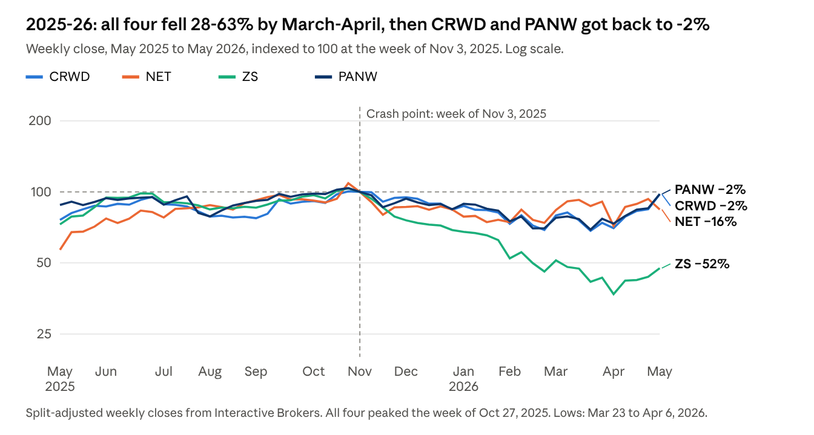

*Source: Interactive Brokers weekly closes, May 5, 2025 to May 4, 2026, split-adjusted.*

**Each crash up close: six months either side of the peak.** The 2000 chart uses Cisco, Check Point, VeriSign and Microsoft, because CRWD, NET, ZS and PANW did not trade yet. It runs to Dec 2002, because the security names peaked months after the Nasdaq and crashed later. All three charts share the same log scale, so the moves can be compared directly.

**Our read.** This is not 1999. Valuations are high for a few leaders, not across the sector, and today's companies have real revenue, cash flow and recurring contracts that the 2000 names lacked. But the last two episodes show that 40 to 80% drawdowns happen even without a bubble, from rate shocks or disruption fears. That is why we hold a basket rather than single names, keep the most expensive stocks (CRWD, NET) at smaller weights, and add on sell-offs rather than chase strength.

*CRWD prices are split-adjusted. Highs and lows are monthly, from Interactive Brokers.*

## Section 7: Conclusion. The next 12 to 18 months

**We may be entering a Y2K-style cybersecurity spending cycle, but without Y2K's deadline. The opportunity is structural. The stock prices will still be cyclical.**

Two forces are pulling in opposite directions.

**Force 1: A Y2K scramble without a deadline.**

Before 2000, companies spent about $300 billion worldwide (about $100 billion in the US) preparing for a computer failure that might never happen. The spending was real because the risk was too large to ignore.

AI could create a similar dynamic. PHP2Shell is an early warning: AI-assisted security research is accelerating vulnerability discovery, while enterprises are only beginning to deploy autonomous agents.

Unlike Y2K, there is no midnight when the problem disappears. Every new agent, permission and data connection creates another potential security risk. Companies will need to continuously reassess their defences.

**Our thesis is that fear of the next incident will drive spending well before that incident actually happens.**

**Force 2: The valuation cycle.**

Strong cybersecurity demand does not guarantee strong stock performance.

We saw this in 2021–22, when rising rates crushed software valuations despite healthy revenue growth. We saw another correction in 2025–26, when fears of AI disrupting traditional software businesses weighed on security stocks.

The lesson is simple: we can be right about cybersecurity spending and still lose money if we buy at the wrong valuation.

### How the next 12–18 months could unfold

**Base case: Security spending accelerates, but stocks remain volatile.**

AI adoption expands the attack surface, and companies gradually increase security budgets. Revenue growth follows, but valuations fluctuate with interest rates and broader software sentiment. We would use significant market corrections to build positions selectively.

**Upside catalyst: A major AI-related cybersecurity scare.**

Imagine an AI-assisted attack or compromised enterprise agent causing widespread disruption at a major bank, exchange or hospital network.

SolarWinds and Colonial Pipeline demonstrated how high-profile incidents can accelerate government action and corporate security priorities. A comparable AI-related event could bring agent security to the top of boardroom agendas almost overnight.

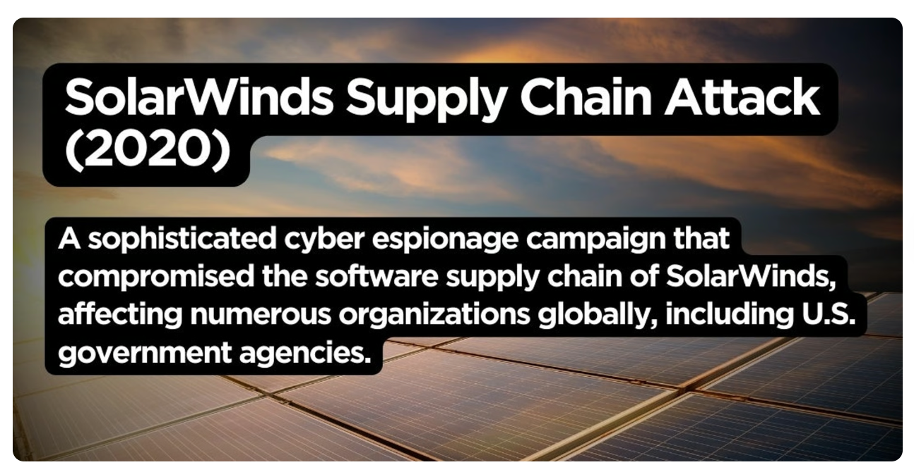

This could trigger a faster spending cycle and a sector-wide re-rating, potentially lifting even lower-quality cybersecurity names.

**The risk: A valuation-driven correction, or a spending cycle that disappoints.**

Cybersecurity stocks have historically suffered severe drawdowns even when underlying demand remained healthy. Higher rates, stretched valuations or weaker-than-expected monetisation of AI security could trigger another correction.

And if the sector eventually enters a fear-driven buying frenzy, we should be prepared to take profits rather than assume the rally will continue indefinitely.
