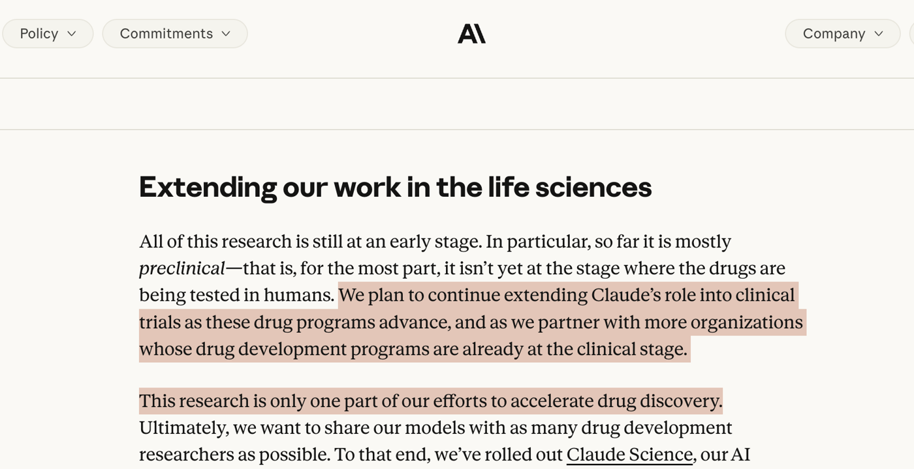
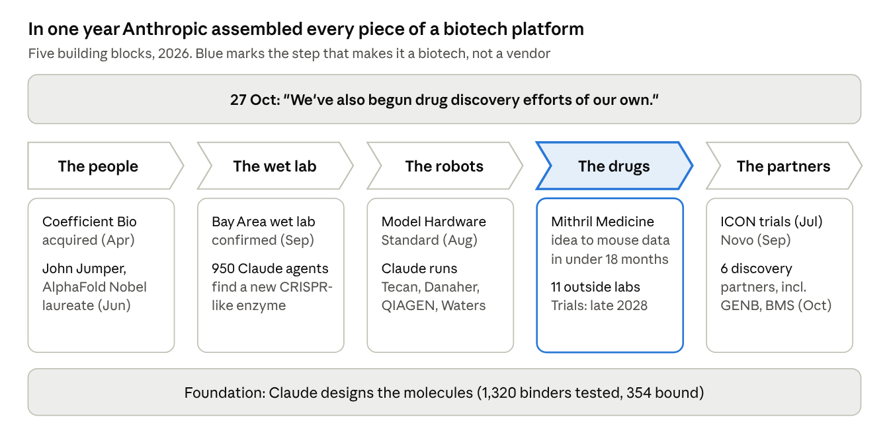
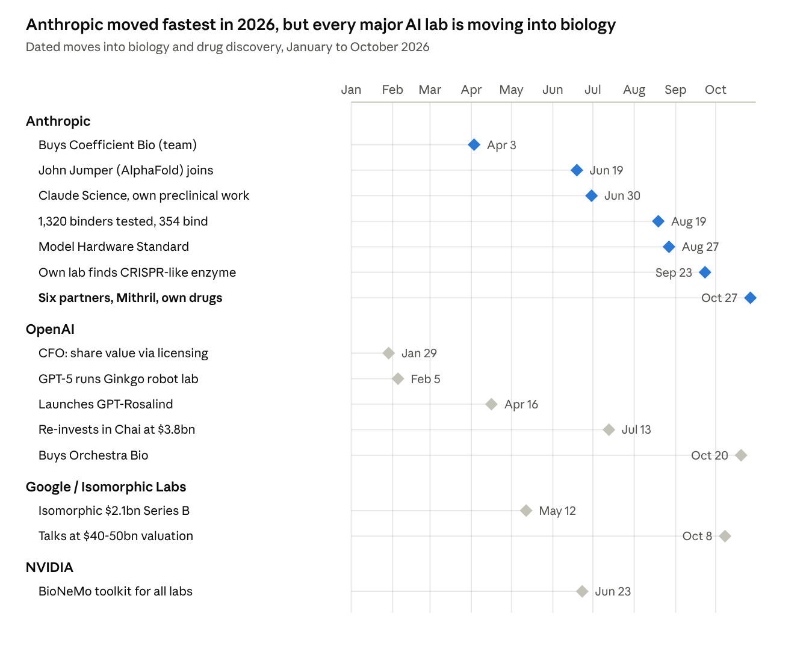
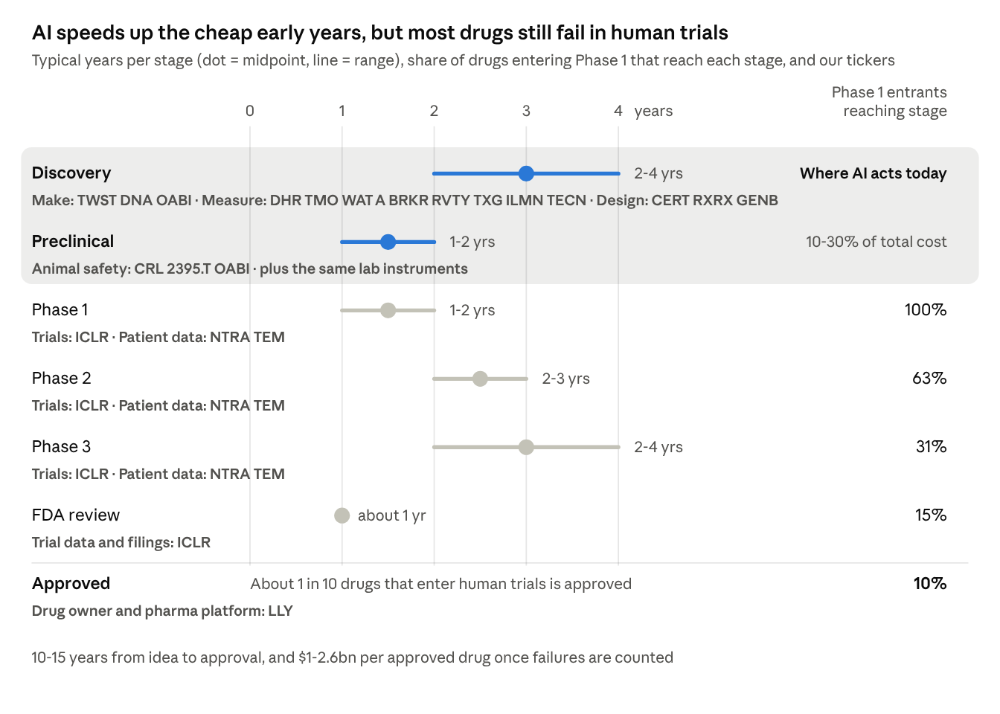
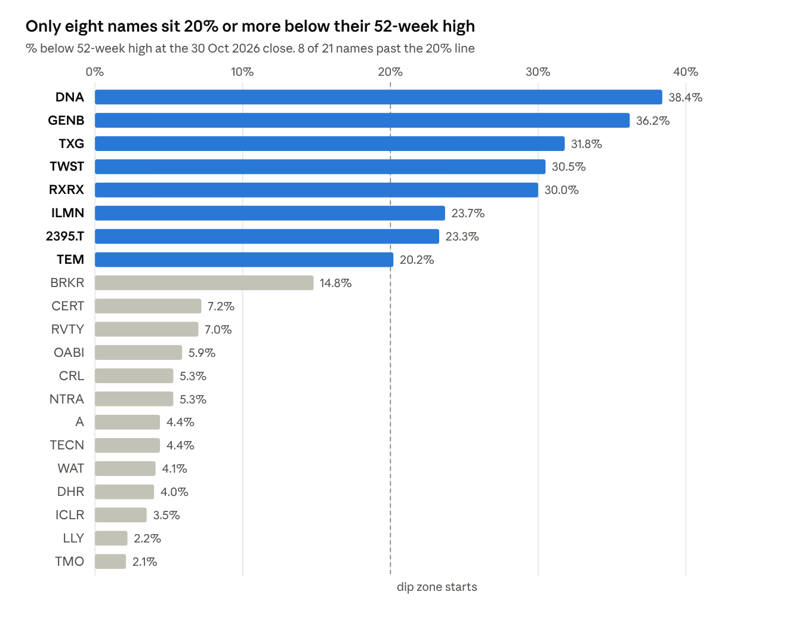

> **"We've also begun drug discovery efforts of our own."** Anthropic,
> 27 October 2026

The frontier AI labs are changing what they are. They are no longer just
selling models to drug companies. They are buying biotechs, building wet
labs and starting their own drug programmes. That puts them in
competition with pharma and makes them buyers of everything a drug
company buys. This paper asks who gets paid when that happens, and what
we should own.

**Contents**

1.  AI Drug Discovery Theme

2.  Why now: the sentence buried in Anthropic's post

3.  It's not just Anthropic

4.  The 101: how a drug actually gets made

5.  One framework: the value-chain map

6.  The six buckets: who gets paid

7.  How big is the money, stage by stage

8.  Valuation scorecard

9.  Avoid and excluded

10. Basket or single names?

11. Risks with this thesis

12. What to watch

13. Glossary, sources and data notes

## 1. AI Drug Discovery Theme

**Frontier AI labs are turning themselves into biotech platforms.**
Three signals point the same way:

- **Frontier labs are buying their way into biology.** Anthropic has
  bought a drug programme, built a wet lab and begun drug discovery of
  its own. OpenAI, Google's Isomorphic Labs and NVIDIA are moving the
  same way.

- **The supply chain reports the volume.** Twist's AI orders,
  GenScript's capacity and ICON's book-to-bill all show it.

- **The economics favour the physical layer.** Design gets cheap, and
  validation stays scarce. Monkey are getting expensive everywhere.

Our first AI-science primer sketched which suppliers could benefit. This
version goes further. We read the news and blog posts of every frontier
lab to separate **announced partners** from **likely candidates** that
may have something in the works:

- **Announced:** Twist, Danaher, Waters, Revvity, 10x, ICON, Generate
  and Tecan (Anthropic), Thermo Fisher and Ginkgo (OpenAI), Lilly
  (Isomorphic and OpenAI).

- **Candidates:** Charles River, SNBL, Agilent, Illumina, Bruker,
  Natera, Tempus and OmniAb.

We also want to mentioned that:

- **AI has not yet proven it makes better drugs.** AI-designed molecules
  pass Phase 1 far more often, but they fail Phase 2 at the usual rate.
  The final verdict comes with Phase II data in **2028-30**.

- **The losers are in the same sector.** Design software and small AI
  biotechs face a competitor with better models and deeper pockets. Big
  pharma, led by Lilly, is building its own platforms. People building
  the models agree. Retro Bio's head of applied AI says protein models
  are multiplying rather than getting better, and that "we probably
  don't need another protein folding model".

- **The labs may not be the ultimate beneficiary.** Dario Amodei is a
  biophysicist by training (Princeton PhD on neural circuits), and
  Anthropic can afford patience. Coding and white-collar automation pay
  the bills. He has said AI could eliminate half of entry-level
  white-collar jobs, and has floated a 3% tax on AI revenue as the
  vehicle to ease the transition. Biology can run at a loss for years on
  that revenue. That is why we own the suppliers now rather than wait
  for the labs' own drugs to pay off.

**Own the theme: yes. Own all 21 names: no.**

| Bucket                                     | Names to own                                         | Entry                                                                             |
|--------------------------------------------|------------------------------------------------------|-----------------------------------------------------------------------------------|
| 1\. Molecule makers                        | TWST, OABI (small)                                   | TWST starter now, add after the 12 Nov results                                    |
| 2\. Lab instruments and consumables        | DHR, WAT, RVTY, TXG, ILMN, with TMO and A as ballast | DHR on a 5-10% pullback. WAT, RVTY, TXG and ILMN after their results, on weakness |
| 3\. Testing services                       | ICLR, CRL, 2395.T                                    | ICLR starter now, small. CRL on a post-print pullback. SNBL small, after 10 Nov   |
| 4\. Data owners                            | None yet (watch NTRA, TEM)                           | Wait                                                                              |
| 5\. AI drug developers and design software | GENB (small)                                         | After the 6 Nov results                                                           |
| 6\. Pharma platform                        | LLY                                                  | Small, as the hedge if pharma wins                                                |

## 2. Why now: the sentence buried in Anthropic's 27 October post

*Not because biotech stocks moved. Because a frontier AI lab told the
world it is no longer just selling models to drug companies. It is
becoming one.*

On 27 October Anthropic published early results from its drug-discovery
work with outside partners. The headline was six partnerships, with
BigHat, Bristol-Myers Squibb, Divergence, Enveda, Generate Biomedicines
and The Column Group. The more important sentence came near the end:
"We've also begun drug discovery efforts of our own. We plan to scale
this work up substantially from here."

Read alone, that is a throwaway line. Read alongside what Anthropic has
done this year, it describes a strategy:

Anthropic's biology build-out, 2026 · 5 building blocks · company posts,
Reuters, TechCrunch

The drug step is the one that matters. Mithril, essentially a one-person
company, reached mouse data for a rare muscular dystrophy (LAMA2) with
no lab of its own. The lab result is still a preprint, humans ran the
bench work, and Anthropic says the lab is not specifically a
drug-discovery lab.

Put together, this is the outline of a biotech platform: models that
propose molecules, a lab that tests them, a pipeline of its own, and
partners to take the winners through human trials.

Why would a model company want its own drugs? Three reasons stand out:

1.  **Data creation and retention.** Every experiment a lab runs on its
    own programmes also trains its next model (section 5).

2.  **Early monetisation through licensing pre-clinical work.** There is
    already a mature market for early-stage drug assets.

3.  **If frontier model design has higher success rate in Phase II trial
    than human designs, this will worth a great deal.** Biotech has
    always been hit-or-miss. If AI makes discovery repeatable, and that
    is still a very big if, the value created is far larger than selling
    software seats (such as co-work and codex).

Use at the bench is already real. Retro Bio says Claude Code and
OpenAI's Codex now do much of its lab's hypothesis generation and
analysis. Scientists with no coding background can run 80-90% of its
computational workflows, and productivity is up 10-20% broadly and
30-50% in some areas. These are one lab's own estimates, not measured
data.

## 3. It's not just Anthropic

*Every major AI lab is moving into biology. The trend is under-covered
because most of the important players are private.*

Anthropic is the most aggressive so far. It is the only lab with
documented evidence of all three of its own drug programmes, its own wet
lab and biotech acquisitions. But it is not alone, and the others are
moving in the same direction from different starting points.

Frontier labs' biology moves, Jan-Oct 2026 · 15 dated events · company
posts, filings and press (sources in section 13)

The labs differ in how far they have gone:

- **Anthropic** is building a vertically integrated biotech: models, a
  wet lab, instrument control, acquired programmes and partners for
  trials.

- **OpenAI** is building the model and the commercial layer. It has a
  specialist life-sciences model, equity stakes in design startups,
  workflow software, and a CFO who has said openly that OpenAI wants a
  share of the value of what its models discover, not just a
  subscription fee. Its clearest result is with Retro Bio (private).
  GPT-4b micro, a protein model trained with OpenAI, redesigned two of
  the four Yamanaka reprogramming factors and made them about 50x more
  efficient at turning cells into stem cells. It took a couple of
  months, against about 10 years for the earlier academic effort.

- **Google's Isomorphic Labs**, run by Demis Hassabis, is closest to a
  real drug pipeline, with three large pharma partners. It has not yet
  dosed a human. **First-in-human was targeted for
  end-2025 and is now expected around end-2026. (this could be a
  catalyst for this theme).**

- **NVIDIA** sells the toolkit to everyone. BioNeMo is the one platform
  that names both Anthropic and OpenAI as users, and NVIDIA's venture
  arm holds small stakes in Generate, Recursion and Lila (two listed
  AI-drug biotechs, GENB and RXRX, and Lila Sciences, a private
  autonomous-lab startup).

- **Microsoft and Meta** are behind. Microsoft sells a research platform
  but runs no drug programmes. Meta's protein-model team left to form
  EvolutionaryScale and later moved to the Chan Zuckerberg Biohub. We
  found no biology activity at xAI.

## 4. The 101: how a drug actually gets made

*To see where AI changes the economics, and where it doesn't, you have
to see the whole journey. It takes 10 to 15 years, and most of the money
is spent at the end.*

A new medicine passes through five stages, and at each one a different
set of companies gets paid.

1.  **Discovery (2-4 years).** Scientists pick a target, usually a
    protein involved in a disease, and design molecules that might act
    on it. Each design has to be physically made, which is where DNA
    writers like Twist come in, then measured with lab instruments from
    Danaher, Thermo Fisher, Agilent, Waters and Bruker. This is the
    stage AI is transforming.

2.  **Preclinical (1-2 years).** The best candidates are tested for
    safety in cells and then in animals, often monkeys for antibody
    drugs, so regulators will allow a first test in people. Charles
    River and SNBL do much of this work.

3.  **Phase 1 (1-2 years).** A small group of healthy volunteers or
    patients. The question is safety and dosing.

4.  **Phase 2 (2-3 years).** A few hundred patients. The question is
    whether it works. This is where most drugs die.

5.  **Phase 3 (2-4 years), then FDA review (about 1 year).** Thousands
    of patients across many hospitals, run largely by contract research
    organisations such as ICON. Phase 3 alone is about three-quarters of
    trial cost.

Third-party life-sciences sector primer, 8 Jul 2026: stage times p3,
attrition p4 (read from its chart, approximate), cost p4

The chart makes the central point. **Discovery is the cheaper part.**
Discovery and preclinical work are 10-30% of the cost of a drug,
depending on how failures are counted. The standard reference, a Tufts
study ([DiMasi et al.,
2016](https://ideas.repec.org/a/eee/jhecon/v47y2016icp20-33.html)), puts
it at about 30%: \$430m of \$1.4bn out-of-pocket per approved drug. The
rest, **the human trials and regulatory work, is largely untouched by AI
today.**

The early evidence on AI-designed drugs fits this picture. Since 2019
about \$60bn has been invested in AI drug discovery, and about 175
AI-derived programmes have reached human trials. In Phase 1, AI-designed
molecules have passed 80-90% of the time against about 50% historically.
In Phase 2, the stage that decides whether a drug works, they pass about
40% of the time, the same as everyone else. As of mid-2026, no fully
AI-designed drug has been approved.

What this means for investors: **AI makes
better-behaved molecules, faster. It has not yet shown it makes drugs
that work better in patients. Though this is what
many frontier labs are trying to change.**
Until it does, the money is in the first two
stages, where the volume of experiments is exploding, and in whoever can
run more trials. A bet on the final verdict is a bet on 2028-30 Phase II
data.

## 5. One framework: the value-chain map

**When AI makes proposing a molecule almost free, the scarce resource
moves to whoever makes, measures and tests it.** The labs cannot do all
of that themselves, so they buy it. Below, the 21 names are grouped into
six buckets by what they actually sell.

**This changes what a lab is selling. Traditional
drug discovery asks, "Does candidate X work?" AI drug discovery also
asks, "What can this experiment teach the model?" Failures count as much
as successes: of 1,320 Claude-designed binders tested, 354 worked, and
the other 966 became training data.** In some workflows the
customer cares less about the physical protein than about the structured
results flowing back into the model. **The labs that
make and test molecules start to look like data foundries.**

Owning that data is affordable for a lab. The Protein Data Bank cost
about \$20bn to build (200,000 structures at about \$100,000 each), but
OpenFold matched AlphaFold2 using about 1% of it. A well-designed
private dataset therefore costs hundreds of millions, not billions.

### The six buckets at a glance

| Bucket                                     | What they sell                                                | Why frontier labs need them                                               | Names                                         |
|--------------------------------------------|---------------------------------------------------------------|---------------------------------------------------------------------------|-----------------------------------------------|
| 1\. Molecule makers                        | DNA, proteins and antibodies made to order                    | Every design has to be built before it can be tested                      | TWST, DNA, OABI                               |
| 2\. Lab instruments and consumables        | The machines and supplies every lab runs on                   | Claude can now operate them directly, and the labs' own wet labs buy them | DHR, TMO, WAT, A, BRKR, RVTY, TXG, ILMN, TECN |
| 3\. Testing services                       | Safety studies in animals and trials in humans, run for a fee | No drug reaches patients without them, and AI does not remove them        | CRL, 2395.T, ICLR                             |
| 4\. Data owners                            | Patient and genomic data                                      | Models learn from real human biology                                      | NTRA, TEM                                     |
| 5\. AI drug developers and design software | Drug design, as software or as a pipeline                     | This is the layer the frontier labs compete with directly                 | GENB, CERT, RXRX                              |
| 6\. Pharma platform                        | Its own models and data, offered to outside biotechs          | The labs' real competitor, and a hedge if pharma wins                     | LLY                                           |

### 1. Molecule makers

These companies turn a digital design into a physical molecule: DNA,
proteins or antibodies, made to order and paid per order. They see the
volume first. Twist is Anthropic's DNA supplier. Ginkgo runs OpenAI's
autonomous-lab experiments. OmniAb's engineered animals, including
OmniChicken, make fully human antibodies.

**Evidence.** The volume is already in suppliers' numbers, and in the
right way: **volume up with margins holding or rising**, the sign of a
supplier keeping the gains rather than cutting price. Twist's case is in
its write-up below. The clearest outside read is **GenScript**, the
largest Chinese peer. Its AI drug-discovery business doubled year on
year in the first half of 2026, its Life Science Group grew 28.8%, and
adjusted gross margin rose to 57.8%. Industry checks put its validation
capacity at about 8,000 designs a day, heading for 16,000 by year end.

We exclude GenScript on China risk. US policy is splitting the supply
chain: the [BIOSECURE
Act](https://www.lw.com/en/insights/2025/12/biosecure-act-becomes-law-limiting-grants-with-biotechnology-companies-of-concern)
(signed 18 December 2025) bars federal money from Chinese "biotechnology
companies of concern", and WuXi AppTec joined the Pentagon's 1260H list
in June 2026. We expect US drug-discovery teams to stop using Chinese
labs, and the split to run both ways over time. That pushes more volume
to US and allied suppliers.

#### Twist Bioscience (TWST)

**What it does.** Twist writes DNA to order. It makes the DNA on silicon
chips, which lets it produce thousands of sequences at once, cheaply.
Customers send a digital sequence, and Twist sends back physical DNA, or
increasingly the proteins and test data made from it. It is paid per
order, so it is a toll on every experiment.

**Numbers.** \$10.1bn market cap, \$432m sales over the last 12 months,
22x EV/sales, FCF yield -0.9% (still burning cash), +378% over one year.

**Revenue mix, fiscal Q3 FY26 (Apr-Jun 2026): \$118.4m, +23% year on
year.**

| By product line (\$m, FY ends Sep)                                     | FY2024    | FY2025    | Q3 FY26   | YoY, Q3 FY26 |
|------------------------------------------------------------------------|-----------|-----------|-----------|--------------|
| DNA Synthesis & Protein Solutions (genes, proteins, antibody services) | 143.8     | 168.5     | 56.6      | +39%         |
| NGS Applications (sequencing panels and kits)                          | 169.1     | 208.1     | 61.8      | +12%         |
| **Total**                                                              | **313.0** | **376.6** | **118.4** | **+23%**     |
| **Gross margin (GAAP)**                                                | 42.6%     | 50.7%     | 52.8%     |              |

The AI story sits inside DNA Synthesis, the fastest-growing line. Twist
does not break out AI-enabled orders in dollars. Full-year fiscal 2026
revenue is guided to \$456-457m. Source: [Q3 FY26
release](https://web.quartr.com/companies/4091?companyId=4091&documentId=3669330&documentType=report&eventId=660210&navigation=external&utm_medium=referral&utm_source=mcp)
and [slides,
p18](https://web.quartr.com/companies/4091?companyId=4091&documentId=3953641&documentType=slide&eventId=660210&navigation=external&utm_medium=referral&utm_source=mcp&sp=18).

**Why it fits.** Every protein a model designs starts as a DNA sequence
that someone has to make. Twist is Anthropic's DNA supplier in three
separate research posts. It is the only listed company that has filed an
8-K about the relationship (19 August, filed as a fair-disclosure
update, not a material contract). It also supplies Lilly's TuneLab
ecosystem and is quoted in Google DeepMind's SynthID Bio launch. Twist
serves every lab. AI teams increasingly run pooled screens built for
models rather than people: about a million designed proteins, each
tagged with a DNA barcode, tested together and read out in one
sequencing run. Every such screen starts with a DNA order.

**The evidence.** Twist guides to triple-digit percentage growth in AI
drug-discovery orders in fiscal 2026, and another year of triple-digit
growth in fiscal 2027. Revenue over the last 12 months was \$432m. Its
synthesis line grew 39% in the first half, faster than the company.

**The catch.** AI orders are still a minority of revenue. Twist does not
disclose them in dollars. At 22x EV/sales the market is pricing the AI
ramp as certain. The CEO sold about \$92m of stock between August and
October, and the company raised more than \$300m at \$96 in August. The
stock is up 378% in a year, and at least one known short seller has
published against it.

**Competition.** Twist is not the only supplier, and the short case
leans on this:

- **Rival DNA makers.** Danaher's IDT, Thermo Fisher's GeneArt, Azenta's
  Genewiz and GenScript all sell DNA to order. Private
  enzymatic-synthesis startups (Ansa, DNA Script, Elegen) are attacking
  cost and gene length.

- **Anthropic uses others too.** Its 1,320-binder test ran through
  Adaptyv Bio, not Twist.

- **The short report.** Scorpion Capital (19 Aug) argues Anthropic
  describes Twist as an "independent contract research organization",
  one vendor among several. It notes the 8-K was a fair-disclosure
  filing (Item 7.01), not a material contract (Item 1.01).

Our read: Twist's edge is scale, speed and price on complex genes, not
exclusivity. The Anthropic link is real but not locked in. Two of the
rivals sit inside basket names (IDT at Danaher, GeneArt at Thermo
Fisher), so the basket keeps the DNA-synthesis exposure even if Twist
loses share.

**Verdict: bullish, the core of the basket.** It has the clearest
documented link, the only reported AI order numbers, and it sells to
every lab. The 12% fall on 30 October puts it 30% below its high, the
first pullback since the Anthropic posts began. We would start a
position now and add after the 12 November results if the fiscal 2027
AI-order guide holds.

#### Ginkgo Bioworks (DNA)

**What it does.** Ginkgo runs automated biology labs and sells lab
automation and research services.

**Numbers.** \$0.7bn market cap, \$112m sales over the last 12 months
(falling), 3.4x EV/sales, FCF yield -25% (heavy cash burn), -7% over one
year.

**Revenue mix (\$m, FY ends Dec, continuing operations).**

| By customer industry (estimated from % disclosed) | FY2024    | FY2025    | Q2 2026  | YoY, Q2 2026 |
|---------------------------------------------------|-----------|-----------|----------|--------------|
| Government and defence                            | 22.6      | 30.5      | 9.1      | +10%         |
| Pharma and biotech                                | 45.2      | 46.5      | 4.0      | -77%         |
| Agriculture                                       | 33.1      | 37.2      | 4.0      | -55%         |
| Food and nutrition                                | 55.7      | 5.3       | 1.4      | -40%         |
| Other                                             | 17.4      | 13.3      | 1.6      | -31%         |
| **Total**                                         | **174.0** | **132.7** | **20.2** | **-48%**     |
| **Gross margin**                                  | n.m.      | n.m.      | n.m.     |              |

Ginkgo books most delivery cost in R&D, so gross margin is not
meaningful. Revenue halved as pharma and ag programmes were cut.
Government and defence, mostly autonomous-lab builds, is now 45% of
revenue and the only line growing. Source: [Q2 2026
10-Q](https://web.quartr.com/companies/3693?companyId=3693&documentId=3668425&documentType=report&eventId=662672&navigation=external&utm_medium=referral&utm_source=mcp&rp=27),
[FY25
10-K](https://web.quartr.com/companies/3693?companyId=3693&documentId=2939602&documentType=report&eventId=412548&navigation=external&utm_medium=referral&utm_source=mcp&rp=140).

**Why it fits.** It is OpenAI's showcase: GPT-5 ran more than 36,000
experiments in Ginkgo's robot lab and cut protein production cost by
about 40%. On paper it is the cleanest listed autonomous lab.

**Against.** The business is shrinking fast. Q2 revenue was \$20m, down
48%, with \$93m of cash burn in the first half, funded partly by selling
new shares. The OpenAI work has no disclosed revenue terms. The
autonomous-lab pitch is also unproven as a business. Discovery assays
are too varied for automation to scale. In Retro Bio's words, "there
hasn't yet been any economies of scale on the automation side".
Automation pays in repeatable clinical and quality-control work, which
favours Danaher, Thermo Fisher and Waters.

**Verdict: bearish.** It is a great demo inside a weak business. Not
now.

#### OmniAb (OABI)

**What it does.** OmniAb licenses genetically engineered animals,
including OmniChicken, that produce fully human antibodies. Partners use
them to discover antibody drugs and pay OmniAb upfront fees, milestones
and royalties. It has 111 partners and 433 programmes.

**Numbers.** \$0.75bn market cap, \$40m sales over the last 12 months,
17x EV/sales, FCF yield ~0% (about -1% without a one-off upfront
payment), +248% over one year.

**Revenue mix (\$m, FY ends Dec).**

| Revenue line                            | FY2024   | FY2025   | Q3 2026 | YoY, Q3 2026 |
|-----------------------------------------|----------|----------|---------|--------------|
| Licence and milestone                   | 13.9     | 9.8      | 0.1     | -84%         |
| Service                                 | 11.9     | 7.3      | 2.8     | +139%        |
| xPloration (instrument and consumables) | 0.0      | 0.8      | 0.7     | from \$0.07m |
| Royalty                                 | 0.6      | 0.9      | 0.4     | -2%          |
| **Total**                               | **26.4** | **18.7** | **4.0** | **+78%**     |
| **Gross margin**                        | n.m.     | n.m.     | n.m.    |              |

A licensing model, so gross margin is not meaningful. Revenue is lumpy:
\$21.6m of the \$31.8m booked in the first nine months of 2026 was
milestones, and the recurring base is about \$4m a quarter. Source: [Q3
2026
release](https://web.quartr.com/companies/14671?companyId=14671&documentId=3852273&documentType=report&eventId=710150&navigation=external&utm_medium=referral&utm_source=mcp),
[FY25
release](https://web.quartr.com/companies/14671?companyId=14671&documentId=2992999&documentType=report&eventId=398814&navigation=external&utm_medium=referral&utm_source=mcp).

**Why it fits.** More AI-designed antibody programmes means more need to
generate and validate antibodies, and OmniAb is paid per programme.
Contracted milestones exceed \$3bn against a market cap of about
\$0.75bn. Q3 revenue was \$4.0m, ahead of the \$3.5m consensus.
Full-year guidance was raised to \$35-39m. It signed a new Lilly deal
worth \$12.5m upfront and up to \$370m in milestones, and it has sold no
stock this year.

**Against.** Revenue is lumpy and mostly one-off milestones, and
royalties were only \$0.4m in Q3. The stock is up about 250% in a year.
Generative AI antibody design could, in time, replace the animal-based
discovery model itself.

**Verdict: option, small.** It is a cheap call option on more antibody
programmes, with a real long-run threat from the same AI that drives it.

### 2. Lab instruments and consumables

These companies sell the equipment and supplies every lab runs on. Most
revenue is recurring consumables and service. This is where the frontier
labs are physically plugging in. Anthropic's Model Hardware Standard (27
August) lets Claude drive instruments directly, with Tecan, Danaher and
QIAGEN at launch and Waters from October. Revvity and 10x have official
Claude connectors. Thermo Fisher is a named customer of OpenAI's
GPT-Rosalind. A neutral supplier wins whichever lab wins. Anthropic
building its own wet lab helps this bucket, because that lab buys the
same instruments.

#### Danaher (DHR)

**What it does.** Danaher is one of the two giant life-science
toolmakers. It sells lab automation (Beckman Coulter), mass spectrometry
(SCIEX), microscopes (Leica), antibodies and reagents (Abcam), and the
equipment pharma uses to manufacture biologic drugs (Cytiva). About 60%
of revenue is recurring consumables and service.

**Numbers.** \$163bn market cap, \$25.6bn sales over the last 12 months,
27x 2026 earnings guidance, FCF yield 3.5%, +9% over one year.

**Revenue mix (\$m, FY ends Dec).**

| Segment                            | FY2024     | FY2025     | Q3 2026   | YoY, Q3 2026              |
|------------------------------------|------------|------------|-----------|---------------------------|
| Biotechnology (bioprocess)         | 6,759      | 7,293      | 1,807     | +0.5% (core +5%)          |
| Life Sciences (instruments, Abcam) | 7,329      | 7,334      | 1,865     | +4%                       |
| Diagnostics                        | 9,787      | 9,941      | 2,882     | +17% (mostly Masimo deal) |
| **Total**                          | **23,875** | **24,568** | **6,554** | **+8% (core +3%)**        |
| **Gross margin (GAAP)**            | 59.5%      | 59.1%      | 58.5%     |                           |

The AI-relevant business is Life Sciences, growing 4%. Headline growth
is mostly the Masimo acquisition. Source: [Q3 2026
10-Q](https://web.quartr.com/companies/3685?companyId=3685&documentId=3862106&documentType=report&eventId=711030&navigation=external&utm_medium=referral&utm_source=mcp&rp=38),
[FY25
10-K](https://web.quartr.com/companies/3685?companyId=3685&documentId=2917984&documentType=report&eventId=401026&navigation=external&utm_medium=referral&utm_source=mcp&rp=43).

**Why it fits.** Danaher was named on Anthropic's page as a launch
partner of the Model Hardware Standard, the protocol that lets Claude
operate instruments. On its Q3 call, management said its collaborations
with NVIDIA and Anthropic "target AI-enabled workflows and instrument
interoperability". No other large tools company said anything
comparable. It announced an NVIDIA collaboration on 14 October and an
autonomous lab at Abcam on 21 October.

**The evidence.** Core growth was about 3% in Q3, guidance was raised,
and the 2026 EPS guide is \$8.57-8.62. The AI work is not yet in the
numbers. The case is about where the orders go: instruments Claude can
operate directly are the ones an AI-run lab buys.

**The catch.** At \$163bn market cap, the theme is a small part of the
business. Danaher trades mostly on bioprocessing and pharma budgets. At
27x earnings and 4% below its high, there is no discount.

**Verdict: bullish, as the quality core.** It is the best-documented
large-cap instrument play, with a call-transcript link no peer has. It
will not double on this theme. It gives the basket a high-quality anchor
that benefits if AI labs standardise on its equipment. We would buy on a
5-10% pullback. There is no results date until January to force the
price.

#### Thermo Fisher (TMO)

**What it does.** Thermo Fisher is the largest life-science supplier in
the world: instruments, reagents, consumables, and through PPD, a
clinical CRO. Almost every lab buys something from it.

**Numbers.** \$259bn market cap, \$47.4bn sales over the last 12 months,
28x 2026 earnings guidance, FCF yield 2.9%, +27% over one year.

**Revenue mix (\$m, FY ends Dec).**

| Segment                                           | FY2024     | FY2025     | Q3 2026    | YoY, Q3 2026             |
|---------------------------------------------------|------------|------------|------------|--------------------------|
| Life Sciences Solutions                           | 9,631      | 10,374     | 2,719      | +5%                      |
| Analytical Instruments                            | 7,463      | 7,554      | 2,002      | +6%                      |
| Specialty Diagnostics                             | 4,512      | 4,676      | 1,098      | -7% (microbiology sold)  |
| Lab Products & Biopharma Services (incl. PPD CRO) | 23,157     | 23,984     | 6,863      | +15% (incl. Clario deal) |
| Eliminations                                      | (1,885)    | (2,033)    | \(546\)    |                          |
| **Total**                                         | **42,879** | **44,556** | **12,137** | **+9% (organic +6%)**    |
| **Gross margin (GAAP)**                           | 42.1%      | 41.5%      | 42.8%      |                          |

The services-heavy mix (CRO, lab products) explains the lower gross
margin than Danaher's. Source: [Q3 2026
10-Q](https://web.quartr.com/companies/4878?companyId=4878&documentId=3875436&documentType=report&eventId=713944&navigation=external&utm_medium=referral&utm_source=mcp&rp=34),
[FY25
release](https://web.quartr.com/companies/4878?companyId=4878&documentId=2688560&documentType=report&eventId=401745&navigation=external&utm_medium=referral&utm_source=mcp).

**Why it fits.** It is the neutral supplier on the OpenAI side of the
trade. It is a named customer of OpenAI's GPT-Rosalind and an adopter of
NVIDIA's BioNeMo. Q3 organic growth was 6%, pharma and biotech grew in
the high single digits, and guidance was raised.

**The catch.** At \$259bn, the AI-biology theme is a rounding error. At
28x earnings and 2% below its high, it is fully priced.

**Verdict: neutral, as ballast.** It makes the basket model-agnostic:
whichever lab wins, Thermo Fisher sells to it. We would only buy on a
broad sell-off.

#### Waters (WAT)

**What it does.** Waters makes liquid chromatography and mass
spectrometry systems, the instruments that separate a sample and
identify exactly what is in it. Pharma labs use them to confirm that a
reaction made what it was supposed to. After merging with BD's
biosciences business, it guides to \$6.4-6.5bn of 2026 revenue.

**Numbers.** \$45bn market cap, \$6.4-6.5bn guided 2026 sales after the
BD merger, 32x 2026 earnings guidance, FCF yield 0.9% (depressed by BD
merger costs), +35% over one year.

**Revenue mix (\$m, FY ends Dec).**

| Segment                                        | FY2024        | FY2025        | Q2 2026   | YoY, Q2 2026                       |
|------------------------------------------------|---------------|---------------|-----------|------------------------------------|
| Analytical Sciences                            | 2,604         | 2,813         | 669       | +7%                                |
| Biosciences (ex-BD)                            | owned by BD   | owned by BD   | 368       | +3% comparable                     |
| Advanced Diagnostics (ex-BD + Waters clinical) | in Analytical | in Analytical | 521       | +7% comparable                     |
| Materials Sciences (TA)                        | 354           | 352           | 87        | +6%                                |
| **Total**                                      | **2,958**     | **3,165**     | **1,645** | **+113% reported, +6% comparable** |
| **Gross margin (GAAP)**                        | 59.4%         | 59.3%         | 44.6%     |                                    |

The BD deal closed 9 February 2026, so the full years (old structure)
and the quarter are not comparable. Q2 GAAP margin includes \$155m of
deal step-up; adjusted it was 54%. The acquired BD businesses, half of
revenue, grow slower (+4%) and at lower margin than legacy Waters.
Source: [Q2 2026
release](https://web.quartr.com/companies/3741?companyId=3741&documentId=3668680&documentType=report&eventId=660682&navigation=external&utm_medium=referral&utm_source=mcp),
[Q4 2025
release](https://web.quartr.com/companies/3741?companyId=3741&documentId=2788242&documentType=report&eventId=393501&navigation=external&utm_medium=referral&utm_source=mcp).

**Why it fits.** Waters' AI Link brings Anthropic's connection protocol
into waters_connect, its instrument software, and Waters joined the
Model Hardware Standard on 15 October. Claude can now ask a Waters
instrument what a sample contains. That is the "measure" step of the
chain, run by the model directly.

**The catch.** The link comes from a trade-press report, not a Waters
release, and none of it is in revenue. The stock is up 35% in a year,
sits 4% below its high and trades at 32x guided earnings. It also
carries merger-integration risk.

**Verdict: neutral to bullish.** It is a real link to a quality business
at a full price. We would wait for the 3 November results and buy only
on a pullback.

#### Agilent (A)

**What it does.** Agilent sells analytical instruments plus CrossLab, a
large services and consumables business that keeps labs running.

**Numbers.** \$49bn market cap, \$7.4bn sales over the last 12 months,
28x 2026 earnings guidance, FCF yield 2.6%, +23% over one year.

**Revenue mix (\$m, FY ends Oct).**

| Segment                             | FY2024    | FY2025    | Q3 FY26 (May-Jul) | YoY, Q3 FY26       |
|-------------------------------------|-----------|-----------|-------------------|--------------------|
| Life Sciences & Diagnostics         | 2,466     | 2,726     | 746               | +11%               |
| CrossLab (services and consumables) | 2,747     | 2,908     | 786               | +6%                |
| Applied Markets                     | 1,297     | 1,314     | 346               | +7%                |
| **Total**                           | **6,510** | **6,948** | **1,878**         | **+8% (core +7%)** |
| **Gross margin (GAAP)**             | 54.3%     | 52.4%     | 55.5%             |                    |

The pharma-facing instruments segment is the growth engine. The latest
margin is flattered by a one-off tariff refund. Source: [Q3 FY26
release](https://web.quartr.com/companies/4662?companyId=4662&documentId=3693390&documentType=report&eventId=681365&navigation=external&utm_medium=referral&utm_source=mcp),
[Q4 FY25
release](https://web.quartr.com/companies/4662?companyId=4662&documentId=2334804&documentType=report&eventId=379474&navigation=external&utm_medium=referral&utm_source=mcp).

**Why it fits.** It has no frontier-lab link. We include it as a pure
toll: consumables and service get used whoever designs the experiment.
Core growth has accelerated to about 7%.

**The catch.** It has no story to re-rate on, at 28x earnings.

**Verdict: neutral, as ballast.** It is a lower-volatility holding that
tracks lab activity. We would buy on dips. The 24 November results are a
useful read on pharma lab spending for the whole group.

#### Bruker (BRKR)

**What it does.** Bruker makes high-end scientific instruments: mass
spectrometers, NMR systems and microscopes for structural biology and
proteomics.

**Numbers.** \$8.7bn market cap, \$3.5bn sales over the last 12 months,
27x 2026 earnings guidance, FCF yield 1.1%, +53% over one year.

**Revenue mix (\$m, FY ends Dec).**

| Segment                         | FY2024    | FY2025    | Q2 2026 | YoY, Q2 2026          |
|---------------------------------|-----------|-----------|---------|-----------------------|
| BioSpin (NMR)                   | 906       | 879       | 196     | +0%                   |
| CALID (mass spec, microbiology) | 1,094     | 1,210     | 310     | +9%                   |
| Nano (microscopy, X-ray)        | 1,098     | 1,084     | 261     | +4%                   |
| BEST (energy, superconductors)  | 283       | 271       | 74      | +12%                  |
| Eliminations                    | \(14\)    | \(8\)     | \(3\)   |                       |
| **Total**                       | **3,366** | **3,437** | **839** | **+5% (organic +3%)** |
| **Gross margin (GAAP)**         | 49.0%     | 45.9%     | 49.6%   |                       |

Growth is narrow: only CALID is growing among the large life-science
lines. The margin recovery is cost cuts and tariff relief off a weak
2025, not volume. Source: [Q2 2026
release](https://web.quartr.com/companies/10843?companyId=10843&documentId=3667050&documentType=report&eventId=661300&navigation=external&utm_medium=referral&utm_source=mcp),
[Q4 2025
release](https://web.quartr.com/companies/10843?companyId=10843&documentId=2811429&documentType=report&eventId=402397&navigation=external&utm_medium=referral&utm_source=mcp).

**Why it fits.** Bruker is quietly assembling a self-driving-lab stack.
On 10 August it took a majority of MIMETAS, whose organ-on-chip
human-tissue models can replace some animal tests. Two days later it
took a stake in Atinary, AI software that plans and runs experiments
automatically. It owns both the instruments and the non-animal testing
that an AI-run lab might use.

**The catch.** Neither deal involves a frontier lab, and terms were not
disclosed. Organic growth is only 1-2%. It took a \$135m goodwill
write-down and carries leverage of about 2.8x. At 27x guided earnings,
it is not cheap for that growth.

**Verdict: neutral.** It has the right strategy and a weak current
business. We would wait for the 4 November results to see whether growth
turns.

#### Revvity (RVTY)

**What it does.** Revvity, formerly PerkinElmer's life-science arm,
sells screening instruments that test thousands of compounds on cells at
once. It also sells Signals, the software where many pharma labs record
experiments and results.

**Numbers.** \$17.5bn market cap, \$2.9bn sales over the last 12 months,
29x 2026 earnings guidance, FCF yield 3.2%, +66% over one year.

**Revenue mix (\$m, FY ends Dec).**

| Segment                                               | FY2024    | FY2025    | Q2 2026 | YoY, Q2 2026          |
|-------------------------------------------------------|-----------|-----------|---------|-----------------------|
| Life Sciences (screening, Signals software, reagents) | 1,399     | 1,431     | 359     | -2%                   |
| Diagnostics                                           | 1,356     | 1,425     | 371     | +5% (+12% ex-China)   |
| **Total**                                             | **2,755** | **2,856** | **730** | **+1% (organic +3%)** |
| **Gross margin (GAAP)**                               | 56.1%     | 54.8%     | 57.1%   |                       |

The AI-relevant segment, Life Sciences, is shrinking for now. Growth is
in Diagnostics once the China business being sold is stripped out. The
Q2 margin includes \$16m of tariff refunds. Source: [Q2 2026
release](https://web.quartr.com/companies/4942?companyId=4942&documentId=3670025&documentType=report&eventId=660532&navigation=external&utm_medium=referral&utm_source=mcp),
[Q4 2025
release](https://web.quartr.com/companies/4942?companyId=4942&documentId=2723235&documentType=report&eventId=394250&navigation=external&utm_medium=referral&utm_source=mcp).

**Why it fits.** Signals has had an official Claude connector since 1
July, so Claude can read and write the lab notebook directly. One
industry research note calls Revvity "the compute of biotech" because
high-content screening orders are running ahead of capacity.

**The catch.** A connector is a free integration, not revenue. The stock
is up 66% in a year at 29x guided earnings.

**Verdict: neutral to bullish.** It owns both a physical screening
business and the data layer. We would wait for the 3 November results
and the 13 November Investor Day, where management may size the AI
opportunity.

#### 10x Genomics (TXG)

**What it does.** 10x sells instruments and, mostly, the consumables
that go with them, for single-cell and spatial biology. These tools show
what is happening inside individual cells, and where in a tissue it is
happening. That is how a researcher sees what a drug candidate actually
does.

**Numbers.** \$9.1bn market cap, \$617m sales over the last 12 months,
14x EV/sales, FCF yield 1.3%, +450% over one year.

**Revenue mix (\$m, FY ends Dec).**

| Segment                                  | FY2024  | FY2025  | Q2 2026 | YoY, Q2 2026                          |
|------------------------------------------|---------|---------|---------|---------------------------------------|
| Single-cell consumables                  | 372     | 363     | 89      | +3%                                   |
| Spatial consumables                      | 121     | 144     | 42      | +16%                                  |
| Instruments                              | 93      | 57      | 8       | -47%                                  |
| Services                                 | 24      | 33      | 11      | +26%                                  |
| Licence and royalty (patent settlements) | 0       | 46      | 2       | -93%                                  |
| **Total**                                | **611** | **643** | **151** | **-13% reported, +3% ex-settlements** |
| **Gross margin (GAAP)**                  | 67.9%   | 69.1%   | 74.5%   |                                       |

Strip out 2025's patent-settlement windfall and 10x grows about 3%.
Consumables carry the business, and instruments collapsed ahead of a new
launch. Source: [Q2 2026
release](https://web.quartr.com/companies/6220?companyId=6220&documentId=3671653&documentType=report&eventId=662651&navigation=external&utm_medium=referral&utm_source=mcp),
[Q4 2025
release](https://web.quartr.com/companies/6220?companyId=6220&documentId=2819578&documentType=report&eventId=397048&navigation=external&utm_medium=referral&utm_source=mcp).

**Why it fits.** 10x was a launch partner for Claude for Life Sciences
in October 2025, so Claude can query 10x data directly. AI-designed
experiments need richer measurement, and single-cell data is among the
most valuable training data for biology models. Gross margin held near
74% as consumables grew.

**The catch.** No AI revenue has been disclosed. Six insiders have been
selling, and estimates were cut sharply after the Q2 results. The stock
is still up 450% in a year even after falling 14% on 30 October. On
social media, one sceptic attributes part of the move to promotional
accounts.

**Verdict: neutral, a trading candidate.** It is a real measurement
franchise with a real Claude link, now 32% below its high. We would only
take a small position after the 6 November results show whether
consumables growth is holding.

#### Illumina (ILMN)

**What it does.** Illumina makes most of the world's DNA sequencers, and
it earns most of its money on the consumable chemistry each run uses.
Every genome read, every tumour sequenced and every single-cell
experiment that ends in sequencing pays Illumina.

**Numbers.** \$35.6bn market cap, \$4.5bn sales over the last 12 months,
44x 2026 earnings guidance, FCF yield 3.0%, down 18.6% on 30 October.

**Revenue mix (\$m, FY ends Dec).**

| Revenue line                            | FY2024    | FY2025    | Q3 2026   | YoY, Q3 2026                        |
|-----------------------------------------|-----------|-----------|-----------|-------------------------------------|
| Sequencing consumables                  | 2,858     | 2,939     | 764       | +2%                                 |
| Sequencing instruments                  | 484       | 465       | 102       | -5%                                 |
| Sequencing service and other            | 651       | 581       | 155       | +5%                                 |
| Microarray (incl. SomaLogic proteomics) | 379       | 358       | 108       | +30%                                |
| **Total**                               | **4,372** | **4,343** | **1,129** | **+4% (+8% before tariff credits)** |
| **Gross margin (GAAP)**                 | 65.4%     | 66.1%     | 73.5%     |                                     |

The Q3 margin includes a one-off \$79m tariff refund. The underlying
margin is about 69%. Clinical demand grows while research still shrinks.
Source: [Q3 2026
10-Q](https://web.quartr.com/companies/5269?companyId=5269&documentId=3924354&documentType=report&eventId=720222&navigation=external&utm_medium=referral&utm_source=mcp&rp=17),
[FY25
10-K](https://web.quartr.com/companies/5269?companyId=5269&documentId=2811014&documentType=report&eventId=398956&navigation=external&utm_medium=referral&utm_source=mcp&rp=68).

**Why it fits.** Sequencing is how biology turns into data, and data is
what the models need. Illumina has a software and AI collaboration with
NVIDIA. Clinical consumables grew 14%. The same pooled screens end in a
sequencing run, so model-first experiments turn biology into sequencing
volume.

**The catch.** The stock fell 18.6% on 30 October even though Q3 beat
and guidance was raised. Reported revenue of \$1.13bn missed by about
\$20m because of \$37m of tariff credits owed to customers. Organic
growth guidance is only just over 4%. Research demand is still falling,
and China is a drag. Before the drop the stock had run up sharply, and
even now it trades at 44x guided earnings.

**Verdict: neutral, watch for a base.** It is the sequencing toll road,
but not yet cheap after a big run. We would watch for the stock to
stabilise. The next checkpoints are the 10 November UBS conference and
the 2027 guide in February.

#### Tecan (TECN, SIX)

**What it does.** Tecan makes liquid-handling robots, the machines that
pipette samples in automated labs.

**Numbers.** \$3.7bn market cap, about \$1.3bn sales over the last 12
months, ~34x forward earnings, FCF yield 2.6% (1.4% counting intangible
spend), +67% over one year.

**Revenue mix (CHF m, FY ends Dec, half-yearly).**

| Segment                              | FY2024    | FY2025    | H1 2026   | YoY, H1 2026                 |
|--------------------------------------|-----------|-----------|-----------|------------------------------|
| Life Sciences (own-brand automation) | 397.0     | 377.1     | 179.6     | -3% (+3% local currency)     |
| Partnering (OEM)                     | 537.3     | 505.4     | 247.9     | -2% (+4% local currency)     |
| **Total**                            | **934.3** | **882.5** | **427.5** | **-3% (+3% local currency)** |
| **Gross margin (IFRS)**              | 34.3%     | 35.2%     | 33.9%     |                              |

The strong franc turns modest growth into a decline, and sales are still
below 2024. Source: [H1 2026
release](https://web.quartr.com/companies/13572?companyId=13572&documentId=3675358&documentType=report&eventId=539079&navigation=external&utm_medium=referral&utm_source=mcp),
[Annual Report
2025](https://web.quartr.com/companies/13572?companyId=13572&documentId=3090087&documentType=report&eventId=397117&navigation=external&utm_medium=referral&utm_source=mcp&rp=117).

**Why it fits.** It is a launch partner in Anthropic's Model Hardware
Standard, adding support to its Fluent robots, and an NVIDIA BioNeMo
adopter. That is about as direct a physical link to an AI-run lab as
exists.

**Against.** It trades at about 34x earnings near its high, and it is
Swiss-listed with no live price data on our account.

**Verdict: watch only.** It has the right product and the right
partners, but the listing makes it impractical for us.

### 3. Testing services

Contract research organisations (CROs) run studies for drug companies,
for a fee. Charles River and SNBL run the animal safety studies required
before a drug enters people. ICON runs human trials. This bucket faces
two tensions:

- **Volume vs. price.** More AI-designed candidates means more studies.
  But faster, AI-run trials mean fewer billable hours. ICON is already
  in "gain-sharing" pricing talks, and Medpace's CEO calls AI a "net
  negative to a service company".

- **Bottleneck vs. policy.** Monkeys are scarce: the US uses
  60,000-70,000 a year, and imports fell 43% in 2023. But the FDA wants
  animal studies to become "the exception rather than the norm". Its
  September 2026 rule says it "does not eliminate or prohibit animal
  studies", so this is a slow headwind, not a ban.

**Evidence.** **Mithril** reached mouse data in under 18 months by
renting 11 outside labs. One small AI-native programme fed eleven
service providers. If we see more one-man design teams using external
labs, the demand can go exponential.

#### Charles River Laboratories (CRL)

**What it does.** Charles River is the world's largest preclinical CRO.
It breeds research animals and runs the safety studies regulators
require before a drug enters humans. It sells a study, not an animal: a
customer signs, say, a \$2m toxicology study, and Charles River provides
the animals, scientists, facilities and regulatory report. Studies
involving monkeys are about 18% of group revenue.

**Numbers.** \$17.1bn market cap, \$4.0bn sales over the last 12 months,
32x 2026 earnings guidance, FCF yield 2.2%, +101% over one year.

**Revenue mix (\$m, FY ends Dec).**

| Segment                                    | FY2024      | FY2025      | Q2 2026     | YoY, Q2 2026          |
|--------------------------------------------|-------------|-------------|-------------|-----------------------|
| Research Models & Services (incl. monkeys) | 829.4       | 846.1       | 209.5       | -2% (organic -1%)     |
| Discovery & Safety Assessment              | 2,451.3     | 2,402.9     | 606.5       | -2% (organic +0%)     |
| Manufacturing Solutions                    | 769.3       | 766.4       | 188.1       | -6% (organic +1%)     |
| **Total**                                  | **4,050.0** | **4,015.4** | **1,004.1** | **-3% (organic +0%)** |
| **Gross margin (excl. amortisation)**      | 32.9%       | 33.0%       | 36.2%       |                       |

The decline is divestitures, and organic growth is flat. The leading
indicator is safety-testing book-to-bill, the best in nearly four years.
The margin step-up comes from exiting loss-making businesses, not price.
Source: [Q2 2026
release](https://web.quartr.com/companies/4114?companyId=4114&documentId=3669536&documentType=report&eventId=662187&navigation=external&utm_medium=referral&utm_source=mcp),
[FY25
10-K](https://web.quartr.com/companies/4114?companyId=4114&documentId=2864462&documentType=report&eventId=398803&navigation=external&utm_medium=referral&utm_source=mcp&rp=56).

**Why it fits.** If AI floods the pipeline with candidates, the next
bottleneck after design is safety testing, and monkeys are scarce.
Charles River now sources about 80% of the monkeys it uses from its own
breeding, which turns scarcity into a margin advantage. Its Q2
safety-testing book-to-bill was the highest in nearly four years. At its
September Investor Day it targeted 5-7% organic growth a year for
2027-30, against flat to 1% in 2026. It also has about \$200m a year of
revenue from non-animal methods (NAMs), the largest disclosed line in
the industry, which partly hedges the FDA risk.

**The catch.** The stock has doubled in a year and trades at 32x guided
earnings. The FDA is working to cut monkey testing for antibodies. A
director sold about \$26m of stock, and a class action over its
monkey-import disclosures is open. There is no documented frontier-lab
link. The case is a read-through from Mithril's use of outside labs. AI
teams also call CROs the "APIs" of biotech but rate their quality as
uneven, and are turning to fast single-assay services (Plasmidsaurus is
the model). That is a share risk in discovery work, less so in regulated
safety studies.

**Verdict: bullish on the business, neutral on the price.** It is the
cleanest large-cap expression of the animal-testing bottleneck, with a
partial hedge built in. At double last year's price, we would only buy a
pullback after the 4 November results.

#### Shin Nippon Biomedical Laboratories (2395.T)

**What it does.** SNBL is a Japanese preclinical CRO that specialises in
safety studies in monkeys. It also breeds its own monkeys, which is rare
and valuable when supply is short.

**Numbers.** \$0.4bn market cap, record orders of ¥35.7bn in the year to
March 2026, 12x trailing earnings (flattered by one-offs), FCF yield
5.0% (year to March 2026, with unusually low capex), +7% over one year.

**Revenue mix (JPY bn, FY ends March).**

| Segment                                  | FY3/25    | FY3/26    | Q1 FY3/27 (Apr-Jun 2026) | YoY, Q1  |
|------------------------------------------|-----------|-----------|--------------------------|----------|
| CRO (mainly nonclinical / animal safety) | 31.51     | 31.20     | 7.53                     | +22%     |
| Medipolis (geothermal power, hotels)     | 0.47      | 0.72      | 0.18                     | +8%      |
| Other                                    | 0.43      | 0.60      | 0.16                     | +14%     |
| **Total**                                | **32.41** | **32.52** | **7.87**                 | **+22%** |
| **Gross margin**                         | 52.3%     | 49.9%     | 51.4%                    |          |
| **Operating margin**                     | 9.2%      | 8.2%      | 6.6%                     |          |

The CRO business is almost all of revenue. Q1 is flattered by projects
that slipped from last year, so don't annualise +22%. Orders (+23%) and
a record ¥44.1bn backlog are the better signal. Source: [Q1 FY3/27
tanshin](https://web.quartr.com/companies/24718?companyId=24718&documentId=4289080&documentType=report&eventId=771011&navigation=external&utm_medium=referral&utm_source=mcp&rp=18),
[FY3/26
tanshin](https://web.quartr.com/companies/24718?companyId=24718&documentId=4289186&documentType=report&eventId=771047&navigation=external&utm_medium=referral&utm_source=mcp&rp=24).

**Why it fits.** It is the purest listed play on the animal-testing
bottleneck. Orders hit a record ¥35.7bn in the year to March 2026. In
the latest quarter, overseas orders rose 69% and US/EU orders 40%,
mainly on monkey studies. The order backlog is ¥44.1bn.

**The catch.** It is small, about \$0.4bn, with thin operating margins
of around 8% and heavy capital spending. Its trailing P/E of 12x is
flattered by non-operating gains. It is the most exposed name in the
basket if the FDA finalises cuts to monkey testing.

**Verdict: neutral to bullish, small size.** If the animal-testing
bottleneck is real, SNBL shows it first in its order book, and it costs
a fraction of Charles River's multiple. It is 23% below its high. We
would take a small position after the 10 November half-year results.

#### ICON (ICLR)

**What it does.** ICON is one of the largest contract research
organisations. Pharma and biotech companies hire it to run their
clinical trials: recruiting patients, managing sites, collecting data
and preparing regulatory filings. It is paid for the work under
multi-year contracts.

**Numbers.** \$15.8bn market cap, \$8.2bn sales over the last 12 months,
20x 2026 earnings guidance, FCF yield 5.4%, +28% over one year.

**Revenue mix (\$m, FY ends Dec, single segment, split by customer
size).**

| Customer tier                         | FY2024    | FY2025    | Q3 2026 (est.) | YoY, Q3 2026 |
|---------------------------------------|-----------|-----------|----------------|--------------|
| Top 5 customers                       | 2,064     | 2,046     | ~480           | ~-5%         |
| Customers 6-10                        | 1,289     | 1,165     | ~308           | ~0%          |
| Customers 11-25                       | 1,759     | 2,072     | ~490           | ~-10%        |
| All others                            | 3,077     | 2,968     | ~747           | ~+2%         |
| **Total**                             | **8,189** | **8,251** | **2,025**      | **-3%**      |
| **Gross margin (after direct costs)** | 29.0%     | 26.4%     | 24.3%          |              |

Bookings and revenue are diverging. Book-to-bill was 1.56x (under a
changed backlog policy), but revenue is falling and gross margin is down
about 470bp in two years as pass-through costs rise. Source: [Q3 2026
release](https://web.quartr.com/companies/13200?companyId=13200&documentId=3880808&documentType=report&eventId=714459&navigation=external&utm_medium=referral&utm_source=mcp),
[Annual Report
2025](https://web.quartr.com/companies/13200?companyId=13200&documentId=3654146&documentType=report&eventId=681526&navigation=external&utm_medium=referral&utm_source=mcp&rp=71).

**Why it fits.** Human trials are the last and most expensive step, and
the step AI does not remove. ICON signed a multi-year collaboration with
Anthropic on 28 July that brings Claude into Orbis, its trial-operations
platform. It is the only large CRO with a documented frontier-lab deal.
If AI produces more viable candidates, more of them need trials.

**The evidence.** ICON won \$3.15bn of net new business in Q3, a
book-to-bill of 1.56x, and its backlog is \$24.5bn. It raised full-year
revenue guidance to \$8.10-8.20bn and bought back \$400m of stock at an
average \$170. At 20x its 2026 EPS guide, it is the cheapest large name
in the group.

**The catch.** Q3 revenue fell 2.9%. The company has restated past
revenue, disclosed a material weakness in its controls, and faces a
class action. Most importantly for this theme, management is in
"gain-sharing" pricing talks: customers want the AI productivity gains
passed back to them. ICON's own AI agents cut one data-preparation step
by 28%, and that is hours it can no longer bill.

**Verdict: bullish, but small.** It has the strongest order book, the
cheapest multiple and a signed Anthropic deal. Governance and AI price
deflation are real reasons to keep the position small. We would start
now, since there are no results until February.

### 4. Data owners

These companies own large sets of real patient and genomic data, which
models need to learn human biology. Their data is valuable whichever lab
wins, but so far their links to frontier labs are indirect.

#### Natera (NTRA)

**What it does.** Natera runs genetic tests from blood: prenatal
screening, transplant monitoring, and Signatera, which detects whether
cancer has come back. Each test also adds to one of the largest genomic
datasets in diagnostics. Q2 revenue was \$753m, up 38%.

**Numbers.** \$59.5bn market cap, \$2.7bn sales over the last 12 months,
22x EV/sales, FCF yield 0.1% (heavy capex), +113% over one year.

**Revenue mix (\$m, FY ends Dec, by payer: Natera does not split by
test).**

| Payer                   | FY2024      | FY2025      | Q2 2026   | YoY, Q2 2026 |
|-------------------------|-------------|-------------|-----------|--------------|
| Insurance carriers      | 1,571.8     | 2,171.2     | 705.1     | +36%         |
| Laboratory partners     | 97.2        | 103.1       | 37.7      | +70%         |
| Patients (self-pay)     | 27.9        | 31.8        | 9.9       | +33%         |
| **Total**               | **1,696.9** | **2,306.1** | **752.8** | **+38%**     |
| **Gross margin (GAAP)** | 60.3%       | 64.7%       | 64.5%     |              |

Catch-up collections on past tests flatter both lines: \$52m in Q2 2026
and \$194m in 2025. Underlying gross margin is about 62%. Source: [FY25
10-K](https://web.quartr.com/companies/4308?companyId=4308&documentId=2946317&documentType=report&eventId=407178&navigation=external&utm_medium=referral&utm_source=mcp&rp=109),
[Q2 2026
10-Q](https://web.quartr.com/companies/4308?companyId=4308&documentId=3669684&documentType=report&eventId=662713&navigation=external&utm_medium=referral&utm_source=mcp&rp=25).

**Why it fits.** NVIDIA's BioNeMo release named Natera as a diagnostics
user. In a world where models need biology data, Natera owns a lot of
it, and it grows with every test.

**The catch.** The link is NVIDIA's wording only. Natera's value comes
from its diagnostics growth, not from AI drug discovery. At 22x EV/sales
and 5% below its high, there is no discount.

**Verdict: neutral.** It is an excellent business whose exposure to this
theme is indirect. We would wait.

#### Tempus AI (TEM)

**What it does.** Tempus sequences cancer patients' tumours for their
doctors. It then licenses the de-identified data, one of the largest
real-world oncology datasets, to drug companies for research and trial
design.

**Numbers.** \$13.0bn market cap, \$1.43bn sales over the last 12
months, 9x EV/sales, FCF yield -2.0%, -18% over one year.

**Revenue mix (\$m, FY ends Dec).**

| Segment                                      | FY2024    | FY2025      | Q2 2026   | YoY, Q2 2026 |
|----------------------------------------------|-----------|-------------|-----------|--------------|
| Diagnostics (tumour sequencing, incl. Ambry) | 451.7     | 955.4       | 289.3     | +20%         |
| Data and applications (licensing to pharma)  | 241.6     | 316.4       | 93.2      | +28%         |
| **Total**                                    | **693.4** | **1,271.8** | **382.5** | **+22%**     |
| **Gross margin (GAAP)**                      | 55.0%     | 62.7%       | 64.4%     |              |

2025's +83% was mostly the Ambry acquisition. Organic growth is now
about 22%. The data business is the higher-margin piece (70%), with data
licensing up 36%. Source: [Q2 2026
release](https://web.quartr.com/companies/17081?companyId=17081&documentId=3677298&documentType=report&eventId=660947&navigation=external&utm_medium=referral&utm_source=mcp&rp=5),
[FY25
release](https://web.quartr.com/companies/17081?companyId=17081&documentId=2917782&documentType=report&eventId=401816&navigation=external&utm_medium=referral&utm_source=mcp&rp=5).

**Why it fits.** If models need human biology data, Tempus owns some of
the scarcest. Data revenue grew 28% in Q2, and full-year guidance was
raised to about \$1.6bn.

**The catch.** We found no frontier-lab link. Bristol-Myers' \$137.5m
contract runs to 2031, about \$26m a year, roughly 1.6% of revenue.
Another \$55m in the same package goes through Pathos AI, co-founded by
Tempus's CEO, so it should not be counted as outside demand. The CEO
sold about \$77m of stock. A pending purchase of Personalis, paid mostly
in stock, will add shares. At about 9x sales and a very high EBITDA
multiple, the price assumes a lot.

**Verdict: neutral to bearish.** The data is valuable, but its link to
this theme is indirect, and dilution plus related-party revenue need
diligence. It fell about 10% on 30 October. We would wait for the 2
November results.

### 5. AI drug developers and design software

These companies sell or practise drug design itself, which is the layer
frontier labs now give away inside their models. History is not kind to
it: Schrödinger, arguably the best design software for 25 years,
returned -66% over five years. Smaller biotechs may also hesitate to
partner, fearing "a vendor with its own pipeline sitting inside their
research org". We treat this bucket as options at best.

#### Generate Biomedicines (GENB)

**What it does.** Generate designs protein and antibody drugs with its
own generative AI. It listed in 2026 at \$16 and is in the clinic.

**Numbers.** \$1.9bn market cap, clinical stage with ~\$27m of partner
revenue a year, FCF yield -13% (cash burn), -4% since its 2026 IPO.

**Revenue mix (\$m, FY ends Dec, collaboration revenue by partner).**

| Partner          | FY2024   | FY2025   | Q2 2026 | YoY, Q2 2026 |
|------------------|----------|----------|---------|--------------|
| Novartis         | 2.3      | 25.1     | 5.6     | -16%         |
| Amgen            | 18.2     | 6.7      | 0.7     | -79%         |
| **Total**        | **20.5** | **31.9** | **6.3** | **-38%**     |
| **Gross margin** | n.m.     | n.m.     | n.m.    |              |
| **Net loss**     | (181.4)  | (223.0)  | (67.3)  | wider        |

Both contracts are finite: Amgen ends in 2026 and Novartis in 2027, so
revenue shrinks unless new deals are signed. The burn is about 10x
revenue, and cash of \$457m lasts into the first half of 2028. Source:
[S-1/A
prospectus](https://web.quartr.com/companies/22008?companyId=22008&documentId=2909503&documentType=report&eventId=566063&navigation=external&utm_medium=referral&utm_source=mcp&rp=114),
[Q2 2026
release](https://web.quartr.com/companies/22008?companyId=22008&documentId=3687614&documentType=report&eventId=663792&navigation=external&utm_medium=referral&utm_source=mcp&rp=7).

**Why it fits.** It is the only listed biotech named as a partner in
Anthropic's 27 October post, for a CAR-T component Claude helped make
about 70% shorter. NVIDIA's venture arm is a shareholder.

**Against.** It is a single-asset clinical biotech, and the Anthropic
work is on its platform, not its lead drug. It rose 27.7% in three
sessions on the news and has since fallen back to 36% below its high. It
sits in the design layer we expect to be squeezed.

**Verdict: option, small.** It is the purest listed Anthropic-partner
headline, and it will trade on headlines. We would not add before the 6
November results.

#### Certara (CERT)

**What it does.** Certara sells software that simulates how a drug
behaves in the body (biosimulation), plus regulatory consulting.

**Numbers.** \$1.7bn market cap, \$408m sales over the last 12 months,
4.4x EV/sales, FCF yield 4.8% (3.3% counting capitalised software), -6%
over one year.

**Revenue mix (\$m, FY ends Dec, continuing operations).**

| Segment                                      | FY2024    | FY2025    | Q2 2026  | YoY, Q2 2026 |
|----------------------------------------------|-----------|-----------|----------|--------------|
| Software (biosimulation)                     | 155.7     | 183.3     | 48.8     | +5%          |
| Services (ex-medical writing, sold May 2026) | 174.1     | 183.7     | 44.5     | -3%          |
| **Total**                                    | **329.8** | **367.0** | **93.3** | **+1%**      |
| **Gross margin**                             | 59.9%\*   | 61.5%\*   | 62.4%    |              |

\*Full-year margins still include the sold medical-writing business.
Software growth has slowed to 5% and services are shrinking, with 2026
guidance at 0-4%. Source: [Q2 2026
release](https://web.quartr.com/companies/13149?companyId=13149&documentId=3688219&documentType=report&eventId=665940&navigation=external&utm_medium=referral&utm_source=mcp&rp=2),
[Q4 2025
release](https://web.quartr.com/companies/13149?companyId=13149&documentId=2935597&documentType=report&eventId=397512&navigation=external&utm_medium=referral&utm_source=mcp&rp=2).

**Why it fits.** It has an NVIDIA BioNeMo toolkit integration (7 July),
and simulation could replace some animal and early human work.

**Against.** This is the design and modelling layer that frontier models
compress. Q2 revenue grew 1%, and guidance is 0-4%. The NVIDIA link has
no money attached. The stock is up about 73% since its Q2 results,
though still down 6% over the year.

**Verdict: bearish for this theme.** The 5 November results would need
to show the services business turning. Not now.

#### Recursion (RXRX)

**What it does.** Recursion is an AI-first biotech. It uses automated
labs and cell imaging to find drugs, and runs its own clinical
programmes.

**Numbers.** \$2.4bn market cap after its October share sale, \$55m
revenue over the last 12 months (mostly milestones), FCF yield -15%
(cash burn), -29% over one year.

**Revenue mix (\$m, FY ends Dec).**

| Revenue line                                               | FY2024   | FY2025   | Q2 2026 | YoY, Q2 2026 |
|------------------------------------------------------------|----------|----------|---------|--------------|
| Collaboration (Roche/Genentech, Sanofi, Bayer, Merck KGaA) | 58.5     | 74.3     | 7.3     | -62%         |
| Grants                                                     | 0.4      | 0.4      | 0.4     |              |
| **Total**                                                  | **58.8** | **74.7** | **7.7** | **-60%**     |
| **Gross margin**                                           | n.m.     | n.m.     | n.m.    |              |
| **Net loss**                                               | (463.7)  | (644.8)  | (131.0) | narrower     |

Revenue is lumpy milestone income, and the loss is about 9x revenue.
Cash of \$557m before the October raise lasts into early 2028. Source:
[FY25
10-K](https://web.quartr.com/companies/10935?companyId=10935&documentId=2925243&documentType=report&eventId=404921&navigation=external&utm_medium=referral&utm_source=mcp&rp=152),
[Q2 2026
release](https://web.quartr.com/companies/10935?companyId=10935&documentId=3667069&documentType=report&eventId=661309&navigation=external&utm_medium=referral&utm_source=mcp&rp=4).

**Why it fits.** It was early to the AI-biology model, with an NVIDIA
investment in 2023. Its familial adenomatous polyposis (FAP) trial
showed 87% of patients improving, with a median 47% reduction in polyps.

**Against.** It is the small AI biotech our thesis says gets squeezed:
frontier labs now offer what was once its edge. It sold 61.5m shares at
\$3.25 days before this paper, a 13% discount that added 11.5% to the
share count. Cash now lasts into 2029. Cell-based AI is also unproven.
Single-cell foundation models do not yet beat simple linear baselines at
predicting what a genetic change does to a cell (Nature Methods, 2025).

**Verdict: bearish.** It is a drug-pipeline bet, not a theme bet. Not
now.

### 6. Pharma platform

Pharma has the data, and the labs have the models. Lilly's TuneLab lets
outside biotechs train Lilly's models on their own data without sharing
it (reportedly 125+ partners). Roche/Genentech runs "lab in the loop",
and Regeneron owns scarce human genetics. If pharma, not the labs,
becomes the discovery platform, Lilly is the likeliest winner.

#### Eli Lilly (LLY)

**What it does.** Lilly is the world's most valuable drug company, built
on its obesity and diabetes drugs (tirzepatide). Q3 revenue grew 39%,
and 2026 guidance was raised to \$91-92bn.

**Numbers.** \$1.33trn market cap, \$86.5bn sales over the last 12
months, 40x 2026 earnings guidance, FCF yield 1.5% (held down by a
manufacturing build-out), +70% over one year.

**Revenue mix (\$m, FY ends Dec, key products).**

| Product                  | FY2024     | FY2025     | Q3 2026    | YoY, Q3 2026              |
|--------------------------|------------|------------|------------|---------------------------|
| Mounjaro (diabetes)      | 11,540     | 22,966     | 10,723     | +65%                      |
| Zepbound (obesity)       | 4,926      | 13,542     | 5,352      | +49%                      |
| Verzenio (breast cancer) | 5,307      | 5,723      | 1,511      | +3%                       |
| Jardiance (diabetes)     | 3,341      | 3,431      | 1,578      | +65% (one-off milestones) |
| Trulicity (diabetes)     | 5,254      | 4,276      | 904        | -14%                      |
| Other                    | 14,675     | 15,241     | 4,330      | +8%                       |
| **Total**                | **45,043** | **65,179** | **24,397** | **+39%**                  |
| **Gross margin (GAAP)**  | 81.3%      | 83.0%      | 83.9%      |                           |

Tirzepatide (Mounjaro plus Zepbound) is now 66% of revenue, which is why
we call Lilly an obesity stock first. Source: [Q3 2026
10-Q](https://web.quartr.com/companies/5159?companyId=5159&documentId=3670126&documentType=report&eventId=660130&navigation=external&utm_medium=referral&utm_source=mcp&rp=10),
[FY25
10-K](https://web.quartr.com/companies/5159?companyId=5159&documentId=2813670&documentType=report&eventId=400087&navigation=external&utm_medium=referral&utm_source=mcp&rp=65).

**Why it fits.** Lilly is pharma's most serious answer to the frontier
labs. It runs TuneLab, which lets outside biotechs train on Lilly's
models with their own data without handing that data over. It owns an
NVIDIA supercomputer with more than 1,000 Blackwell GPUs. It also
partners with Isomorphic (\$45m upfront, up to \$1.7bn in milestones)
and has worked with OpenAI on antibiotics. If pharma, rather than the
labs, becomes the AI discovery platform, Lilly is the likeliest winner.
Pharma also holds data the labs cannot copy. Immunogenicity and
developability results from past programmes sit inside drug companies,
and only aggregated versions are public.

**Against.** The stock is an obesity-drug trade at 40x earnings, near
its high, with US prices falling 7%. The AI platform is a tiny fraction
of its \$1.3trn value.

**Verdict: option, the other side of the trade.** We would hold it as a
hedge against the labs losing the platform race, not as AI exposure. The
7 December Innovation Day is the next look at the platform.

## 7. How big is the money, stage by stage

**The slice AI is changing today is roughly \$30-90bn a year. That is
small for a mega-cap and large for a mid-cap, which is why the theme
works through mid-caps.**

Global pharma R&D runs at roughly \$300bn a year (estimates range from
\$250bn to \$400bn). The 25 largest drug companies spent about \$185bn
in fiscal 2025, and biotech raised another \$68.5bn in 2025. Mapped to
the stages of section 4, the money splits like this:

| Stage                     | Share of a drug's cost                     | Spend a year (est.)                                               | Who gets paid                                    | Our buckets         |
|---------------------------|--------------------------------------------|-------------------------------------------------------------------|--------------------------------------------------|---------------------|
| Discovery and preclinical | 10-30%                                     | ~\$30-90bn                                                        | Molecule makers, instruments, animal-safety CROs | 1, 2, 3 (CRL, SNBL) |
| Human trials, Phase 1-3   | 70-90% (Phase 3 alone is ~¾ of trial cost) | ~\$210-270bn                                                      | Clinical CROs, trial sites, data owners          | 3 (ICLR), 4         |
| New buyer: frontier labs  | n/a                                        | ~\$0.8bn if a lab with \$80bn of revenue spends 1% (illustration) | Mostly discovery and preclinical suppliers       | 1, 2, 3             |

The first row is where experiment volume is exploding, and it pays
buckets 1-3 directly. The second row is bigger, but AI barely touches it
yet, so it matters for ICON and the data owners, not for the toolmakers.
The third row is tiny against the total, but it lands on companies small
enough to feel it: \$0.8bn is almost twice Twist's annual revenue, and a
rounding error for Thermo Fisher.

Sources: third-party life-sciences sector primer (8 Jul 2026), [DiMasi
et al.
2016](https://ideas.repec.org/a/eee/jhecon/v47y2016icp20-33.html),
[IntuitionLabs](https://intuitionlabs.ai/articles/pharma-rd-spending-percent-revenue-2026).
The \$300bn global figure and the stage split are our estimates from
these ranges.

## 8. Valuation scorecard

**The quality names are fully priced. The dip arrived on 30 October, but
mostly in the riskier names.**

The valuation measures below mean the following:

- **P/E** is price divided by the company's own 2026 earnings guidance.
  For profitable tools and CRO businesses, mid-20s is the norm. Above
  30x needs faster growth.

- **EV/sales** is enterprise value (market cap plus debt minus cash)
  divided by the last 12 months of revenue. We use it for companies that
  are growing fast or not yet profitable.

- **1-yr return** is the share-price move over the past year.

| Ticker | Company               | Layer                   | Price, 30 Oct | Mkt cap, \$bn | Valuation             | 1-yr return   | Next print (ICT)       |
|--------|-----------------------|-------------------------|---------------|---------------|-----------------------|---------------|------------------------|
| TWST   | Twist Bioscience      | Make                    | \$152.78      | 10.1          | 22x EV/sales          | +378%         | 12 Nov                 |
| DHR    | Danaher               | Measure                 | \$232.23      | 163           | 27x P/E               | +9%           | 27 Jan                 |
| ICLR   | ICON                  | Human trials            | \$211.36      | 15.8          | 20x P/E               | +28%          | 18 Feb                 |
| WAT    | Waters                | Measure                 | \$462.72      | 45.4          | 32x P/E               | +35%          | 3 Nov                  |
| RVTY   | Revvity               | Measure                 | \$157.00      | 17.5          | 29x P/E               | +66%          | 3 Nov                  |
| CRL    | Charles River         | Animal safety           | \$359.41      | 17.1          | 32x P/E               | +101%         | 4 Nov                  |
| TMO    | Thermo Fisher         | Measure                 | \$697.00      | 259           | 28x P/E               | +27%          | 28 Jan                 |
| A      | Agilent               | Measure                 | \$174.87      | 49.3          | 28x P/E               | +23%          | 24 Nov                 |
| NTRA   | Natera                | Data                    | \$414.30      | 59.5          | 22x EV/sales          | +113%         | 6 Nov                  |
| TXG    | 10x Genomics          | Measure                 | \$70.11       | 9.1           | 14x EV/sales          | +450%         | 6 Nov                  |
| ILMN   | Illumina              | Measure / data          | \$235.99      | 35.6          | 44x P/E               | +150%         | Feb (reported 29 Oct)  |
| 2395.T | SNBL                  | Animal safety           | ¥1,506        | 0.4           | 12x trailing P/E      | +7%           | 10 Nov                 |
| BRKR   | Bruker                | Measure                 | \$57.07       | 8.7           | 27x P/E               | +53%          | 4 Nov                  |
| TEM    | Tempus AI             | Data                    | \$72.22       | 13.0          | 9x EV/sales           | -18%          | 2 Nov                  |
| LLY    | Eli Lilly             | Pharma platform         | \$1,417.54    | 1,334         | 40x P/E               | +70%          | 7 Dec (Innovation Day) |
| GENB   | Generate Biomedicines | Design                  | \$14.46       | 1.9           | n.m. (clinical stage) | -4% since IPO | 6 Nov                  |
| OABI   | OmniAb                | Make (antibody animals) | \$5.11        | 0.75          | 17x EV/sales          | +248%         | Mar 2027               |
| TECN   | Tecan (SIX)           | Measure                 | CHF 245.40    | 3.7           | 34x P/E               | +67%          | 15 Mar 2027            |
| CERT   | Certara               | Design                  | \$11.02       | 1.7           | 4.4x EV/sales         | -6%           | 5 Nov                  |
| DNA    | Ginkgo Bioworks       | Make                    | \$11.21       | 0.7           | 3.4x EV/sales         | -7%           | 6 Nov                  |
| RXRX   | Recursion             | Design                  | \$4.03        | 2.4           | n.m.                  | -29%          | 3 Nov                  |

IBKR daily closes and 52-week highs, 30 Oct 2026. TECN is the 23 Oct
close (no SIX data on our account); 2395.T from Google Finance

Three observations:

- **30 October was a down day across the group.** Illumina fell 18.6%
  after its results, Twist fell about 12% from \$173.45, Tempus fell
  9.9%, and 10x, Generate and Bruker all dropped. Twist is now 30% below
  its high. That is the first real pullback in the core name since the
  Anthropic posts began.

- **The quality names have not moved.** Danaher, Thermo Fisher, Waters,
  Agilent and Charles River all sit within 6% of their highs, at 27-32x
  earnings. ICON is also near its high, though at a cheaper 20x. Charles
  River has doubled in a year.

- **Several names in the dip zone are there for a reason.** Ginkgo is
  shrinking and burning cash. Recursion has just sold stock at a
  discount. Generate is a single-asset clinical biotech. A fall from the
  high is not the same as a buying opportunity.

## 9. Avoid and excluded

**China-linked names: WuXi AppTec, WuXi Biologics, Pharmaron, GenScript,
XtalPi, Insilico Medicine.** Several are among the best-placed companies
in the theme on pure operating evidence. GenScript is the clearest
demand signal in the industry. Given the security act in the U.S.
(BIOSECURE), we believe there's too much risk to hold these positions.
WuXi AppTec was added to the Defense Department's 1260H list of Chinese
military companies on 8 June 2026.

**QIAGEN (QGEN).** It is a named launch partner of Anthropic's Model
Hardware Standard. But EQT agreed a cash takeover at €46.50 a share on
21 October, so the price is pinned to the deal and carries no theme
upside.

**The design layer: Schrödinger (SDGR), Absci (ABSI), AbCellera
(ABCL).** These sell or practise computational discovery, the layer we
expect to be squeezed (bucket 5). They are useful as signals, because
they move first on frontier-lab news, but they are not holdings.
AbCellera has also just raised about \$200m at \$9.75.

**Other CROs: Medpace (MEDP), IQVIA (IQV).** Both have no frontier-lab
link. Medpace's CEO calls AI a "net negative to a service company".
IQVIA carries about 3.5x leverage. If we want CRO exposure, ICON is the
one with a documented Anthropic deal.

**Mega-cap pharma other than Lilly: BMY, NVO, SNY, GMAB, REGN, Roche.**
Regeneron and Roche are well placed on data (bucket 6), and Novo has an
Anthropic collaboration. But at their size the theme does not move the
numbers, and each trades on its own drug pipeline and patent cliff.
Bristol-Myers fell 0.4% on its Claude announcement. Lilly is the
exception because TuneLab makes it a candidate platform, not just a
customer.

**Design and engineering software: Dassault (DSY), Cadence (CDNS).** The
life-science units are small parts of large engineering software
companies.

**Robotics: Teradyne (Universal Robots), Doosan Robotics.** They are
Model Hardware Standard partners, but their revenue is factory
automation, not life science.

**NVIDIA.** It is the hub of the AI-biology ecosystem through BioNeMo,
but biology is immaterial to a data-centre company, and it is better
owned as an AI infrastructure name.

## 10. Risks with this thesis

**This is a narrative trade first.** The real validation comes with
Phase II results from AI-designed drugs, from late 2028 onward. Until
then, the stocks trade on announcements, partnerships and order
commentary, not on proof that AI makes better medicines. The base rate
is sobering. About 10% of drugs entering Phase I reached approval in
2006-15, and 7.9% in 2011-20, straight through the genomics, CRISPR and
machine-learning eras. No AI-discovered drug has been approved yet.
Retro Bio expects AI drugs to need 5-10 years from first human dose to
approval.

Three forces decide whether the money pool grows or is just
redistributed, and each can turn against us:

- **China as a cheap supplier of molecules.** Chinese biotechs
  out-licensed about \$136bn of assets in 2025, and China-origin assets
  were over half of global pharma licensing in Q1 2026. Cheap Chinese
  molecules compete with AI-designed ones. BIOSECURE limits Chinese
  labs, not Chinese assets.

- **Frontier-lab budgets stay small.** Even 1% of an \$80bn lab's
  revenue is only ~\$0.8bn a year. If the labs keep biology as a side
  project, or build capacity in-house, the new demand does not arrive at
  scale.

**Other risks:**

- **AI drugs fail at normal rates in Phase II.** This is the long-term
  thesis breaker. If AI-designed drugs look great in discovery and Phase
  I but fail like everyone else's in Phase II and III, the "repeatable
  discovery engine" is a faster way to make the same mistakes. Labs
  would cut experimental budgets, and the experiment volume behind
  buckets 1-3 would stall. The first real answers arrive in 2028-30.

- **Experimental budgets stop growing.** Near term, the supply-chain
  trade depends on biotech funding and pharma R&D budgets far more than
  on Anthropic. A funding drought, a rate shock or drug-pricing policy
  (most-favoured-nation pricing) would hit tools and CROs regardless of
  AI.

- **Capacity catches up.** Bottleneck trades end when supply responds.
  GenScript is roughly doubling its validation capacity this year. New
  monkey-breeding facilities, including a proposed 30,000-animal site,
  would ease the preclinical squeeze.

- **AI gains go to the customer.** CROs are already negotiating
  "gain-sharing". If shorter trials mean fewer billable hours faster
  than they mean more trials, CRO revenue shrinks while volumes rise.

- **The FDA moves faster on monkeys.** A final rule cutting monkey
  studies for antibodies would hit Charles River and SNBL directly. It
  is a draft, not a rule, today.

- **The labs insource.** Anthropic already has its own wet lab. If
  frontier labs build more capacity in-house, outsourced service
  providers lose share, though instrument makers still sell the
  equipment.

- **Politics around Anthropic.** Anthropic's IPO prospectus cites a
  February presidential order to stop using its models and a Defense
  Department supply-chain risk designation. It warns of "material
  revenue losses or business disruptions" and of being
  "disproportionately or selectively targeted by particular governmental
  bodies". Government revenue is under 1%, but the risk reaches
  partners. This favours suppliers that serve every lab, OpenAI's and
  Google's included.

- **Insiders are selling into the rally.** Twist's CEO sold about \$92m
  between August and October, and the company raised more than \$300m at
  \$96 in August (the stock is now about \$153). Tempus's CEO sold about
  \$77m. Recursion raised \$200m at \$3.25. When management sells at
  these prices, we should ask what they see.

- **It is one crowded trade.** The tools and CRO names rallied about 20%
  before this paper, mostly on higher multiples rather than higher
  earnings. Many sit near 52-week highs. A sector rotation would hit the
  whole basket at once.

## 12. What to watch

**The next three weeks decide the entry. The next three years decide the
thesis.**

### The November results window

Most of the basket reports between 2 and 24 November. The table lists
the prints that matter most for the theme. Bruker (4 Nov), SNBL (10
Nov), Certara, Ginkgo and Recursion also report. Times are Bangkok
(ICT).

| Date (ICT)        | Company                      | The question for this theme                                              |
|-------------------|------------------------------|--------------------------------------------------------------------------|
| Mon 2 Nov, 20:45  | Tempus (TEM)                 | Does data licensing grow without the BMS deal flattering it?             |
| Tue 3 Nov, 19:30  | Revvity (RVTY)               | Do screening orders show AI-driven volume? Investor Day on 13 Nov        |
| Tue 3 Nov, 20:00  | Waters (WAT)                 | Any revenue or pipeline attributed to AI Link and Claude?                |
| Wed 4 Nov, 21:00  | Charles River (CRL)          | Safety-testing book-to-bill, monkey pricing, comments on FDA policy      |
| Fri 6 Nov, 04:30  | Natera (NTRA)                | Data partnerships beyond NVIDIA, volume growth                           |
| Fri 6 Nov, 04:30  | 10x Genomics (TXG)           | Consumables pull-through from AI-driven single-cell work                 |
| Fri 6 Nov, 21:30  | Generate Biomedicines (GENB) | Any economics attached to the Anthropic work                             |
| Thu 12 Nov, 20:00 | Twist (TWST)                 | AI drug-discovery orders: does fiscal 2027 guide to triple digits again? |
| Tue 24 Nov, 04:30 | Agilent (A)                  | Pharma lab spending, the base rate for the whole group                   |

### The signposts that matter more

- **Frontier-lab spending turning into disclosed revenue.** The test is
  a named customer or a revenue line, not a blog post. Watch for any
  supplier disclosing frontier-lab revenue, or for Anthropic's IPO
  filings breaking out life-sciences spending.

- **More labs buying biotechs.** Anthropic has bought Mithril and OpenAI
  has bought Orchestra Bio. A third deal, or an acquisition of a listed
  company, would confirm the "labs become biotechs" hypothesis and
  re-rate the whole group.

- **First human trials of AI-native drugs.** Isomorphic Labs' first
  programmes are expected to enter the clinic around end-2026, after one
  delay. Mithril's first human trial could start as soon as late 2028.

- **Retro Bio's first clinical entry.** OpenAI's protein-design partner
  expects its first programme in the clinic within about a year, and
  plans to disclose AI-discovered new targets.

- **Phase II data, 2028-30.** This is the real verdict. If AI-designed
  drugs pass Phase II at clearly better than the usual ~40%, the
  platform thesis is proven and the value goes far beyond tools. If not,
  the theme narrows back to an experimental-volume trade.

- **FDA guidance on monkey testing for antibodies.** A final guidance,
  not the draft, would be the moment to cut animal-testing exposure.

- **Big pharma's response.** Lilly's TuneLab partner count, and whether
  Roche, Novartis or others open their models and data to outsiders.
  Pharma platforms competing for biotechs would cap the frontier labs'
  share.

## 13. Glossary, sources and data notes

### Glossary

| Term                    | Plain English                                                                                     |
|-------------------------|---------------------------------------------------------------------------------------------------|
| Frontier lab            | A company building the most capable general AI models: Anthropic, OpenAI, Google DeepMind         |
| Wet lab                 | A physical lab where experiments use real chemicals, cells and animals, not computer simulation   |
| Binder                  | A protein designed to stick to a specific target molecule, the starting point of many drugs       |
| Preclinical             | Safety and activity testing in cells and animals before a drug is given to people                 |
| Phase 1 / 2 / 3         | Human trials: safety (small), whether it works (hundreds), confirmation at scale (thousands)      |
| CRO                     | Contract research organisation: runs studies or trials for drug companies, for a fee              |
| NHP                     | Non-human primate, usually cynomolgus monkeys, used in antibody safety studies                    |
| NAMs                    | New approach methods: non-animal tests such as human-cell assays, organ chips and computer models |
| Model Hardware Standard | Anthropic's open specification that lets AI models operate lab instruments                        |
| MCP / connector         | A standard plug that lets an AI model read from and write to another company's software           |
| BioNeMo                 | NVIDIA's software toolkit for biology AI, used by most of the labs                                |
| Book-to-bill            | New contracts signed divided by revenue billed. Above 1.0x means the backlog is growing           |
| Federated learning      | Training a model on several parties' data without the data leaving each owner                     |

### Primary sources

- **Anthropic:** [Early progress in drug development (27 Oct
  2026)](https://www.anthropic.com/research/early-progress-drug-development),
  [Model Hardware Standard (27 Aug
  2026)](https://www.anthropic.com/news/model-hardware-standard-research-preview),
  [Adaptyv binder case
  study](https://adaptyvbio.substack.com/p/case-study-benchmarking-claudes-protein),
  [Reuters on the Anthropic wet
  lab](https://www.thestar.com.my/tech/tech-news/2026/09/18/exclusive-anthropic-quietly-sets-up-biology-lab-as-it-ramps-ai-drug-program),
  [Mithril
  profile](https://www.theneuron.ai/news/inside-mithril-one-employee-biotech-anthropic-acquired),
  [John Jumper to
  Anthropic](https://news.bgov.com/artificial-intelligence/nobel-winner-john-jumper-to-leave-google-deepmind-for-anthropic),
  [Claude Science
  launch](https://www.thestar.com.my/tech/tech-news/2026/07/01/anthropic-releases-claude-science-for-automating-research),
  [Reuters on the IPO
  prospectus](https://www.thestar.com.my/tech/tech-news/2026/10/02/exclusive-anthropic-warns-government-attitudes-may-hurt-customer-ties-ipo-prospectus-shows)

- **Industry and base rates:** [Accelerate Bio podcast with Retro Bio's
  head of applied
  AI](https://open.spotify.com/episode/6BS3vbOSSVmvxhO9MOn7Rd) (16 Jul
  2026), [BIO/Informa/QLS clinical success rates
  2011-2020](https://www.bio.org/clinical-development-success-rates-and-contributing-factors-2011-2020),
  [BIO 2006-2015
  study](https://www.innovationnj.net/news/biotechnology-innovation-organization-releases-largest-study-ever-on-clinical-development-success-rates),
  [Ahlmann-Eltze et al., Nature Methods
  2025](https://pmc.ncbi.nlm.nih.gov/articles/PMC12328236/)

- **OpenAI:**
  [GPT-Rosalind](https://openai.com/index/introducing-gpt-rosalind),
  [GPT-5 in Ginkgo's autonomous
  lab](https://openai.com/index/gpt-5-lowers-protein-synthesis-cost),
  [Orchestra
  Bio](https://runtimewire.com/article/openai-acquires-orchestra-bio-drug-development-operations),
  [Chai Discovery Series
  C](https://thenextweb.com/news/chai-discovery-400m-series-c-ai-drug-discovery),
  [Thermo Fisher with
  OpenAI](https://www.businesswire.com/news/home/20251016668531/en/Thermo-Fisher-Scientific-to-Accelerate-Life-Science-Breakthroughs-with-OpenAI)

- **Google / Isomorphic:** [Isomorphic
  funding](https://www.isomorphiclabs.com/press/isomorphic-labs-funding),
  [clinical timeline
  delay](https://whbl.com/2026/01/20/google-backed-ai-drug-discovery-startup-isomorphic-labs-delays-clinical-trial-timeline/),
  [SynthID
  Bio](https://thenextweb.com/news/google-deepmind-synthid-bio-watermark-ai-designed-proteins)

- **NVIDIA:** [BioNeMo Agent Toolkit (23 Jun
  2026)](https://investor.nvidia.com/news/press-release-details/2026/NVIDIA-Announces-BioNeMo-Agent-Toolkit--Tools-for-Agents-to-Accelerate-Scientific-Discovery/default.aspx),
  [Lilly AI
  factory](https://blogs.nvidia.com/blog/2026/02/26/lilly-ai-factory-live/)

- **Companies:** [Twist
  8-K](https://www.sec.gov/Archives/edgar/data/1581280/000158128026000050/0001581280-26-000050-index.htm),
  [Twist joins Lilly
  TuneLab](https://investors.twistbioscience.com/news-releases/news-release-details/twist-bioscience-joins-lilly-tunelab-advance-antibody-drug),
  [ICON-Anthropic](https://investor.iconplc.com/news-releases/news-release-details/icon-announces-multi-year-collaboration-anthropic-bring-frontier),
  [ICON
  Q3](https://investor.iconplc.com/news-releases/news-release-details/icon-reports-third-quarter-2026-results/),
  [Danaher-NVIDIA](https://investors.danaher.com/2026-10-14-Danaher-Collaborates-with-NVIDIA-to-Advance-Autonomous-Science),
  [Revvity Signals x
  Claude](https://s202.q4cdn.com/560601150/files/doc_news/Revvity-Expands-Signals-AI-Ecosystem-Through-Anthropic-Claude-Integration-2026.pdf),
  [Waters AI
  Link](https://healthcare-digital.com/news/waters-integrating-anthropic-ai-into-laboratory-workflows),
  [Charles River
  Q2](https://ir.criver.com/news-releases/news-release-details/charles-river-laboratories-announces-second-quarter-2026-results),
  [Bruker-MIMETAS](https://mimetas.com/news/bruker-announces-majority-investment-in-mimetas-to-advance-human-physiology-relevant-drug-discovery-and-development),
  [Bruker-Atinary](https://www.news-medical.net/news/20260812/Bruker-announces-strategic-collaboration-with-Atinary-Technologies-to-advance-Self-Driving-Laboratories.aspx),
  [Illumina Q3
  8-K](https://www.sec.gov/Archives/edgar/data/0001110803/000111080326000202/q326earningsrelease.htm),
  [Tempus-BMS
  8-K](https://www.sec.gov/Archives/edgar/data/1717115/000119312526429533/d135568d8k.htm),
  [OmniAb Q3
  8-K](https://www.sec.gov/Archives/edgar/data/0001846253/000184625326000049/a2026q3ex991.htm),
  [Recursion
  offering](https://www.sec.gov/Archives/edgar/data/0001601830/000160183026000134/rxrx-finalprosuppxoct2026o.htm),
  [Certara-NVIDIA](https://www.certara.com/press-releases/certara-accelerates-drug-discovery-and-development-with-nvidia-bionemo-agent-toolkit/),
  [Lilly-Isomorphic](https://www.biospace.com/isomorphic-labs-announces-strategic-multi-target-research-collaboration-with-lilly),
  [Lilly TuneLab federated
  learning](https://revvitysignals.com/sites/default/files/documents/4766/TuneLab-at-Revvity-Federated-Learning-Program-2026-08-03-09-50-03.pdf),
  [Novo-Anthropic](https://www.globenewswire.com/news-release/2026/09/16/3363106/0/en/novo-and-anthropic-will-collaborate-to-advance-drug-discovery-with-claude.html),
  [QIAGEN-EQT](https://live.deutsche-boerse.com/news/eqs-adhoc-qiagen-nv-conclusion-of-a-business-combination-agreement-with-eqt-private-equity-preliminary-q3-2026-results-and-suspension-of-full-year-2026-outlook---1be9c4ce-e0ad-4661-9ba6-49b515be9195)

- **FDA:** [Year 1 animal-testing report (20 Apr
  2026)](https://www.fda.gov/news-events/press-announcements/fda-achieves-year-1-goals-reducing-animal-testing-drug-development),
  [Nonclinical studies rule (21 Sep
  2026)](https://www.fda.gov/news-events/press-announcements/fda-updates-regulations-advance-innovative-alternatives-animal-testing)

- **Industry:** Third-party life-sciences sector primer (8 Jul 2026),
  Goldman Sachs web article on biotech (10 Jul 2026), [IntuitionLabs on
  pharma
  R&D](https://intuitionlabs.ai/articles/pharma-rd-spending-percent-revenue-2026),
  Robonomics AIDD research journal (30 Oct 2026) and "AI Drug Discovery
  Is Becoming a Bottleneck Trade"

### Data notes

- Prices are regular-session closes on 30 Oct 2026 from IBKR. TECN is
  the 23 Oct close: our account has no SIX data. SNBL's price and P/E
  are from Google Finance, and its trailing P/E is flattered by
  non-operating gains.

- P/E uses the midpoint of each company's own 2026 EPS guidance. The
  DHR, TMO, CRL, ICLR and A guides were taken from earlier work and not
  re-checked this week. EV excludes leases. Tempus's EV probably
  understates debt because convertible notes are excluded.

- Illumina's +150% one-year return is doubtful: the data provider's
  starting price sits below its own 52-week low.

- The Lilly TuneLab partner count is unverified. One source gives 70+
  with a target of 150 by end-2026, and an October 2026 industry note
  gives 125+. We quote 125+ as reported.

- GenScript's design capacity figures (8,000 a day, heading for 16,000)
  come from industry checks, not company disclosure.

- Market caps and share counts from the data vendor were wrong for
  several names and were corrected from filings.

- Executive pay, share structure and insider trading were not assessed
  name by name. Before any position is sized above a starter, a
  company-level write-up should cover them.

- Bucket placements and entry suggestions are judgement calls, not
  facts. FCF yield = trailing-12-month operating cash flow minus capex,
  divided by market cap at 30 Oct. Periods run to Sep-26 for names that
  have reported Q3, Jun/Jul-26 for the rest, and to March 2026 for SNBL.
