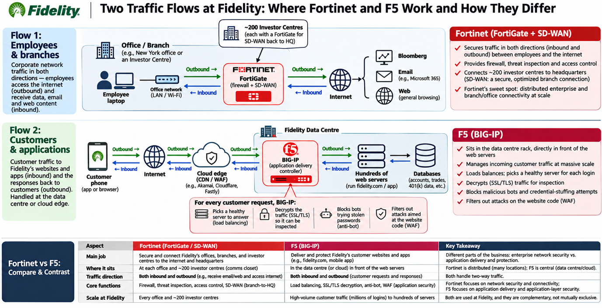
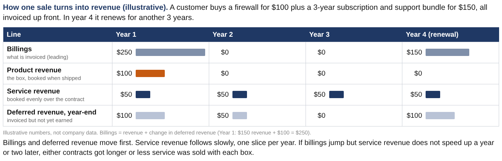
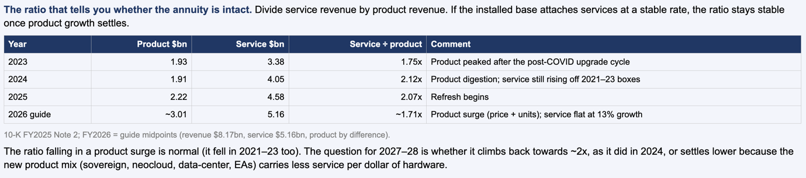
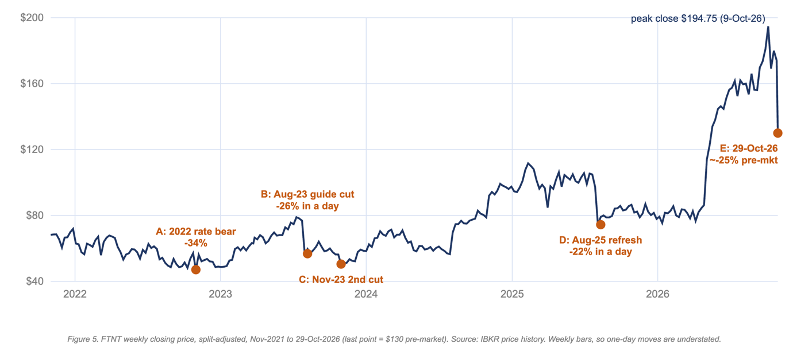

**Basket: Cybersecurity hardware. FTNT and FFIV at equal weight, waiting for an entry point.**

Both names fell about 20% on earnings last week. FFIV fell 20.4% on
28-Oct and 26.3% from the 27-Oct close to the 30-Oct close. FTNT fell
20.1% on 29-Oct (it opened 26.5% down) and closed at \$136.08 on 30-Oct,
30.1% below its 9-Oct peak.

I want to own both, equal weight, as exposure to the cybersecurity
hardware category. I am not picking a winner between them. I am waiting
for an entry point, and the conditions I want to see are set out at the
end.

On a fundamental basis, both will benefit from the cybersecurity trend.
Valuations are lower, but not uniformly cheap. On 30-Oct closes FFIV
trades at 18.6x forward earnings and 5.2x EV/sales. FTNT trades at 36.3x
and 12.2x.

**Fortinet and F5 have one key advantage: their businesses are anchored
in physical infrastructure**, making them harder for frontier AI labs to
disrupt. You can vibe-code software, but you can’t vibe-code a box or a
chip into existence.

**The downside is greater exposure to hardware spending cycles**. That
helps explain F5’s lower multiples against software-centric peers like
Cloudflare (189.9x forward P/E, 39.5x EV/sales) and Zscaler (48.5x,
11.1x). For Fortinet it only partly holds. FTNT is cheaper than Zscaler
on forward P/E but dearer on EV/sales, and it is far above FFIV on both.

I believe cybersecurity hardware deserves a place in a thematic cyber allocation. The moat isn’t the hardware itself. It’s being physically in
the data path inside the customer’s own building. Given the current
cybersecurity environment, every company will need that. The two names
do different jobs in that data path (Figure 1), so owning both gives me
the category rather than a bet on one company.

## What AI cannot easily replicate

- **Installed position.** Banks and governments route customer requests
  through BIG-IP. Ripping out the front door of a trading app is a
  career risk for a CIO, however cheap the alternative code is.

- **Accumulated configuration.** Banks have years of custom iRules
  (BIG-IP’s traffic scripts) and policies. AI can help translate them,
  but someone still has to test and own the migration.

- **Physical custody.** Sovereignty and regulation increasingly require
  the control point to sit in a facility the customer owns. A frontier
  lab can’t ship a certified appliance into a central bank’s data
  centre.

- **Throughput at line rate.** Decrypting traffic cheaply at line rate
  needs purpose-built silicon (F5’s FPGA logic, Fortinet’s ASICs).
  That’s a supply-chain and silicon advantage, not a coding one. One
  caveat: systems were only \$923m of F5’s \$3,417m FY26 revenue (27%),
  so the silicon moat covers a minority of F5’s business.

## What AI does erode

- **The software itself is getting cheaper to write.** Open-source
  proxies like Envoy and HAProxy, and new entrants, will close feature
  gaps faster. F5 itself says that in the last three months AI helped it
  implement engineering fixes on its own code base that would previously
  have taken seven years of work. Cuts both ways.

- **Rule-writing is commoditising.** Signature and rule production used
  to be a vendor’s job. The WAF that adapts by itself (F5’s AI WAF,
  Cloudflare’s equivalents) becomes table stakes, not a differentiator.

- **Hardware isn’t the only route into the data path.** Cloudflare and
  Akamai sit there without a box. Their moat is a global network that is
  also impossible to vibe-code. So “in the data path” can be won without
  hardware.

# Compare and contrast FTNT vs F5

*Figure 1. Two traffic flows at a large financial firm, using Fidelity as the example: where Fortinet and F5 work and how they differ. Illustrative only. It is not based on Fidelity disclosures, and details such as the ~200 investor centres are indicative.*

**FTNT sweet spot.** Hospitals, factories, universities, retail chains:
the left side is huge. Thousands of devices on campus (scanners,
infusion pumps, production-line controllers, cameras) plus many sites to
connect. That’s Fortinet’s sweet spot: firewalls between network zones,
industrial security, and SD-WAN to link branches.

**F5 sweet spot.** Banks, brokers, airlines, e-commerce, government
portals: the right side is huge, because the business is the website and
the app. That’s F5’s sweet spot. Their pitch since 2025 has been that a
bank with apps in its own data centres, in AWS and at the edge should
write one security policy, not three.

**The PHP flaws.** The event is php2shell: two critical
remote-code-execution flaws in PHP (CVE-2026-109618 and
CVE-2026-109619), disclosed and fixed on 21-Oct-2026. Cloudflare had WAF
rules live about 9 hours before disclosure, including for free plans. In
my opinion, the primary beneficiaries of events like this are the edge
players, Cloudflare (\$NET), Akamai (\$AKAM) and Fastly (\$FSLY),
because a cloud WAF can push one rule to every customer at once. To be
fair, F5’s CEO cited the same event on the 27-Oct call as a win for F5’s
AI WAF, and Ken Xie also cited the PHP vulnerabilities on Fortinet’s
call. My view is that F5 is trying to grow into this market but for now
mainly serves its own installed base.

## The service annuity: is the installed base still paying?

### First, how these companies make money

Both companies earn money in two ways, and the two behave very
differently.

- **Product (the box).** A one-off sale of a hardware appliance:
  Fortinet’s FortiGate firewall, F5’s BIG-IP. It is booked as revenue in
  the quarter it ships. It is lumpy, because customers only replace
  boxes every few years. This is what drives the hardware cycle.

- **Service (the annuity).** The subscriptions and support that keep the
  box useful: threat-intelligence updates, software updates, technical
  support. Customers pay for as long as the box is in use. It is booked
  as revenue evenly over the contract, slice by slice.

**Why the split matters.** Service is the better business. It repeats,
it is predictable, and it carries much higher gross margin than hardware
(Fortinet’s GAAP product gross margin is 64.4%, and its service margin
is well above that). So product drives revenue growth and the cycles,
while service drives gross profit, cash flow stability and the valuation
multiple.

**One quirk at F5. F5 reports “product” as systems (hardware) plus
software. Part of that software is recurring (term subscriptions and
SaaS), but accounting books much of a term licence’s value up front, so
it lands in product**. That makes F5’s headline service/product ratio
look less recurring than the business really is, which is why I show F5
two ways below.

*Figure 2. How billings, deferred revenue and service revenue relate.
Illustrative numbers, not company data.*

### The ratio: service ÷ product

**What it measures.** For every \$1 of new boxes sold this year, how
many dollars of service the whole installed base paid. 2.0x means \$2 of
service for every \$1 of boxes.

**How to read a change:**

- **Ratio rising:** service is growing faster than box sales. The
  business is becoming more recurring (or hardware sales are slow).

- **Ratio falling because product boomed:** not bad in itself. Many new
  boxes went out, and each should bring service revenue over the next
  few years. The ratio should climb back as they start paying.

- **Ratio falling because service weakened:** bad. Customers are buying
  less service per box, or not renewing.

Both ratios fell in the latest year. In both cases product boomed,
service did not shrink. The question for 2027–28 is whether the
boom-year boxes bring the usual amount of service with them.

| **Fiscal year** | **FTNT service / product**                        | **F5 service / product (headline)** | **F5 recurring / non-recurring** |
|-----------------|---------------------------------------------------|-------------------------------------|----------------------------------|
| FY2021          | 1.66x                                             | n/a                                 | n/a                              |
| FY2022          | 1.48x                                             | n/a                                 | n/a                              |
| FY2023          | 1.75x                                             | 1.11x                               | 2.61x                            |
| FY2024          | 2.12x                                             | 1.21x                               | 3.34x                            |
| FY2025          | 2.07x                                             | 1.05x                               | 2.74x                            |
| FY2026          | about 1.71x (guide midpoint, TTM to Sep-26 1.74x) | 0.91x                               | 2.30x                            |

*FTNT years end 31-Dec, F5 years end 30-Sep. F5 recurring = services +
term subscription + SaaS. Non-recurring = systems + perpetual licences.
FTNT service is FortiGuard subscriptions plus FortiCare support, so it
is closer to a true annuity measure than F5’s headline ratio. Source: company 10-Ks and 8-Ks.*

**In plain terms:**

- **FTNT, 2.12x to about 1.71x.** Fortinet sold far more boxes in 2026
  (product about +36% at the guide midpoint) while service grew about
  13%. The base is still paying, but service is not keeping pace with
  the boom.

- **F5 headline, 1.21x to 0.91x.** Systems grew 31% in each of FY25 and
  FY26 while services grew about 3%. Same story: a hardware refresh
  outran the annuity.

- **F5 with software counted as recurring, 3.34x to 2.30x.** Still well
  above 1x, so most of F5’s revenue is recurring. It fell for the same
  reason, the hardware refresh.

The service revenue you see this quarter is the slow release of
contracts signed in the past (Figure 2). So there are two stages to
watch.

- **Leading indicators (signed or invoiced, not yet earned).** These
  tell you what service revenue should look like over the next one to
  three years. **Billings** is what was invoiced this period (revenue
  plus the change in deferred revenue). **Deferred revenue** is cash
  invoiced for service not yet delivered. It sits on the balance sheet
  and moves into revenue month by month. **RPO** (remaining performance
  obligations) is all contracted revenue not yet recognised, invoiced or
  not. It is the broadest backlog measure.

- **Conversion (earned).** Service revenue on the income statement. This
  is what actually reaches gross profit.

Normally, when billings and deferred revenue grow fast, service revenue
speeds up a few quarters later. If the leading indicators stay strong
but service revenue does not speed up, something is leaking. Two common
causes: longer contracts (a 5-year deal invoiced up front inflates
billings but spreads revenue thinly), or less service sold per box,
which the industry calls lower “attach”.

- **Fortinet: the pipeline is full, but it is turning into revenue more
  slowly.** The leading indicators are healthy: service billings +26% in
  Q3-26, deferred revenue +19.3%, RPO +18.8%. Conversion is not: service
  revenue grew only about 13%, down from 28.1% in FY23, and the FY26
  service guide was cut again in October. The CFO blamed mix. Sovereign
  and networking deals carry less service per dollar of hardware. **Why
  it matters:** service is Fortinet’s high-margin, recurring profit
  engine. If attach is structurally lower, every new box is worth less
  over its life, and the stock deserves a lower multiple. **The test:**
  FY27 service growth above about 13%, which management says it will
  deliver.

- **F5: stable, but barely growing.** Services grew 2.8% in FY26 and are
  guided to low to mid single digits for FY27. The leading indicators
  are better: deferred revenue +10.3% to \$2,204.4m, RPO \$2.2bn at
  Jun-26, term subscriptions +14% on “strong renewal rates”. **Why it
  matters:** F5’s growth in the last two years came from a one-off
  hardware refresh (systems +31% in each of FY25 and FY26). When the
  refresh ends, software subscriptions have to carry growth. The base is
  not leaking (2.30x with software counted as recurring). It is just not
  growing much.

## Growth and AI, side by side

The rows below split the same revenue in different ways. Quick
definitions:

- **Revenue growth:** total sales booked in the period, product plus
  service.

- **Billings growth:** what was invoiced. It runs ahead of revenue
  because multi-year subscriptions are invoiced up front and earned
  later (Figure 2). Fortinet discloses it, F5 does not. About 10 points
  of Fortinet’s Q3 billings growth came from price rises, not more
  units.

- **Hardware growth:** the box line. Fortinet calls it “product” (mainly
  FortiGate appliances). F5 calls it “systems” (BIG-IP hardware). F5’s
  separate software line is not in this row.

- **Service growth:** subscriptions and support from the installed base,
  the annuity.

- **FCF / non-GAAP net income:** how much reported profit turns into
  cash. Above 100% means cash runs ahead of profit, usually because
  customers prepay multi-year subscriptions. That is Fortinet’s 146%.
  F5’s weak Q4 cash reflects an inventory build and supplier
  prepayments.

- **Disclosed AI metric:** whether the company puts a number on AI
  demand at all.

**The read:** Fortinet grows faster on every line and converts more
profit into cash. F5 is the only one that puts a number on AI. Neither
has shown that AI revenue is recurring yet.

| **Metric**                | **Fortinet (FTNT)**                                                                                       | **F5 (FFIV)**                                                                                         |
|---------------------------|-----------------------------------------------------------------------------------------------------------|-------------------------------------------------------------------------------------------------------|
| Latest revenue growth     | Q3-26 +20.5%, 9M-26 +22.1%                                                                                | FY26 +10.6%, Q4 FY26 +13.2%                                                                           |
| Billings growth           | Q3-26 +29.2% (about 10 pts from price rises)                                                              | Not disclosed                                                                                         |
| Hardware growth           | Q3-26 product +36.8%                                                                                      | FY26 systems +31%                                                                                     |
| Service growth            | Q3-26 +12.7%, service billings +26%                                                                       | FY26 +2.8%, service billings not disclosed                                                            |
| FCF / non-GAAP net income | About 146% (9M-26)                                                                                        | 86% (FY26), Q4 FCF only \$91m                                                                         |
| Disclosed AI metric       | None. No AI revenue, AI bookings or AI customer count                                                     | Direct AI bookings “well over \$100 million” in FY26, 200+ direct AI customers                        |
| AI products and wins      | FortiAIGate, FortiGuard Inline AI Security Service, FortiSOC agent. Unnamed 7-figure and 8-figure AI wins | AI data delivery, AI runtime security, AI factory load balancing. Named customers Indosat and Telenor |

*Source: company releases, 10-Qs and call transcripts.*

**Is F5’s AI recurring or one-off?** It cannot be determined from what
F5 discloses. F5 does not split AI bookings into hardware, software and
services. Management says the majority is AI data delivery inside BIG-IP
deals, which points to a sizeable hardware share, but that is inference.
“Well over \$100 million” is also only a few percent of \$3.4bn revenue.
Neither company has shown that AI is a recurring revenue stream yet.

### Latest guidance

**What to look at:** F5 guides revenue +8% to +9% but EPS only +3% to
+5%, so margins are shrinking (component costs). Fortinet raised its
billings guide for the third time but cut service, the same
leading-vs-conversion gap described above. Margin percentages fall when
memory and component costs rise faster than prices.

| **Item**                  | **F5 FY2027 guide (27-Oct-2026)**                                                   | **Fortinet guide (28-Oct-2026)**                                                                                                                             |
|---------------------------|-------------------------------------------------------------------------------------|--------------------------------------------------------------------------------------------------------------------------------------------------------------|
| Revenue                   | +8% to +9% (about \$3,690m to \$3,725m)                                             | FY26 \$8.125bn to \$8.215bn (+19.5% to +20.8%). Q4 \$2.155bn to \$2.245bn (+13.1% to +17.8%)                                                                 |
| Billings                  | Not guided                                                                          | FY26 \$9.568bn to \$9.718bn (+26.7% to +28.7%), raised for the third time. Q4 \$2.775bn to \$2.925bn (+20% at midpoint)                                      |
| Service                   | Low to mid single digit growth                                                      | FY26 \$5.15bn to \$5.17bn (+12.4% to +12.9%), cut from \$5.18bn to \$5.22bn                                                                                  |
| Hardware                  | Systems “upper single digit”, stronger in H1. H2 replacement bookings expected down | Q4 product implied about \$778m to \$888m (+12.5% to +28.5%)                                                                                                 |
| Non-GAAP gross margin     | 80.5% to 82.5%, down from 84.0% (component costs)                                   | FY26 79.7% to 80.3%. Q4 78% to 80%                                                                                                                           |
| Non-GAAP operating margin | 33% to 35%, vs 35.1% in FY26                                                        | FY26 36.5% to 37.5%, vs 35% in FY25                                                                                                                          |
| Non-GAAP EPS              | \$18.00 to \$18.30, only +2.9% to +4.6%                                             | FY26 \$3.54 to \$3.58 (+28% to +30%)                                                                                                                         |
| Next period               | Q1 FY27 revenue \$875m to \$895m, EPS \$4.25 to \$4.37, gross margin 81.5% to 82.5% | FY27 qualitative only: billings and revenue to outpace TAM growth (about 16%), service growth higher than 2026 (“improved growth rates”, not “acceleration”) |

*Growth rates are calculated from company guides. F5 fiscal year ends 30-Sep.*

# FTNT

Doc: FTNT primer

- **Hardware is peaking, not breaking.** Product revenue grew 37% in Q3.
  IR said about 10 percentage points of billings growth came from price
  rises. Cheap inventory (components, memory) is used up: the CFO says
  inventory is “normal” from Q3 and lead times are getting longer. GAAP
  product gross margin fell from 67.7% to 64.4%. Q4 billings are guided
  to +20% at the midpoint, against +29% actual growth in Q3.

- **Software and services lag.** Service revenue grew 13% and the
  full-year service guide was cut, to \$5.15bn to \$5.17bn from \$5.18bn
  to \$5.22bn. This is the third service-guide cut since Aug-2025. In
  July the CFO had said service growth would pick up in the second half.

- **The real worry is attach.** New sovereign, neocloud and
  large-enterprise deals carry less service per dollar of hardware. The
  CFO said “Sovereign has less services” and conceded more discounting
  between hardware and services.

- **Rivals in cloud security are pulling ahead.** Gartner moved Fortinet
  from Leader to Challenger in its Magic Quadrant for SASE Platforms,
  published 28-Jul-2026. That is three months old, not new news. There
  are four Leaders: Netskope, Cato Networks, Palo Alto Networks and
  Zscaler. Fortinet is still a Leader in the 2026 Magic Quadrant for
  Hybrid Mesh Firewall. Fortinet now reports a merged “SASE Firewall”
  pillar, which grew 34% in Q2 and 31% in Q3. Unified SASE billings grew 35% in Q2.
  AI-driven security operations billings growth slowed to 15% from 25%
  in one quarter.

- **Test:** the 2027 service guide, due with the Q4 print in early February 2027 (estimated, last year it was 5-Feb-2026). The
  CFO has already said 2027 service growth will be higher than in 2026.

*Figure 3. FTNT service-to-product ratio. Source: 10-K FY2025 Note 2,
FY2026 guide midpoints.*

**Note on Figure 3:** strictly, it fell in 2021 and 2022 (1.83x, 1.66x, 1.48x) and bounced
back in 2023 (1.75x). The point stands: the ratio drops in hardware
booms and recovers afterwards. 

My FTNT case hinges on 1) hardware continuing to deliver growth and 2)
services sales inflecting. Management cites timing (“It’s really a
timing issue”), not market share loss, as the services headwind. But it
also conceded mix, so I want to see the inflection before building exposure to FTNT. The upcoming \$ANT IPO (Anthropic filed its
S-1 on 26-Oct-2026, no date set) and this sector’s historical pattern
are reasons to be patient. The valuation is more attractive than it was
a month ago. I can wait for the mid-terms, the ANT IPO and the next
prints, and see how the stock trades.

## What history tells us

**The point in one line:** Fortinet’s big earnings-day crashes have been
about when customers buy boxes, not about customers leaving. The stock
has always recovered, usually within a year.

**Four patterns:**

- **Crashes are about hardware timing.** Every big drop I checked (2016,
  2023, 2025, 2026) came from a hardware or billings slowdown. In none
  of them did Fortinet lose its installed base. (Four other 10%+
  earnings-day falls, in 2015, 2018 and twice in 2022, have causes I
  have not checked.)

- **Most of the damage happens on day one.** The first day is usually
  well over half the total fall. The exception is when management cuts
  guidance a second time, as in 2023. Then the stock kept sliding for
  another three months.

- **Recovery takes months, not years.** Usually 4 to 13 months back to
  the pre-crash price. The outlier is 2015, which took about two years.

- **Services never drove a recovery.** The rebounds came from margins
  and buybacks (2023–24) or a new product cycle (2025–26), on my reading. Service growth has slowed the whole time.

| **Reaction day**                           | **Day-1 move** | **Total drawdown** | **Day-1 share** | **Back to pre-print close** |
|--------------------------------------------|----------------|--------------------|-----------------|-----------------------------|
| 23-Oct-2015                                | -19.3%         | -44.9%             | 43%             | 15-Dec-2017 (25.8 months)   |
| 12-Oct-2016                                | -10.1%         | -16.1%             | 63%             | 3-Feb-2017 (3.7 months)     |
| 4-Aug-2023 (billings guide cut)            | -25.1%         | -34.6%             | 72%             | 27-Aug-2024 (12.8 months)   |
| 7-Aug-2025 (billings raised, service cut)  | -22.0%         | -23.0%             | 96%             | 7-May-2026 (9.0 months)     |
| 29-Oct-2026 (billings raised, service cut) | -20.1%         | -21.8% so far      | 92% so far      | Pending                     |

*Day-1 share = the first day’s fall as a share of the total fall. Yahoo daily closes, split-adjusted. The Nov-2023 second cut
(-12.3%) is part of the Aug-2023 episode.*

**What it means for today:**

- **Base case is 2025.** Same setup: billings guide raised, service
  guide cut, stock down about 22% in a day. It got back to the pre-crash
  price in 9 months and roughly doubled within a year.

- **Bear case is 2023.** It applies only if Fortinet cuts its billings
  guide, which it has not done. Then expect a second leg down, about a
  third off the peak in total, and about a year to recover.

- **Where today is worse than 2025.** The stock starts from a higher
  valuation (about 36x forward earnings vs about 28x at end-FY25, per secondary data). And part of this year’s hardware boom
  comes from price rises and cheap inventory running out, which looks
  like 2022–23.

- **So the one signal to watch is the billings guide.** Held or raised
  points to the 2025 path. Cut points to the 2023 path.

*Figure 4. FTNT weekly closing price, split-adjusted, Nov-2021 to
29-Oct-2026. Source: IBKR price history. Weekly bars, so one-day moves
are understated.*

**Note on Figure 4:** on daily closes the Aug-23 first-day fall was 25.1%. On 29-Oct-26 FTNT opened at \$127.96 (-26.5%), closed at \$139.10 (-20.1%), and closed at \$136.08 on 30-Oct. The peak was \$194.75 on 9-Oct-26.

# FFIV

FFIV is the other half of the basket. Like FTNT, it is security
hardware, but it does a different job in the data path (Figure 1). F5’s
FY26 guidance history is a ladder of total revenue growth raises:

| **Date**                  | **Oct-25**                | **Jan-26** | **Apr-26** | **Jul-26**  | **Actual** |
|---------------------------|---------------------------|------------|------------|-------------|------------|
| FY26 revenue growth guide | 0–4% (cut for the breach) | 5–6%       | 7–8%       | about 9–10% | +10.6%     |

*Source: F5 8-K releases.*

The FY27 starting guide of 8–9% is higher than last year’s starting
point, but last year’s start was depressed by the Oct-2025 breach. The
FY25 start was 4–5%. The ladder also did not protect the stock. FFIV
fell 20.4% on 28-Oct, as hard as FTNT, and kept sliding to 26.3% down by
the 30-Oct close. The market sold the margin and EPS guide: gross margin
down to 80.5–82.5% from 84.0% on component costs, EPS up only 3–5%, and
H2 replacement bookings expected down. The “hardware peaking, services
lag” critique I aimed at FTNT fits F5 too. In FY26 systems grew 31% and
services 3%.

In the most recent call, management highlighted three direct AI use
cases:

- **AI data delivery.** In one APAC conglomerate example, BIG-IP is “the
  single high throughput control point for data moving between storage
  and GPU compute”. Customers deployed 29.2 Tb of F5-powered AI data
  delivery capacity in Q4 alone, up nearly 250% YoY, led by banking,
  financial services and healthcare. That is capacity deployed, not
  revenue. F5’s direct AI bookings were “well over \$100 million” for
  FY26. (Peers: storage vendors’ own front ends, NetScaler.)

- **AI runtime security.** When an enterprise exposes an AI model or
  agent, attackers try prompt injection, jailbreaks and data
  exfiltration. One of the world’s largest financial institutions used
  F5 Bot Defense to block personal AI agents logging into customer
  accounts at the front door. Several other large enterprises, not named
  as banks, do the same. These are outside agents arriving at the bank’s
  front door, which is exactly where F5 sits. The risk is that F5 is up
  against bundlers like PANW, CSCO and CRWD, which all want to sell into
  this layer.

- **AI factory load balancing.** Inside an AI data centre, inference
  requests must be routed to the GPU that can answer fastest, with
  tenants isolated from each other. (Competitors: NVDA’s own software,
  open-source inference gateways and hyperscaler native stacks.)

Whether this AI demand turns into recurring revenue cannot be determined
from F5’s disclosures. I will watch deferred revenue, RPO and term
subscriptions rather than the bookings headline.

# Trade-offs

- Equal weight reduces single-name risk. FTNT’s risk is service
  conversion and SASE share. F5’s is the end of a refresh cycle and
  margin pressure. Owning both means neither alone decides the outcome.

- It does not reduce sector risk. Both fell about 20% on earnings in the
  same week (FTNT -20.1%, FFIV -20.4%), and FTNT also fell 5.9% on
  28-Oct, the day after F5 reported, before its own print. Both depend
  on hardware cycles (FTNT product +37%, F5 systems +31%), and component
  costs are squeezing both margin guides.

- Equal weight in dollars is not equal valuation risk. FTNT trades at
  about twice F5’s forward P/E (36.3x vs 18.6x) and more than twice its
  EV/sales (12.2x vs 5.2x).

# Entry plan and kill triggers

I would build exposure when I see the conditions below. These are what I am waiting for, not price targets. The thresholds are drawn from the company guides, and they are my framing, not
company targets.

### FTNT: what I want to see before building

- Management comments on the service trajectory at the BMO (12-Nov), UBS
  (2-Dec) and Barclays (9-Dec) conferences.

- Q4 billings at or above the guide, which keeps Aug-2025 as the
  analogue rather than Aug-2023.

- A 2027 service guide above 2026’s about 12.6%, as the CFO has
  pre-signalled.

**Kill triggers:** Q4 billings below the \$2.775bn low end, any cut to
the billings guide or FY27 billings outlook, a 2027 service guide not
above about 12.6%, or SecOps billings growth below 15%.

### FFIV: what I want to see before building

- Q1 FY27 results (late January 2027, estimated) showing the H1
  systems refresh holding, revenue within \$875m to \$895m and gross
  margin within 81.5% to 82.5%.

- Cash conversion recovering from Q4’s \$91m FCF as the inventory build
  and supplier prepayments unwind.

**Kill triggers:** Systems growth decelerating faster than “upper single
digit”, gross margin below the 80.5% low end, or a new exploited BIG-IP
vulnerability tied to the source code stolen in the Oct-2025 breach.

### Both: category checks

**Kill trigger:** evidence that php2shell-style events push WAF spend to
edge vendors rather than appliances. Cloudflare’s print on 5-Nov is the
first test.

### Catalysts

| **Date (US)**                | **Event**                                                | **Why it matters**                                                    | **Status**                                 |
|------------------------------|----------------------------------------------------------|-----------------------------------------------------------------------|--------------------------------------------|
| Thu 5-Nov-2026, after close  | Cloudflare Q3 earnings                                   | Edge WAF demand after php2shell                                       | Confirmed                                  |
| Thu 12-Nov-2026              | FTNT at BMO Technology and Innovation Leaders Conference | First management comment after the guide                              | Confirmed (Q3-26 8-K)                      |
| Wed 18-Nov-2026, after close | PANW fiscal Q1                                           | SASE and firewall read-through                                        | Estimated date              |
| Tue 24-Nov-2026, after close | Zscaler fiscal Q1                                        | SASE share read-through                                               | Estimated date              |
| Wed 2-Dec-2026               | FTNT at UBS Global Technology and AI Conference          | Service trajectory comments                                           | Confirmed (Q3-26 8-K)                      |
| Wed 9-Dec-2026               | FTNT at Barclays Global Technology Conference            | Service trajectory comments                                           | Confirmed (Q3-26 8-K)                      |
| Late Jan 2027                | FFIV Q1 FY27 (guide \$875m to \$895m)                    | Whether the H1 refresh holds and gross margin lands at 81.5% to 82.5% | Estimated, last year 27-Jan-2026 |
| Early Feb 2027               | FTNT Q4-26 and 2027 guide                                | 2027 service guide                                                    | Estimated, last year 5-Feb-2026  |
| Not set                      | Anthropic (ANT) IPO pricing                              | Sector flows and AI-security sentiment                                | S-1 filed 26-Oct-2026, date not set |

*Source: company releases and conference announcements. Dates marked estimated are based on last year's timing.*

# Sources

**Key sources**

- Fortinet Q3-26 release (8-K ex99.1):
  https://www.sec.gov/Archives/edgar/data/1262039/000126203926000024/ftntq3-2026ex991.htm

- Fortinet Q3-26 prepared remarks:
  https://fortinet.gcs-web.com/static-files/4c66c3b5-3dc7-4bfa-ab92-c021c681dc7b

- Fortinet Q3-26 call transcript:
  https://stockanalysis.com/stocks/ftnt/transcripts/718650-q3-2026/

- Fortinet FY2025 10-K:
  https://www.sec.gov/Archives/edgar/data/1262039/000126203926000007/ftnt-20251231.htm

- Fortinet Q4-24 release (FY23 and FY24 billings):
  https://www.sec.gov/Archives/edgar/data/1262039/000126203925000007/ftntq4-2024ex991.htm

- F5 Q4 FY26 release (8-K ex99.1):
  https://www.sec.gov/Archives/edgar/data/1048695/000104869526000074/ex991-q426earningsreleasef.htm

- F5 Q4 FY26 call transcript:
  https://www.fool.com/earnings/call-transcripts/2026/10/27/f5-ffiv-q4-2026-earnings-call-transcript/

- F5 FY2025 10-K:
  https://www.sec.gov/Archives/edgar/data/1048695/000104869525000157/ffiv-20250930.htm

- Gartner SASE 2026 Leaders:
  https://www.sdxcentral.com/news/gartner-sase-2026-rankings-netskope-leads-cato-networks-leaps-and-palo-alto-networks-falls/

- php2shell, Cloudflare:
  https://blog.cloudflare.com/php-vulnerabilities-waf-protection/ and
  CERT: https://www.kb.cert.org/vuls/id/763488

- Anthropic S-1:
  https://www.sec.gov/Archives/edgar/data/2130357/000162828026067168/anthropicpbc-sx1.htm

- Prices: https://query1.finance.yahoo.com/v8/finance/chart/FTNT and
  https://query1.finance.yahoo.com/v8/finance/chart/FFIV

- Valuation snapshot (S&P data, secondary):
  https://stockanalysis.com/stocks/ftnt/statistics/ and
  https://stockanalysis.com/stocks/ffiv/statistics/
