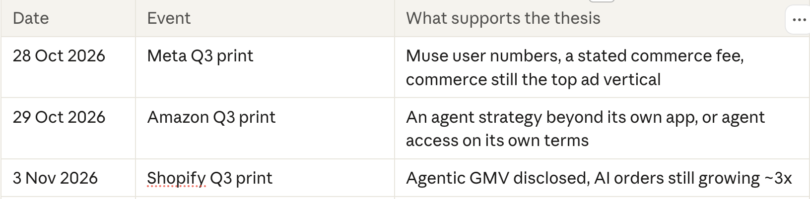
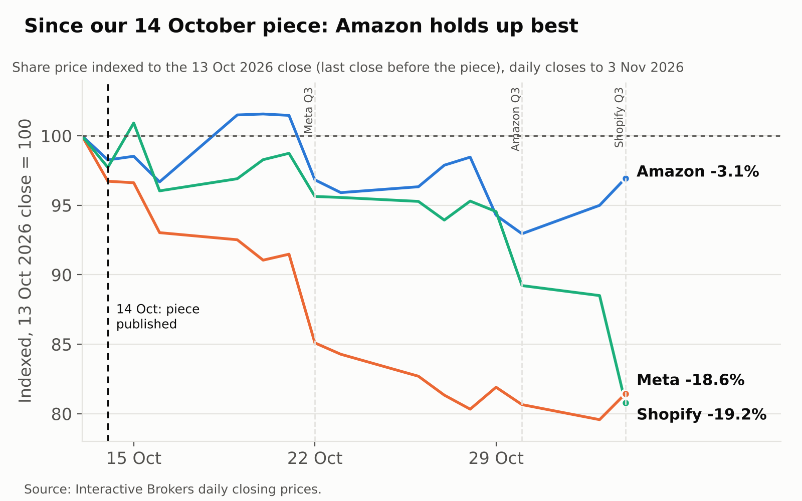
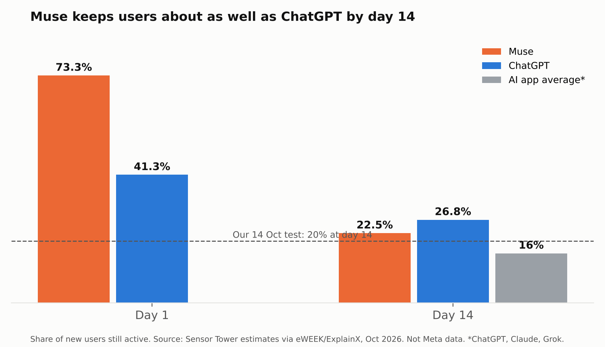
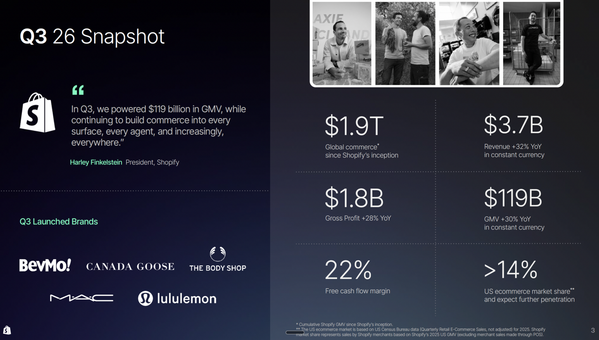
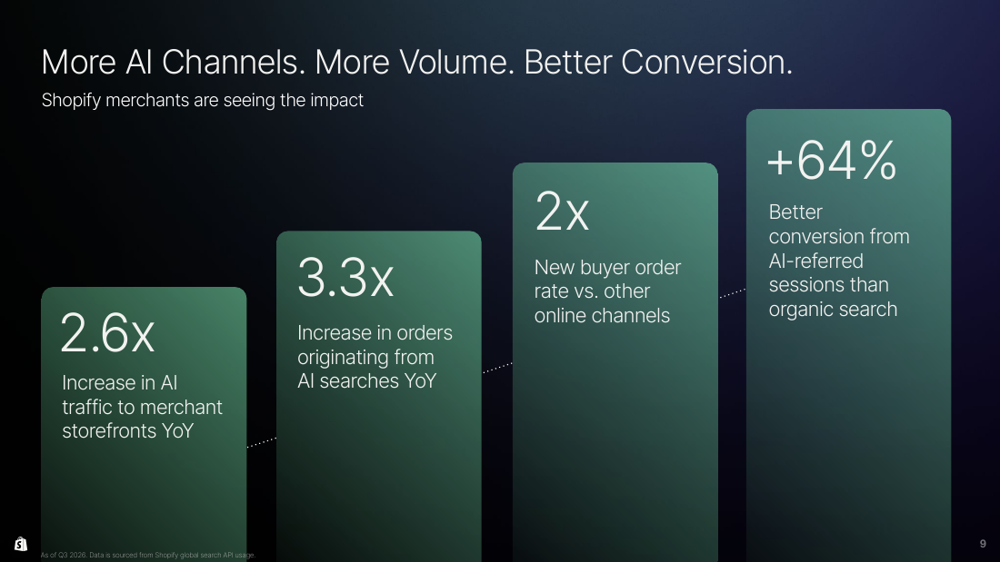

*Follow-up to [The Mall Is Closing](/research/the-mall-is-closing/) (14 October 2026). Prices are IBKR closes to 3 November 2026.*

**Last time, these are the things we are tracking for this earning season:**

- **Amazon:** the door to outside agents is open, and the negotiation is now about price.
- **Meta:** Muse works as a shopping agent, but it is costing Meta its free cash flow. Affected by unexpected $95bn dilution.
- **Shopify:** the business delivered and Shop Pay won inside the agents, but the stock had priced to perfection and fell.

**What we did not see coming: the market turned against AI spending.** Since 13 October the backdrop changed more than the companies did:

- **The CoreWeave scare.** CoreWeave fell about 25% in the week to 16 October, with $51bn+ of debt and bond yields above 15%. Chip stocks had their worst week since April 2025 (SMH -10%), and investors started asking who pays for the AI build-out.
- **Negative free cash flow became the story.** Meta's first cash burn in over a decade and its $95bn equity raise, and Amazon's -$42bn trailing free cash flow, landed in the middle of that scare.
- **Midterms and the Iran war.** Election risk on 3 November and oil swings around the war added volatility. The Nasdaq-100 entered its third correction of 2026.

In that tape, anything short of perfect was sold.

## $AMZN: open to agents, on Amazon's terms

| Q3 2026 | Value | Street expected | Change |
| --- | --- | --- | --- |
| Net sales | $201.9bn | $202.3bn (miss) | +12% (+16% ex Prime Day shift) |
| EPS | $1.89 | $1.97 (miss) | from $1.95 |
| Operating income | $28.1bn |  | +61% |
| Q4 operating income guide, midpoint | $31.0bn | $33.0bn (below) |  |
| AWS revenue | $46.0bn | $45.7bn (beat) | +39% |
| AWS backlog | $578bn |  |  |
| Advertising | $19.6bn |  | +12% (about +20% ex Prime Day) |
| Alexa for Shopping users, 12 months | 400m |  | from 350m |
| Capex, 2026 guide | about $220bn |  | 2027 "meaningfully higher" |
| Free cash flow, trailing 12 months | -$42.4bn |  | from +$14.8bn |
| Stock, next day | -1.4% |  |  |

**Amazon revenue by segment, last six quarters ($bn, YoY)**

| Quarter | North America | International | AWS | Total | Ads | Subscriptions |
| --- | --- | --- | --- | --- | --- | --- |
| Q3 2026 | 112.9 (+6%) | 43.1 (+5%) | 46.0 (+39%) | 201.9 (+12%) | 19.6 (+11%) | 14.0 (+11%) |
| Q2 2026 | 116.2 (+16%) | 42.2 (+15%) | 42.2 (+37%) | 200.6 (+20%) | 19.8 (+26%) | 13.7 (+12%) |
| Q1 2026 | 104.1 (+12%) | 39.8 (+19%) | 37.6 (+28%) | 181.5 (+17%) | 17.2 (+24%) | 13.4 (+15%) |
| Q4 2025 | 127.1 (+10%) | 50.7 (+17%) | 35.6 (+24%) | 213.4 (+14%) | 21.3 (+23%) | 13.1 (+14%) |
| Q3 2025 | 106.3 (+11%) | 40.9 (+14%) | 33.0 (+20%) | 180.2 (+13%) | 17.7 (+24%) | 12.6 (+11%) |
| Q2 2025 | 100.1 (+11%) | 36.8 (+16%) | 30.9 (+17%) | 167.7 (+13%) | 15.7 (+23%) | 12.2 (+12%) |

*Source: Amazon quarterly earnings releases.  Ads and subscriptions are revenue types inside the North America and International segments, not extra segments.*

- **North America / International:** the online store, third-party seller fees, ads, Prime and physical stores, split by where the customer is.
- **AWS:** cloud computing, AI chips and services, sold to businesses worldwide. 23% of sales but most of the profit.
- **Ads:** sponsored listings and video ads, the shelf space agents can walk past.
- **Subscriptions:** Prime fees, music, video and other digital subscriptions.

**Market read: an AWS quarter.** Amazon missed on EPS, retail sales and Q4 guidance, and the stock fell as much as 7% before trading opened. AWS beat and Jassy's 2027-28 growth target pulled it back to -1.4% by the close. The focus was AWS growth and cash burn, not retail.

> **Andy Jassy, CEO:** *"With our continued pace of innovation, new core and AI functionality, enterprises wanting to run their core and AI workloads in AWS, and the amount of capacity that we're adding each year, **we believe that AWS can grow north of 40% in each of 2027 and in 2028 and be a trillion-dollar revenue business in the next five to 10 years.**"*

**Back to agents.**

No analyst asked about shopping agents. Jassy raised it himself in prepared remarks:

> **Andy Jassy, CEO:** *"**Though we anticipate working with horizontal agents**, we believe Alexa for Shopping is going to be the primary shopping agent customers use to shop Amazon."*

> **Andy Jassy, CEO:** *"The natural question is whether agentic shopping from external horizontal agents is meaningfully impacting Amazon Ads. The answer is no. Few customers are doing much shopping this way yet, as the experience is still not great nor more convenient than coming to a retailer directly to research or one-click order there."*

Mark Mahaney (Evercore ISI) asked about fresh grocery, where Meta has paired Muse with Instacart:

> **Andy Jassy, CEO:** *"When we look at the difference between the total amount of spend that we think our consumers and customers are spending on items that we could serve them on versus what they spend on us, the biggest difference is grocery."*

**What it means:** Amazon is not refusing outside agents, it is setting the price. Meta said the same from the other side. Bullish, and the agent catalyst is closer than on 14 October.

## $META: Muse works, the bill arrives

| Q3 2026 | Value | Street expected | Change |
| --- | --- | --- | --- |
| Revenue | $64.6bn | $63.35bn (beat) | +26% |
| Q4 revenue guide, midpoint | $74.5bn | $73.6bn (above) |  |
| Operating income | $13.0bn |  | -37% (+11% ex $9.89bn legal charge) |
| EPS | $3.83 ($7.40 ex legal charge) | $5.46 (miss reported, beat ex charge) | from $1.05 |
| Capex | $34.9bn |  |  |
| Free cash flow | -$2.1bn |  | from +$10.6bn |
| Capex, 2026 guide | $135-145bn |  | 2027 not given |
| Muse set-ups, first 6 weeks | 10m+ |  | US and Canada |
| Muse daily users | about 2.5m |  | 25% of set-ups |
| Muse users who shop | 25%+ of weekly actives |  | $200+ average order |
| Stock, next day | -7.0% |  |  |

*Street estimates: [StockStory via FinancialContent](https://markets.financialcontent.com/stocks/article/stockstory-2026-10-21-metas-nasdaqmeta-q3-2026-sales-top-estimates-quarterly-revenue-guidance-slightly-exceeds-expectations).*

**Meta revenue by segment, last six quarters ($m, YoY)**

| Quarter | Advertising | Other | Family of Apps | Reality Labs | Total |
| --- | --- | --- | --- | --- | --- |
| Q3 2026 | 63,061 (+26%) | 1,097 | 64,158 | 443 | 64,601 (+26%) |
| Q2 2026 | 59,363 (+27%) | 1,007 | 60,370 | 431 | 60,801 (+28%) |
| Q1 2026 | 55,024 (+33%) | 885 | 55,909 | 402 | 56,311 (+33%) |
| Q4 2025 | 58,137 (+24%) | 801 | 58,938 | 955 | 59,893 (+24%) |
| Q3 2025 | 50,082 (+26%) | 690 | 50,772 | 470 | 51,242 (+26%) |
| Q2 2025 | 46,563 (+21%) | 583 | 47,146 | 370 | 47,516 (+22%) |

*Source: Meta quarterly earnings releases.*

- **Family of Apps:** Facebook, Instagram, WhatsApp, Messenger and Threads. Advertising is 98% of total revenue. Other is WhatsApp business messaging, Meta Verified and subscriptions such as Meta One.
- **Reality Labs:** Quest headsets and AI glasses, under 1% of revenue and losing about $4bn a quarter.
- **Muse revenue** does not show yet. When the transaction fee starts, it would most likely land in Other.

**Market read: the funding, not the quarter.** Revenue was strong, but the stock fell 7.0% after free cash flow turned negative and Meta created a non-voting Class C share. Five days later it announced up to **$95bn** of new stock, its largest equity raise ever: about $35bn underwritten now, plus up to $60bn of Class C sold over time ([InvestmentNews](https://www.investmentnews.com/equities/meta-plots-95b-stock-offering-as-ai-spending-drains-cash-flow/268740)). Two readings: it funds the AI buildout, or it helps Zuckerberg. Under the Class C deal he can sell 20% of his new shares, which could cover a bill from California's proposed billionaire tax (Proposition 40), in return for staying resident for eight years ([Investing.com](https://www.investing.com/news/stock-market-news/metas-new-class-c-stock-to-keep-zuckerberg-in-california-fund-ai-spending-spree-4966480)).

| Meta stock | Move |
| --- | --- |
| 22 Oct, day after the print and Class C | -7.0% |
| 23-28 Oct, around the $95bn raise | -4.7% |
| 13 Oct to 3 Nov | -18.6% |

On the earnings call, five days before the raise:

> **Susan Li, CFO:** *"We do not have any specific financing plans to announce at this time, but we thought it was prudent to establish the appropriate capital structure framework to ensure that we have access to a diverse pool of funding sources."*

**Back to agents.**

Twitter's drop-off claim is half right. Muse loses three in four new users by day 14, but that beats the AI app average and passes our 20% test. Daily users of about 2.5m are a quarter of our 10m test, and time in app is 7.5 minutes a day against ChatGPT's 23 ([Similarweb via OfficeChai](https://officechai.com/ai/is-metas-muse-usage-is-falling-after-the-initial-buzz-what-the-data-shows/)).

Eric Sheridan (Goldman Sachs) asked how Meta handles "aggregators or suppliers that don't want agents to interact with their platforms or their services":

> **Mark Zuckerberg, CEO:** *"Not everyone wants to be an early adopter. That is fine. **We will work with folks on the terms that makes sense for them.**"*

> **Susan Li, CFO:** *"I think over the long run, this will move towards more permissioned, structured interactions, and that will include **authenticated APIs, approved agent partnerships**, or direct communications between a consumer's personal agent and a business's own agent."*

Mark Mahaney (Evercore ISI) asked whether monetisation has to come faster, and whether the $200 basket includes travel:

> **Mark Zuckerberg, CEO:** *"My guess, I think that we are going to work on monetization somewhat sooner on this than our normal playbook... To your question, that does include travel too."*

In prepared remarks, on the business model:

> **Mark Zuckerberg, CEO:** *"For most people, the product should be free, and **we will build commerce tools so we get paid a fee based on the transactions that we help facilitate. We expect this will be paid for by businesses.**"*

**What it means:** the commission model is stated, the rate is not. Bullish long term, with the funding risk now in the cash flow.

## $SHOP: the rail held, the stock did not

| Q3 2026 | Value | Street expected | Change |
| --- | --- | --- | --- |
| Revenue | $3.74bn | $3.74bn (in line) | +32% |
| GMV | $119.1bn | $120.08bn (miss) | +29% |
| Subscription revenue | $836m | $850m (miss) | +20% |
| Adjusted EPS | $0.49 | $0.47 (beat) |  |
| Gross margin | 47.6% |  | from 48.9%, passes our 47% test |
| Free cash flow margin | 22% |  | from 18% |
| Shop Pay GMV |  |  | +50% |
| Orders from AI search | 3.3x |  | year on year |
| Agentic GMV | not disclosed |  |  |
| Q4 gross profit guide | high-20s growth |  | revenue low 30s |
| Stock, same day | -8.7% |  |  |

**Shopify revenue by segment, last six quarters ($m)**

| Quarter | Merchant solutions (YoY) | Subscription solutions (YoY) | Total | Merchant share |
| --- | --- | --- | --- | --- |
| Q3 2026 | 2,906 (+35%) | 836 (+20%) | 3,742 | 78% |
| Q2 2026 | 2,781 (+37%) | 802 (+22%) | 3,583 | 78% |
| Q1 2026 | 2,420 (+39%) | 750 (+21%) | 3,170 | 76% |
| Q4 2025 | 2,895 (+35%) | 777 (+17%) | 3,672 | 79% |
| Q3 2025 | 2,145 (+38%) | 699 (+15%) | 2,844 | 75% |
| Q2 2025 | 2,024 (+37%) | 656 (+17%) | 2,680 | 76% |

*Source: Shopify quarterly earnings releases, Q4 2025 to Q3 2026 (prior-year columns for Q2 and Q3 2025). Growth rates as stated on each earnings call.*

- **Merchant solutions:** fees that grow with what merchants sell. Mostly payment processing (Shopify Payments, Shop Pay), plus currency conversion, shipping labels, tax, lending (Shopify Capital), point-of-sale hardware and ads. This is where agent orders show up.
- **Subscription solutions:** what merchants pay to use the platform. Monthly plans (Basic to Plus), app and theme sales, domains, and variable platform fees that large Plus merchants pay as their sales grow.

**Market read: good, not perfect, and priced for perfect.** Revenue matched and EPS beat, but GMV and subscription revenue missed, and guidance implies slower growth. At about 87x 2026 earnings, with the Nasdaq-100 in a technical correction, that was enough: -14.9% before the open, -8.7% at the close ([Investing.com](https://www.investing.com/news/stock-market-news/why-is-shopify-stock-tumbling-today-93CH-4994894)).

**Back to agents.**

Most of the agentic content in Shopify's Q3 deck is plumbing: 15 AI and connector launches in eight weeks, from ChatGPT and Claude to Gemini, Copilot, Muse and Grok, so merchants can run their stores from inside the agents. Far less shows growth actually delivered by agent-led traffic. The one slide that does is below, and it gives multiples, not dollars. Still early days, but the signs are positive.

*Source: Shopify Q3 2026 earnings deck, slide 9.*

**How Shopify makes money from Muse and other agents.** No fee from the agent itself. An agent order earns Shopify exactly what a website order earns:

| Revenue line | How an agent order pays | Size today |
| --- | --- | --- |
| Payments (Shopify Payments, Shop Pay) | A cut of every order paid through Shopify, whichever agent sent it | Merchant solutions = 78% of revenue, payments penetration 68% |
| Variable platform fees | Large merchants pay more as their GMV grows | Inside subscription solutions |
| New merchants | Agents suggest Shopify to people starting a store, who then pay a subscription | Not disclosed |
| Shop Pay outside Shopify | In Claude Duet, Instinct and Grok Bot, Shop Pay is the wallet for non-Shopify merchants too | New. Revenue not disclosed |

**So agents grow Shopify through volume, not a new fee**. The last row is the one to watch: it is the first time Shopify gets paid on stores it does not host. Whether Shopify will charge extra for powering agents was asked on the call and not answered.

**During the Q&A session, there are also mentions of agents:**

Samad Samana (Jefferies) asked about Muse and whether economics differ by wallet:

> **Harley Finkelstein, President:** *"I would say it is still quite early. Momentum is certainly strong. The quality of traffic is really, really quite high, and that we think is really, really important. **The agent is really just this new front door here.**"*

Shweta Khajuria (Wolfe Research) asked whether Shopify shares economics with the agents:

> **Jeff Hoffmeister, CFO:** *"If you start, for example, on Muse, and if you as a consumer then do a search which leads to a merchant which is using Shopify, then **the economics to us are exactly the same.**"*

Ken Gawrelski (Wells Fargo) asked about horizontal versus vertical agents:

> **Harley Finkelstein, President:** *"Any agent can complete a checkout with any store... The idea really here is to be too good to ignore."*

Colin Sebastian (Baird) asked whether Shopify would charge more for powering agents. It went unanswered.

**What it means:** Shop Pay is the wallet inside the agents, but agents earn Shopify no extra fee. After a 19% fall the view moves from neutral toward constructive.

## $V: for context, the rail says it is still small

Visa reported fiscal Q4 2026 on 27 October. Its slides carry no agentic material, so the evidence is the call.

| Fiscal Q4 2026 | Value | Change |
| --- | --- | --- |
| Net revenue | $12.1bn | +13% |
| Cross-border e-commerce volume |  | +17% |
| AI partners live in production | nearly 50 | incl. Shop Pay |
| E-commerce transactions tokenized | 60%+ |  |
| FY27 revenue guide | low double digits |  |

In prepared remarks:

> **Ryan McInerney, CEO:** *"As we look at the albeit limited number of agentic transactions today, Visa credentials are being used by consumers, businesses, and agents. **We have nearly 50 AI partners live and in production, including more recently, Shopify's Shop Pay**, with that number expected to double in the coming months."*

Sanjay Sakhrani asked about adoption after Muse and Instinct launched:

> **Ryan McInerney, CEO:** *"I think it is still very early. **If you just look at just even the user numbers that are public for Muse, it is still very early in terms of the number of consumers that are doing this**, and certainly in the big scheme of things in our overall business, it is a very small amount."*

James Faucette asked whether agent volume is incremental and when it shows up in results:

> **Ryan McInerney, CEO:** *"It is still very early. We do have conviction that the opportunity is significant. We do have conviction that there is real incremental opportunities. **But as we think about the next four quarters in 2027, it all remains very small in the big scheme of the enormous size of our business.**"*

> **Ryan McInerney, CEO:** *"Are agents making more purchases at more seller locations because they are optimizing based on value, speed, delivery, whatever it is important to the user? Those are opportunities. I think we remain very excited and have conviction about the opportunities, but I think we all just need to realize that the development of all of this is still quite early."*

**What it means:** the biggest card network sees agent volume as too small to matter in 2027. That fits Jassy's "few customers" and Shopify's "volume is small". The thesis is about direction, not this year's numbers.

## Scorecard: the dated checks from 14 October

| Check | Result | Verdict |
| --- | --- | --- |
| Meta Q3 (21 Oct, not 28 Oct) | Fee model stated, no rate. Commerce top ad vertical | Supports |
| Amazon Q3 (29 Oct) | "Anticipate working with horizontal agents". Ads +12% headline | Mixed |
| Shopify Q3 (3 Nov) | AI orders 3.3x, gross margin 47.6%, no agentic GMV | Supports, partly |
| Meta's partners | Personal Agent Protocol with Walmart, Stripe, Shopify, Sierra | Supports |
| Opt-in data | No update | Open |
| Muse retention and users | Day 14: 22.5% (test 20%). Daily users about 2.5m (test 10m) | Mixed |
| Meta 2027 capex guide | Not given. Free cash flow negative | Open, leaning negative |
| Shop Pay inside Muse | Wallet in Muse, Instinct, Claude Duet, Grok Bot | Supports |
| Amazon and outside agents | No deal yet. Both sides signal terms | Open, leaning positive |
| Holiday season | Starts now | Open |

**Next:** Black Friday data, any Amazon agent deal before Christmas, Meta Q4 and 2027 capex (27 Jan), Amazon Q4 (4 Feb), Shopify Q4 (11 Feb).

## Sources

Primary (earnings materials and transcripts via Quartr):

- [Meta Q3 2026 event: release, 10-Q, slides](https://web.quartr.com/companies/4109/events/718643/overview?utm_source=mcp&utm_medium=referral)
- [Meta Q3 call, Zuckerberg on Muse usage and shopping](https://web.quartr.com/sources/s89650594173648846015671?utm_source=mcp&utm_medium=referral)
- [Meta Q3 call, Zuckerberg on the transaction fee model](https://web.quartr.com/sources/s61994542744151961174203?utm_source=mcp&utm_medium=referral)
- [Meta Q3 call, Li on the Personal Agent Protocol](https://web.quartr.com/sources/s58007793939178131211491?utm_source=mcp&utm_medium=referral)
- [Amazon Q3 2026 event: release, 10-Q, slides](https://web.quartr.com/companies/4762/events/720308/overview?utm_source=mcp&utm_medium=referral)
- [Amazon Q3 call, Jassy on Alexa for Shopping](https://web.quartr.com/sources/s57283184943820247433078?utm_source=mcp&utm_medium=referral)
- [Amazon Q3 call, Jassy on ads and outside agents](https://web.quartr.com/sources/s64873122730983326055302?utm_source=mcp&utm_medium=referral)
- [Shopify Q3 2026 event: release, 10-Q, slides](https://web.quartr.com/companies/4014/events/725032/overview?utm_source=mcp&utm_medium=referral)
- [Shopify Q3 call, Finkelstein on AI traffic and orders](https://web.quartr.com/sources/s85936829221861774667917?utm_source=mcp&utm_medium=referral)
- [Shopify Q3 call, Finkelstein on Shop Pay beyond Shopify](https://web.quartr.com/sources/s48598377228262174107390?utm_source=mcp&utm_medium=referral)
- [Shopify Q3 call, Hoffmeister on agent economics](https://web.quartr.com/sources/s94395984739620908358657?utm_source=mcp&utm_medium=referral)

Muse retention and usage (third-party estimates, not Meta data):

- [Yahoo Finance: Muse brings back 73% of new users (Sensor Tower)](https://finance.yahoo.com/technology/article/metas-muse-ai-agent-brings-back-73-of-new-users--nearly-double-chatgpts-rate-164557360.html)
- [ExplainX: Muse retention, claimed vs verified](https://explainx.ai/blog/meta-muse-73-percent-day-1-retention-vs-chatgpt-41-percent-day-14-claimed-vs-verified-2026)
- [OfficeChai: Is Muse usage falling after the initial buzz](https://officechai.com/ai/is-metas-muse-usage-is-falling-after-the-initial-buzz-what-the-data-shows/)

Prices: Interactive Brokers daily closes, 13 October to 3 November 2026. Forward P/E figures are the 14 October multiples rescaled by price, with no estimate changes, so treat them as approximate.

*Not investment advice.*
