## Provisional view

I have been talking about mid-term volatility risk since August and subsequently capped AI hardware exposure at 25%. The outcome of the mid-term is greater than I have expected because historically, based on my research, mid-term has been a non-event. Democrats have performed strongly, including in Texas (the largest Republican-led state), and the possibility of a slower or more constrained data-center buildout has become more prominent. 

On a technical level, the recent sell off has been brutal, and I think that **once or twice a year, markets open a genuine window for investors to step in and build positions, and this may be one of them.**  Both semis and gold now look attractive. I cannot say this is the bottom, and no one can time it. If growth projections slow in 2028, multiples can compress and prices can fall further. But this is a far better point to start building small positions on weakness than six months ago.

The current 20-stock basket should therefore not be treated as one AI trade. Each company needs to be reviewed separately. Menlo Ventures ($8.5Bn), estimates that annual enterprise AI spending reached $176.8 billion by September 2026, up from $33 billion in 2025. It also reports that AI agents account for 80% of tokens on OpenRouter. These figures suggest that demand remains strong, but they do not mean that every data-center project or supplier will earn good returns.

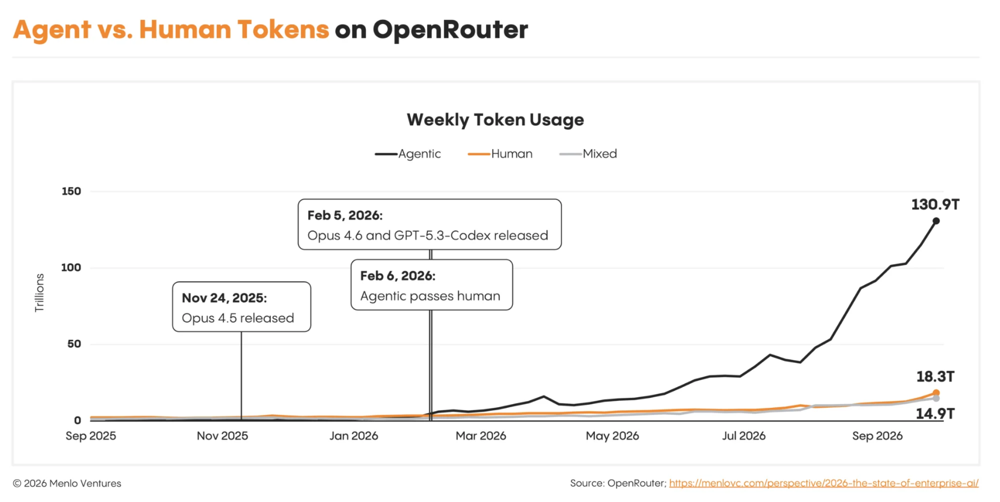

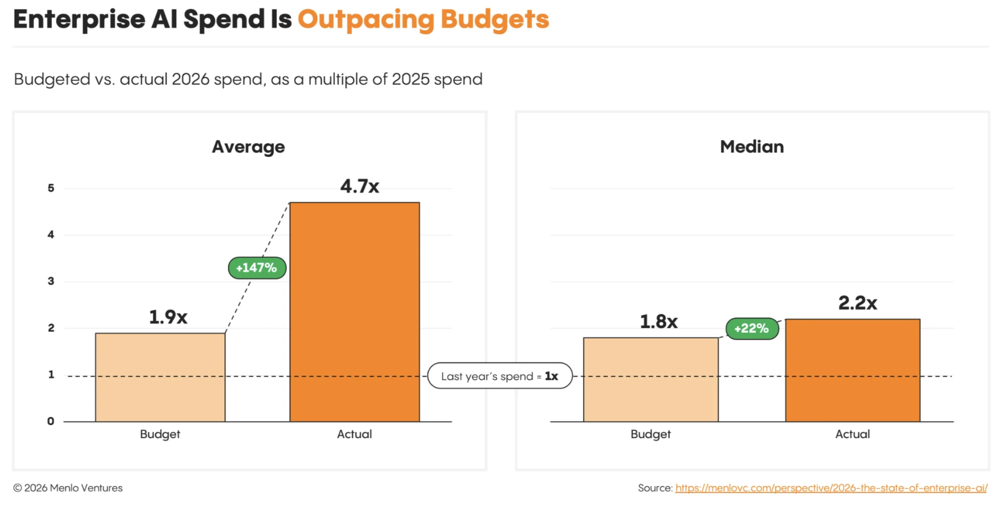

As for the difference between actual and planned spend, **agents explain the gap. They work independently, run in parallel, and keep going even after people step away,** **so spending scales with work rather than headcount.** This growth was the key driver of the AI market inflection this year: Spend per enterprise nearly **quintupled** while adoption among enterprises rose only from **55%** to **65%**. 

My working view is **selective growth**: AI demand remains strong, but the winners will be the ones that survive a slower pace AI-build out, who has the ability to execute, the financial strength to operate and customer quality to sustain orders.  

## What has changed?

**The midterm election has introduced a new political uncertainty to the thesis.** The market reaction in the past few days suggests that investors are paying more attention to the political risk around AI infrastructure.

Gina Hinojosa (the new governor of Texas) ran on a cost-of-living campaign and was particularly keen on restricting data-center expansion. If I look at flips in governorships, they are in states where a large amount of expansion is planned, with Texas by far the largest.

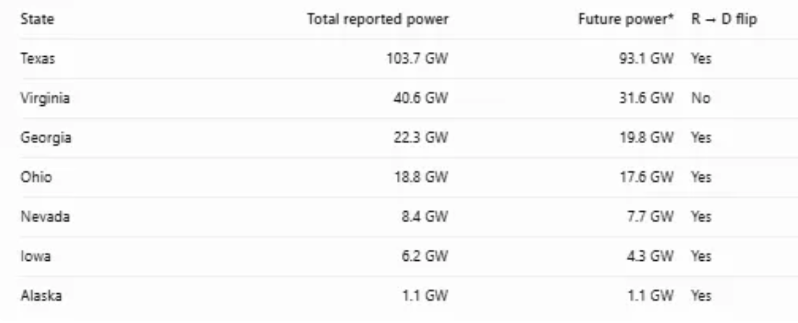

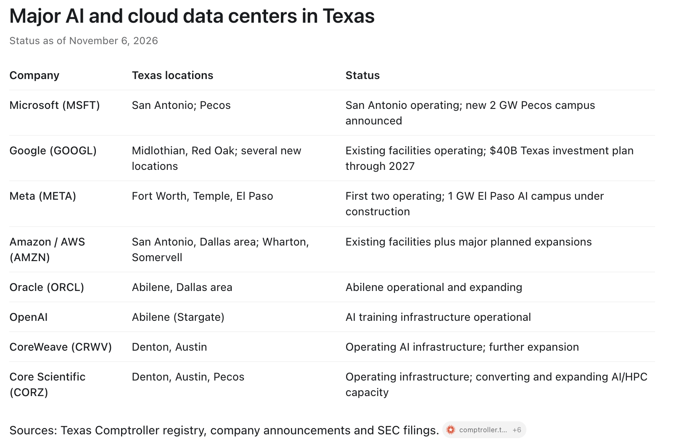

**Future** **projects (which will be impacted more by** **the change of guard)**

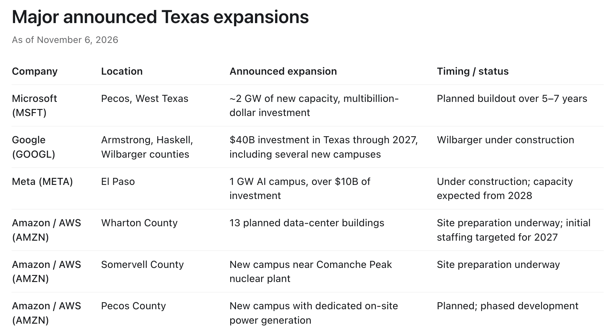

Generally speaking, midterms are a non-event. The party in power loses seats, and the legislative agenda slows. **But the flip in Texas is a huge deal.** Before the midterms, most political commenters would have said the chance of a slowdown in data-center buildout was relatively low, as **all the main players were engaging in a capital war. But now, with the midterms, the chances of regulation slowing the data-center buildout has increased.** Hinojosa has explicitly promised a moratorium on new data-center approvals until the Texas Legislature can establish stronger protections. Her stated priorities include electricity and water costs, local community consent, transparency, labor standards and eliminating certain tax incentives. She takes office on January 19, 2027.

Democrats have also pushed for restoring Obamacare, increased government spending, and lower taxes for households. **Healthcare dominated democratic spending.** 

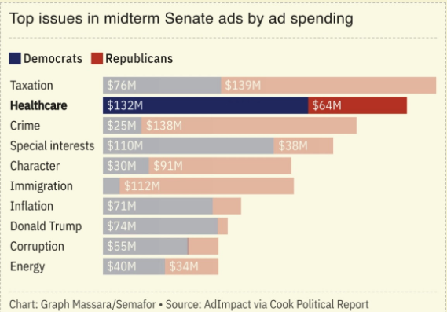

It is unclear whether this is truly bearish for markets. **If hyperscalers do not build data centers in the US, can the government afford the investment and jobs to shift abroad?** **Or letting China lead the AI race?** The United States will likely remain on the AI train; the question is more about speed, location, and regulation.

**Looking at the fundamentals, there are still plenty** **of states for data center expansion** such as in the Midwest, the Northwest, and the Southeast. **The key voter concern is that data centers raise power bills, however, this can easily be resolved by data centers bringing their own power such as gas turbines, fuel cells and battery capacity.** So, I don’t think the data center growth story is over, although growth will likely slow down as more states impose restrictions.

## What the Citrini challenge gets right—and where it is incomplete

Citrini has been one of the most influential voices on the AI trade. He was early, making the case for semiconductors and AI hardware back in mid 2023, so when he changes his view, the market listens. His recent piece, "End of the AI Trade", likely added to the latest sell-off. I think his argument deserves to be taken seriously, and here is how I read it.

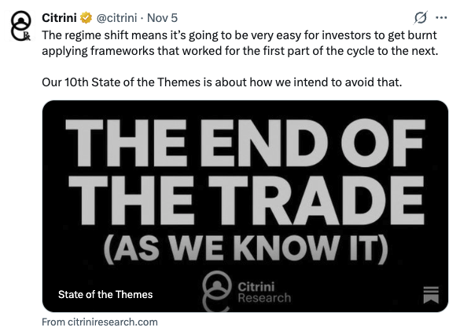

Citrini's main argument is that money for AI projects is getting tight, and this is now easy to see. He also sees a second problem: building data centers is getting harder. The main bottlenecks are power, grid connections and government policy. A year ago, investors treated these bottlenecks as a reason to buy. Now they are real risks to projects. If a project cannot get power, a grid connection or a permit on time, it is delayed. Each delay pushes the finish date closer to the date when the project's debt must be repaid. That is when investors start to worry about defaults. Since the midterm elections, these delays look likely to get longer.

On the labs, he also worries that their ARR does not justify the capex.

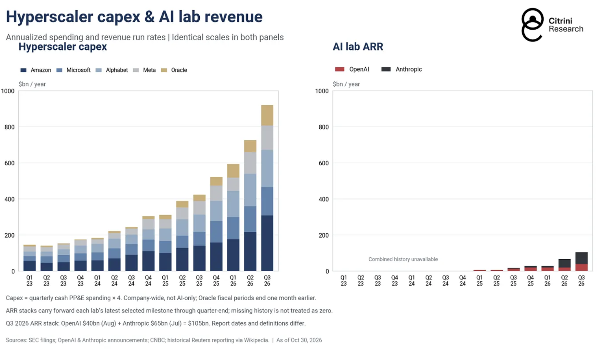

**They are not going to stop investing based on the overall direction of AI adoption. However, they believe we are going into a "muddle through" phase.** Bottlenecks, financing, and policy continue to pose challenges that delay and add cost to projects, posing serious risk to companies that rely on overflow capacity or alternative providers. They favour

- first-mover over new entrants
- quality over growth
- live-compute over backlog

And they will express AI view in pair-trades, such that net-net they are neutral on this sector. Their pairs are

- Accelerators: Long NVDA/short AMD
- Neoclouds: Long Oracle/short NBIS
- Hyperscalers: Long Meta/short GOOG
- Power: Long GE Vernova/short Bloom Energy
- Engineering: Long Schneider electric/short EnerSys

**Citrini had** **some fair points, however I would challenge that...**

**They** **essentially treats** **frontier lab ARR as the only revenue stream** **that must justify the entire** **AI capex buildout.** This completely ignores the explosive growth in demand for open-weight models, as well as the enormous amount of compute being deployed for AI-enhanced advertising, search, recommendation engines, etc.

Much of the economic value created by these applications doesn't explicitly show up as AI revenue on the P&L. For example, Meta is already generating substantial incremental advertising revenue from AI-driven improvements in targeting and recommendations. Yet none of that is captured by looking at frontier lab ARR.

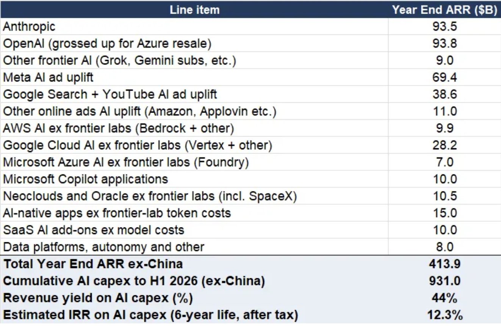

Here is a plausible calculation of actual ARR from AI, which is roughly $414Bn/year ex China, which leads to estimated IRR of AI at 12.3%. The above math is a good barometer that both AI revenues and IRRs are already healthy—although some parts of it are hidden in the massive revenue growth which the big internet giants are seeing. **I just think, the leaders of hyperscalers are some of the greatest entrepreneur of our time, and they are happy to take on 8-10% interest rates to borrow to fund the capex spend, what does that say about the actual IRR they are seeing?**

In the meantime, models continue to grow more powerful and use cases keep expanding—from coding to 3D design, mathematics, research, medical diagnosis, legal analysis, etc.

## The 6–12 month question

The likely 6–12 month transition is from expansion at almost any price to expansion subject to proof of utilization and return. That distinction matters more for the basket than an aggregate capex percentage alone.

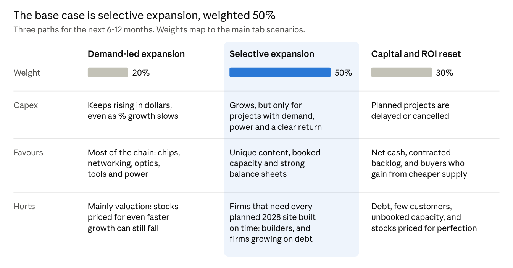

**The recent sell-off may therefore reflect a “sell now, evaluate later” response to uncertainty rather than proof that the underlying demand thesis has failed.** This does not justify panic, but it does reinforce the need to distinguish reasonably valued, financially durable companies from holdings that require an unconstrained buildout to succeed. The political development changes the evidentiary burden and the expected path of investment; it does not, by itself, overturn the selective-growth view.

Being long AI capex beta has been one of the most profitable trades in the market over the last three years, and **if capex growth indeed slows down from here, I suspect that strong share price performance can now start spreading out to more areas in tech.** I am especially looking for names that can **grow recurring revenues** by selling automation and other AI powered workloads to customers. **One obvious area are the big cloud platforms, where enterprises run their digital workloads, store their data, and are now also purchasing ever more tokens.**

## My current holdings re-evaluated: 20-stock basket

I use a company-level source table and aggregate it by cluster.

| Exposure cluster | Tickers | Core underwriting question | Decision |
| --- | --- | --- | --- |
| Accelerators and foundry | NVDA, AMD, TSM | Does workload growth sustain accelerator demand, utilization, and pricing as customer mix changes? | Buy on dip: TSM > AMD  Do not add: NVDA (political uncertainty, share loss to GOOG and AMD) |
| Manufacturing equipment | ASML, LRCX, ONTO | Are customers adding leading-edge and advanced-packaging capacity, or digesting installed tools? | WIP |
| Networking and optics | AVGO, ALAB, COHR, LITE, SITM | How much growth comes from rising content per system versus the number of systems deployed? | WIP: AVGO, ALAB, SITM Sell: LITE. Keep small: COHR |
| Memory and storage | SNDK, SIMO | Can inference data growth offset memory-cycle and pricing risk? | WIP |
| Power and physical buildout | BE, VRT, FIX, CAT | Are projects delayed, cancelled, or shifted toward on-site power and more expensive delivery? | Hold: BE WIP: VRT, FIX, CAT |
| Power semiconductors | IFX | Is the investment case driven by AI buildout or by a separate industrial cycle? | WIP: IFX |
| Hyperscalers | AMZN, GOOG | Does more disciplined capex reduce free cash flow near term or improve long-run returns? | Hold: AMZN, GOOG |

For each name, I would document:

| Dimension | Evidence to use |
| --- | --- |
| Buildout reliance | Share of revenue tied to AI/data-center capex, and exposure to new capacity versus replacement/content growth |
| Contractual proof | Backlog, take-or-pay terms, customer prepayments, cancellation rights, and delivery schedule |
| Financial proof | Net debt, liquidity, free cash flow, debt maturities, and ability to self-fund growth |
| Customer risk | Top-customer concentration and dependency on labs, neoclouds, or hyperscalers |
| Valuation sensitivity | Earnings expectations and what capex/workload assumptions they imply |

Then I can score each item transparently—for example, 1–5—with a source and date beside every score. 

## Accelerator and Foundry

*Underwriting question: does workload growth sustain **comp**ute** demand, utilization, and pricing as customer mix changes?*

### NVDA

| Platform ($,M) | FY22 | FY23 | FY24 | FY25 | FY26 | % contribution |
| --- | --- | --- | --- | --- | --- | --- |
| Data Center | 10,613 | 15,005 | 47,525 | 115,186 | 193,737 | 89.7% |
| – Compute | n/a | 11,317 | 38,950 | 102,196 | 162,361 | 75.2% |
| – Networking | n/a | 3,688 | 8,575 | 12,990 | 31,376 | 14.5% |
| Gaming | 12,462 | 9,067 | 10,447 | 11,350 | 16,042 | 7.4% |
| Pro Visualization | 2,111 | 1,544 | 1,553 | 1,878 | 3,191 | 1.5% |
| Automotive | 566 | 903 | 1,091 | 1,694 | 2,349 | 1.1% |
| OEM & Other | 1,162 | 455 | 306 | 389 | 619 | 0.3% |
| **Total** | **26,914** | **26,974** | **60,922** | **130,497** | **215,938** | 100% |

**Thesis:** the accelerator platform, now extending into the CPU (Vera) and the full rack. INTACT on volume, with a rising but contingent financing exposure.

Nvidia hasn't reported yet, 17th Nov.  It delivered a near perfect Q2 quarter, as revenue accelerated, networking grew 35% QoQ, with elite-level margins and cash flow that are significantly better than even the trademark value-stock Apple.  **What I am concerned with is** the inference market is becoming more competitive, CPU-to-GPU attach rates could divert compute spend. Also, last quarter they changed the segment reporting methodology which is likely a defensive move ahead of hyperscaler allocating more AI budget to custom silicon.  

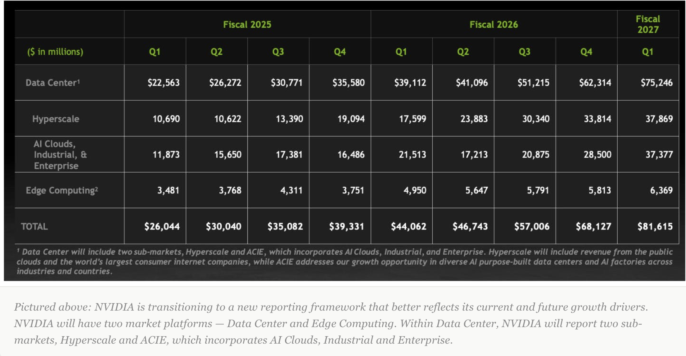

**Demand since last print:** China orders from ByteDance, Alibaba and Tencent reported above $35bn, with no SKU or licence detail. SpaceX reportedly raising ~$40bn to buy Vera Rubin, closing 2027. NVDA paid a ~$1.4bn test prepayment to KYEC and $1.5bn to Amkor to lock back-end capacity.

**Valuation:** $181.60 at the 5 Nov close. 23.0x trailing GAAP P/E, 14.6x trailing sales, 11.5x run-rate sales. Financials lag a quarter (FQ2), so the multiples will compress if Q3 lands near the $108bn guide.

**Risks:** 

- **Pricing faces its first measured challenge from TPUs:** in one third-party test (SemiAnalysis InferenceX, 7 Sep, FP8), TPU Ironwood cost ~$0.181 per million tokens vs $0.222 for B200 and $0.276 for B300, 19-34% cheaper at a normal interactivity level. NVIDIA still leads on FP4. One test is a warning, not proof of a pricing shift. 
- **Secular financing:** under its AI Cloud Partner programme, NVIDIA sells GPUs at full margin, then guarantees the neocloud's rental revenue for six years at a floor of $2.35 per GPU-hour for GB300, about half the $4.50-4.60 market rate on five-year contracts. In return it shares revenue above the floor. Three deals are public: Firmus in Batam ($21.1bn obligation), SharonAI ($4.2bn) and GMI ($2.2bn, estimated). NVIDIA reportedly paused new deals in late August.
- **Other forms of support:** guaranteeing landlords (up to $105bn for SB Energy's Ohio campus leased to an OpenAI affiliate), signing leases itself ($20bn for third parties) and taking equity in customers. 
- **Balance sheet capacity:** funded debt of ~$36bn against ~$283bn of FY27 EBITDA (SemiAnalysis model), with consensus at ~$441bn of EBITDA in FY28. In SemiAnalysis's stress test, liquid net worth covers off-balance-sheet obligations only 0.11x in FY27, reaching 1.0x in FY29 and 2.35x in FY31. **Near-term coverage therefore rests on future cash flow, not today's balance sheet.**
- **Where it breaks:** not a cyclical dip in demand, but competing chips taking the lead. NVIDIA would then have to cut prices to hold share, so EBITDA falls just as the projects it backs become uncompetitive. Both sides of the coverage ratio worsen together.
- **Other political/legal risk:** DoJ probe into the Groq deal. Recently Jensen has been in the headlines quite often after reports that he was the target of a Chinese spy plot (Nvidia denies the report), which has caused concerns in Washington DC. What would be the implication on the company?

- **What to watch on the Q3 FY27** **earnings call:** GPU rental prices and utilization, China licences, whether the Q3 10-Q extends the guarantees, and a valuation on a consistent basis. For NVDA the 17 Nov print is a test of **whether the guarantee lines keep growing faster than revenue.**

As a result, I actually want to take the contrarian view (against Citrini) that **GPUs would see the biggest cut as Nvidia has higher exposure to the neocloud ecosystem**, which has the least cash available to actually finance the buildouts. **It’s clear that hyperscalers are all in on their ASIC strategy, with both Google and Amazon at the forefront** of this trend, and these are the hands with the most cash available.

### AMD 

| Segment ($,M) | FY22 | FY23 | FY24 | FY25 | 9M26 | % contribution |
| --- | --- | --- | --- | --- | --- | --- |
| Data Center | 6,043 | 6,496 | 12,579 | 16,635 | 21,039 | 59.8% |
| Client(PC biz) | 6,201 | 4,651 | 7,054 | 10,640 | 8,896 | 25.3% |
| Gaming | 6,805 | 6,212 | 2,595 | 3,910 | 2,272 | 6.5% |
| Embedded | 4,552 | 5,321 | 3,557 | 3,454 | 2,959 | 8.4% |
| **Total** | **23,601** | **22,680** | **25,785** | **34,639** | **35,166** | **100%** |

**Thesis:** 

The credible second source at rack scale, plus the best server CPU franchise as agentic AI lifts CPU demand. INTACT, strengthened.

In AMD’s architecture, the industry-leading 432GB of HBM is sitting very close to the GPU, which means it’s extremely high-bandwidth local memory. To contrast, although Google offers better memory utilization through shared memory, even strong ICI interconnects introduce latency and offer lower bandwidth than local memory.  

Technically, there is more risk in this approach, as securing HBM is clearly an industry-wide obstacle. Yet AMD is leaning into the constraint with 12 HBM4 stacks and 432GB per MI455X. The tradeoff is that it leads to a performance advantage as inference workloads need quick access to model weights and KV cache. By keeping more of the data in local HBM, it reduces the need to move it across an interconnect. 

**Print (3 Nov, Q3):** 

Revenue $13.4bn, data center $8.5bn (+97%). Q4 guide ~$17bn vs ~$16.2bn consensus. 2027 revenue >+80%, data center "well over 100%".

**Read on Q3** **earnings:**

- CPU: Venice to see higher unit shipments and core counts

Server CPU growth for 2027 was raised to more than 100% (from more than 70%)

- GPU: Helios is entering a multi-GW cycle

Next quarter will mark the first quarter that AMD’s GPU business is expected to surpass its CPU server business: “In Q4, we are guiding sequentially revenue growing 50% for Data Center business. It is actually going to be the quarter Data Center AI business surpass server business.”  Management confirmed that Anthropic, Meta, Microsoft, OpenAI and Oracle have brought their first Helios racks online, with deployments expected to increase substantially in Q4 as production continues to ramp. 

- Operating margin accelerates despite GPU margin pressure

AMD’s operating leverage was impressive in Q3, with revenue increasing 45% YoY while adjusted operating income increased 75% to $3.9 billion. Operating margin expanded more than 500 basis points, while adjusted EPS increased 74% YoY to $2.09. 

However, the rapid growth of AMD’s GPU business will likely introduce pressure on gross margins. Adjusted gross margin of 56% this quarter was guided to 55% next quarter. The CFO acknowledged that Data Center AI carries a lower gross margin than the corporate average. 

- Inventory and receivables surged, and cash flows felt it

Cash flow was the clear weak spot of the quarter, with operating and free cash flow margins dropping into single-digit territory and reaching the lowest levels since the end of 2023 due to a sharp working capital build.  

**Risks:** 

Inventory +$3bn to $11.5bn, debt $3.3bn to $7.1bn, FCF only $554m. Two lab customers need financing for multi-GW deployments. PCs down 20%+ in Q4. So the risk for AMD is concentration in timing, with inventory now positioned for a 27% sequential step-up in Q4 driven by a first-generation rack-scale product, so any slip in Helios deployment schedules would leave inventory elevated into 2027.  

I should also note that Nvidia has a strategic advantage in financing its customers with a much healthier balance sheet. The question for 2028 is if AMD will have to give into the peer pressure and start financing its customers, as well. That is a tougher proposition, as its debt has already more than doubled while it secures supply. 

**AMD is** **not a company without risks; rather it’s a “no pain, no gain” type of stock profile. AMD will surprise you with incredible growth, then equally thin margins the next quarter, then low cash or high debt, and then a two-catalyst punch that wildly delivers.**  

### TSM

| Platform ($,M, computed) | FY22 | FY23 | FY24 | FY25 | 9M26 | % contribution |
| --- | --- | --- | --- | --- | --- | --- |
| HPC | 31,111 | 29,799 | 45,941 | 71,004 | 80,201 | 65.3% |
| Smartphone | 29,593 | 26,334 | 31,528 | 35,502 | 27,989 | 22.8% |
| IoT | 6,829 | 5,544 | 5,405 | 6,121 | 6,033 | 4.9% |
| Automotive | 3,794 | 4,158 | 4,504 | 6,121 | 4,913 | 4.0% |
| DCE | 2,276 | 1,386 | 901 | 1,224 | 1,228 | 1.0% |
| Others | 2,276 | 2,079 | 1,802 | 2,448 | 2,456 | 2.0% |
| **Total, reported** | **75,880** | **69,300** | **90,080** | **122,420** | **122,820** | **100%** |

**Thesis**

The toll road for every AI chip, GPU, ASIC or CPU. HPC was 68% of revenue in Q3 (65% for 9M26). INTACT, strengthened.

**It is the cleanest hold in the group.** Demand is above capacity and pricing is rising on both nodes and packaging. Demand is also broadening beyond accelerators into agentic CPUs and ASICs, so the shift in customer mix that pressures NVDA pricing (TPUs, custom silicon) is neutral or positive for TSM. Management now sends its own teams to check US data-center and power readiness, and the feedback is "so far so good". Thesis strengthened. Still open: size of price increases, and Terafab. 

**Print (15 Oct, Q3)** 

Revenue $46.7bn (+41%), GM 66.4%, operating margin 58.7%, net income NT$763.1bn (+68.7%). Wafer revenue N3 33%, N5 28%, N2 8%. Average price per wafer above $10k, a record. Q4 guide $52.3-54.3bn, GM 65-67%. FY26 growth ~44%.

**Read on Earnings:**

- **2027-28 capacity and pricing:** N3 running above 100% utilization. N2 capacity more than doubles in 2027. New Tainan N3 fabs in 1H27 and 1H28, Arizona Fab 2 pulled forward to 3Q27, Kumamoto 3nm in 2028. Price rises of 5-10% on advanced nodes and 10-15% on packaging in 2027. Capex $80-90bn in 2027, and 2026-28 will be "even more significantly higher" than the prior three years.
- **Valuation:** ADR $353.10 at the 5 Nov close. 23.7x trailing GAAP P/E, 12.2x trailing sales, 10.1x run-rate sales. One external forecast has 2027 revenue +40.6% in NT$, which would bring the P/E toward the high teens on 2027 earnings.
- **Risks:** overseas fabs and N2 dilute GM ~2pts in 2026, rising to 3-4pts. The Q4 GM midpoint of 66% sat below buy-side hopes of 67-68%. Consumer demand is elastic to component prices in 2027. Terafab, Elon Musk's planned US fab where TSMC may be tenant or operator, is unresolved. Cross-strait and US tariff (Section 232) risk is not priced anywhere in this review, and for the largest line it is the main tail risk. The Kaohsiung site is halted after a fatal scaffolding collapse, with no timeline. Largest line in the basket.

**Group read.** Workload growth is sustaining demand across all three names. The difference is pricing power and who pays. TSM has pricing power and does not care which chip wins. AMD and NVDA both now support part of their own demand. AMD does it through warrants to anchor labs, rising receivables (DSO 63 vs 57 days), debt more than doubled to $7.1bn and thin FCF. NVDA does it through ~$160bn of contingent floors, leases and guarantees, mostly phased from FY2029. On one consistent test, AMD's version is the sharper one today, because it already shows in working capital while NVDA's sits mostly in contingent lines. AMD also trades at ~88x trailing earnings against ~23x for NVDA. On revenue quality and price NVDA screens better than AMD today, but AMD has the stronger growth guide and is taking share. My preference is TSM, then AMD. I will not add to NVDA, given political uncertainty and share loss to GOOG and AMD.

## Manufacturing Equipment

### ASML

### LRCX

### ONTO

## Networking and Optics

### AVGO

### ALAB

### COHR

| Segment ($,M) | FY22 | FY23 | FY24 | FY25 | FY26 | % contribution |
| --- | --- | --- | --- | --- | --- | --- |
| Datacenter & Communications | n/a | n/a | 2,631.4 | 3,755.2 | 5,274.6 | 74.1% |
| Industrial | n/a | n/a | 2,076.3 | 2,055.0 | 1,843.6 | 25.9% |
| *Old: Networking* | 2,197.2 | 2,340.9 | 2,295.7 | – | – |  |
| *Old: Materials* | 1,119.4 | 1,349.8 | 1,016.6 | – | – |  |
| *Old: Lasers* | 0 | 1,469.4 | 1,395.4 | – | – |  |
| **Total** | **3,316.6** | **5,160.1** | **4,707.7** | **5,810.1** | **7,118.2** | **100%** |

**Thesis:** the vertically integrated optics maker with the InP scale to ride 1.6T and optical circuit switching. Operations are intact. Cash conversion is now the issue. TAM ~$90bn by 2030 (company estimate, including ~$30bn for CPO, NPO and chip-to-chip). 

**What the Marvell-LITE deal means for COHR**

- **Marvell bought LITE to catch up with Broadcom.** Broadcom already sells the full stack: its own 200G EMLs, DSPs, switches and a shipping CPO switch (Tomahawk 6 Davisson). Marvell had DSPs and switches but no lasers. As CPO grows, the DSP pool shrinks and value moves to lasers and optical engines. Marvell CEO Matt Murphy: "what's really needed is extreme co-design… we are acting now as scale-up begins to ramp next year."
- **It does not squeeze AVGO directly.** Broadcom makes its own lasers and is not a known LITE customer.
- **It does squeeze COHR's module business.** A transceiver or optical engine is DSP + laser + packaging. COHR makes its own lasers and packaging but buys DSPs from Marvell or Broadcom. Its DSP supplier now owns a rival with a ready DSP-plus-laser bundle. Innolight and AAOI face the same pressure.
- **It helps COHR as a laser source.** Optics becomes a two-stack contest, Broadcom vs Marvell-LITE. Broadcom-camp hyperscalers (Google, Meta) may not want lasers from a Marvell unit. A Broadcom DSP with a COHR laser gives them a second source and pricing leverage.
- **LITE is still the stronger CPO/NPO company.** Marvell is positioning for the next accelerator roadmaps (NVDA, GOOG), and LITE arguably leads COHR in CPO/NPO.

**Cash is the constraint.** The next 6-12 months depend on capacity coming online and on customers paying for it. Capex rose 7x YoY to $776m (33% of revenue). Cash is $1.55bn against $4bn of debt. FY26 FCF was -$1.0bn, so COHR fails my cash rule. Management says its LTAs include upfront payments, but I have not seen meaningful pre-funding or co-funding in the cash flows. COHR is the name in this group most exposed to a funding squeeze.

**Valuation:** $169.76 at the 5 Nov close. 35.2x trailing GAAP P/E, 4.3x trailing sales, 3.6x run-rate sales. The cheapest optics name on sales by a wide margin, so fair, not distressed.

**Conclusion: reduce networking exposure and keep small positions in AVGO and COHR.** Three reasons:

1. The path of the Marvell-LITE merger is unclear.
2. Political headwinds make data-center project delays more likely.
3. Growth is accelerating, but capex needs are rising just as capital gets tighter.

**Actions.** I will exit my LITE position and will not build one in MRVL. China's antitrust review and months of integration mean the deal will take time, and I want to see how it progresses first. AVGO and a small COHR position are how I will express my CPO/NPO view for 2027-28.

### SITM

## Memory and Storage

**HBM and HBF is the trend. The HBM shortage is now reshaping the product roadmaps.** Nvidia has reportedly lowered memory configurations for Rubin Ultra (not confirmed by Nvidia).  (The Information (~6 Aug 2026), echoing an earlier SemiAnalysis comment: Nvidia is testing Rubin Ultra with as little as 192-256 GB of HBM, versus 1 TB of HBM4E shown at GTC. Some designs use fewer stacks and step back to HBM4. A quad-die design was reportedly cancelled in June.)

*Per TrendForce: “Compared to earlier plans for 12-Hi HBM modules, 8-Hi configurations use fewer DRAM dies, lowering both the cost per stack and the overall GPU bill of materials. These configurations also enable the same HBM bit output to support more GPUs. Given the ongoing tight HBM supply, 8-Hi setups are expected to be a priority for evaluation by many GPU and ASIC vendors in 2027, balancing performance, supply, and cost.” *

This creates a counterintuitive outcome for memory makers given Nvidia could use less HBM per GPU, but potentially ship more GPUs from the same constrained HBM supply while paying a higher price for each gigabit of HBM.  

**Micron’s executives** **on earnings call:**  “*when customers reduce their content growth versus prior expectation, as I referred to in certain platforms, that really is to enable them to ship more units as reflected in the strong server growth in 26 as well as 27, which sets the stage up well for 2028 timeframe. So, I see a healthy demand-supply environment here going forward for the factors related to demand as well as for supply, and that obviously bodes well for the industry pricing environment as well.”* 

Nvidia, Google and AMD together already creates a short fall on memory supply. In addition, **the demand for DRAM (ex HBM) is also going** **up due to agentic workload and its expanding context window.** 

Surging context window lengths are another main driver of memory demand, as KV cache capacity scales proportionately with context windows. According to Artificial Analysis, OpenAI’s GPT-3.5 Turbo, released in 2023, had a context window of just 4k tokens. OpenAI’s latest model, GPT-5.5 (xhigh), has a context window of 922k tokens, a 230X increase in the span of three years.     

### SNDK

### SIMO

## Power and Physical Buildout

### BE

| Category ($,M) | FY22 | FY23 | FY24 | FY25 | 9M26 | % contribution |
| --- | --- | --- | --- | --- | --- | --- |
| Product | 880.7 | 975.2 | 1,085.2 | 1,531.3 | 2,662.4 | 87.2% |
| Installation | 92.1 | 92.8 | 122.3 | 204.1 | 161.8 | 5.3% |
| Service | 151.0 | 183.1 | 213.5 | 228.3 | 198.5 | 6.5% |
| Electricity | 75.4 | 82.4 | 52.8 | 60.4 | 29.7 | 1.0% |
| **Total** | **1,199.1** | **1,333.5** | **1,473.9** | **2,024.0** | **3,052.3** | **100%** |

**Thesis:** speed to power.  **Chips without power are inventory, not intelligence.** Bloom sells on-site fuel cells that hyperscalers can switch on faster than a grid connection. WEAKENED on cash, concentration and open allegations.

And for the first time I can recall from earnings calls, Bloom is to become more integrated to utility infrastructure. On the earnings call on 22nd Oct, Bloom discussed traditional utility companies as becoming key customers, as they emphasised utility companies are coming to the same conclusion as hyperscalers. Management suggests the company could become part of the long-term strategy of whale-sized utilities rather than competing with them for customers seeking near-term power solutions. 

Bloom works with utilities in three ways. Only the first two are signed deals today.

1. **Utility as reseller (AEP, Nov 2024).** AEP agreed to buy up to 1GW of Bloom fuel cells and place them at customer sites as a bridge until the grid catches up. The units do not export power to the grid. Customers pay all project costs under a special contract, so other ratepayers pay nothing. The Ohio regulator approved the first two sites: AWS on a 6-year contract and Cologix on a 15-year contract. ([AEP](https://www.aep.com/news/stories/view/9866/), [DCD](https://www.datacenterdynamics.com/en/news/aep-ohio-wins-approval-for-on-site-power-units-at-aws-cologix-data-centers/))
2. **Utility as owner-generator (AEP and Google, Oct 2026).** AEP will invest $4bn in a 702MW Bloom fuel-cell plant near Cheyenne, Wyoming, about 92% AEP-owned. Google buys the power under a 20-year PPA. The plant adds carbon capture for near-zero emissions, with full operation at end-2028. ([ESG Today](https://www.esgtoday.com/?p=26319))
3. **Utility puts Bloom in its rate base (management's pitch, no deal named yet).** In this model a utility buys Bloom servers as transmission and distribution assets, places them in front of the meter and recovers the cost from all ratepayers, without waiting for a specific customer. CEO KR Sridhar on the Q3 call ([transcript](https://web.quartr.com/m/sources/s355304372002395835068)):
    - *"The more they start seeing us as a distribution asset through which they can reduce their total cost and still keep serving their customer, the better it is for the rate payer, the better it is for them to go to their policymakers and ask them to rate base their procurement of Bloom Energy Servers to put into the transmission and distribution base as both a transmission asset and a distribution asset."*
    - *"It allows them to put us in front of the meter and distribute that load as it comes. They don't need to wait for a customer to ask for an order. They can procure like they do in their IRPs right now based on the plans and based on the demands without any specific customer in mind."*
    - *"If they lose their customer and they lose their rate base, then they have to increase the cost on the rest of the rate payers, which is not what the state wants and which is not what the end customer wants."*
    - *"The utilities are finally getting the leeway they need from their regulators to include these assets, and so they're jumping on the opportunity. We see this as a huge growth business for us going forward."*
    - *From prepared remarks: "Many utilities are increasingly recognizing that our clean baseload generation asset, a Bloom Energy Server, when deployed at their distribution networks, is a faster and more economical way to fulfill power growth demand of their customers and enhance the distribution network stability and reliability. I expect to see significant wins in our utility-related business, often called front of the meter arrangements."* 

**Democrats ran on data centers shifting power costs to households.** Bloom's model of the customer paying for its own power (AEP Ohio: other ratepayers pay nothing) is the fix both parties already back. That is the real policy fit.

**Risks:**

- Cash flow turned negative. OCF -$27m, FCF -$181m, capex 3x QoQ to $154m. Contract assets rose $430m and inventory 22% to $928m.
- **On** **timing of data centre build out:** "The rest of the timing on the data centers is up to the customer to speak, and we will not comment on that." The CFO says the outlook is built from backlog "customer by customer against site readiness and conversion timing", and "the timing of a small number of deliveries around year-end will determine where in the range we land."
- Two customers 69% of revenue (one related party). The 43% customer is unnamed. The related party is Bloom's Brookfield JVs, whose end user looks like Oracle. 
- **Order book** **risk:** Oracle 1.2GW firm within an "up to 2.8GW" framework. AEP Ohio ~100MW firm of a 1GW framework. AEP/Google 702MW Wyoming PPA, which may sit inside an earlier 900MW order. Pricing holding at $3,200-3,600/kW. Fremont capacity expanding past 5GW, no timeline.
- **Valuation:** $167.52 at the 5 Nov close. 102.8x trailing GAAP P/E, 14.2x trailing sales, 11.0x run-rate sales. Highest meaningful trailing P/E in the basket.

Overall still bullish on BE longer term, I will recommend a small position hold because the impact from the mid-term sits on both sides for BE. **Delays are documented:** Project Jupiter (2.45GW Oracle) slipped ~4 months into 2027, Vineland (328MW Nebius) had a stop-work order before approval, AEP Wyoming moved from 2028 to 2030. No cancellations appear in any file. **On the other hand, the shift to on-site power is real,** with projects pivoting to Bloom because fuel cells avoid the slowest permits. Delivery is more expensive and Bloom's pricing is holding. So the buildout slowdown helps Bloom's competitive position while delaying its revenue. Thesis on demand intact, on execution weakened. For BE the risk is less about policy and more about converting frameworks into firm orders and cash at **~100x trailing earnings.**

### VRT

### FIX

## Power Semiconductors

### IFX

## Hyperscalers

### AMZN

### GOOG

## Tactical considerations at the end—not the thesis

Short-term market mechanics may still matter, but they should remain separate from the 6–12 month view.

The draft flags a potential Anthropic IPO, prime-broker de-risking, tax-loss selling, and option assignments as possible near-term sources of flow and volatility. These can affect entry points, risk sizing, and whether a position can withstand a further drawdown. They do not by themselves establish a long-term hardware demand outcome.

## Source notes

- [Menlo Ventures 2026 State of Enterprise AI](https://menlovc.com/perspective/2026-the-state-of-enterprise-ai/) — useful directional evidence on enterprise deployment spending, agent usage, and methodology; estimates, not audited market totals.
- User-supplied **Nov 5 semi basket re-evaluation draft** — source for the 19 holdings, stated weights, scenarios, and open diligence questions. Its market, policy, event, and company assertions need primary-source verification before being treated as facts.
- User-supplied **Nov 4 Citrini AI sections** — source for the financing, capex-discipline, and relative-value challenge. Its claims are treated here as an argument to test, not an authority.