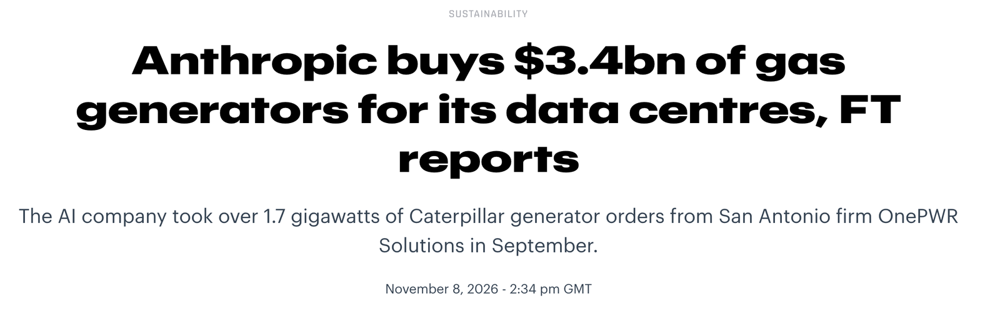
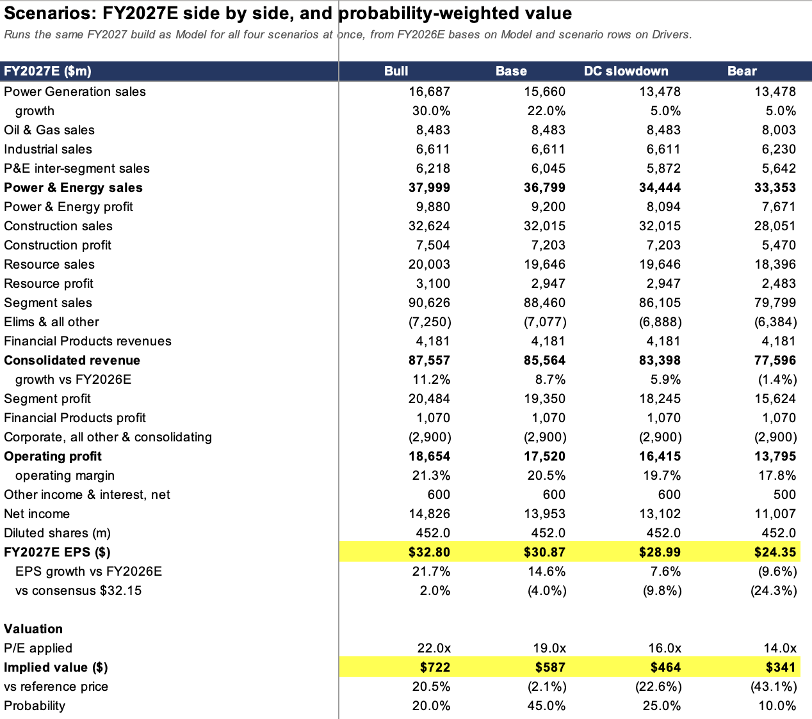
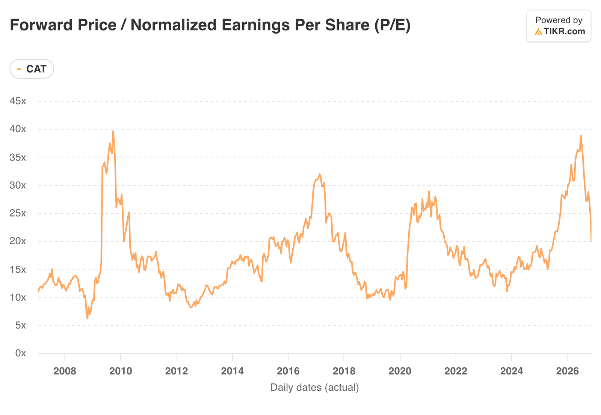
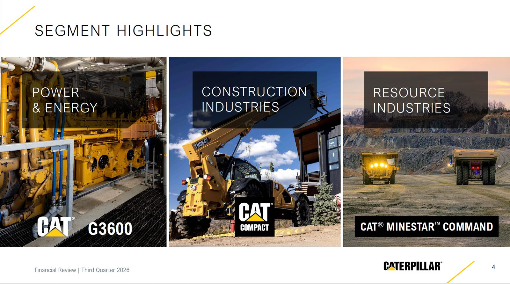
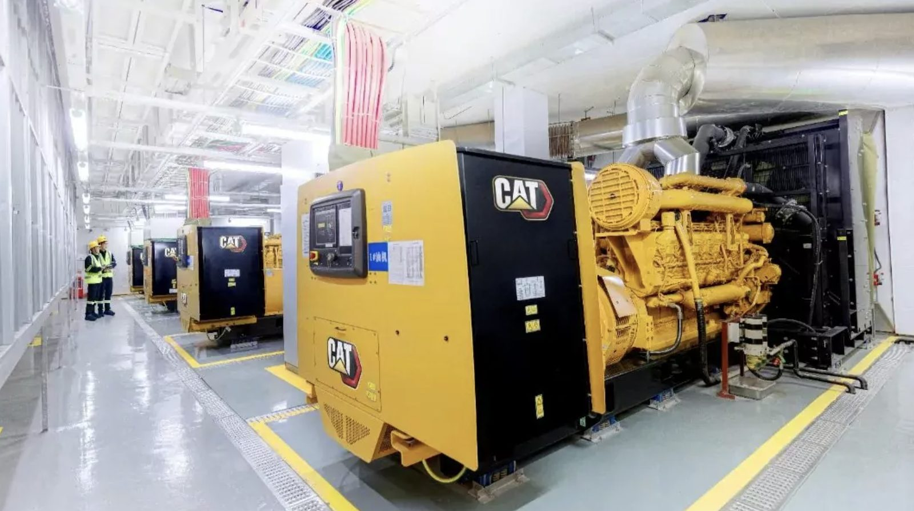
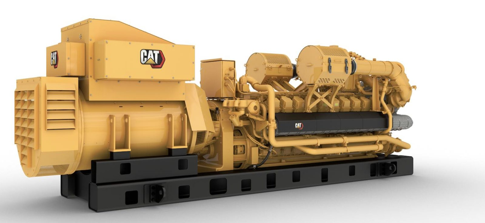
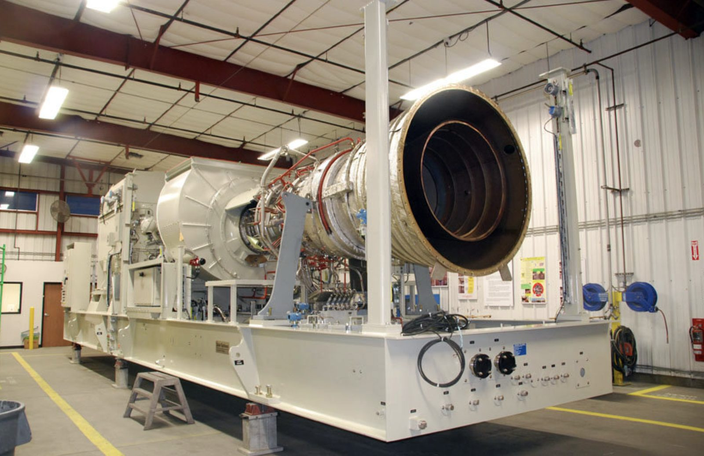
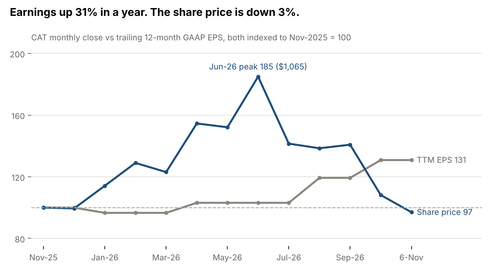

## 1. Two developments that could change CAT's outlook

In one week, an AI lab paid $3.4bn to take over a queue position for Caterpillar generators, and voters in Texas elected a governor who has promised to pause new data centers. Both stories are about the same thing: who gets to build AI power, and how fast.

### The Anthropic generator deal

**On 8-Nov-26 the Financial Times reported that Anthropic had agreed in late September to pay about $3.4bn for 1.7 GW of large gas-fired generators.** The seller was not Caterpillar. It was OnePWR Solutions, a San Antonio developer of behind-the-meter power plants. OnePWR had ordered the Caterpillar units about two years earlier but could not raise the money to complete the purchase. Anthropic had first planned to buy electricity from OnePWR. Instead it took over the generator orders and the installation work itself. Neither company commented, and the 1.7 GW figure comes from one unnamed source ([TNW, citing the FT](https://thenextweb.com/news/anthropic-3-4bn-gas-generators-onepwr-ft)).

The deal tells us three things about the market.

- **Delivery slots are the scarce asset.** CAT is booking large-engine orders into 2029 and turbine orders into 2030 ([Q3 call](https://web.quartr.com/m/sources/s51389116229635487147114)). An order placed in 2024 is a slot in 2026–27 that nobody can buy new. Anthropic paid for the place in the queue as much as for the machines.
- **Owning beats contracting.** By taking the equipment directly, Anthropic removes the risk that a thinly capitalized developer fails before power is delivered. This is "bring your own power" taken one step further: bring your own power plant.
- **Pricing is rich, but most of it is not CAT's.** $3.4bn for 1.7 GW is about $2,000/kW. In March, Atlas Energy agreed to pay $840m for 1.4 GW of CAT gensets, about $600/kW for equipment alone ([Utility Dive](https://www.utilitydive.com/news/atlas-energy-buy-840m-power-assets-caterpillar/814697/)). If OnePWR's units were priced similarly, CAT's share of the $3.4bn is roughly $1bn. The rest goes to installers, balance of plant, service companies and OnePWR's margin. That is our estimate.

For Caterpillar, this is **not new demand**. The order was placed two years ago and is most likely already in CAT's $78bn backlog. What changed is the quality of the customer: an order at risk of default now sits with a buyer that can pay. The figures also do not fully reconcile. OnePWR's own February 2026 release listed just over 1.2 GW of assets, not 1.7 GW ([OnePWR release](https://stocks.observer-reporter.com/observerreporter/article/gnwcq-2026-2-3-onepwr-solutions-announces-more-than-12-gw-of-power-generation-assets-ready-for-deployment)).

The less comfortable lesson is that a Caterpillar customer ran out of money. The weak link in AI power is not demand for engines. It is the balance sheets of the small developers between the OEM and the end user.

### The 3-Nov midterms and data-center politics

The election delivered the largest Democratic state-level gains in years in the states that matter most for data centers. In Texas, Gina Hinojosa beat Gov. Greg Abbott 52.8% to 45.7% (results not yet certified) and Democrats flipped the Texas House ([Ballotpedia](https://ballotpedia.org/Texas_gubernatorial_election,_2026)). Democrats also won governorships in Ohio (Amy Acton), Georgia (Keisha Lance Bottoms), Wisconsin and Nevada, held Arizona and Pennsylvania, and took a 3–2 majority on Georgia's utility regulator. Voters backed data-center restrictions in 40 of 41 local ballot measures ([TNW](https://thenextweb.com/news/data-centres-us-midterms-ballot-measures)).

We should separate what is proposed from what is in force.

- **Campaign pledges.** Hinojosa promised to pause approvals of *new* data centers until the legislature passes protections. She takes office in January and cannot halt projects already permitted or under construction ([ABC13](https://abc13.com/post/governor-elect-gina-hinojosa-vows-ban-future-data-centers-texas/20021143/)). Bottoms pledged a temporary moratorium on new approvals in Georgia, with approved projects proceeding. Acton backs a conditional moratorium in Ohio. These are pledges, not law.
- **Already in force, and set by a Republican.** The tightest rules in Texas came from Abbott himself. On 3-Aug-26 he paused new data-center grid connections pending an ERCOT audit. On 21-Sep-26 he told the state environmental regulator (TCEQ) to issue "no permits sought by data center projects", which TCEQ applied to air and water permits for supporting infrastructure until audits finish in December ([San Antonio Current](https://www.sacurrent.com/news/abbott-orders-pause-of-air-permits-for-data-centers-experts-question-whether-he-has-the-authority/)). Pennsylvania's Shapiro ended fast-track permitting by executive order in August. Republicans such as Vivek Ramaswamy and Ken Paxton also proposed restrictions. This is not a one-party story.

The market treated it as one. On 4-Nov CAT fell about 6% with no company news, alongside GE Vernova (down 9–12%) and Vertiv (−13%), while the hyperscalers that already own capacity rose. **A pause on new data-center approvals hits future equipment orders (2028+), which is what their high valuations price in.** Funds sold the whole "AI power" basket at once, not name by name. Bloomberg Intelligence said CAT was simply "caught up in this AI trade".** We think it is overdone. What it means for CAT's demand.** CAT does not disclose how much of its power backlog sits in Texas or with projects that still need permits. What we can say is that 58% of the $78bn backlog ships within 12 months, and those are mostly projects already financed and sited. Policy delays are far more likely to push new orders out by a year, or move them to another state, than to cancel orders already placed. Bernstein estimates 244 GW of the 433 GW pipeline is politically exposed but expects most of it to proceed with developers paying more ([24/7 Wall St](https://247wallst.com/investing/2026/11/03/ge-vernova-rallies-7-as-bernstein-calls-election-day-data-center-fears-overblown-eaton-climbs-6-vertiv-gains-5/)).

Some rules actually favour CAT. "Pay your own way" and bring-your-own-power requirements, now backed by both parties and by the White House's voluntary Ratepayer Protection Pledge, push developers toward on-site generation. The exception is permitting. Texas has paused air permits as well as grid connections, so on-site gas is not an escape route there for now. It is worth noting, as a hypothesis we cannot confirm, that OnePWR is a Texas developer and Anthropic signed in late September, days after Abbott's permit freeze.

**The tension.** AI developers are paying up to secure equipment years ahead. Politics and financing are slowing how fast new sites can be approved and funded. For CAT the near-term effect is mostly on sentiment and the multiple, because the next two years of power output are already sold. The risk is to the 2028–30 order book, and that is exactly the part of the story that justified the June valuation.

## 2. Our preliminary conclusion: Accumulate on weakness

We rate CAT **Accumulate on Weakness** at $558.63. That means one entry price, about $460, roughly 18% below the 6-Nov close, and no buying in size before then. CAT is an excellent business whose valuation has come back from bubble territory to roughly fair. It is not yet cheap enough to buy outright with a January outlook, a construction destock and a political overhang still ahead.** Why $460.** It is what CAT is worth if the data-center slowdown happens. In that case 2027 EPS falls to $28.99 (Power Gen growth cut from +22% to +5%, Power & Energy margin 1.5 points lower), and 16x gives $464. At $460 the stock would trade on 14.9x our base EPS of $30.87 and 14.3x consensus of $32.15. That is 21% below our base value of $586 and 18% below our probability-weighted value of $558. Buying there means the slowdown is already paid for.** Where the analysis does not support it.** $460 prices in the slowdown, not the bear case. If a construction downturn comes on top (2027 EPS about $24.35 at 14x), value is $340, another 26% below $460. It is also a long way from here. CAT last traded at $460 in September 2025. If the slowdown does not happen, the base case is only 5% above the 6-Nov price and the order may never fill. That is the cost of this discipline, not a flaw in it.

$32.15 is 2027 consensus EPS ([TIKR](https://www.tikr.com/blog/caterpillar-stock-sinks-10-in-a-week-despite-record-backlog-is-it-a-buy)). Scenario EPS come from our segment model (summary below), which shows the data-center-slowdown case of $28.99 at 16x = $464 that anchors our $460 entry. All multiples are our assumptions. 19x is CAT's five-year average forward P/E. If January guidance moves 2027 EPS, the entry price moves with it: it stays at about 16x the slowdown-case EPS.

**Long termfwd PE trend**

### The segment model behind these scenarios

Our base case gives 2027 EPS of about $30.90, 4% below the $32.15 consensus. A data-center slowdown alone takes it to about $29.00. Add a construction downturn and it falls to about $24.35. Weighted by our probabilities (20/45/25/10), the four scenarios are worth about $558, almost exactly the 6-Nov price.

All figures in $bn unless stated. 2026 quarters are company actuals from the [Q1](https://web.quartr.com/m/documents/3274058), [Q2](https://web.quartr.com/m/documents/3667365) and [Q3](https://web.quartr.com/m/documents/3867995) 2026 earnings releases. Q4 2026 and everything for 2027 are our estimates.

**Why these assumptions**

- **Power Gen growth.** 2026 is tracking about +25% (nine months +33%, Q4 slower against a tough comparison).** Factory capacity is the limit, not demand. CAT plans to take large-engine capacity to nearly 3x the 2024 level by 2030, which is about 20% a year, and is expanding turbines too. **Base +22% is that ramp plus price. Bull +30% assumes the 2026 pace holds. DC slowdown +5% assumes some customers push deliveries out, which CAT already allows ("we move slots around"). It stays positive because 58% of the backlog ships within 12 months and failed buyers are being replaced (OnePWR).
- **P&E margin.** Nine-month 2026 is 23.4%, and Q2–Q3 ran about 24.5%. Base 25% adds price and lower tariffs. DC slowdown: 23.5%, 1.5 points below base. The margin falls because the new factories' depreciation is already in the cost base and less volume is spread across it.
- **Construction.** 2026 sales are up about 29% over nine months, helped by dealer restocking. Base +5% because dealers end 2026 with more inventory and sales-to-user growth is slowing from 20%+. Bear −8% is a normal cyclical down year (higher rates, slower non-residential building, dealers destocking). The 19.5% bear margin is about 2 points below Q1 2026's 21.4%. DC slowdown: same as base (+5%, 22.5%). Data-center sites do use CAT machines, but they are a small share of construction demand, so we assume no change.
- **Resource.** Three strong order quarters in a row on copper, gold and the Canadian oil sands, and nine-month sales are up 13%. Base +10%. Margins stay near Q2–Q3 2026 levels of 13.5–14.9% (Q1 was a weak 10.0%). DC slowdown: same as base (+10%, 15%). Mining and rail do not depend on data centers.
- **Corporate.** Nine-month 2026 corporate items, eliminations and other were −$1.8bn including about $0.5bn of one-off IEEPA tariff refunds. That is about −$3.1bn a year underlying. We use −$2.9bn because restructuring falls. DC slowdown: unchanged at −$2.9bn. Corporate costs do not move with data-center volumes.
- **P/E.** Bull 22x: the market pays for the power story again. Base 19x: CAT's five-year average. DC slowdown 16x: the post-election discount on AI-power names persists. Bear 14x: a typical multiple for a cyclical at the bottom of the cycle.** What the model tells us**

1. Consensus of $32.15 sits between our base and bull. To get there, Power Gen needs to grow about 30%, or margins need to be about 1 point higher than our base.
1. **A data-center slowdown costs only about $1.90 of 2027 EPS (−6%), but takes 21% off value through the lower multiple. The risk to CAT is the multiple, not 2027 earnings.**
1. The weighted value of about $558 equals today's price. CAT is fairly priced (on 6th Nov), which supports accumulating below fair value rather than buying now. Our $460 entry is set at the DC-slowdown value of $464.

*Limits:* Q4 2026 segment figures are our estimates. CAT restated 2025 segments in 2026 when rail moved to Resource Industries, so we built from 2026 actuals only. The probabilities are judgment, not data. FX, pensions and acquisitions are not modelled.

**What would change our view.**

- *More positive:* a 2027 outlook in January that puts margins clearly above the bottom of the range, or disclosed new prime-power orders in the multi-GW range. Either would make the slowdown case less likely, and we would raise the entry toward 17–18x base EPS ($525–555).
- *More negative:* signs that a construction downturn is joining the data-center slowdown (our bear case, $340), consensus 2027 EPS below about $27, or outright cancellations rather than deferrals in Power & Energy. Any of these would move us to Watchlist even at $460. Deferred slots and permit freezes on their own are the slowdown case, which $460 already prices in.
- *Valuation alone:* above $620, about 19x 2027 consensus, the risk/reward is no longer attractive for a 6–12 month horizon.

## 3. Understanding Caterpillar: history, businesses and revenue

Caterpillar is a 100-year-old machinery company that now earns its largest profit pool from engines and turbines, not bulldozers. It was formed in 1925 from the merger of Holt Manufacturing and C.L. Best Tractor, two California track-type tractor makers. It listed on the NYSE in December 1929 and moved its headquarters from Illinois to Irving, Texas in 2022. The CEO, Joe Creed, is a 1997 company veteran who took over in May 2025.

The company reports three operating segments plus a finance arm. In Q3 2026 (July–September 2026) they looked like this:

| Segment (Q3 2026) | Sales $bn | Growth y/y | Profit $bn | Margin | Share of segment profit |
|---|---|---|---|---|---|
| Power & Energy | 8.78 | +18% | 2.14 | 24.4% | 44% |
| Construction Industries | 7.98 | +18% | 1.83 | 22.9% | 38% |
| Resource Industries | 4.62 | +15% | 0.62 | 13.5% | 13% |
| Financial Products | 1.18 | +9% | 0.26 | 22.4% | 5% |
| **Company (consolidated)** |** 20.68** |** +17%** |** 4.21 (op. profit)** |** 20.4%** |  |

Source: [CAT Q3 2026 earnings release](https://web.quartr.com/m/documents/3867995), pages 2, 4 and 6. Segment shares are our calculation from the four segment profits. Segment sales include inter-segment sales, so they sum to more than the consolidated figure.

**Power & Energy** (formerly Energy & Transportation) sells reciprocating engines, gensets and Solar Turbines gas turbines into four end uses. Power Generation, the data-center line, was $3.42bn in Q3, up 30%. Oil and Gas, mostly gas-compression engines and turbines, was $2.24bn, up 13%. Industrial engines were $1.63bn, up 4%. Solar Turbines, bought from International Harvester in 1981, is the turbine franchise that data-center customers now queue for.** Construction Industries** sells excavators, loaders, dozers and compact equipment to contractors, rental fleets and infrastructure builders.** Resource Industries** sells large mining trucks, autonomous haulage, quarry equipment and, since a 2026 realignment, rail.** Financial Products** (Cat Financial) lends to dealers and customers to buy the equipment.

North America is now 58% of revenue ($12.0bn of $20.7bn in Q3), and grew 24%. Asia/Pacific fell 2% and is only 14%. CAT is a US infrastructure and US power story more than a China or global-capex story today.

### How CAT actually makes money

**CAT earns three times on most machines. First on the sale itself**, where price realization added $663m to Q3 sales, about 3.8% on the prior-year base.** Second on parts and service over a 10–20 year asset life. Third on financing through Cat Financial**, whose past-due rate of 1.31% is the lowest since 1998 ([Q3 call](https://web.quartr.com/m/sources/s73853368429641205481718)). The aftermarket is what makes the business less cyclical than its order book suggests, because a fleet that is working needs parts even in a year nobody buys new machines.

The cash conversion is high. Q3 machinery free cash flow (MP&E FCF) was $3.8bn, and management guides the full year to the top half of a $6–15bn range. It returns substantially all of it, $2.0bn in Q3 through $1.2bn of buybacks and $0.7bn of dividends. Diluted share count fell from 470.8m to 460.9m in a year ([Quartr financials](https://web.quartr.com/m/documents/3867994)).

### Why the dealers matter

**Caterpillar does not sell to most end customers directly. It sells through roughly 150 independent dealers,** many family-owned for generations, who own the branches, the rental fleets, the service bays and the customer relationship. That structure has two consequences for investors.

**It is the moat.** A contractor in rural Texas or a mine in Chile buys CAT because a dealer can have a technician and a part on site within hours. Competitors can match the machine, but** rebuilding a dealer network of this density takes decades.It is also a source of reported noise. Dealers stock and destock inventory on their own schedule**, and CAT books revenue when it ships to the dealer, not when the dealer sells to the end user. Q4 2026 is a live example. Management expects a $1.6bn seasonal Construction Industries dealer destock versus $0.6bn a year ago, a roughly $1bn year-on-year headwind, even though sales to end users are still growing ([Q3 call](https://web.quartr.com/m/sources/s50475879655964481355470)). The gap between sales to users and reported sales is the first thing to check every quarter.

## 4. Industry positioning and competitive advantages

**CAT is the default choice in heavy machinery and one of three or four credible suppliers in on-site gas power,** and its edge in both comes from the same place: installed base plus dealers. Its weakness is that in power it does not make the largest turbines, which is where GE Vernova and Siemens Energy sit.** Machines.** In construction and mining CAT competes with Komatsu (the clear number two), Deere, Volvo CE, Hitachi and, increasingly outside the West, Sany and XCMG. Chinese makers win on price in emerging markets and in China itself, where CAT is a small player. In North America, where CAT now earns most of its machine profit, the dealer network and higher resale values justify CAT's price premium.** Power.** Data-center power has two distinct markets and CAT plays in both, at different scale.

- *Backup power* (diesel gensets that run a few hours a year). CAT, Cummins, Rolls-Royce mtu and Rehlko (ex-Kohler) dominate. Lead times are now into 2028 ([Q3 call](https://web.quartr.com/m/sources/s52417401578031105810693)). Not taking off yet.

- *Prime power* (gas engines and turbines that run all day because the grid connection is years away). Here CAT sells large gas reciprocating gensets (G3520, CG260) and Solar Turbines units in the roughly 5–40 MW class. It competes with Wärtsilä and INNIO Jenbacher in engines, Siemens Energy and Baker Hughes in small turbines, and Bloom Energy fuel cells as a non-combustion alternative. GE Vernova and Mitsubishi own the 300 MW+ heavy-duty turbine market, which CAT does not address.

Solar turbine

The prime-power niche matters because it is modular. A developer can add 20 engines at a time and start generating within months, while a heavy-duty turbine slot is now sold out years ahead. **That modularity is what OnePWR, Atlas Energy and Anthropic are paying for. As a rough guide, 1.7 GW would be about 680 units if they were all 2.5 MW G3520 gensets, or about 110 if they were all 15 MW Solar turbines. The actual mix in the Anthropic/OnePWR order isn’t disclosed.Weaknesses.** Capacity is the binding constraint, not demand. Management said there is "no slack in the system" and a single test-cell outage hit Q3 ([Q3 call](https://web.quartr.com/m/sources/s82425340130812098368368)). Tariffs cost about $2.2bn in 2026, and margins are stuck near the bottom of the company's target range.** Gas engines also face emissions permitting that grid power does not, **and fuel cells or batteries could take part of the prime-power niche if their costs fall.

| Company | Price 6-Nov-26 | Forward P/E | Trailing P/E | Main overlap with CAT |
|---|---|---|---|---|
| Caterpillar (CAT) | $558.63 | ~18.6x | ~21.9x | — |
| GE Vernova (GEV) | $774.11 | 33.4x | 20.2x | Gas turbines, grid |
| Cummins (CMI) | $450.07 | 13.8x | 18.8x | Gensets, engines |
| Deere (DE) | $671.65 | 32.0x | 37.3x | Construction equipment |

## 5. Cyclical industrial or structural growth story?

**Our answer is that CAT is still mostly a cyclical industrial, with a structural growth engine of about one-sixth of sales on the side.** That engine is real and it is growing at 30%. But it is not large enough to justify valuing the whole company like a power-equipment pure play, which is roughly what the market did at the June peak.** Can CAT build enough.** Not yet, and this is the key operating fact.** Management called capacity "the top pacing factor for growth in Power & Energy" ([Q3 call](https://web.quartr.com/m/sources/s91223959939207737296984)). **The plan is to raise large reciprocating engine capacity to nearly 3x the 2024 level by 2030, now including a second 3600-series line in a converted locomotive plant in Winston-Salem. Solar Turbines capacity is also being expanded. 2026 capex is about $3.3bn. Large engine orders now run into 2029 and turbine orders into 2030, with frame agreements beyond that.

That creates an unusual backlog. Total backlog was $78bn at end-Q3, up 96% in a year, and roughly equal to a full year of revenue.

**Does this deserve a different multiple?** Partly. A simple scenario shows the limits. Assume Power Generation ends 2026 at about $12.8bn of annual sales and compounds at 20% a year. By 2029 it would be about $22bn. If the rest of CAT grows at 6% a year, Power Generation would still be only about 22% of a roughly $100bn company. These are our assumptions, not guidance.

So the structural story raises CAT's through-cycle growth by perhaps 1–2 percentage points a year, and it lowers earnings volatility by adding a long-dated backlog. That argues for CAT trading at a premium to its own 19x five-year average P/E. It does not argue for 30x+, which is where GE Vernova trades and where CAT was in June. **We should not treat headline AI commitments, such as the $895bn Anthropic disclosed in its amended IPO filing, as CAT's addressable market. CAT sells the engine and the turbine. Most of a data center's power cost goes to the developer, the installer, the fuel and the grid.**

## 6. Latest earnings, guidance and the next six months

Q3 2026 (July–September, reported 29-Oct-26) was a record quarter that the market sold anyway. The issue was not demand but the shape of Q4 and the margin path. The stock fell 9.3% on the day to $647.39 and has since slid to $558.63 on 6-Nov ([Trefis](https://www.trefis.com/stock/cat/articles/621581/why-did-caterpillar-stock-fall/2026-10-30), [TIKR](https://www.tikr.com/blog/caterpillar-stock-sinks-10-in-a-week-despite-record-backlog-is-it-a-buy)).

**What was reported** ([earnings release](https://web.quartr.com/m/documents/3867995)):

- Sales and revenues $20.68bn, +17%, a hair under the $20.76bn consensus.
- Adjusted EPS $7.20, +45%, versus $7.06 consensus. GAAP EPS $7.13.
- Adjusted operating margin 20.6%, +310bp. It includes $128m of IEEPA tariff recoveries, and management said the margin ex-recoveries was in line with plan.
- Backlog a record $78bn, +96% y/y, up in all three segments for a fourth straight quarter.

**Accelerating:** Power Generation (+30% sales, +75% sales to users), North America (+24%), and mining orders.** Slowing:** total company growth, from 24% in Q2 to 17% in Q3, and Asia/Pacific (−2%).** Management guidance** ([Q3 call](https://web.quartr.com/m/sources/s55388406793766416389390)):

- Full-year 2026 sales growth "mid to high teens", unchanged. On $67.6bn of 2025 revenue, that implies Q4 sales of roughly $19.1–21.8bn against $19.1bn last year. "Moderate" Q4 growth points to the lower half.
- Q4 by segment: Power & Energy moderate growth, Construction flat (a ~$1bn dealer-destock headwind), Resource strong growth.
- Full-year adjusted margin ex-IEEPA "near the bottom of the target range". Tariff costs about $2.2bn for the year, $600m in Q4. The Q4 figure is $200m lower than Q4 2025.
- Machinery free cash flow in the top half of the $6–15bn range. Capex about $3.3bn, trimmed from $3.5bn.
- No 2027 guidance until the Q4 call, currently scheduled for 28-Jan-27 ([Quartr](https://web.quartr.com/m/events/772557)).

**What analysts did.** Price targets came down hard within a week. Citi went from $950 to $800, Morgan Stanley from $915 to $675, Baird from $970 to $729 and DA Davidson from $882 to $685 ([Investing.com](https://www.investing.com/news/stock-market-news/why-is-caterpillar-stock-sliding-today-93CH-5000048)). Consensus 2027 EPS slipped only 1.3%, from $32.59 to $32.15 ([TIKR](https://www.tikr.com/blog/caterpillar-stock-sinks-10-in-a-week-despite-record-backlog-is-it-a-buy)). One director bought 1,000 shares at about $620 on 2-Nov.** What the market may be getting wrong.** We think it is over-reading the Q4 sales shape. The Construction destock is a dealer timing choice and dealers still end 2026 with more inventory than a year ago. Power & Energy is constrained by factory output, not by orders. We think it is under-reading the margin setup for 2027: tariff costs are now running $200m a quarter lower year-on-year, capacity depreciation is already in the cost base, and management explicitly said it expects to "claw our way off the bottom" of the margin range ([Q3 call](https://web.quartr.com/m/sources/s91139285181222639566887)).

The market may be right about one thing. Consensus 2027 EPS of $32.15 is about 20% above our rough 2026 estimate of $26–27, built from $20.37 of nine-month GAAP EPS plus a Q4 in line with guidance. Getting there needs about 10% revenue growth and roughly 150bp of margin expansion. That is achievable, but it leaves little room for a weak construction year or a delay in power deliveries.

**Catalysts, next two quarters:**

1. 17-Nov-26: CAT fireside chat. First management comments after the election and the Anthropic report.
1. Monthly dealer sales-to-users data: the test of whether the Q4 destock is timing or demand.
1. Further large prime-power orders. Atlas Energy's 1.4 GW (March 2026) and the Anthropic/OnePWR transfer are the templates.
1. 28-Jan-27: Q4 results and the first 2027 outlook. This is the main event.

## 7. Valuation, risks and what would change our view

The 2026 round-trip in CAT was almost entirely a multiple story. Trailing earnings per share rose 31% in twelve months while the share price ended roughly where it started, after an 85% run to June and a 48% fall since.

The peak coincided with Michael Burry disclosing a short at $1,060.98 on 30-Jun-26, arguing the price had run ahead of a normal earnings cycle ([TIKR](https://www.tikr.com/blog/caterpillar-fell-12-from-its-high-after-michael-burrys-short-is-cat-stock-a-buy-in-2026)). He was right about the multiple. The earnings kept rising.

**Key risks.**

- *Macro cycle.* Construction and mining are half of segment profit. Long rates matter: the 30-year Treasury yield touched 5.73% intraday on 7-Oct-26, the highest since 2002.
- *AI capex and financing.* The OnePWR episode shows the weak link is developers' access to capital, not demand. If more small developers fail to fund orders, slots may be reallocated more slowly than in Anthropic's case.
- *Politics.* State-level limits on data centers could slow new projects (Section 1). We think they mostly shift timing and location, but they would hurt the multiple first.
- *Capacity execution.* Every test-cell outage or supplier delay is lost revenue in a sold-out business.
- *Margins and tariffs.* $2.2bn of 2026 tariff cost and the progressive margin target keep CAT "skipping along the bottom" of its range.

**Revisiting our case.** It rests on three arguments: the share price has de-rated far more than earnings, the power backlog is sold out and failed orders get re-sold rather than cancelled, and 2027 margins should improve. The evidence supports all three, with one caveat each. The de-rating argument fails if 2027 consensus EPS falls below about $27, because then $460 is no longer cheap. The backlog-quality argument fails if CAT discloses outright cancellations, not just deferrals, in Power & Energy. The margin argument fails if January guidance keeps 2027 margins at the bottom of the range.** What we need to find out over the next few quarters:**

1. What margin does Power Generation earn versus the 24.4% Power & Energy average? Ask at the 17-Nov fireside chat.
1. How much of the Power & Energy backlog sits with non-investment-grade developers like OnePWR, and what deposits and cancellation terms protect CAT?
1. Does the 28-Jan-27 outlook take 2027 margins off the bottom of the target range?
1. Do monthly dealer sales to users stay positive through the Q4 Construction destock?
1. Do new state rules after the 3-Nov election touch air permits for on-site gas generation, the one policy lever that hits CAT directly?

**Conclusion.** CAT is a high-quality cyclical with a genuine structural kicker, now at a fair price rather than a cheap one. Our single entry is about $460, where a data-center slowdown is already in the price. We would not chase above $620 before the January outlook, and we would re-test $460 if the slowdown-case EPS changes.

## Sources

Prices are 6-Nov-26 closes (IBKR). Company figures are from CAT filings via Quartr. Everything labelled "our estimate" or "our assumption" is analysis, not reported data. Unverified items: the 1.7 GW figure (single FT source), the Texas result (not yet certified), and whether the TCEQ pause covers on-site gas plants specifically.

**Company primary sources**

- [CAT Q3 2026 earnings release](https://web.quartr.com/m/documents/3867995)
- [CAT Q3 2026 10-Q](https://web.quartr.com/m/documents/3867994)
- [CAT Q3 2026 earnings call (Quartr)](https://web.quartr.com/m/events/712381)
- [CAT Q4 2026 event, 28-Jan-27 (Quartr)](https://web.quartr.com/m/events/772557)

**Anthropic / OnePWR / power equipment**

- [TNW: Anthropic buys $3.4bn of gas generators, FT reports](https://thenextweb.com/news/anthropic-3-4bn-gas-generators-onepwr-ft)
- [OnePWR release, 3-Feb-26](https://stocks.observer-reporter.com/observerreporter/article/gnwcq-2026-2-3-onepwr-solutions-announces-more-than-12-gw-of-power-generation-assets-ready-for-deployment)
- [Utility Dive: Atlas Energy $840m Caterpillar deal](https://www.utilitydive.com/news/atlas-energy-buy-840m-power-assets-caterpillar/814697/)

**Politics**

- [Ballotpedia: Texas gubernatorial election 2026](https://ballotpedia.org/Texas_gubernatorial_election,_2026)
- [ABC13: Hinojosa vows pause on new data centers](https://abc13.com/post/governor-elect-gina-hinojosa-vows-ban-future-data-centers-texas/20021143/)
- [San Antonio Current: Abbott orders pause of air permits](https://www.sacurrent.com/news/abbott-orders-pause-of-air-permits-for-data-centers-experts-question-whether-he-has-the-authority/)
- [TNW: voters rejected data centres in 40 of 41 measures](https://thenextweb.com/news/data-centres-us-midterms-ballot-measures)
- [Reuters via WTVB: AI data-center stocks dip after Democratic sweep](https://wtvbam.com/2026/11/04/ai-data-center-stocks-dip-renewables-surge-after-democrat-sweep-in-us-midterm-elections/)
- [24/7 Wall St: Bernstein calls data-center fears overblown](https://247wallst.com/investing/2026/11/03/ge-vernova-rallies-7-as-bernstein-calls-election-day-data-center-fears-overblown-eaton-climbs-6-vertiv-gains-5/)

**Market, estimates and valuation**

- [Trefis: why CAT fell on 29-Oct](https://www.trefis.com/stock/cat/articles/621581/why-did-caterpillar-stock-fall/2026-10-30)
- [Investing.com: price-target cuts, 4-Nov](https://www.investing.com/news/stock-market-news/why-is-caterpillar-stock-sliding-today-93CH-5000048)
- [TIKR: consensus EPS and multiples, 8-Nov](https://www.tikr.com/blog/caterpillar-stock-sinks-10-in-a-week-despite-record-backlog-is-it-a-buy)
- [TIKR: CAT sinks 6% after midterms](https://www.tikr.com/blog/caterpillar-sinks-6-as-democrats-win-congress-caught-up-in-this-ai-trade)
- [TIKR: Burry short, July 2026](https://www.tikr.com/blog/caterpillar-fell-12-from-its-high-after-michael-burrys-short-is-cat-stock-a-buy-in-2026)
- stockanalysis.com statistics: [CAT](https://stockanalysis.com/stocks/cat/statistics/), [GEV](https://stockanalysis.com/stocks/gev/statistics/), [CMI](https://stockanalysis.com/stocks/cmi/statistics/), [DE](https://stockanalysis.com/stocks/de/statistics/)
