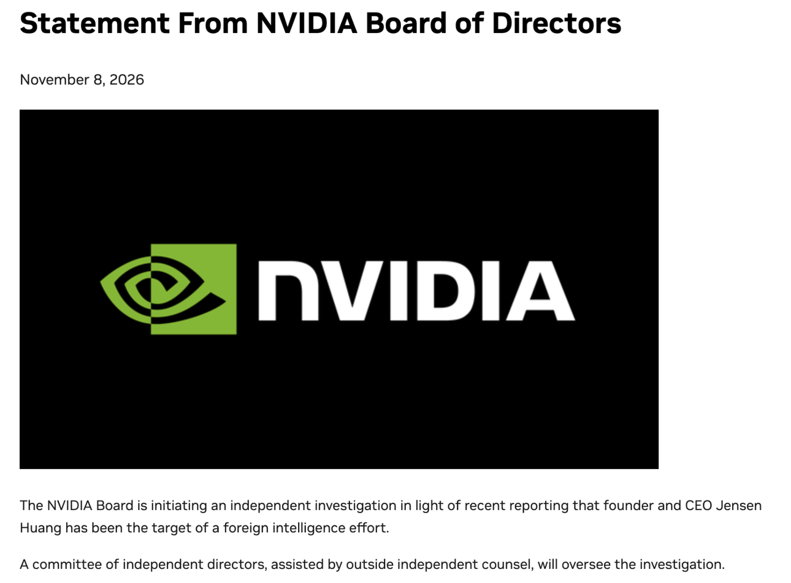
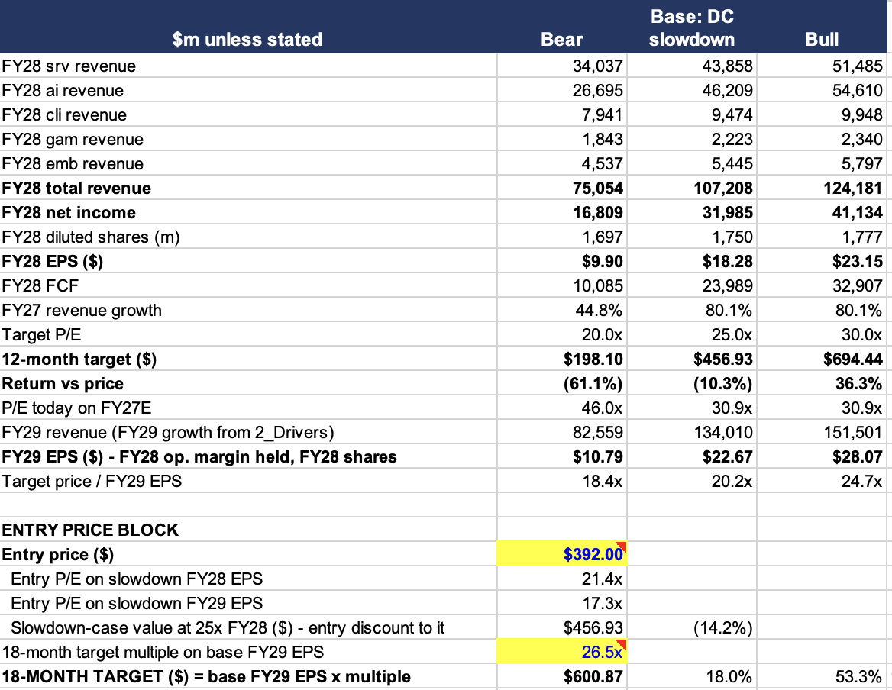
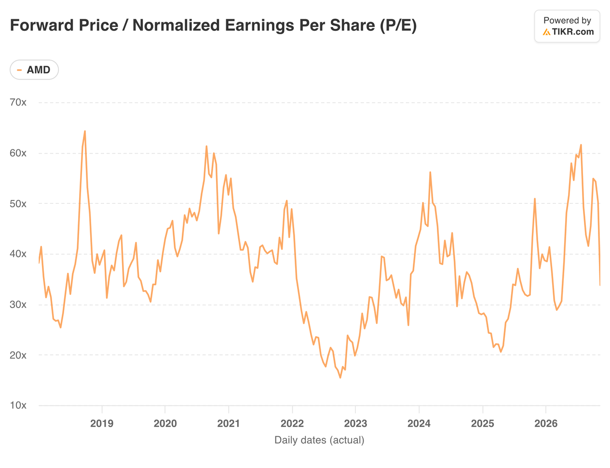
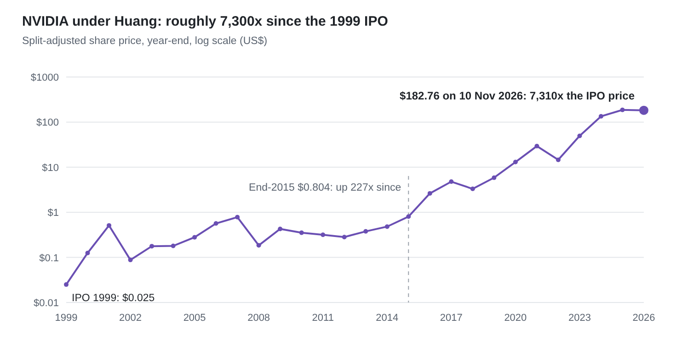
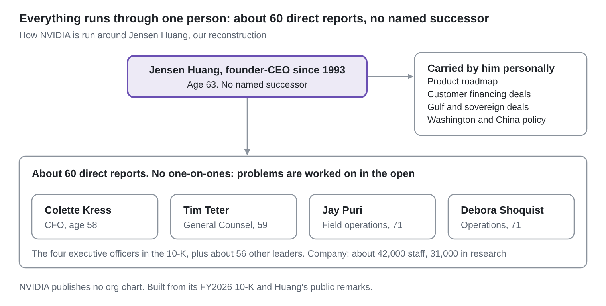

**NVIDIA's board opened an independent investigation on 8 November into reports that Jensen Huang was the target of a foreign intelligence effort.** The board says it has no reason to believe national security or company secrets were compromised, and that it has confidence in Huang ([NVIDIA board statement](https://investor.nvidia.com/news/press-release-details/2026/Statement-from-NVIDIA-Board-of-Directors/default.aspx)). Three House committee chairs have asked him for a closed-door briefing on 18 November ([The Next Web](https://thenextweb.com/news/house-chairs-jensen-huang-briefing-megaspeed)).

We do not judge the allegation here. Our question is narrower: **if the company that sells most of the world's AI accelerators loses its founder's authority in Washington or at the helm, what changes in the next 6 to 12 months, and who wins the 2028 earnings? **Our answer is AMD.

## Preliminary conclusion: Accumulate on Weakness, buy at $392, 18-month target $600

**We prefer AMD over NVIDIA and Google's TPU.** Reference price $509.31 (10 November 2026). Three reasons:

1. **It is the only merchant alternative to NVIDIA in GPUs.** NVIDIA's governance problem turns a second supplier from a price lever into a board-level requirement for every large buyer.
2. **It sells into the custom-chip camp too.** Google's newest TPU 8tx runs on AMD EPYC host CPUs. AMD says OpenAI picked EPYC as the host for its first custom accelerators. When TPU wins, AMD often still ships.
3. **Server CPUs are the part of AI least bound by power permits.** CPU racks draw a fraction of a GPU rack's power and fit into existing data centers.

**Why not buy at $509.** At 25x, today's price needs FY28 EPS of about $20.37, or 24% growth on FY27. Our base case, built on Morgan Stanley's 2028 slowdown, has 11%. Our bull case has 40%. The selloff has priced part of the slowdown, not all of it.

**Why $392.** It is 21.4x our base-case FY28 EPS of $18.28 and 17.3x FY29. It assumes FY28 EPS of about $15.68, 14% below even our slowdown case, so we are paid for the risk. AMD traded at $402 intraday on 5 November, so the level is reachable. From $392, our base case returns 17% in 12 months and our bull case 77%.

**Where the analysis does not support it.** $392 does not protect against our bear case of $198 (20x trough EPS of $9.90). That needs a cyclical downturn on top of the slowdown, plus a broad China ban.

The full model, with all three cases and every assumption here:

**Historical forward P/E**

**What would change our view**

- **More positive. Raise the buy level to $457** (our base-case value) if a hyperscaler names AMD as a second source for 2028 capacity, or an independent test shows EPYC Venice matching NVIDIA's Vera on agent work.
- **More negative. Move to Watchlist** if AMD's inventory rises again at the Q4 print while it guides revenue flat, if licensed China sales are revoked across the industry, or if Helios deployments slip past mid-2027. None of these is in our base case.
- **Ceiling.** We would not chase above $600.

## What comes after Jensen

**The record.** Huang co-founded NVIDIA in April 1993 and has run it ever since. Bloomberg calls him the longest-serving CEO in Silicon Valley ([Bloomberg](https://www.bloomberg.com/news/articles/2026-01-27/nvidia-lacks-clear-successor-for-superstar-ceo-who-built-company)). The stock listed in January 1999 at $12, about $0.025 after six stock splits (our calculation). At $182.76 it has risen roughly 7,300 times. Even from the end of 2015, before the AI era, it is up about 227 times ([Macrotrends](https://www.macrotrends.net/stocks/charts/NVDA/nvidia/stock-price-history), split-adjusted).

*Source: Macrotrends year-end closes 2000-2025 (split- and dividend-adjusted). IPO $12 divided by 480 for six splits (our calculation). 2026 = IBKR, 10 Nov 2026.*

**How central he is.** Huang runs NVIDIA through about 60 direct reports and holds no one-on-ones. Problems are worked on in the open, with everyone present ([Entrepreneur](https://www.entrepreneur.com/business-news/why-nvidia-ceo-jensen-huang-never-has-one-on-one-meetings), from the Lex Fridman podcast). The structure is flat by design, and he sits at the centre of it. **He also personally carries what moves the stock beyond the chips: the product roadmap, the customer financing deals, the Gulf and sovereign deals, and NVIDIA's case in Washington. **He travelled with President Trump to Beijing this year to push for H200 deliveries ([The Next Web](https://thenextweb.com/news/nvidia-h200-china-licences-huang-beijing-trip)).

*Source: our reconstruction from NVIDIA's FY2026 10-K (executive officers, headcount) and Huang's remarks on the Lex Fridman podcast.*

**Succession: the gap is the risk.** NVIDIA has no named successor ([Bloomberg](https://www.bloomberg.com/news/articles/2026-01-27/nvidia-lacks-clear-successor-for-superstar-ceo-who-built-company)). Huang's own answer is that he shares what he knows continuously, so his direct reports could run the company ([Wccftech](https://wccftech.com/nvidia-ceo-doesnt-believe-in-succession-plans/)). The 10-K names four other executive officers: CFO Colette Kress (58), General Counsel Tim Teter (59), and Jay Puri and Debora Shoquist, who run sales and operations and are both 71 ([NVIDIA 10-K FY2026](https://www.sec.gov/Archives/edgar/data/1045810/000104581026000021/nvda-20260125.htm)). Huang is 63. **The two longest-serving operators are older than he is. An abrupt exit would leave no obvious internal heir, and the market would price that before it could judge whoever came next.**

**What Washington could do to NVIDIA.** We separate what is in force from what is proposed:

- **In force.** Commerce clears H200 sales to China case by case. It has approved roughly two dozen Chinese firms. The New York Times found that one approved assembler, New Matrix, lists an empty office and has owners linked to a blacklisted fund ([via FourWeekMBA](https://fourweekmba.com/ai-two-us-cleared-nvidia-h200-firms-in-china-had-empty-offices/)).
- **Formally proposed.** Senators Jim Banks (R) and Elizabeth Warren (D) asked Commerce in March to pause NVIDIA licences for China and four Southeast Asian countries ([Senate Banking Committee](https://www.banking.senate.gov/newsroom/minority/senators-banks-and-warren-urge-commerce-secretary-lutnick-to-suspend-or-reconsider-nvidia-export-licenses-amid-supermicro-chip-diversion-indictment)). The House Foreign Affairs Committee passed the Chip Security Act, which requires location checks on advanced chips ([House China Committee](https://chinaselectcommittee.house.gov/media/press-releases/house-committee-passes-chip-security-act)). Warren is expected to chair Senate Banking from January.

**If the allegation holds**, the likely sequence is: H200 China licences frozen, the Chip Security Act fast-tracked with support from both parties, and a compliance monitor on NVIDIA's board. **None of that cuts orders from US hyperscalers. It cuts the China option and the premium the market pays for Huang's ability to bend policy.**

**Wider controls hit AMD too, which is why China is not our case.** Restrictions would likely apply to every US accelerator, not just NVIDIA's. AMD has licensed MI308 sales to China ([AMD Q3 2026 10-Q](https://www.sec.gov/Archives/edgar/data/2488/000000248826000191/amd-20260926.htm)). It billed 22.4% of 2025 revenue ($7.8bn) to China and Hong Kong, across all products and by billing location, so it includes PC chips sold to Chinese assemblers ([AMD 2025 10-K](https://www.sec.gov/Archives/edgar/data/2488/000000248826000018/amd-20251227.htm)). NVIDIA reported 8.2% of revenue from China-headquartered customers in its July quarter ($7.9bn of $96.2bn), and 9.1% for fiscal 2026, with Hopper shipments to China under 1% of data-center revenue ([NVIDIA Q2 FY2027 10-Q](https://www.sec.gov/Archives/edgar/data/1045810/000104581026000075/nvda-20260726.htm)). And Beijing is already blocking imports itself: it told its firms to pause H200 orders this year ([The Next Web](https://thenextweb.com/news/nvidia-h200-china-licences-huang-beijing-trip)). Demand that cannot go to NVIDIA in China does not go to AMD either.

**Where AMD actually gains: customers taking a second supplier.** Every large buyer now has governance risk in its supply chain. A board approving a multi-gigawatt order has to ask what happens if NVIDIA's founder is gone or its export licences are frozen. The answer is a qualified second merchant GPU, and there is only one. AMD already has 6-gigawatt agreements with OpenAI and Meta. Big buyers are approving every vendor: Oracle says it is "continuing to build with Intel, NVIDIA, and AMD". In 2027 AMD cannot take more, because it is sold out. **The gain shows up in 2028, if NVIDIA releases capacity at TSMC as TrendForce reports it might ([TrendForce](https://www.trendforce.com/news/2026/11/10/news-nvidia-order-cuts-reportedly-loom-amid-huang-controversy-amd-asic-rivals-may-gain-tsmc-capacity/), unconfirmed). Our model adds 8% to AMD's 2028 GPU revenue for this**. It is our assumption, and the main thing to test.

**The OpenAI deal: what AMD gets, and what it pays.** In October 2025 OpenAI agreed to deploy 6 gigawatts of AMD GPUs over several generations, starting with 1GW of MI450 from the second half of 2026 ([OpenAI](https://openai.com/index/openai-amd-strategic-partnership)). AMD's CFO said it would bring "tens of billions of dollars in revenue". At the $15-20bn per gigawatt an analyst cited on the Q3 call, the full 6GW is worth roughly $90-120bn over several years. OpenAI pays cash for the chips. **To win the order, AMD added a sweetener: a warrant for up to 160m AMD shares, which OpenAI can buy for almost nothing. The shares unlock only as OpenAI's gigawatts ship and as AMD's share price rises. Meta got the same deal, with a final price hurdle of $600. In effect, AMD gives a discount paid in its own stock instead of cash. **That ties OpenAI's interest to AMD's success, but the two big deals together could hand over up to about 20% more shares. The risk is OpenAI's ability to finance and build: if its 2028 projects slip with the permit delays, the later tranches slip too.

**The 6 to 12 month view.** The orders that matter are being placed now for 2027, and AMD's 2027 is sold out either way. NVIDIA's earnings are not at risk in that window. Its multiple is. For AMD, the year in play is 2028: whether the second-supplier gain arrives just as Morgan Stanley's slowdown hits.

## NVIDIA vs AMD vs TPU, plus Trainium

**Custom chips are the bigger threat to NVIDIA, but they do not take AMD's slot.** Four players sell four different things:

| Company | What it sells for AI | Main buyers | Price, 10 Nov |
| --- | --- | --- | --- |
| NVIDIA | Merchant GPUs, full racks, networking, CUDA software | Everyone | $182.76 |
| AMD | Merchant GPUs (MI450 in Helios racks) and EPYC server CPUs | Frontier labs, hyperscalers, sovereigns. Also the host CPU inside Google's TPU 8tx | $509.31 |
| Alphabet | TPU, a custom chip, through Google Cloud and now direct into customer sites | Nearly 100 customers, including Anthropic, Meta, Apple, Oracle | $288.15 |
| Amazon | Trainium, a custom chip, through AWS | Anthropic and OpenAI, on multi-gigawatt commitments | $267.55 |

Prices from IBKR.

**The TPU numbers, and what they are.** Bloomberg Intelligence expects TPU sales to grow from about $12bn this year to more than $135bn in 2028 ([Bloomberg via Yahoo Finance](https://finance.yahoo.com/technology/ai/articles/google-escalates-nvidia-rivalry-specialized-123000247.html)). That is an analyst forecast, not guidance. It includes related hardware and software, and excludes customers who use TPUs through Google Cloud. Its analyst says TPUs cost about 30% less than NVIDIA GPUs for similar throughput. Anthropic holds an option to buy up to $150bn of TPUs between 2028 and 2031. Google launched two more chips on 9 November, TPU 8tx and TPU 8i Max ([Google](https://blog.google/innovation-and-ai/infrastructure-and-cloud/global-network/tpu-8i-max-and-8tx/)). Morgan Stanley credits the TPU 8 generation with up to 2.7x the training performance and 80% better inference price-performance than the last.

**Trainium is the same model at Amazon.** Amazon's chip business, including Graviton and Nitro, passed a $25bn annual run rate in Q2 2026. Andy Jassy has said it would be about $50bn if sold to outsiders ([The Register](https://www.theregister.com/2026/04/29/amazon_chips_20b_business/)).

**Who wins where.** Custom chips win inside their owner's cloud, and with labs tied to that owner. Buyers outside those clouds want a GPU they can own, move and program with open software: Meta, OpenAI, Oracle, sovereign projects and the neoclouds. That is the merchant market, and after NVIDIA there is only AMD in it. AMD also sells to the custom camp. TPU 8tx pairs Google's chip with AMD's EPYC hosts, and OpenAI picked EPYC as the host CPU for its first custom accelerators.

**Why Alphabet is not a pure accelerator bet.** Google is still one of the strongest hyperscalers, with Cloud up 103% to $30.7bn in Q3 ([Alphabet Q3 2026 release](https://s206.q4cdn.com/479360582/files/doc_news/2026/Oct/28/attachments/2026q3-alphabet-earnings-release.pdf)). But its share price is driven by much more than TPUs. Q3 search advertising came in at $63.4bn against about $65bn expected, and the stock fell about 10% after hours on 28 October, even as TPU demand grew fast. TPU is still small next to Search and YouTube: advertising was $82.0bn in the quarter, about 64% of revenue. Even a $135bn TPU business in 2028 would be one driver among several.

## The dark horse: server CPUs in a power-constrained world

**The market sees AMD as a GPU challenger. In 2028, its CPUs may matter more.** Agents spend much of their time between model calls: running tools and code, starting sandboxes and checking results. That work runs on CPUs. Andy Jassy said on 29 October that reinforcement learning after training and agent tool use are "mostly done on CPUs versus AI accelerators".

**Demand is ahead of supply.** Intel's data-center business grew 78% last quarter at a 42% operating margin. Intel says the industry is "supply-constrained throughout 2027 and into 2028". Both Intel and AMD see the server CPU market topping $200bn within about five years. AMD expects server revenue to roughly double in 2027, "mostly in units and core counts" ([Q3 2026 call](https://web.quartr.com/companies/4705/events/724028/overview)).

**Why CPUs suit a slowdown.** A CPU rack draws a fraction of a GPU rack's power and can replace old servers in existing buildings. It does not need the new powered shells that the 2028 permit delays will hold back. Server CPUs also carry higher margins than DC AI, which AMD's CFO calls "a little bit dilutive". If GPUs slow and CPUs keep growing, AMD's gross margin rises. That is why our bull case has server revenue up 35% in 2028 and gross margin at 56%.

**The threat is real.** NVIDIA's own Vera CPU runs agent workloads about 1.2x faster than AMD's current EPYC in tests run by NVIDIA customers and partners. Arm's first CPU and Amazon's Graviton are competing for the same sockets. AMD's new generation, Venice, has not been tested independently. The shortage protects pricing for now. Once supply catches up, buyers can split orders across vendors and cap prices, which Intel's own words put in late 2028 at the earliest.

## AMD in Morgan Stanley's slowdown

**AMD is now a data-center company.** Data Center will be about 65% of 2026 revenue and about 70% of segment profit:

| Segment | FY26E revenue | Growth | 9M-26 operating margin | Share of 9M-26 segment profit |
| --- | --- | --- | --- | --- |
| Data Center | $33.9bn | +104% | 31% | 69% |
| Client | $11.1bn | +5% | 15% (with Gaming) | 18% (with Gaming) |
| Gaming | $2.9bn | -25% |  |  |
| Embedded | $4.2bn | +22% | 40% | 12% |
| **Total** | **$52.1bn** | **+51%** |  |  |

FY26E is nine months reported plus our Q4 build from the guide (Jan-Dec 2026). Margins exclude unallocated costs. Source: AMD 8-K segment tables ([Q3 2026](https://web.quartr.com/m/documents/3955570), [Q4 2025](https://web.quartr.com/m/documents/2740568)).

**2027 is sold out. In 2028 the bottleneck moves from chips to permits.** Think of three separate constraints: chips (wafers, packaging, HBM memory), powered buildings, and end demand for AI. In 2027 chips bind. AMD says it has secured "wafers, substrates, advanced packaging, memory" and still has more demand than supply. Morgan Stanley keeps 2027 AI capex unchanged because governors are unlikely to disrupt projects already under construction (Morgan Stanley, 8 Nov 2026).

2028 is different. Morgan Stanley moves 5GW of US projects into 2029, 20% of US projects and 10% of global ones. US data-center additions fall 4% in 2028, from 20.7GW to 19.9GW, then jump 38% in 2029. Hyperscaler capex grows 73% in 2027 to $1,641bn, then only 7% in 2028. Morgan Stanley spells out what that means for chips:

> "a shift in the bottleneck to the powered shell stage will result in reduced undersupply and pricing power and potentially a buildup of inventory or a slowing in orders… the supply chain could go through a traditional down-cycle of slowing orders, margin normalization and earnings downgrades, even if AI demand is intact."

**Our read: GPUs move to balance in 2028, CPUs stay short.** Chip capacity for 2028 was planned for a bigger build. Up to about 10% too much supply globally is the gap, before anything absorbs it (our estimate). Three things can absorb it:

1. swapping older GPUs out of already-powered sites,
2. the 20GW of potential spillover Morgan Stanley sees in Asia and Europe
3. and more spend per gigawatt.

We expect roughly balanced, not a glut. Server CPUs need no new buildings, so their shortage should last longer.

**What our base case assumes.** 2027 at management's markers: revenue +80%, server revenue doubling. 2028 revenue +14%, with server CPUs up 15% and GPUs up 19% including the second-supplier gain. Gross margin slips from 55% to 54% as pricing power fades. That is faster than hyperscaler capex because of share gains, and it is the case $392 is built on.

**The risk this creates for AMD.** Some of AMD's GPU wins exist because NVIDIA is sold out. When chips stop being scarce, those buyers can go back. AMD then has to win on cost per token alone. That makes 2028 a clean test of the second-supplier thesis.

**What to watch.**

- **AMD's inventory.** It rose $3bn in Q3 to $11.5bn, about 1.5 quarters of cover. I/O Fund warns that "any slip in Helios deployment schedules would leave inventory elevated". Receivables have risen to about 63 days of sales.
- **Hyperscalers' 2028 capex comments** on their January and February prints.
- **TSMC's advanced-packaging plans, and HBM contract prices.**
- **NVIDIA order cuts**, reported by TrendForce and unconfirmed.

## Latest earnings and catalysts

**Q3 2026 (Jul-Sep) was a beat, and the guide was a bigger one.** Revenue was $13.4bn, up 45%, against a consensus of about $13.1bn. Data Center revenue nearly doubled to $8.5bn. Non-GAAP EPS was $2.09 against $1.94 expected (consensus figures via I/O Fund). Q4 guidance is $17bn plus or minus 3%, up 66%, against a consensus of about $16.2bn ([AMD Q3 2026 release](https://web.quartr.com/m/documents/3955570)). At a 55% gross margin and $3.75bn of opex, the guide implies Q4 EPS of about $2.91 (our calculation).

**Management's 2027 markers, in its own words** ([Q3 2026 call](https://web.quartr.com/companies/4705/events/724028/overview)):

- Lisa Su: "we now expect revenue to grow more than 80% in 2027". The Street was at about 60% before the print.
- Server CPUs will "about double". Data Center AI will "significantly more than double".
- Data Center will be "more than 80% of our total revenue in 2027".
- Jean Hu: opex will grow at "less than half of the top-line revenue growth rate".

**The weak spots.** Free cash flow fell to $554m as inventory rose by $3bn. Debt rose to $7.1bn after a $4.75bn bond issue. A $1.1bn non-cash charge on customer warrants hit GAAP profit. OpenAI and Meta can each earn up to 160m shares at $0.01 as gigawatts ship and price hurdles up to $600 are met ([Meta warrant 8-K](https://www.boardroomalpha.com/sec/amd-8-k-2026-02-24-0000002488-26-000045)). That is up to 19% dilution. AMD will guide the share-count impact in 2027.

**How the stock took it.** The print itself moved AMD only 1% on 4 November. The next day it fell 17% with the chip index on the election result, then recovered to $508.58 by 9 November. Politics, not results, is setting the price.

**Catalysts, next six months**

- **17 November:** NVIDIA's Q3 FY2027 results ([NVIDIA](https://nvidianews.nvidia.com/news/nvidia-sets-conference-call-for-third-quarter-financial-results-6928873)). Watch for any change in 2027-28 order language.
- **18 November:** the closed-door House briefing requested from Huang. Whether he attends is not yet known.
- **January 2027:** the new Democratic Congress is sworn in. Watch for the Chip Security Act and licence reviews.
- **Late January to early February:** hyperscalers' Q4 prints and their first 2028 capex comments.
- **Early February:** AMD's Q4 print (date not yet set). Inventory, the 2027 guide and warrant share-count guidance.

## Valuation, risks and revisiting our case

**At $509, only the bull case pays over 12 months.** We value each case on FY28 EPS, which is what the market will price in November 2027:

| Case | FY28 EPS | P/E | 12-month value | vs $509 |
| --- | --- | --- | --- | --- |
| Bear: slowdown, downturn, China ban | $9.90 | 20x | $198 | -61% |
| Base: Morgan Stanley's slowdown | $18.28 | 25x | $457 | -10% |
| Bull: chip replacement, CPUs, overseas, second supplier | $23.15 | 30x | $694 | +36% |

Non-GAAP EPS, our estimates. FY26 is $8.03 and FY27 $16.48 in base and bull.

**Why these multiples.** Today AMD trades at about 31x our FY27 EPS. On TIKR's GAAP data its forward P/E of 38.2x is the lowest since 2017, against a 2017-2026 median of 53.4x. We do not use that history directly: those multiples sat on much smaller earnings. Instead we match the multiple to growth. The bull case compounds EPS at about 30% a year from FY27 to FY29, so 30x. The base case compounds at about 17%, so 25x is already generous. The bear gets a trough multiple on trough earnings.

**Key risks**

- Helios deployments slip and inventory builds into 2027.
- NVIDIA capacity comes back and buyers who chose AMD because NVIDIA was sold out return to it.
- A broad China ban removes AMD's licensed MI308 sales and triggers inventory charges.
- Customer warrants dilute shareholders by up to 19%.
- NVIDIA's Vera and Arm-based CPUs take agent sockets before Venice proves itself.

**Revisiting our case**

1. **Customers take AMD as a second supplier.** Fails if no hyperscaler or frontier lab names AMD for new 2028 capacity by AMD's Q2 2027 print. The cleanest proof is a large repeat order with no warrant attached.
2. **Server CPUs carry AMD through the slowdown.** Fails if CPU supply catches up and pricing falls during 2027, or if independent tests of Venice by 31 March 2027 trail NVIDIA's Vera.
3. **The slowdown is a delay, not a cut.** Fails if hyperscalers' first 2028 capex comments point down rather than flat, or if AMD's inventory rises again at the Q4 print.

**Open questions**

- How much accelerator revenue does AMD earn in China today? It does not disclose it.
- Will NVIDIA release capacity at TSMC, and will AMD get it?
- How big are the warrant tranches, and at what share prices do they vest?
- What does Huang say, if he attends, on 18 November?

**Conclusion.** We prefer AMD as the way to own the move away from a single AI supplier, whatever happens to Jensen Huang. It is the only merchant alternative to NVIDIA, it sells into the custom-chip camp, and its CPUs suit a world short of power. But today's price already assumes a stronger 2028 than our base case. We rate AMD Accumulate on Weakness, look to buy at $392, and set an 18-month target of $600.

## Sources

**Company primary**

- [AMD Q3 2026 earnings release](https://web.quartr.com/m/documents/3955570), [Q2 2026](https://web.quartr.com/m/documents/3666985), [Q1 2026](https://web.quartr.com/m/documents/3286951), [Q4 2025](https://web.quartr.com/m/documents/2740568)
- [AMD Q3 2026 earnings call transcript](https://web.quartr.com/companies/4705/events/724028/overview)
- [AMD-Meta 6GW partnership](https://ir.amd.com/news-events/press-releases/detail/1279/amd-and-meta-announce-expanded-strategic-partnership) and [Meta warrant 8-K summary](https://www.boardroomalpha.com/sec/amd-8-k-2026-02-24-0000002488-26-000045)
- [NVIDIA board statement, 8 Nov 2026](https://investor.nvidia.com/news/press-release-details/2026/Statement-from-NVIDIA-Board-of-Directors/default.aspx)
- [NVIDIA 10-K FY2026](https://www.sec.gov/Archives/edgar/data/1045810/000104581026000021/nvda-20260125.htm) (executive officers, headcount)
- [NVIDIA Q3 FY2027 call date](https://nvidianews.nvidia.com/news/nvidia-sets-conference-call-for-third-quarter-financial-results-6928873)
- [Google TPU 8tx and 8i Max](https://blog.google/innovation-and-ai/infrastructure-and-cloud/global-network/tpu-8i-max-and-8tx/)

**Politics**

- [House chairs request Huang briefing (The Next Web)](https://thenextweb.com/news/house-chairs-jensen-huang-briefing-megaspeed)
- [Banks-Warren letter to Commerce, 24 Mar 2026](https://www.banking.senate.gov/newsroom/minority/senators-banks-and-warren-urge-commerce-secretary-lutnick-to-suspend-or-reconsider-nvidia-export-licenses-amid-supermicro-chip-diversion-indictment)
- [Chip Security Act passes House Foreign Affairs Committee](https://chinaselectcommittee.house.gov/media/press-releases/house-committee-passes-chip-security-act)
- [NYT report on H200 licensees (via FourWeekMBA)](https://fourweekmba.com/ai-two-us-cleared-nvidia-h200-firms-in-china-had-empty-offices/)
- [H200 China clearances (The Next Web)](https://thenextweb.com/news/nvidia-h200-china-licences-huang-beijing-trip)
- [2026 midterm results (OPB/NPR)](https://www.opb.org/article/2026/11/04/2026-midterms-democrats-win-the-senate/)

* [OpenAI-AMD partnership, 6 Oct 2025](https://openai.com/index/openai-amd-strategic-partnership)
* [TipRanks: Morgan Stanley on AMD, Oct 2025](https://www.tipranks.com/news/still-has-to-prove-itself-says-morgan-stanely-about-amd-stock)

**Market and research**

- Morgan Stanley Global Thematics, "Buy the Drop: AI Investment Opportunities Post the US Midterms", 8 Nov 2026 (excerpts held by us, not public)
- [Bloomberg on TPU forecast (via Yahoo Finance)](https://finance.yahoo.com/technology/ai/articles/google-escalates-nvidia-rivalry-specialized-123000247.html)
- [Bloomberg: NVIDIA lacks clear successor](https://www.bloomberg.com/news/articles/2026-01-27/nvidia-lacks-clear-successor-for-superstar-ceo-who-built-company)
- [Entrepreneur on Huang's 60 direct reports](https://www.entrepreneur.com/business-news/why-nvidia-ceo-jensen-huang-never-has-one-on-one-meetings), [Wccftech on succession](https://wccftech.com/nvidia-ceo-doesnt-believe-in-succession-plans/)
- [BEP Research, "What Is an Agentic CPU?", 9 Nov 2026](https://newsletter.bepresearch.com/p/what-is-an-agentic-cpu-five-tests) (Intel and Jassy quotes are cited from here)
- I/O Fund, "AMD's Q3: Two Catalyst Punch Leads to 80% FY27 Outlook", 4 Nov 2026 (consensus figures, inventory cover)
- [TrendForce on NVIDIA order cuts](https://www.trendforce.com/news/2026/11/10/news-nvidia-order-cuts-reportedly-loom-amid-huang-controversy-amd-asic-rivals-may-gain-tsmc-capacity/)
- [Amazon chips run rate (The Register)](https://www.theregister.com/2026/04/29/amazon_chips_20b_business/), [Amazon Q2-Q3 2026 releases (via FourWeekMBA)](https://fourweekmba.com/ai-how-amazons-ai-machine-works-aws-made-63-of-q3-profit/)
- [NVIDIA price history (Macrotrends)](https://www.macrotrends.net/stocks/charts/NVDA/nvidia/stock-price-history). Prices: IBKR, 10 Nov 2026
- AMD forward P/E history: TIKR.com, GAAP basis

**Checked against the filings in Quartr:** NVIDIA's China revenue ([Q2 FY2027 10-Q](https://web.quartr.com/m/sources/s69936978981), [FY2026 10-K](https://web.quartr.com/m/sources/s51955685246)), NVIDIA's Hopper-to-China share ([Q2 FY2027 10-Q](https://web.quartr.com/m/sources/s69995782131)), AMD's China revenue ([2025 10-K](https://web.quartr.com/m/sources/s58541292688)) and AMD's MI308 licence language ([Q3 2026 10-Q](https://web.quartr.com/m/sources/s67190200705)). The two China figures use different measures: NVIDIA by customer headquarters, AMD by billing location. **Not re-verified by us:** Alphabet's Q3 figures, which come from the link in our earlier draft. The Morgan Stanley and I/O Fund figures are as published by them. Consensus figures are single-source.
