# The USD Debasement Basket: initiation report

Date: 2026-05-20
Theme: US Dollar Devaluation
Type: theme
Tickers: FNV, WPM, AEM, ALS
Canonical: https://theme-radar.github.io/research/usd-debasement-initiation/

Summary: Gold royalty and streaming companies are the hedge we need for the financial repression era. Basket: FNV, WPM, AEM and ALS.

Watch the US 10Y Treasury yield. It is the single most important macro variable for the next few months.

Today:

- US 10Y: 4.65%
- US 30Y: 5.17%
- Highest long bond yield in 19 years

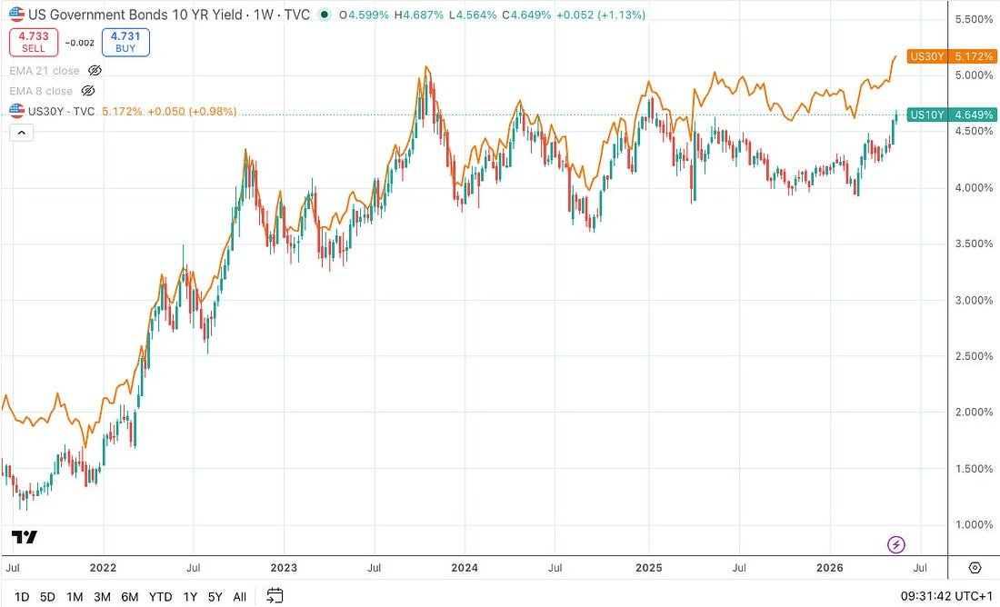

This is no longer a bond market story. The 10-year yield is now the input variable for every other asset class — equities, the dollar, property, gold, the entire commodity complex. Reasoning from first principles, the cleanest hedge is a basket of equities structurally levered to the USD debasement trade.

**Here’s the chain of logic, step by step:**

- **10-year at 4.5% is the political pain threshold.** In April 2025, when the 10Y spiked from ~3.9% to 4.5% in three trading sessions, Trump paused his reciprocal tariffs within days. Treasury Secretary Scott Bessent was reportedly the voice in the room arguing the pivot was non-negotiable. The bond market — not the stock market — forced the U-turn.
- **Yields are back at the pain threshold now.** 10Y at 4.68%, 30Y at 5.12%. Bessent and Trump have to pull these yields back down. They have no choice — the US has ~$9.7 trillion of debt to refinance in the next twelve months, and every basis point of yield is real interest expense the budget cannot absorb.
- **The structural problem:** the US has **no natural marginal buyer** for its debt at current size. Foreign official holdings have stagnated; the Fed is still running off the balance sheet. Treasury needs to engineer demand without announcing QE, because explicit monetization would break dollar credibility.
- **The likely toolkit is financial repression**: making banks the marginal buyer via a permanent SLR exemption (precedent: COVID-era temporary exemption freed ~$600B of capacity), and channeling stablecoin issuers into T-bills via the GENIUS Act framework. **The result: nominal yields artificially suppressed, inflation tolerated above target, real yields negative or near zero.**
- **Gold and the USD debasement trade are where the value goes.** Negative real yields are the single cleanest tailwind for gold and hard assets. Gold streamers express this with operating leverage and no exposure to mining cost inflation.

**This piece initiates on four names:**

- **Franco-Nevada (FNV) —** the blue-chip gold royalty company. Debt-free, 19-year dividend grower.
- **Wheaton Precious Metals (WPM) —** silver-heavy streaming pure-play with the biggest growth pipeline in the sector.
- **Agnico Eagle (AEM) —** the senior gold miner. Adds direct operating leverage if gold runs to $5,500-6,000.
- **Altius Minerals (ALS) —** the diversified debasement-trade kicker. Owns royalties on copper, lithium, potash, and electricity. With an under-appreciated AI data center angle.

**The setup is binary, and both outcomes pay me.** If Bessent’s plan works and yields come down, the USD debasement trade rallies on the real-yield tailwind. If he fails and yields keep climbing, the resulting sovereign-credit/USD credibility panic sends gold even higher as a flight-to-safety bid. **Both roads lead to the same trade.** The basket is built capital-preservation first, returns second.

> **Terminology**
>
> **GEO (Gold Equivalent Ounce).** The unit royalty/streaming companies use to express a mixed-metal portfolio in a single comparable number. Other metals are converted into gold ounces using realised period prices — e.g. at gold $4,500/oz and silver $50/oz, 90 oz of silver = 1 GEO. Each company discloses the price ratios it uses, so GEO counts can shift period-to-period from price changes alone, not just physical output. When you see “margin per GEO” or “cash cost per GEO” in this piece, it is the company’s own portfolio-weighted measure.
>
> **AISC (All-In Sustaining Cost).** The senior-producer (AEM) equivalent — total cash cost per ounce produced including sustaining capex, mine-site G&A, and reclamation, but excluding growth capex. The industry’s standard measure of operating margin per ounce for an integrated miner.
>
> **eSLR / SLR.** Supplementary Leverage Ratio. A bank capital rule requiring large US banks to hold capital against all assets, including Treasuries. The enhanced SLR (eSLR) is the version that applies to G-SIBs. Recalibration or full Treasury exemption is the central financial-repression lever this piece is built around.

## Part 1 — The Setup

### The buyer-of-last-resort problem

The US Treasury needs to refinance roughly $9 trillion over the next twelve months. Net new issuance is running at roughly $2 trillion per year on top of that. There is no natural marginal buyer at scale:

- Foreign official holdings have been flat-to-down for over a decade as a share of the float. China has been a net seller; Japan’s appetite is capped by its own currency and rates dynamics.
- The Federal Reserve is still running off its balance sheet (QT), though at a slower pace.
- Domestic banks have been net sellers since 2022 as deposits have shrunk and capital rules have tightened.
- Money market funds absorb T-bills but not the long end.

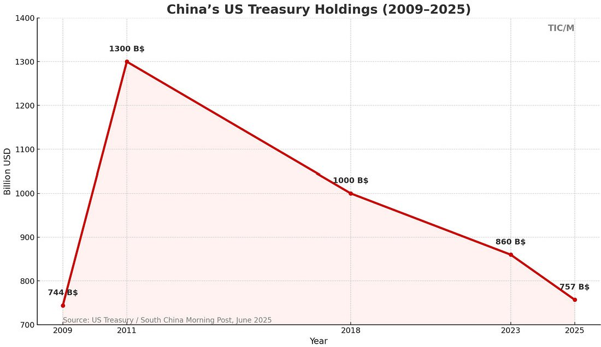

The Treasury cannot announce QE — explicit monetisation would break dollar credibility immediately. So the playbook has to engineer demand without naming it. This is what financial repression looks like in 2026.

### The financial repression playbook

Two policy levers are already in motion. Both are sometimes lumped together as stealth QE, though they’re better described as regulatory-driven demand engineering.

#### Lever 1: Supplementary Leverage Ratio reform

The supplementary leverage ratio (SLR) requires the largest banks to hold capital against all assets, including Treasuries. During COVID the SLR was temporarily relaxed for Treasury holdings, freeing up roughly $600 billion of bank balance-sheet capacity. The federal banking agencies **finalised the enhanced SLR (eSLR) rule on 25 November 2025**, with effect from 1 April 2026 — banks could elect to adopt the new standards as early as 1 January 2026. That is the first leg, and it is already done. Bessent stated publicly on 23 May 2025 that the administration is “very close to moving” on the next leg — full or partial exemption of US Treasuries from leverage ratio calculations for the G-SIBs. The implication is the same as during COVID: an immediate, structural increase in domestic bank demand for Treasuries, which is mechanically bullish for prices and bearish for yields at the long end.

#### Lever 2: Stablecoins as a regulated forced bid

The GENIUS Act and the broader regulated stablecoin framework essentially turn US-dollar stablecoin issuers into mandatory T-bill buyers. Tether alone now holds over $120 billion in US T-bills — already larger than Germany’s sovereign holdings of UST. If stablecoin issuance continues at its current trajectory and the regulatory framework consolidates around US-domiciled issuers, the implied incremental demand for T-bills is in the hundreds of billions over the next 24 months. Treasury gets a non-bank, non-sovereign, structurally captive demand source. The dollar gets defended on the way down.

### Why real yields no longer constrain gold

Here is the wrinkle that breaks the standard textbook gold framework. The 10-year TIPS yield is at **2.11%**. By the historical correlation — gold versus TIPS yield runs at roughly -0.75 since 2003 — gold should not be near $4,570 with real rates this high. Yet it is. The correlation has broken.

Three things are driving this:

- **Central bank buying.** Global central banks bought over 1,000 tonnes of gold annually in 2022, 2023, and 2024, and the pace continued in 2025-26. The People’s Bank of China is the most visible buyer but BRICS and Middle Eastern central banks are accumulating in parallel.
- **Sovereign credit hedging.** In a world where the US fiscal trajectory is structurally deteriorating and the cleanest collateral on Earth (USTs) is being managed for political optics, gold is the only neutral reserve asset that is no one’s liability.
- **Geopolitical reordering.** The freezing of Russian FX reserves in 2022 was a one-way ratchet on the rest-of-world’s willingness to hold UST as primary reserves. Gold has been the destination.

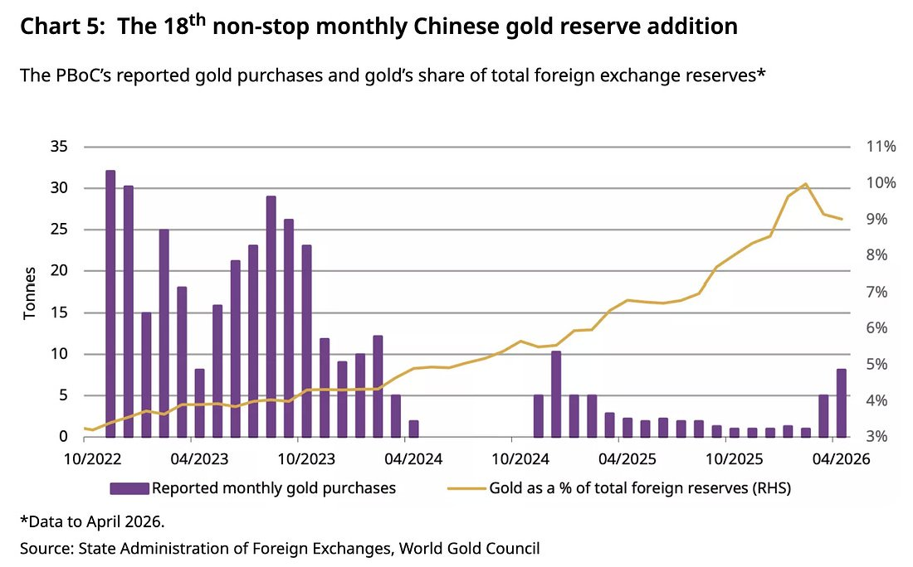

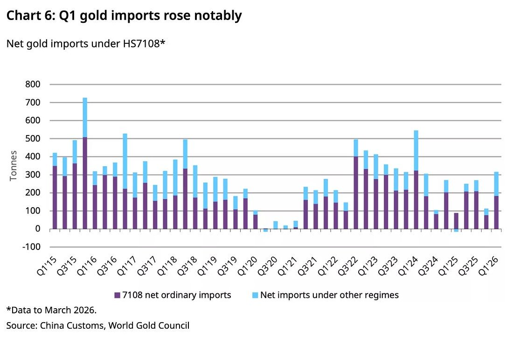

**This matters for the basket in a specific way. If gold can rally with real yields at 2%, what happens when financial repression compresses nominal yields and lets inflation run?** Real yields fall, and the textbook tailwind comes on top of the secular bid that already exists. The setup is not low real yields → gold — it’s gold is already in a secular bull driven by debasement, and real yield compression is the next leg up.

## Part 2 — Why royalty, streaming, and a senior producer

If the macro thesis is **a structural USD debasement trade for the next decade**, the question becomes how to express it. The choices are physical metal, gold ETFs, royalty/streaming companies, senior producers, and junior miners. The framework we’d apply: maximise leverage to commodity prices, minimise exposure to cost inflation, and avoid balance-sheet risk.

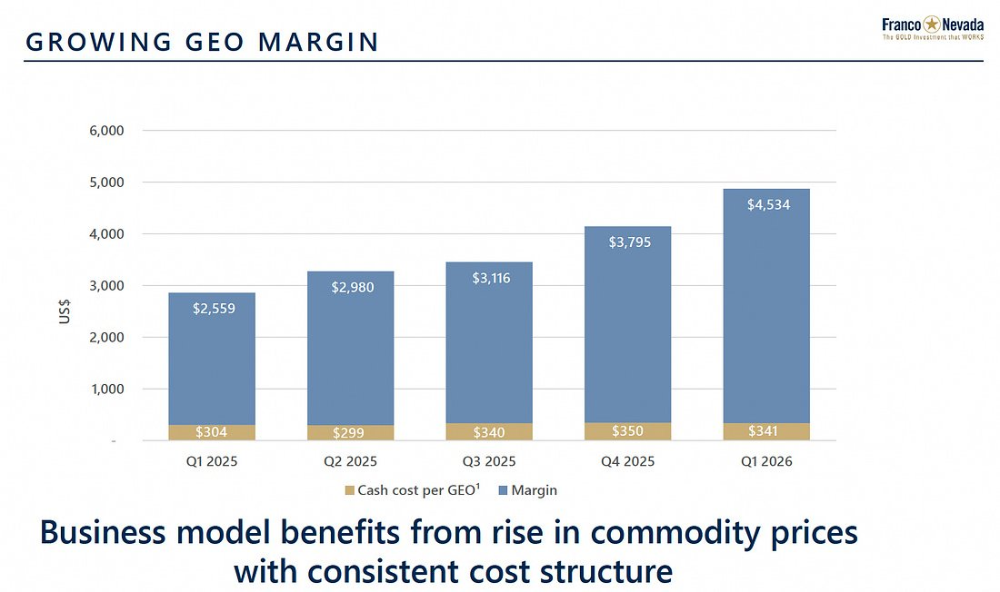

### The royalty / streaming model

A royalty company buys the right to a percentage of revenue from a mine. A streamer buys the right to a percentage of metal output at a fixed (low) cost. In both cases, the company makes a one-time upfront payment and receives a perpetual cash flow stream. Two structural advantages:

- **Capital light.** Once the deal is done, the streamer has no operating costs, no labour, no fuel, no maintenance capex. Operating expenses are essentially zero. Cash operating margins per gold-equivalent ounce sold are over $4,200 at Wheaton and over $4,500 at Franco-Nevada. Pure miners — even the best — run at 60-65% of that.
- **Immune to cost inflation.** This is the under-appreciated part. When energy, labour, and equipment costs rise — as they have for the past four years — miners absorb the hit. Streamers don’t. A streamer’s per-ounce cost is contractually fixed at deal inception, typically at a few hundred dollars per ounce. This is exactly the cost dynamic you want in an inflationary regime.
- **Optionality.** Streamers benefit from mine-life extensions, exploration upside, and new discoveries on the underlying property at no incremental cost. The longer the asset produces, the more the streamer collects.
- **Diversified by construction.** Top-tier streamers hold portfolios of 20-50+ assets across jurisdictions. Single-mine operational risk is minimal.

### Why include a senior producer (AEM)

Pure streamers give roughly 1.3x leverage to spot gold over a full cycle. A senior producer like Agnico Eagle gives roughly 2.0-2.5x leverage. The trade-off is operating risk and cost-inflation exposure. We include AEM for three reasons:

- Operating leverage. AEM’s all-in sustaining cost is ~$1,480/oz against a realised gold price of $4,861/oz in Q1 2026. Margins per ounce expand non-linearly with gold above $4,000.
- Tier-1 jurisdiction concentration. AEM operates almost entirely in Canada, Mexico, Finland, and Australia. No African or South American political risk to speak of.
- Capital return discipline. The company returns ~40% of free cash flow as dividends and buybacks, with an A- credit rating (Fitch, April 2026) and $2.9 billion net cash.

AEM is the operating-leverage leg. It is the part of the basket that gets you paid disproportionately if gold goes to $5,500-6,000.

### Why include Altius (ALS)

Altius is the smallest and most contrarian addition to the basket. It is a royalty company — same business model as FNV and WPM — but its portfolio is diversified across **copper, nickel, cobalt, lithium, potash, iron ore, and renewable electricity**. Precious metals exposure is incidental, not core.

The case for inclusion rests on a broader version of the thesis. Financial repression is not specifically a gold trade — it is a **broad USD debasement trade**. The same forces that push gold higher also push the broader commodity complex higher: structurally negative real rates, sovereign credit debasement, supply-side constraints in critical minerals, and a global energy transition that requires copper, lithium, nickel, and uranium at unprecedented scale.

Altius gives the basket exposure to all of this — at a market cap of roughly C$2.2 billion and a multiple substantially below the precious-metals royalty cohort. The recent acquisition of Lithium Royalty Corp (March 2026, $140M cash + 9.6M shares) is a high-conviction call on lithium oversupply normalising and prices recovering — which is already happening, with lithium prices having doubled from 2024 lows. The renewable electricity royalty portfolio (over 19,000 MW of potential capacity through GBR) is a direct play on US data centre demand and grid buildout.

Altius is the diversified debasement-trade kicker. It is smaller, less liquid, and more cyclical than the precious metals names. It also has the highest skew to the upside.

## Part 3 — What kills the thesis

The basket is wrong if any of the following happen:

- **Iran conflict de-escalation + Fed rate hikes.** If the Iran conflict is resolved and the Fed delivers a credible hiking cycle, real yields go higher, the dollar strengthens, and gold rolls over. This is the cleanest invalidation.
- **A credible fiscal consolidation.** Unlikely under either party, but a real deficit-reduction package would remove the debasement bid for gold. Watch the 2027 budget process. Although we put a very low probability of this happening.
- **China reserve reversal.** If China credibly stops accumulating gold and resumes buying USTs, the central bank bid weakens. Low probability but worth monitoring.
- **Operating risk at AEM.** The two fatal accidents at Fosterville and Canadian Malartic in early 2026 are a reminder. AEM’s tier-1 jurisdiction concentration limits political risk but not operational risk.
- **Cobre Panamá uncertainty for FNV.** The stream is currently impaired and the restart is targeted for Q3 2026, but the political situation in Panama remains fluid. Management is constructive but not betting the company on it.
- **Liquidity at ALS.** Daily volume is thin. The position should be built patiently and not exited in a hurry.

#### Catalysts and things to look out for…

- **SLR Treasury exemption announced.** The single highest-conviction catalyst. Treasury exemption from leverage ratios is the explicit financial-repression signal. Bessent has been telegraphing this since May 2025.
- **30-year sustained above 5.25% with no Fed response.** Confirms the administration has lost control of the long end without policy retort. Bullish for gold.
- **CPI prints tolerated above target with dovish Fed messaging.** The behavioural confirmation of financial repression. Watch the Fed’s reaction function to CPI surprises through Q3 2026.
- **Further central bank gold buying disclosed.** Q3 WGC data is the next major release.

## Appendix — Company primers

Each primer includes business model, revenue breakdown, Q1 2026 highlights, and notable management commentary from the most recent earnings call (Quartr).

### Franco-Nevada (FNV) — The gold royalty blue chip

#### What they do

Franco-Nevada is the largest and oldest precious-metals royalty company. Founded in 1983, IPO’d in 2007. The model is simple: pay a one-time upfront fee in exchange for a percentage of revenue (a royalty) or a fixed share of production at a low fixed cost (a stream) for the life of a mining asset. FNV owns interests in over 400 assets across multiple commodities and jurisdictions.

#### Revenue breakdown (Q1 2026)

- Precious metals (gold, silver, platinum, palladium): 85-87% of revenue
- Diversified assets (iron ore, oil & gas, NGLs): ~13% of revenue, contributed $82.6M in Q1
- Geographic split: 87% Americas (US, Canada, Mexico, Peru, Chile, Ecuador, Argentina)
- Top assets: Cobre Panamá (in restart), Antamina, Detour Lake, Candelaria, Antapaccay, Guadalupe-Palmarejo, MWS, Stibnite, Vale royalty

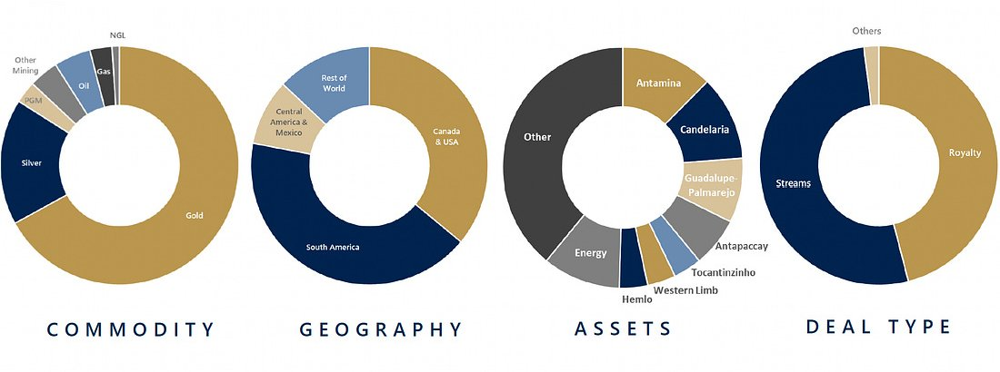

#### Q1 2026 in numbers

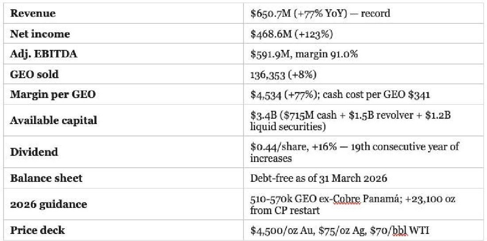

#### Notable management commentary

- “Margin per GEO increased 77% to $4,534, while cash cost per GEO was $341.” — The single best illustration of why the streaming model works in an inflationary regime.
- “Royalty and streaming model provides insulation from cost inflation and commodity price volatility.” — Management’s own framing.
- “Preference for private transactions over acquiring junior royalty companies.” — Capital allocation discipline; they’re not chasing the cycle.
- “MSCI ESG rating upgrade to AAA.” — Marginal but matters for institutional mandates.
- “Cobre Panamá received approval to process and export stockpiled ore; stream deliveries expected to resume in Q3 2026.” — The biggest single asset catalyst for FNV in 2026.

### Wheaton Precious Metals (WPM) — The silver-heavy streaming pure play

#### What they do

Wheaton Precious Metals is the second-largest streaming company globally and the largest by silver exposure. The company has streaming and royalty agreements on 22 operating mines and 26 development-stage assets, giving it significant organic growth visibility — production is guided to grow to 1.2 million GEOs by 2030 and remain at similar levels through 2035.

#### Revenue breakdown (Q1 2026)

- Gold: ~50% (Salobo is the largest single contributor)
- Silver: ~45% (Peñasquito, Antamina, Aljustrel)
- Palladium and cobalt: small residual contributors
- Geographic spread: Brazil, Mexico, Peru, Canada, Portugal, Argentina

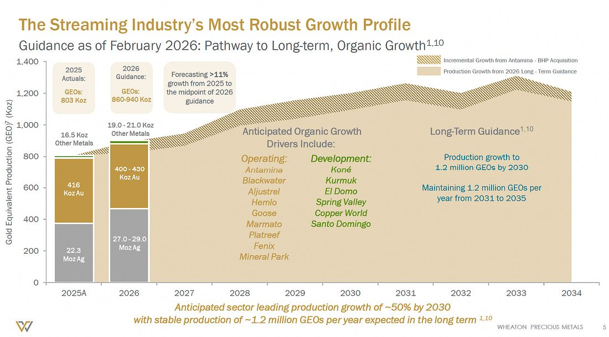

#### Q1 2026 in numbers

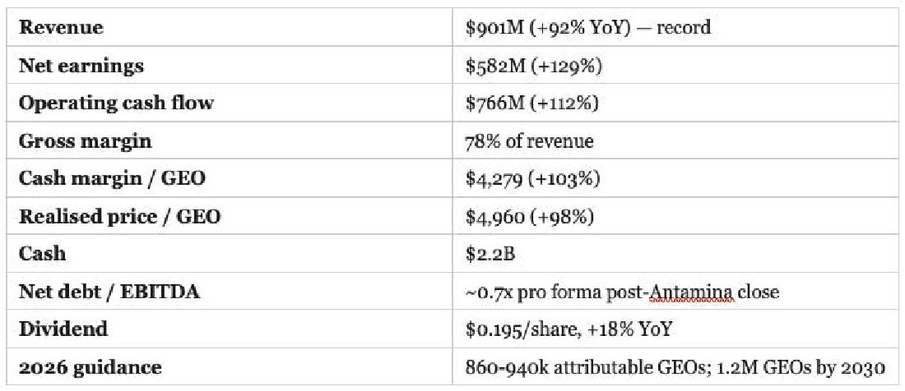

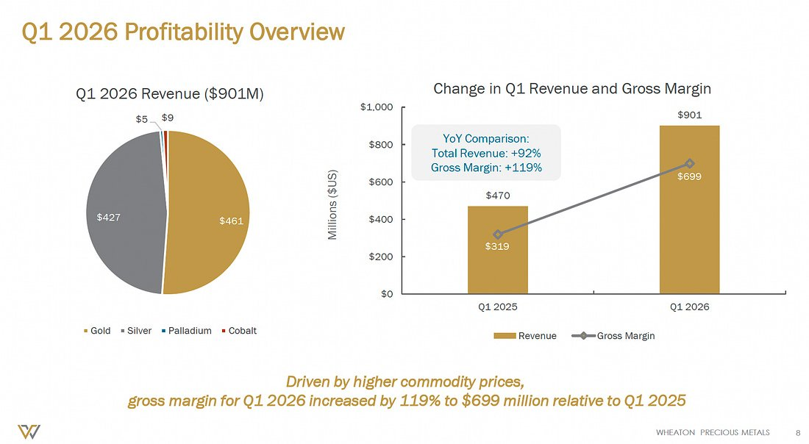

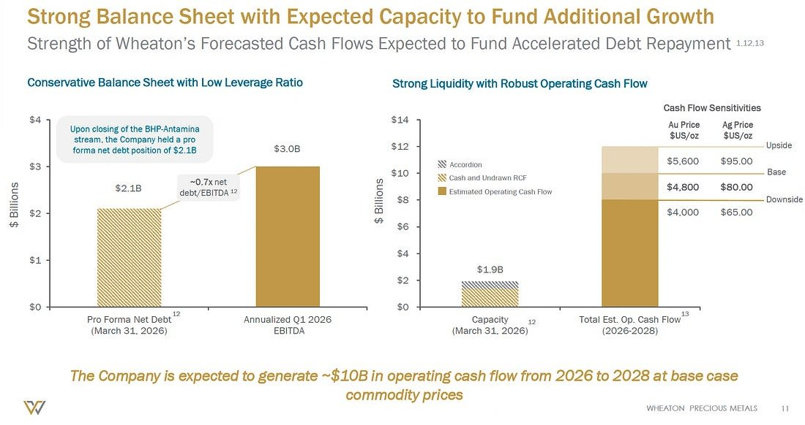

#### Notable management commentary

- “$4.3 billion Antamina BHP streaming deal — doubling silver stream from Antamina.” — Landmark deal closed in Q1 2026, immediately accretive to silver exposure.
- “Industry-leading growth profile with further de-risking from project advancements.” — Management positioning WPM as the growth name in the royalty space.
- “Streaming model provided strong leverage to rising prices.” — Realised price per GEO up 98% YoY validates the model.
- “Increased competition for streaming and royalty deals in the sector.” — Honest acknowledgment that deal pipelines are crowding. Watch capital deployment discipline.
- “No impact from Middle East conflict on ability to write new business.” — Direct response to investor concerns about deal-flow disruption.
- “Haytham Hodaly appointed CEO, Randy Smallwood became Chair.” — Smooth internal succession. Smallwood remains involved as Chair.

### Agnico Eagle Mines (AEM) — The senior producer with tier-1 jurisdictions

#### What they do

Agnico Eagle is a senior gold miner — operating mines, not royalties. The company produces ~3.3-3.5 million ounces of gold annually, mostly from tier-1 jurisdictions: Canada (Detour Lake, Canadian Malartic, LaRonde, Macassa, Meadowbank, Meliadine, Goldex), Finland (Kittila), Australia (Fosterville), and Mexico (Pinos Altos, La India). The company has a clean balance sheet, a top-tier safety and ESG record, and a track record of disciplined capital allocation.

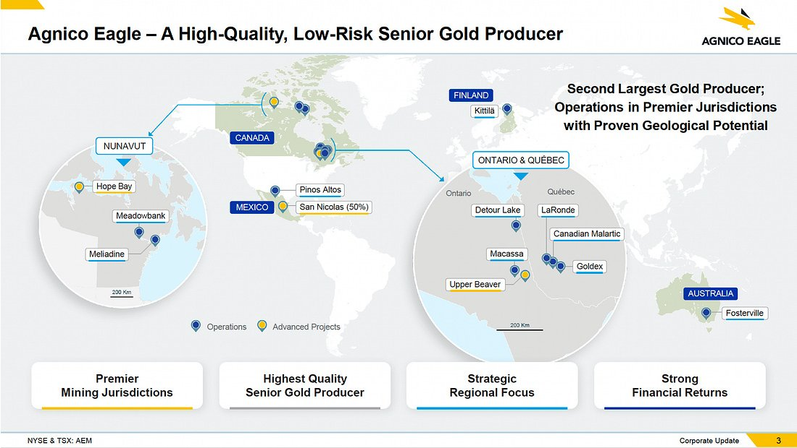

#### Revenue breakdown (Q1 2026)

- Gold: ~95%+ of revenue
- Silver and by-product credits: residual
- Geographic split: Canada ~70%, Finland ~10%, Australia ~5%, Mexico ~15%
- Production mix: ~3.4M oz/yr; top mines Detour Lake (177k oz Q1), Canadian Malartic (166k oz Q1), Meadowbank (114k oz Q1), Meliadine (94k oz Q1)

#### Q1 2026 in numbers

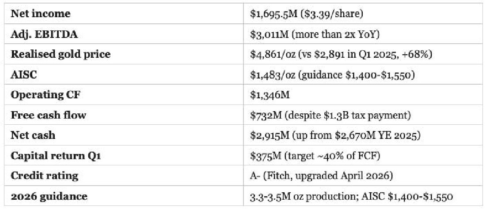

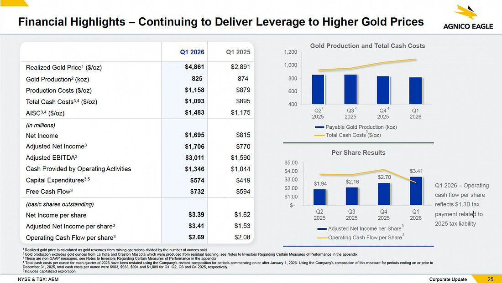

#### Notable management commentary

- “Record net income and operating margins in Q1 2026, driven by higher realized gold prices and strong operational performance.” — Cleanly captures the operating-leverage story.
- “Targeting return of ~40% of annual free cash flow to shareholders through dividends and buybacks.” — Clear capital return framework. ~$1.5B/year at current FCF run-rate.
- “NCIB repurchased 721,211 shares at an average price of $207.68/share; seeking renewal with increased internal limit to $2 billion.” — Buyback is a serious lever, not a fig leaf.
- “Announced consolidation of properties in Finland’s Central Lapland Greenstone Belt.” — M&A of Rupert Resources, Aurion Resources, and full ownership of Fingold JV. Strategic — building a future tier-1 district.
- “Fatal accidents at Fosterville and Canadian Malartic prompted renewed safety focus.” — Sobering. Management is taking it seriously, but it is a real risk that doesn’t exist for streamers.
- “Fitch upgraded long-term issuer rating to A- in April 2026.” — Investment-grade with running room. Few gold miners are A-rated.

### Altius Minerals (ALS) — The diversified debasement-trade royalty

#### What they do

Altius is a Canadian royalty company with a portfolio that spans copper, nickel, cobalt, lithium, potash, iron ore, and renewable electricity. The company also has a project generation business that develops mineral properties for sale or royalty. The recent acquisition of Lithium Royalty Corp (closed March 2026 for $140M cash and 9.6M shares) materially expanded the lithium portfolio.

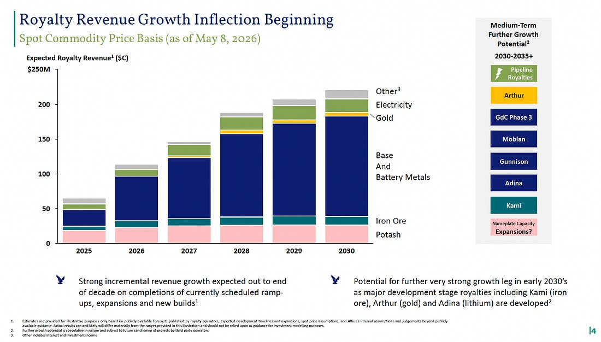

#### Revenue breakdown (Q1 2026)

- Base metals (copper, nickel): $9.1M — Chapada is the largest single asset
- Potash: $4.5M (royalties on Nutrien-operated assets)
- Lithium: ramping from LRC acquisition (Sigma, Core, Goulamina)
- Electricity (renewables): ramping, GBR portfolio of 19,000+ MW potential, 3,268 MW operational
- Iron ore (LIORC, historically): residual
- Total Q1 royalty revenue $26.8M (+79% YoY) — small but growing fast

#### Q1 2026 in numbers

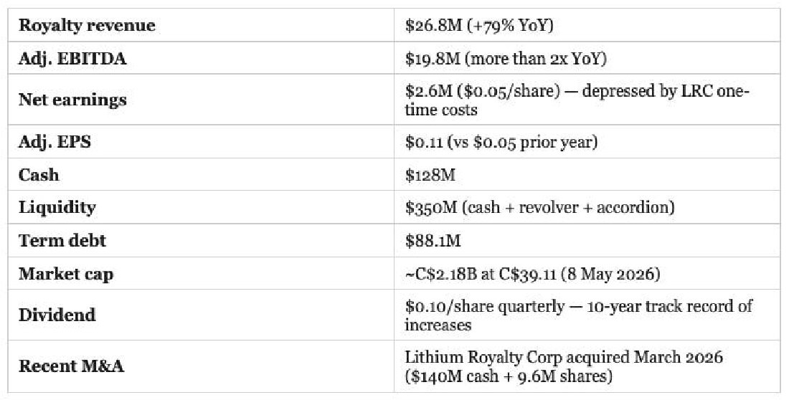

#### Notable management commentary

- “Lithium market has rebounded sharply, with prices doubling and demand accelerating, especially from battery storage for renewables.” — Validates the LRC acquisition timing.
- “U.S. electricity generation sector experiencing a boom, with strong demand from data centers and renewable buildouts.” — The renewable royalty portfolio is positioned for the AI/data centre tailwind.
- “GBR portfolio representing over 19,000 MW in potential capacity and 3,268 MW operational.” — Material scale for a sub-3B-cap royalty company.
- “Strong potash market outlook with potential record global shipments in 2026.” — Underappreciated — potash royalties have grown +15% YoY and have long-life optionality.
- “Voisey’s Bay Mine Expansion and Curipamba copper-gold project expected to boost production in 2026 and 2027.” — Two near-term volume catalysts.
- “Competitive dynamics in commodities like uranium and precious metals may limit new investments due to return challenges.” — Honest discipline. Altius isn’t chasing trendy commodities; it’s allocating where returns are still attractive.

#### Embedded AI call option

The 28.5% interest in GBR (Great Bay Royalties) has innovated a new natural resources royalty category that relates to utility scale wind and solar based power generation +/- battery storage.

GBR/ARR is **the option value inside Altius**. We’re not buying ALS for the data center thesis — we’re buying it for diversified hard-asset royalty exposure, and getting an embedded call option on the AI power buildout for free (or close to free) at today’s price. If the renewable royalty business scales to $100M+ in annual revenue over the next 3-5 years (plausible given the 5.1 GW backlog), the market will likely re-rate ALS materially.

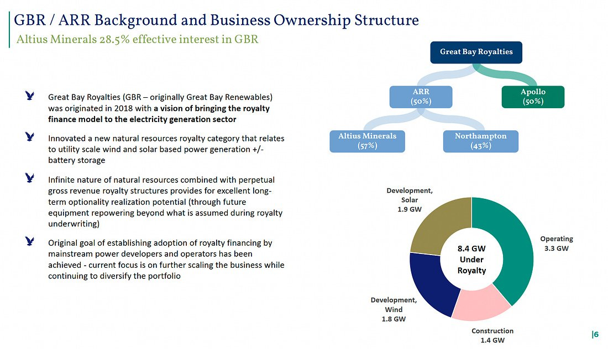

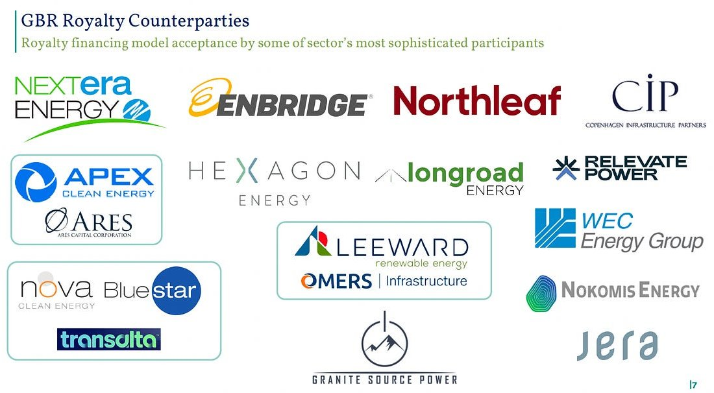

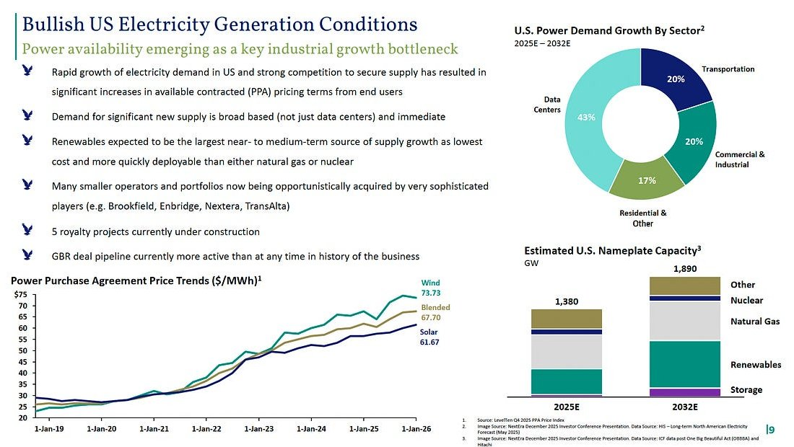

### Sources and notes

- Macro data: FRED (DGS10, DGS30, DFII10), US Treasury daily par yield curve, May 2026.
- Gold spot prices: COMEX / LBMA, mid-May 2026.
- Bessent SLR commentary: Bloomberg (23 May 2025); US Department of the Treasury press release SB0314.
- eSLR rule finalisation: Federal Reserve Board, 25 November 2025; effective 1 April 2026.
- Company financial data: Q1 2026 earnings releases and transcripts via Quartr (FNV 13 May 2026; WPM 8 May 2026; AEM 1 May 2026; ALS 13 May 2026).
- Market caps and stock prices: Yahoo Finance, Bloomberg, mid-May 2026.

This piece reflects the author’s personal views and is provided for information only. It is not investment advice and is not a recommendation to buy or sell any security.
